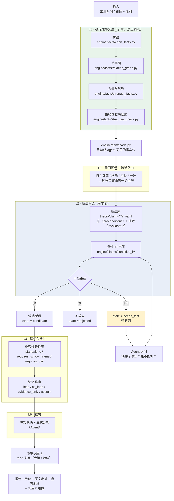
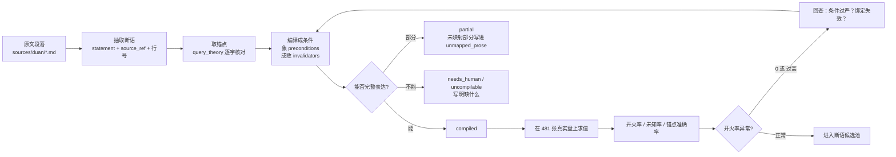

# 一张八字是如何被分析的

> 本文说明 mangpai-fusion 如何从「一个出生时间」走到「一条可追溯、可证伪的判断」。
> 文中所有盘面事实均由 `python -m engine.cli` 实际跑出，未作任何心算或虚构。
> 撰写日期：2026-10-27。

---

## 0. 一句话概括

**系统把「命理师的推理」拆成两件事：一件是机器绝对不许猜的（盘面事实），一件是机器必须承认自己不知道的（判断）。**

- **盘面事实**由引擎计算，确定、可复现、带地址。
- **判断**由断语表达，断语编译成可求值条件，求值结果是**真 / 假 / 未知**三值。
- **未知不许折成假**。未知上由 Agent 追问或交给人裁决。

这不是「检索关键词 + 图算法」。这是「**象 + 成败 + 应期**」的三段式推理被写成了可执行的形式。

---

## 1. 全景流程图



### 白话版（同一张图）

```
出生时间
   │
   ├─[L0] 排盘 ──→ 四柱、十神、藏干、旬空、长生
   │        │
   │        └→ 关系图 ──→ 冲 / 合 / 穿 / 刑 / 破 / 墓库 / 三合三会
   │                  │
   │                  └→ 力量 ──→ 通根、得令、党势、调候
   │                            │
   │                            └→ 做功候选 ──→ 制用 / 化用 / 合用 / 生泄用 / 墓用
   │
   ├─[L1] 这张盘是什么局面？该听哪一派的？
   │
   ├─[L2] 哪些断语的条件成立？
   │        成立 → 候选
   │        不成立 → 丢弃
   │        不知道 → 追问（这是重点）
   │
   ├─[L3] 这条断语在这个流派框架里算不算数？
   │
   ├─[L6] 几派冲突时谁说了算？
   │
   └─[应期] 哪一年？← 这里接大运流年
```

---

## 2. 逐段拆解

### L0 · 确定性事实层

**原则：引擎只回答「盘上有什么」，不回答「这代表什么」。** 引擎不做吉凶判断。

| 步骤 | 模块 | 产出什么 | 举例（字段名） |
|---|---|---|---|
| ① 排盘 | `engine/facts/chart_facts.py` | 四柱、十神、藏干（本气/中气/余气）、纳音、旬空、十二长生、坐干关系 | `yi.ten_god`、`branch.hidden[].q` |
| ② 关系图 | `engine/facts/relation_graph.py` | 六冲、六合、六穿、三刑、相破、天干五合/冲、三合、三会、墓库 | `edge.kind`、`edge.members`、`edge.completeness` |
| ③ 力量 | `engine/facts/strength_facts.py` | 每个天干的通根、得令情况、党势计数、人元司令、调候 | `strength.stems[D.s].roots` |
| ④ 格局与做功 | `engine/facts/structure_check.py` | 子平八格要件核对；段派五类做功候选（制用/化用/合用/生泄用/墓用） | `duan_zuogong.candidates[].mode` |

**每条事实都带地址。** 地址是这套系统的骨架：

| 地址 | 含义 |
|---|---|
| `Y.s` / `Y.b` | 年干 / 年支 |
| `M.s` / `M.b` | 月干 / 月支 |
| `D.s` / `D.b` | 日干 / 日支（夫妻宫） |
| `H.s` / `H.b` | 时干 / 时支 |
| `DY{n}.s` / `DY{n}.b` | 第 n 步大运的干 / 支 |
| `LN{year}.s` / `LN{year}.b` | 某流年的干 / 支 |

有了地址，「夫妻宫被冲」不是一句形容词，而是 `chong_at(at=D.b)` —— 可求值、可复核、可证伪。

### L0.5 · 事实的出口

`engine/api/facade.py` 把引擎的完整事实裁剪成 Agent 可见的包。

> ⚠️ **这里目前有一处正在修的缺陷**（ADR-007 D5）：`facade.py:93` 的 `keep` 白名单把 `tiyong` / `binzhu` / `distance` 三个字段删掉了，而 `condition_ir` 里的 `zuogong` 原子正好要读 `tiyong`。结果是「谁制谁」的 target 判定静默失效。这是 P0。

### L1 · 局面画像 + 流派路由

先看**日主强弱、格局、宫位、十神**，再决定这张盘该由哪一派主导。这是命理师的第一眼，不是最后一步。

路由有四个角色：

| 角色 | 含义 |
|---|---|
| `lead`（主） | 这一派对本盘判断权重最高 |
| `co_lead`（副） | 次要权重 |
| `evidence_only`（只作旁证） | 不作为结论，只作支持材料 |
| `abstain`（弃权） | 本盘超出该派适用范围，不发言 |

> 现状：`engine/decision/l1_school_router.py` 存在（364 行），但与 L2 的断语求值**尚未接通**。这是待做的接线。

### L2 · 断语候选（本系统的核心）

一条断语长这样（真实片段，`theory/claims/conditions-v2/pilot-20.yaml`）：

```yaml
- id: M1-D-298
  school: duan
  domain: 婚姻
  statement: 夫妻宫为用且不受刑冲穿破合，婚姻较好
  source_ref: {path: sources/duan/MinerU_markdown_婚姻专辑_....md, line: 48}
  source_quote: 夫妻宫位要安静，如有用，不能被刑坏，冲破，穿倒，或六合，暗合他星。
  falsifier: 夫妻宫为用且安静但婚姻破裂，则本条证伪
  conditions_v2:
    framework_dependency: requires_school_frame
    frame_atom: {atom: tiyong, args: {role: 用, at: D.b}}
    time_window: natal
    preconditions:
      all:
        - not: {any: [chong_at(D.b), chuan_at(D.b), xing_at(D.b), po_at(D.b)]}
        - not: {atom: he_at, args: {at: D.b}}
```

**四个字段缺一不可**：

| 字段 | 作用 | 没有它会怎样 |
|---|---|---|
| `source_quote` | 原文逐字 | 引用链断，无法追溯 |
| `falsifier`（证伪条件） | 什么样的事实能推翻它 | 变成不可证伪的玄学 |
| `preconditions`（象） | 盘面上该看到什么 | 断语变成拍脑袋 |
| `invalidators`（成败/救应） | 什么情况下这条**不算** | 假阳性——看着成立其实不成立 |

> ⚠️ **现状**：`pilot-20.yaml` 20 条断语的 `invalidators` **20/20 全为空**。等于全部只有「象」没有「成败」。这是 ADR-007 D12 判定的「设计失效」。

### L2.5 · 三值求值

`engine/claims/condition_ir/ir.py` 对条件树求值，结果只有三种：

| 值 | 状态 | 含义 | 去向 |
|---|---|---|---|
| `True` | `candidate` | 条件成立，断语可以出 | 进入 L3 |
| `False` | `rejected` | 条件不成立，这条断语不适用 | 丢弃（但保留可查） |
| `None` | `needs_fact` | **有事实缺了，不知道** | 交 Agent 追问 |

三值逻辑的真值表不是普通的布尔表：

```
False AND Unknown = False      ← 已经确定不成立，不必再问
True  AND Unknown = Unknown    ← 前提成立，但成败不知道 → 必须问
```

这条规则让系统能**过滤掉不相关的盘**，同时**只在真正需要判断的地方提问**。

### L3 · 结构合法性

断语不是单打独斗都能成立的。三类框架依赖：

| 依赖 | 含义 | 例子 |
|---|---|---|
| `standalone`（独立） | 单条即可成立 | 「年柱空亡，祖上无缘」 |
| `requires_school_frame`（需流派框架） | 必须放在某派整体框架里才算 | 「夫妻宫为用」——「用」是段派的体用概念，子平里没有 |
| `requires_pair`（需配对） | 必须有另一条命题同时成立 | 「食神入墓，寿元受损」需要「印食禄三宝」那条一起判 |

这一层最容易被写错：把一条「只在段派框架里成立」的断语当成通用结论，就会得出别的流派不认的结论。

### L6 · 裁决与应期

- **裁决**：几派都出候选且互相冲突时，按路由权重 + 证据强度分主次，给结论，不许和稀泥。
- **应期**：把大运、流年接进来，回答「哪一年」。

`relation_graph.py:85` 的 `_nodes(chart, dayun_index, liunian_year)` 已能建岁运节点与边，并给边打 `scope` 标记（`natal` / `dayun` / `liunian` / `dayun+liunian`）。

> ⚠️ **现状**：4 个岁运原子中 3 个是空壳（`atoms.py:558/562/566` 直接返回未知）。**所以系统目前能说「婚姻怎样」，说不出「哪一年」。** 这是「不能预测」的直接原因。

---

## 3. 实况走查：一张真实盘走完全程

用段建业《婚姻专辑》里的原文标杆盘：

```
坤造：癸丑  癸亥  辛亥  癸巳
```

原文对此盘的判断是：**婚姻好**（「伤官亥冲巳，夫宫为喜，冲去夫星忌神」）。

以下是引擎实际跑出来的东西（`python -m engine.cli all --pillars "癸丑 癸亥 辛亥 癸巳" --gender 坤 --json`）。

### 第 1 步：排盘

```
日主：辛（阴金）    性别：坤
年柱 癸丑  月柱 癸亥  日柱 辛亥  时柱 癸巳
```

十神与藏干：

| 柱 | 干 | 十神 | 支 | 本气 | 中气 | 余气 |
|---|---|---|---|---|---|---|
| 年 | 癸 | 食神 | 丑 | 己·偏印 | 癸·食神 | 辛·比肩 |
| 月 | 癸 | 食神 | 亥 | 壬·伤官 | 甲·正财 | — |
| 日 | 辛 | 日主 | 亥 | 壬·伤官 | 甲·正财 | — |
| 时 | 癸 | 食神 | 巳 | — | — | — |

### 第 2 步：体用划分（段派）

引擎给出：

```
Y.s 双属 | Y.b 体 | M.s 双属 | M.b 双属
D.s 体   | D.b 双属 ← 夫妻宫 | H.s 双属 | H.b 用
```

**注意：夫妻宫（D.b 亥）是「双属」**，因为它坐的是伤官，而段派原文说「食神与伤官既可以是体，也可以是用」。

### 第 3 步：关系图（只列触及夫妻宫的边）

```
e008  sanhui  partial   丑 + 亥      （亥子丑三会的半局）
e010  xing    zixing    亥 + 亥      （亥亥自刑）
e012  chong   —         亥 + 巳      （亥巳冲）★
```

### 第 4 步：做功候选（段派）

```
制用   M.b + D.b   伤官 + 伤官
制用   M.b + H.b   伤官 + 正官
制用   D.b + H.b   伤官 + 正官   ← 夫妻宫制时支官星
生泄用  D.s + *.s   日主 + 食神
```

### 第 5 步：跑断语 M1-D-298（「夫妻宫安静，婚姻较好」）

```
结果：state = rejected，value = False
原因：preconditions 不成立
失败于：?()
```

**这里是全篇最该看的一段。**

1. `?()` 这个失败标签本身是个缺陷——`ir.py` 的 `_label()` 不认识 `not` / `any` 组合节点，所以**失败原因不可读**。人要追责都追不到。
2. 更关键：这条断语因为「夫妻宫被冲」被判 `rejected`，**系统对这张盘什么也没说**。
3. 但段建业对这张盘的原文判断是「**婚姻好**」——因为冲掉的是**忌神**（夫星忌神）。

也就是说：**原文的标杆好盘，我们算不出来。** 这不是数据缺失，是断语被编译成了「静态匹配」——它只会说「被冲就不好」，不懂「冲掉忌神是好事」。

这正是缺 `invalidators`（救应/反条件）的后果，也是「象 + 成败」两段式里**少了「成败」那一段**的后果。

---

## 4. 一条断语的完整生命周期



**硬规矩**：验证分三层，不许混算。

| 层 | 用什么盘 | 验什么 |
|---|---|---|
| A 命中率筛查 | 真实盘（有盘无结局） | 这条断语会不会乱开火 |
| B 真实自然对照 | 真实盘 + 真实结局 + 置信区间 + 分层 | 说得对不对（**目前缺这一层**） |
| C 编译器回归 | 合成盘，正例反例 | 条件写对没有（只验编译保真，不计准确率） |

另外，**时柱相关断语只在 `true_solar` 层验证**（485 例中 330 例），时柱不可信的盘不得混入统计。这是 ADR-005 定的分层。

---

## 5. 三值逻辑到底怎么用

举个具体例子。某条断语：

```
「夫妻宫被冲，且冲的是忌神，则婚姻反而好」
```

编译成：

```yaml
preconditions:                       # 象：夫妻宫确实被冲
  all: [{atom: chong_at, args: {at: D.b}}]
invalidators:                        # 成败：冲的是不是忌神
  any: [{atom: is_yongshen, args: {at: "冲的那一方"}}]
```

在「只知道四柱、没给喜忌」的输入下：

| 情况 | 求值 | 状态 | 系统行为 |
|---|---|---|---|
| 夫妻宫没被冲 | `pre = False` | `rejected` | 这条断语不适用，丢弃 |
| 被冲了，且知道冲的是忌神 | `pre = True, inv = True` | 被推翻 | 不出这条 |
| 被冲了，但**不知道喜忌** | `pre = True, inv = Unknown` | `needs_fact` | **追问：这盘的喜忌是什么？** |

第三种才是这套系统存在的意义：**它知道自己不知道什么，并且能说清缺哪一项。**

---

## 6. 现在哪里通了、哪里断着

诚实表。这是本文最重要的一张表。

| 环节 | 状态 | 证据 |
|---|---|---|
| L0 排盘 | ✅ 通 | 481 盘 0 错（`tools/engine_audit.py`） |
| L0 关系图 | ✅ 通 | 481 盘无缺边/假边/重复边（`tools/relations_audit.py`） |
| L0 做功候选 | ✅ 通 | 宫制星 477/481 盘（`tools/zuogong_probe.py`） |
| L0.5 事实出口 | ❌ **断** | `facade.py:93` 删 `tiyong`，`zuogong` 原子的 target 恒错 |
| L2 断语求值器 | ✅ 通 | 42 原子、三值、未知不折叠 |
| L2 断语库 | ⚠️ 半通 | 20 条试点：compiled 8 / partial 4 / needs_human 5 / uncompilable 2 / reference_only 1 |
| L2 成败（invalidators） | ❌ **空** | 20/20 全为空 |
| L2 岁运原子 | ❌ **空壳** | `atoms.py:558/562/566` 直接返回未知 |
| L2 力量比较原子 | ❌ **没有** | 段派「制得住」无法表达 |
| L1 流派路由 | ⚠️ 存在未接 | `l1_school_router.py` 364 行，未接 L2 |
| L3 框架依赖 | ✅ 通 | `standalone` / `requires_school_frame` / `requires_pair` 三态已实现 |
| L6 裁决 | ⚠️ 存在未接 | `l6_staged_arbitration.py` |
| 应期（哪一年） | ❌ **不能** | 3/4 岁运原子是空壳 |
| 报告 | ⚠️ 双头 | `render_report.py` 2282 行，同时渲染旧链与 v5 |

**一句话**：**底盘是干净的，推理是半截的，应期是空的。**

---

## 7. 文件对照表

| 你要找什么 | 去哪个文件 |
|---|---|
| 排盘 | `engine/facts/chart_facts.py` |
| 冲合穿刑破、三合三会、墓库 | `engine/facts/relation_graph.py` |
| 通根、得令、党势、调候 | `engine/facts/strength_facts.py` |
| 格局、做功候选、体用 | `engine/facts/structure_check.py` |
| Agent 可见的事实包 | `engine/api/facade.py` |
| 命令行入口 | `engine/cli.py` |
| 断语求值器 | `engine/claims/condition_ir/ir.py` |
| 42 个原子 | `engine/claims/condition_ir/atoms.py` |
| 断语 YAML | `theory/claims/conditions-v2/pilot-20.yaml` |
| 理论原文检索 | `tools/query_theory.py`（`sources/` + `theory/`） |
| 断语试点报告 | `tools/claim_condition_report.py` → `META/claim-condition-pilot-v1.md` |
| 481 盘命中统计 | `tools/claim_condition_corpus.py` |
| 重构基线尺子 | `tools/verify_baseline.py` |
| 架构决策 | `docs/adr/ADR-001` – `ADR-007` |

---

## 8. 下一步要补的（按 ADR-007）

1. **通事实出口**：`facade.py` 保留 `tiyong` / `binzhu` / `distance`，`actor` 缺值输出 `null` 而非删键。
2. **修 `he_at`**：现在它把「半个三合/三会」和「日柱自合」也算成「被合」，481 盘里 412 盘被误点亮（85.7%）。
3. **补 `invalidators`（成败）**：这是「象+成败」两段式缺的那一半。
4. **通岁运**：4 个原子接上已建好的岁运边，原局原子加 `scope == "natal"` 隔离。
5. **力量比较原子**：极端清晰盘判真假，胶着即 `unknown`。
6. **补 `needs_judgment` 原子**：凡是没完全量化的条件，挂一个显式未知，不许删掉当「已编译」跑。

做完 1–3，证明点 A 成立（`M1-D-298` 命中从 6 盘升到 ≥30 盘）。做完 4–5，证明点 B 成立（能回答「制得住吗」和「哪一年」）。
