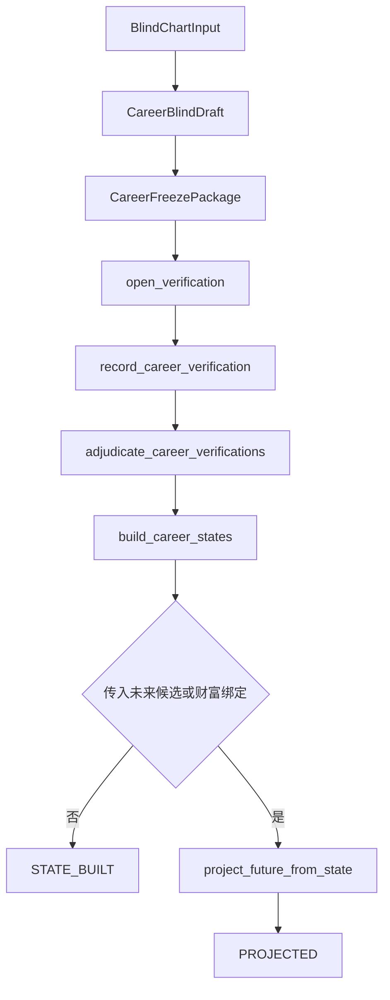
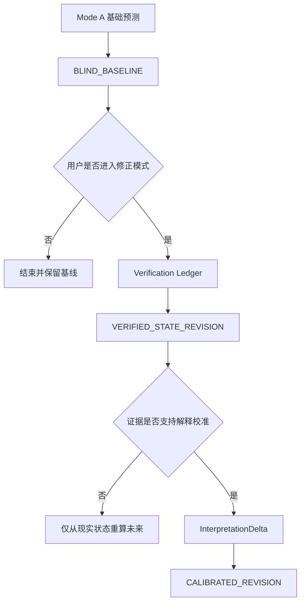

# as-of 双模式重构 Phase 0 事实审计与决策包

> 日期：2026-09-30  
> 审计范围：事业主领域、财富显式传播、as-of 会话、冻结、核验、状态构建、未来投影、CLI、归档与测试证据  
> 授权边界：只读审计，不修改引擎代码，不切换生产入口，不实施 Phase 1–7  
> 已确认目标：产品保持两种模式；内部区分 `BLIND_BASELINE`、`VERIFIED_STATE_REVISION`、`CALIBRATED_REVISION`

---

## 1. 执行摘要

### 1.1 总结论

当前仓库已经实现了一条质量较高的 **核验后状态推演链**：

```text
盲输入
→ 历史盲断草稿
→ 冻结与哈希绑定
→ 全量事件核验登记
→ 影响裁决
→ VerifiedState 与 HypothesisState
→ 事业未来投影
→ 事业到财富的显式传播
→ verified artifact 归档
```

但它尚未实现已批准产品模型中的完整双模式：

| 内部制品 | 审计结论 | 说明 |
|---|---|---|
| `BLIND_BASELINE` | **未完整实现** | 已有历史盲断冻结，但没有无反馈当前状态假设、无反馈未来投影、blind-only 归档与完整血缘元数据。 |
| `VERIFIED_STATE_REVISION` | **核心语义基本实现，制品化与部分核对不足** | 已有 confirmed-only 事实状态、状态有效期、路径开关、条件分支和未来投影；但必须为全部冻结事件提交记录，且没有独立 revision 类型、父制品和结构化比较。 |
| `CALIBRATED_REVISION` | **未实现为第一类能力** | 现有字段只能描述条件分支与未来差异，不能表达、审批、应用、回滚或重跑 case-scoped 命理解释差量。 |

最关键的阻断点不是规则不足，而是 [`run_career_session()`](../engine/asof/session_runner.py:53) 把核验、裁决与状态构建设为必经步骤。当前系统无法合法完成：

```text
盲断
→ 冻结
→ 盲态当前状态假设
→ 无反馈未来预测
→ 归档 BLIND_BASELINE
```

因此，推荐后续实施顺序保持为：

1. 先建立完整、不可变、可归档的 `BLIND_BASELINE`；
2. 再把现有核验链包装为可稀疏提交的 `VERIFIED_STATE_REVISION`；
3. 最后新增 case-scoped `InterpretationDelta` 与 `CALIBRATED_REVISION`；
4. 三类制品共用核心推理链，禁止复制三套引擎。

### 1.2 Phase 0 建议决策

建议用户批准以下后续原则，但本报告不执行实现：

- **批准 Phase 1 时只做无反馈基础预测证明，不同时实现校准。**
- **不要直接在现有线性状态机中粗暴插入大量状态。** 运行阶段与制品类型应分离建模。
- **优先新增聚合制品与旁路入口，复用现有冻结、状态轨、投影和归档底座。**
- **部分核对应支持稀疏提交。** 未提交项保持 `UNVERIFIED`，不要求伪造 `WITHHELD` 记录。
- **`InterpretationDelta` 必须是独立、可审批、可回滚、case-scoped 的结构化对象。**
- **继续保持正式生产入口不变。** 当前项目状态也明确 prospective 生产切换未获许可，见 [`META/project-state.json`](../META/project-state.json:70)。

---

## 2. 审计依据与边界

### 2.1 主要事实源

- 仓库 AI 操作与优先级规则：[`AGENTS.md`](../AGENTS.md:1)
- 当前机器状态：[`META/project-state.json`](../META/project-state.json:1)
- 已批准的双模式讨论稿：[`plans/as-of-dual-mode-reconstruction-prompt-draft-2026-09-30.md`](as-of-dual-mode-reconstruction-prompt-draft-2026-09-30.md:1)
- as-of 会话契约：[`engine/asof/session_contract.py`](../engine/asof/session_contract.py:1)
- 冻结与核验：[`engine/asof/consultation_freeze.py`](../engine/asof/consultation_freeze.py:1)
- 状态裁决与构建：[`engine/asof/career_state_builder.py`](../engine/asof/career_state_builder.py:1)
- 事实与假设状态：[`engine/asof/state_ledger.py`](../engine/asof/state_ledger.py:1)
- 未来投影：[`engine/asof/future_projection.py`](../engine/asof/future_projection.py:1)
- 会话编排：[`engine/asof/session_runner.py`](../engine/asof/session_runner.py:1)
- 归档适配：[`engine/asof/archive_integration.py`](../engine/asof/archive_integration.py:1)
- CLI：[`tools/as_of_session_cli.py`](../tools/as_of_session_cli.py:1)
- as-of 测试：[`tests/asof/`](../tests/asof/)

### 2.2 本次未做事项

- 未修改任何 Python、JSON、YAML、CLI 或生产入口代码。
- 未运行完整 `pytest`。
- 未创建 `BLIND_BASELINE`、`InterpretationDelta` 或新 schema。
- 未切换正式报告生成入口。
- 未扩展家庭、学业、婚姻、健康领域。
- 未把历史计划或报告中的声明当作代码事实。

因此，本报告是 **静态代码与测试契约审计**，不是运行验收报告。

---

## 3. 当前实现状态图

### 3.1 状态枚举

[`ConsultationState`](../engine/asof/session_contract.py:20) 当前按枚举顺序定义：

```text
STRICT_BLIND_INPUT
→ BLIND_DRAFTED
→ FROZEN
→ VERIFICATION_OPEN
→ ADJUDICATED
→ STATE_BUILT
→ PROJECTED
→ ARCHIVED
```

[`transition_session()`](../engine/asof/session_contract.py:338) 只允许进入枚举中的下一个相邻状态。


### 3.2 实际会话编排

[`run_career_session()`](../engine/asof/session_runner.py:53) 的真实调用链为：



关键事实：

1. [`open_verification()`](../engine/asof/consultation_freeze.py:591) 无条件执行。
2. [`adjudicate_career_verifications()`](../engine/asof/career_state_builder.py:372) 无条件执行。
3. [`build_career_states()`](../engine/asof/career_state_builder.py:496) 无条件执行。
4. [`project_future_from_state()`](../engine/asof/future_projection.py:249) 只接受 [`CareerStateBuildResult`](../engine/asof/career_state_builder.py:188)。
5. 归档函数 [`archive_asof_state()`](../engine/asof/archive_integration.py:163) 只接受 `STATE_BUILT` 或 `PROJECTED` 的完整核验链。

### 3.3 状态机与归档的漂移

状态枚举包含 `ARCHIVED`，但当前归档函数：

- 不接受 `ARCHIVED` 输入；
- 不调用 [`transition_session()`](../engine/asof/session_contract.py:338)；
- 不返回更新后的 [`SessionEnvelope`](../engine/asof/session_contract.py:184)；
- 只返回通用 archive result。

因此，`ARCHIVED` 在当前集成路径中是 **声明存在、实际不可达** 的状态。后续不应简单补一次状态跳转，而应先决定：

- `ARCHIVED` 是会话运行状态；还是
- 归档是制品存储状态，应与推理状态正交。

本报告推荐第二种。

---

## 4. 现有对象与三类制品映射

| 目标概念 | 现有对象 | 覆盖程度 | 事实判断 |
|---|---|---:|---|
| Blind input snapshot | [`BlindChartInput`](../engine/asof/session_contract.py:133) + SHA-256 | 较高 | 对命盘和大运输入已实现封闭 schema 与哈希；不含当前问题、规则快照和反馈读取声明。 |
| Session identity | [`SessionIdentity`](../engine/asof/session_contract.py:161) | 较高 | 已绑定 case、截止日和 session；不含运行种类、父制品和 revision。 |
| Workflow envelope | [`SessionEnvelope`](../engine/asof/session_contract.py:184) | 中等 | 已绑定输入哈希和运行状态；未绑定 artifact kind、parent hash、反馈访问状态。 |
| Historical blind draft | [`CareerBlindDraft`](../engine/asof/consultation_freeze.py:140) | 高 | 包含冻结 fundamentals 和截止日前 events。 |
| Historical freeze package | [`CareerFreezePackage`](../engine/asof/consultation_freeze.py:149) | 高 | 内容寻址且有身份绑定；本质是 retrospective freeze，不是完整 blind baseline。 |
| Verification ledger | [`CareerVerificationRecord`](../engine/asof/consultation_freeze.py:176) | 中高 | 有 verdict、实际落点、约束、taxonomy 证据和冻结包哈希；不支持稀疏提交产品语义。 |
| Impact adjudication | [`CareerImpactAdjudication`](../engine/asof/career_state_builder.py:135) | 高 | 可裁决影响、持续期、范围、路径和假设字段。 |
| Verified reality state | [`VerifiedState`](../engine/asof/state_ledger.py:115) | 高 | confirmed-only、截止日有效状态、事实主线清晰。 |
| Conditional state | [`HypothesisState`](../engine/asof/state_ledger.py:129) | 中高 | 可表达重大未决候选的条件、差异、最小问题和反证。 |
| Verified future projection | [`FutureProjectionFromState`](../engine/asof/future_projection.py:148) | 高 | 支持事业主线、最多两个条件分支、财富传播和未实现领域弃权。 |
| `BLIND_BASELINE` | 无单一对象 | 低 | 历史冻结已存在；当前状态假设、未来投影、问题与血缘缺失。 |
| `VERIFIED_STATE_REVISION` | [`CareerStateBuildResult`](../engine/asof/career_state_builder.py:188) + projection | 中高 | 核心运行语义存在；缺独立制品类型、父 baseline 和 comparison。 |
| `InterpretationDelta` | 无 | 缺失 | 仓库 Python 中未发现对应正式对象或等价层次结构。 |
| `CALIBRATED_REVISION` | 无 | 缺失 | 没有应用解释差量后重跑核心结构与未来的入口。 |
| Comparison artifact | 无 | 缺失 | 没有 baseline、verified、calibrated 三者的结构化差异制品。 |

---

## 5. `BLIND_BASELINE` 审计

### 5.1 已实现部分

#### A. 严格盲输入边界

[`BlindChartInput`](../engine/asof/session_contract.py:133) 只包含：

- schema version；
- chart source；
- gender；
- four pillars；
- daiyun。

它不包含职业、已知历史或反馈字段。输入可通过 [`compute_blind_input_sha256()`](../engine/asof/session_contract.py:317) 内容寻址。

#### B. 历史盲断冻结

[`CareerBlindDraft`](../engine/asof/consultation_freeze.py:140) 包含：

- `fundamentals`；
- `events`。

[`freeze_career_draft()`](../engine/asof/consultation_freeze.py:563) 会校验：

- 只能从 `BLIND_DRAFTED` 冻结；
- fundamental 窗口不能超过 `as_of_date`；
- event 窗口不能超过 `as_of_date`；
- 冻结包绑定 session identity 和 blind input hash。

这已经是可靠的 **历史回溯盲断冻结底座**。

#### C. 候选证据门

[`evaluate_event_candidate()`](../engine/asof/event_candidate.py:130) 明确不读取现实履历，并要求命盘证据、根层证据、理论来源和流年候选门。这是后续 blind baseline 可以复用的候选生成基础。

### 5.2 缺失部分

#### 阻断 B1：没有完整 baseline 聚合对象

[`CareerFreezePackage`](../engine/asof/consultation_freeze.py:149) 只有：

- schema version；
- identity；
- blind input hash；
- fundamentals；
- historical events。

它没有：

- artifact kind；
- 用户当前问题；
- 截止日当前状态假设；
- 未来预测；
- 未来条件分支；
- 父制品信息；
- 规则、理论、代码或模型快照；
- 输入白名单声明；
- 是否读取过反馈；
- 输出哈希和运行种类。

因此当前对象应准确称为 **Career Retrospective Freeze Package**，不能直接冒充完整 `BLIND_BASELINE`。

#### 阻断 B2：无反馈运行路径不存在

[`run_career_session()`](../engine/asof/session_runner.py:53) 的必填参数包括：

- verifications；
- suggestions；
- impact adjudications；
- fundamental adjudication；
- daiyun end。

即使冻结事件为空，系统仍会进入核验与裁决阶段，产生的是核验链后的 `STATE_BUILT`，而不是 blind baseline。

#### 阻断 B3：未来投影只接受核验后状态

[`project_future_from_state()`](../engine/asof/future_projection.py:249) 强制要求：

- 输入是精确的 [`CareerStateBuildResult`](../engine/asof/career_state_builder.py:188)；
- envelope 必须处于 `STATE_BUILT`；
- active states 和 paths 必须来自 confirmed ledger；
- hypothesis branches 必须绑定 `PARTIAL_HIT`、`UNKNOWN` 或 `WITHHELD` 的核验记录。

因此现有 [`HypothesisState`](../engine/asof/state_ledger.py:129) 不是无反馈当前状态假设，而是 **核验链中未决事件的条件分支**。

#### 阻断 B4：没有 blind-only 归档

[`archive_asof_state()`](../engine/asof/archive_integration.py:163) 要求同时存在：

- freeze package；
- adjudication bundle；
- state result；
- 可选 projection。

[`_validate_chain()`](../engine/asof/archive_integration.py:46) 明确拒绝 `FROZEN`，只允许 `STATE_BUILT` 或 `PROJECTED`。归档 schema 也固定为 `asof-verified-artifact/v1`。

#### 高风险 B5：命主当前问题不是显式输入

现有 blind input、session identity、draft 和 CLI 顶层输入均没有 question 模型。当前问题无法正式参与：

- 领域路由；
- 时间范围；
- 候选优先级；
- 输出筛选；
- 最小消歧；
- 弃权理由。

#### 高风险 B6：没有可复现运行快照

候选对象有局部 `frozen_version`，但 baseline 聚合层没有：

- 产品版本；
- git 或代码快照；
- 规则集 digest；
- 理论 registry digest；
- taxonomy version；
- runner/model identifier。

### 5.3 `BLIND_BASELINE` 结论

结论：**现有实现完成了 BLIND_BASELINE 的历史冻结内核，但没有完成基础预测产品。**

最小语义闭环必须至少增加：

```text
BlindBaseline
├── identity 与 artifact kind
├── blind input snapshot
├── question snapshot
├── retrospective freeze package
├── blind current-state hypotheses
├── blind future projection
├── rules and runtime snapshot
├── input-access declaration
├── content digest
└── lineage metadata
```

---

## 6. `VERIFIED_STATE_REVISION` 审计

### 6.1 已实现的核心能力

#### A. 核验状态足够细分

[`VerificationVerdict`](../engine/asof/consultation_freeze.py:58) 已区分：

- `CONFIRMED`；
- `PARTIAL_HIT`；
- `REJECTED`；
- `UNKNOWN`；
- `WITHHELD`。

[`record_career_verification()`](../engine/asof/consultation_freeze.py:700) 还执行以下失败关闭规则：

- `WITHHELD` 禁止填写实际落点；
- 其他 verdict 必须有实际落点；
- `UNKNOWN` 必须有显式 reality constraint；
- verdict 必须与冻结中心或替代落点核验结果一致；
- 记录必须绑定冻结包 hash。

#### B. 事实状态只接收 confirmed event

[`build_verified_state()`](../engine/asof/state_ledger.py:182) 只归并：

- 事件日期不晚于截止日；
- verification status 为 `CONFIRMED`；
- 截止日仍有效的状态。

[`RealityStateEntry`](../engine/asof/reality_track.py:9) 要求事实状态必须 `verified=True`。未核验候选不能写入事实轨。

#### C. 状态有效期已实现

[`_state_until()`](../engine/asof/state_ledger.py:151) 的持续期语义为：

| Persistence | 现实状态有效期 |
|---|---|
| `INSTANT` | 仅事件日，且不会生成持续事实状态 |
| `SHORT_TERM` | 到显式 `short_term_until` |
| `REMAINDER_OF_DAIYUN` | 到当前大运结束 |
| `CROSS_DAIYUN` | 无固定截止 |
| `PERMANENT` | 无固定截止 |

#### D. 转折事件可改变路径

[`build_verified_state()`](../engine/asof/state_ledger.py:182) 对 `TURNING_POINT` 事件建立 open/closed path states。未来候选可通过 [`CareerFutureCandidate`](../engine/asof/future_projection.py:86) 引用 required active states 和 required open paths。

#### E. 未决重大候选保持条件分支

[`admit_hypothesis_branch()`](../engine/asof/state_ledger.py:228) 只准入：

- 非 confirmed、非 rejected；
- 影响为 `MAJOR` 或 `TURNING_POINT`；
- 持续期至少覆盖大运剩余、跨大运或永久；
- 会改变 fundamentals；
- 会改变未来结论；
- 有最小消歧问题。

这符合“事实主线与竞争假设分离”的原则。

#### F. 财富传播显式且失败关闭

事业事件进入财富状态必须通过 [`propagate_career_event_to_wealth()`](../engine/asof/wealth_propagation.py:54)，满足：

- 有且只有一条匹配传播边；
- required conditions 已满足；
- falsifier 未触发；
- source event 已核验；
- propagation edge 已核验。

#### G. 未实现领域明确弃权

[`project_future_from_state()`](../engine/asof/future_projection.py:249) 对 family、education、marriage、health 返回 `NOT_IMPLEMENTED` 和 `ABSTAIN`，没有用占位文本伪装完成。

### 6.2 主要缺口

#### 阻断 V1：当前不支持真正的稀疏部分核对

[`adjudicate_career_verifications()`](../engine/asof/career_state_builder.py:372) 和 [`build_career_states()`](../engine/asof/career_state_builder.py:496) 都要求：

```text
每个 frozen event
必须恰好有一条 verification record
```

所以当前“部分核对”只支持：

- 所有事件都提交记录；
- 未提供事实的事件显式标记 `WITHHELD` 或 `UNKNOWN`。

它不支持产品意义上的：

- 用户只核对一两个事件；
- 其他事件完全不提交；
- 系统仍生成局部 verified revision。

#### 高风险 V2：非 rejected 事件全部需要 impact suggestion 和 adjudication

对 `PARTIAL_HIT`、`UNKNOWN`、`WITHHELD`，当前仍要求：

- 一条 impact suggestion；
- 一条 impact adjudication。

这会迫使调用者对未掌握现实事实的事件补充事件日期、状态值、影响和持续期。虽然分支可能最终不进入 [`VerifiedState`](../engine/asof/state_ledger.py:115)，但输入负担和语义风险较高。

#### 高风险 V3：revision 不是第一类制品

[`CareerStateBuildResult`](../engine/asof/career_state_builder.py:188) 没有：

- artifact kind；
- revision ID；
- parent `BLIND_BASELINE` ID 和 hash；
- feedback scope；
- sparse verification coverage；
- compared baseline；
- changed/unchanged future conclusion IDs。

#### 高风险 V4：没有结构化 baseline comparison

现有归档虽然把 freeze package、records、state result 和 projection 放在同一 payload 中，但没有显式生成：

```text
Baseline future
→ Verified reality changes
→ Recomputed future
→ Changed and unchanged conclusions
```

#### 中风险 V5：`REJECTED` 从状态 ledger 中被跳过

[`build_career_states()`](../engine/asof/career_state_builder.py:496) 对 rejected record 直接 `continue`。完整归档仍保留 record，但状态结果本身不保留 rejected ledger entry。后续比较工具若只消费 state result，会丢失“原候选被否定”的直接证据。

### 6.3 `VERIFIED_STATE_REVISION` 结论

结论：**核心推理语义已经基本具备，主要工作是产品契约重构，而不是重写状态引擎。**

应复用：

- [`CareerVerificationRecord`](../engine/asof/consultation_freeze.py:176)；
- [`EventImpactAssessment`](../engine/asof/state_ledger.py:54)；
- [`VerifiedState`](../engine/asof/state_ledger.py:115)；
- [`HypothesisState`](../engine/asof/state_ledger.py:129)；
- [`FutureProjectionFromState`](../engine/asof/future_projection.py:148)；
- 财富显式传播边。

主要新增应集中在：

- 稀疏 verification ledger；
- revision 血缘；
- baseline comparison；
- verified future rerun 证明物。

---

## 7. `CALIBRATED_REVISION` 审计

### 7.1 容易被误认为校准能力的现有字段

[`CareerImpactAdjudication`](../engine/asof/career_state_builder.py:135) 已有：

- `difference_from_verified`；
- `changed_fundamental_ids`；
- `changed_future_conclusions`；
- `condition`；
- `minimum_question`；
- `falsifier`。

这些字段会进入 [`HypothesisState`](../engine/asof/state_ledger.py:129)，可表达：

> 如果某个未决现实候选成立，哪些基本面和未来结论会不同。

这不是命理解释校准，原因是它们不会：

- 修改对象映射；
- 修改结构主判；
- 修改主次；
- 修改取用；
- 修改事件映射；
- 修改应期机制；
- 修改理论适用域；
- 重新执行结构推理。

### 7.2 已有但属于其他治理层的 calibration

仓库其他模块存在：

- 全局或跨案例治理动作；
- 概率 calibration 参数；
- prospective artifact revision metadata。

这些能力不能直接作为 `CALIBRATED_REVISION` 复用，因为本任务要求的是：

```text
单 case
+ 冻结 baseline
+ 已核验现实状态
+ case-scoped InterpretationDelta
+ 同一核心推理链重跑
```

把全局规则治理或概率缩放接到单案解释修正，会违反已批准边界。

### 7.3 缺失能力

仓库 Python 代码中未发现以下正式对象或等价实现：

- `InterpretationDelta`；
- `ObjectMappingDelta`；
- `StructuralInterpretationDelta`；
- `PrimarySecondaryDelta`；
- `YongshenDelta`；
- `EventMappingDelta`；
- `TimingDelta`；
- `DomainApplicabilityDelta`；
- `CALIBRATED_REVISION`。

也未发现以下运行能力：

1. 校准差量父版本与父 hash；
2. 支持证据命题 ID；
3. 独立反证和适用域；
4. 证据强度门；
5. 人工审批门；
6. case-scoped 限制；
7. 回滚；
8. 将差量应用到结构轨；
9. 用差量重跑 future candidate generation；
10. 校准前后结构化推理 diff；
11. 防止校准进入全局 registry 的隔离证明。

### 7.4 `CALIBRATED_REVISION` 结论

结论：**尚未实现。**

后续应新增的是“解释 overlay 契约”，而不是第二套校准引擎。推荐逻辑：

```text
Frozen structural snapshot
+ Verified reality state
+ Approved InterpretationDelta overlay
→ Same structural and timing reasoners
→ Recomputed future candidates
→ CALIBRATED_REVISION
```

`InterpretationDelta` 默认不能修改全局规则。高影响 delta 必须人工批准；证据不足时应返回 `CALIBRATION_REJECTED` 或 `NOT_ENOUGH_EVIDENCE`，而不是强行生成修正版本。

---

## 8. CLI、归档与测试证据

### 8.1 CLI 事实

[`tools/as_of_session_cli.py`](../tools/as_of_session_cli.py:59) 当前强制顶层输入包含：

- blind input；
- draft；
- verifications；
- suggestions；
- impact adjudications；
- fundamental adjudication；
- daiyun end；
- archive metadata。

未来候选和财富绑定只是可选，但核验与裁决不是可选。

[`run_and_archive_session()`](../tools/as_of_session_cli.py:463) 只调用：

```text
run_career_session
→ archive_asof_state
→ read-back digest verification
```

因此 CLI 不能生成 blind-only artifact。

### 8.2 归档事实

[`serialize_asof_archive_payload()`](../engine/asof/archive_integration.py:136) 的 payload 固定包含：

- envelope；
- freeze package；
- adjudication bundle；
- state result；
- projection。

[`archive_asof_state()`](../engine/asof/archive_integration.py:163) 的 artifact schema 固定为 `asof-verified-artifact/v1`，并要求 verifier 与 verification basis。因此它适合 verified chain，不适合无反馈 baseline。

### 8.3 已有测试能证明的内容

现有测试已经覆盖：

- 状态转换和错误关闭；
- 冻结包与输入 hash 绑定；
- verified-only 事实状态；
- hypothesis 分支准入；
- state-built 后未来投影；
- 显式财富传播；
- 完整会话归档和读回 hash；
- as-of 模块与默认生产 pipeline 的静态隔离。

代表性证据：

- [`test_session_contract.py`](../tests/asof/test_session_contract.py:309)
- [`test_career_state_builder.py`](../tests/asof/test_career_state_builder.py:679)
- [`test_future_projection.py`](../tests/asof/test_future_projection.py:857)
- [`test_archive_integration.py`](../tests/asof/test_archive_integration.py:101)
- [`test_unit9_real_case_future_state_projection.py`](../tests/asof/test_unit9_real_case_future_state_projection.py:35)
- [`test_unit10_real_case_explicit_wealth_propagation.py`](../tests/asof/test_unit10_real_case_explicit_wealth_propagation.py:323)
- [`test_unit11_second_case_session_productization.py`](../tests/asof/test_unit11_second_case_session_productization.py:42)
- [`test_production_isolation.py`](../tests/asof/test_production_isolation.py:75)

### 8.4 现有测试不能证明的内容

当前测试不能证明：

1. 完全不提供历史反馈仍可产生完整 future projection；
2. baseline 包含历史、现在、未来并整体冻结；
3. blind-only artifact 可独立归档；
4. 用户只提交部分事件核验即可生成 revision；
5. verified revision 有父 baseline 血缘；
6. 存在第一类 interpretation delta；
7. calibrated revision 重新运行结构与未来推理；
8. baseline、verified、calibrated 可结构化比较；
9. 单案 delta 不会污染全局规则；
10. 三类未来预测有独立评价账本。

---

## 9. 缺口优先级

### 9.1 Blocker

| ID | 缺口 | 影响 |
|---|---|---|
| B-01 | 无无反馈完整运行路径 | 基础预测模式不能成立。 |
| B-02 | 冻结包不含当前状态假设和未来预测 | 首次结果不完整，无法证明后续未覆盖。 |
| B-03 | 无 blind-only archive contract | `BLIND_BASELINE` 无法成为正式不可变制品。 |
| B-04 | 未来投影只能从 verified state 出发 | 不能产生盲态未来。 |
| B-05 | 核验要求全量事件记录 | 产品要求的部分核对不能成立。 |
| B-06 | 无 `InterpretationDelta` 和 calibrated rerun | `CALIBRATED_REVISION` 不能成立。 |

### 9.2 High

| ID | 缺口 | 影响 |
|---|---|---|
| H-01 | 无 artifact kind、parent ID/hash 和 revision lineage | 三类制品容易混淆或覆盖。 |
| H-02 | 无问题模型 | 当前问题不能正式参与路由与筛选。 |
| H-03 | 无规则、理论、代码和 taxonomy 快照 | 结果难以复现。 |
| H-04 | 无 comparison artifact | 无法证明未来变化来自状态或解释差量。 |
| H-05 | `ARCHIVED` 状态不可达 | 状态契约与实际归档语义漂移。 |
| H-06 | 未核验事件仍需 impact suggestion/adjudication | 容易制造伪事实和不必要人工负担。 |

### 9.3 Medium

| ID | 缺口 | 影响 |
|---|---|---|
| M-01 | rejected event 不进入 state ledger | 只读 state result 时会丢失否定信息。 |
| M-02 | verified artifact 命名无法表达 baseline 或 calibrated | 归档类型扩展困难。 |
| M-03 | 不同评价轨尚未制品化 | 历史盲测与未来准确率可能混账。 |

---

## 10. 推荐目标架构

### 10.1 产品两模式、内部三制品



### 10.2 将运行阶段与制品类型分离

不建议把所有概念继续塞进 [`ConsultationState`](../engine/asof/session_contract.py:20)。建议分为两条正交轴：

```text
WorkflowStage
= input / drafted / frozen / verification / adjudicated / projected

ArtifactKind
= BLIND_BASELINE / VERIFIED_STATE_REVISION / CALIBRATED_REVISION
```

理由：

- 三种制品都可能处于 projected、archived 等存储阶段；
- artifact kind 表达认识论身份；
- workflow stage 表达运行进度；
- 避免出现 `BLIND_PROJECTED`、`VERIFIED_PROJECTED`、`CALIBRATED_PROJECTED` 等组合爆炸。

### 10.3 推荐的聚合制品

#### A. Blind baseline

```text
BlindBaselineArtifact
├── artifact metadata
├── input access declaration
├── BlindChartInput snapshot
├── QuestionSnapshot
├── CareerFreezePackage
├── BlindCurrentStateSnapshot
├── BlindFutureProjection
├── runtime and rule snapshot
└── content digest
```

#### B. Verified revision

```text
VerifiedStateRevisionArtifact
├── parent baseline reference
├── sparse VerificationLedger
├── impact adjudications
├── VerifiedState
├── unresolved HypothesisState branches
├── recomputed future projection
└── ComparisonArtifact
```

#### C. Calibrated revision

```text
CalibratedRevisionArtifact
├── parent verified revision reference
├── approved InterpretationDelta
├── calibrated structural snapshot
├── recomputed future projection
├── reasoning trace diff
└── ComparisonArtifact
```

### 10.4 共享推理原则

三类制品不应有三套 future engine。应抽取共享投影入口，接受显式起点类型：

```text
ProjectionContext
├── structural snapshot
├── reality state or blind state hypotheses
├── optional InterpretationDelta
├── as_of_date
├── question scope
└── candidate and propagation policies
```

随后由同一核心投影逻辑生成：

- 事业未来主线；
- 最多两个关键条件分支；
- 财富显式传播；
- 未实现领域弃权。

---

## 11. 最小变更方案

### 11.1 Phase 1：无反馈基础预测证明

目标：建立可归档 `BLIND_BASELINE`，不修改核验链语义。

行动清单：

- [ ] 新增 artifact kind 与通用 lineage metadata 契约。
- [ ] 新增 question snapshot，保持出生事实不可变。
- [ ] 定义 blind current-state snapshot，不复用 `VerifiedState` 名称。
- [ ] 定义 blind future projection 输入契约。
- [ ] 复用 [`CareerFreezePackage`](../engine/asof/consultation_freeze.py:149) 作为历史冻结子对象。
- [ ] 提供不调用 verification/adjudication 的 blind runner。
- [ ] 提供 blind-only serializer 和 archive adapter。
- [ ] 增加输入访问声明，证明未读取反馈。
- [ ] 增加无反馈运行、归档、读回和不可覆盖测试。
- [ ] 保持现有 [`run_career_session()`](../engine/asof/session_runner.py:53) 兼容，避免首阶段破坏 verified path。

失败关闭条件：

- baseline 中任何未来结论依赖 verification record；
- baseline 缺 current-state hypothesis；
- baseline 不能独立归档；
- baseline archive 能被后续 revision 覆盖；
- blind runner 读取 case feedback 或 known facts。

### 11.2 Phase 2：核验与现实状态修订

目标：把现有强核验链包装为真正可选、可稀疏提交的 `VERIFIED_STATE_REVISION`。

行动清单：

- [ ] verification ledger 允许只提交已核对事件。
- [ ] 未提交 frozen event 自动保持 `UNVERIFIED`，不写事实状态。
- [ ] 区分 `UNVERIFIED` 与用户显式 `WITHHELD`。
- [ ] 只对足以影响现实状态的已提交项要求 impact adjudication。
- [ ] 保留 rejected、unknown、withheld 的完整 ledger 可追溯性。
- [ ] revision 引用 parent baseline ID 和 hash。
- [ ] 从 verified state 重新运行 future projection。
- [ ] 生成 baseline 与 verified revision 的结构化 comparison。

失败关闭条件：

- 未提交事件进入事实轨；
- rejected event 改变现实状态；
- revision 覆盖 baseline；
- future 变化无法追溯到 reality state change。

### 11.3 Phase 3：解释校准差量

目标：新增 case-scoped `InterpretationDelta`，不修改全局规则。

行动清单：

- [ ] 定义 delta kind 封闭枚举。
- [ ] 每个 delta 记录 old value、new value、evidence、counter-evidence、scope、parent 和 rollback。
- [ ] 建立单证据与多证据门。
- [ ] 高影响 delta 强制人工批准。
- [ ] 默认禁止写入全局 registry、rule、weight 或 router。
- [ ] 提供 delta overlay 应用器，不复制推理引擎。
- [ ] 证据不足时明确拒绝校准。

失败关闭条件：

- 单案反馈自动改变全局规则；
- delta 无父版本或不能回滚；
- delta 仅修改报告文本；
- delta 未重新进入结构与未来推理链。

### 11.4 Phase 4：重跑与差异证明

行动清单：

- [ ] 统一 blind、verified、calibrated projection context。
- [ ] 记录 changed and unchanged conclusions。
- [ ] 记录触发变化的 state IDs 或 delta IDs。
- [ ] 生成 reasoning trace diff。
- [ ] 防止把历史核验后重跑计入首次盲测。

### 11.5 Phase 5–7

- Phase 5：建立 blind historical、blind future、verified future、calibrated future 四条评价账本。
- Phase 6：新增旁路 CLI 和归档入口，正式生产保持不变。
- Phase 7：只有在真实 prospective 证明、回归门和用户批准后，评审生产切换。

---

## 12. 迁移策略

### 12.1 兼容优先

首阶段不要直接删除或重写：

- [`CareerFreezePackage`](../engine/asof/consultation_freeze.py:149)；
- [`CareerAdjudicationBundle`](../engine/asof/career_state_builder.py:178)；
- [`CareerStateBuildResult`](../engine/asof/career_state_builder.py:188)；
- [`FutureProjectionFromState`](../engine/asof/future_projection.py:148)；
- [`archive_asof_state()`](../engine/asof/archive_integration.py:163)。

优先通过新聚合制品与适配器包裹现有对象。

### 12.2 Schema 演进

建议：

- 保留现有 `asof-session/v1` 和 `asof-verified-artifact/v1` 的读取兼容；
- 新增明确 artifact kind 的新 schema；
- 不把新字段偷偷塞进旧 schema；
- 旧 verified artifacts 可视为 legacy verified revisions，但不得反推不存在的 baseline future。

### 12.3 归档迁移

建议新增通用 immutable artifact envelope，由 artifact-specific payload 承载：

```text
ImmutableArtifactEnvelope
├── schema_version
├── artifact_id
├── artifact_kind
├── parent_artifact_id
├── parent_digest
├── input_digest
├── runtime_snapshot
├── generated_at
├── as_of_date
├── feedback_accessed
├── payload_digest
└── payload
```

现有 verified archive adapter 可逐步适配该 envelope；不要为了统一格式重写历史文件。

### 12.4 生产隔离

当前 [`META/project-state.json`](../META/project-state.json:70) 明确 prospective production switch 不允许。后续 Phase 1–6 应继续：

- 使用旁路模块；
- 使用单独 CLI；
- 不修改默认 pipeline 路由；
- 保留 [`test_production_isolation.py`](../tests/asof/test_production_isolation.py:75) 一类静态隔离门；
- 新增 baseline 和 delta 对全局 registry 的负向隔离测试。

---

## 13. 关键风险与控制

| 风险 | 触发方式 | 控制措施 |
|---|---|---|
| 反馈泄漏 | blind runner 读取 feedback、known facts 或 verified ledger | 输入白名单、静态 import 门、运行访问声明、负向 fixture。 |
| 制品身份混淆 | 用 verified artifact 保存 blind baseline | 强制 artifact kind 与 schema 分离。 |
| 事后圆断 | 结果揭晓后扩大落点或时间窗 | baseline 冻结 taxonomy、中心落点、替代落点、窗口和反证。 |
| 伪部分核对 | 所有事件都被迫生成 withheld 记录 | 支持稀疏 ledger，未提交即 unverified。 |
| 伪校准 | 只修改 `changed_future_conclusions` 文本 | delta 必须进入共享推理链并生成 trace diff。 |
| 单案污染全局 | delta 写入 rule registry 或 weights | case-scoped namespace、只读全局 registry、隔离测试。 |
| 状态组合爆炸 | 为每种制品复制 workflow states | WorkflowStage 与 ArtifactKind 正交。 |
| 旧归档破坏 | 原地修改旧 schema | 新 schema、读取兼容、不覆盖迁移。 |
| 未来准确率混账 | 用历史核验重跑结果充当 future accuracy | 四条独立评价账本和到期观察。 |

---

## 14. 建议的下一阶段执行顺序

如果用户批准进入实施，建议只批准 Phase 1，并按以下顺序交给代码模式执行：

- [ ] 读取 Phase 0 报告和现有契约，确认不改变 verified path。
- [ ] 设计 artifact metadata、question snapshot 和 blind-state 契约。
- [ ] 设计 blind projection context 与共享 future projection 边界。
- [ ] 实现 blind runner，不调用 verification/adjudication。
- [ ] 实现 blind serializer 和 immutable archive adapter。
- [ ] 增加无反馈、无泄漏、不可覆盖和读回 hash 测试。
- [ ] 用一个无历史反馈 fixture 生成完整 `BLIND_BASELINE` 证明物。
- [ ] 运行 as-of 定向测试和全量回归。
- [ ] 提交 Phase 1 证据包，等待用户决定是否进入 Phase 2。

明确不进入：

- 稀疏核验重构；
- `InterpretationDelta`；
- 六大领域扩展；
- UI；
- 正式生产切换。

---

## 15. Phase 0 最终判断

### 已实现

- 严格盲命盘输入与哈希；
- 截止日前历史 fundamentals/events 冻结；
- 细分 verification verdict；
- confirmed-only 现实状态；
- 状态持续期与路径开关；
- 未决重大候选条件分支；
- 事业未来投影；
- 事业到财富显式传播；
- 未实现领域弃权；
- verified chain 归档和 hash 读回；
- 与默认生产 pipeline 的静态隔离。

### 部分实现

- `BLIND_BASELINE` 的历史冻结部分；
- `VERIFIED_STATE_REVISION` 的状态与未来推演内核；
- 部分核对的 verdict 表达，但不是稀疏提交；
- 未来变化描述字段，但不是解释校准；
- archive lifecycle，但 `ARCHIVED` 状态不可达。

### 未实现

- 无反馈完整基础预测；
- blind current-state snapshot；
- blind future projection；
- blind-only archive；
- question model；
- artifact kind 与完整 lineage；
- 稀疏部分核对；
- first-class `VERIFIED_STATE_REVISION`；
- `InterpretationDelta`；
- `CALIBRATED_REVISION`；
- 三类制品 comparison artifact；
- 四轨评价账本。

### 最终建议

**Phase 0 审计结论支持继续推进，但下一次授权应严格限定为 Phase 1：无反馈基础预测证明。**

原因：

1. 这是产品两模式成立的前提；
2. 它补的是当前最大认识论断口；
3. 它可最大程度复用现有冻结和投影基础；
4. 它能在不触碰校准和全局规则的情况下形成独立可证伪成果；
5. 它为后续 verified 与 calibrated revision 提供不可变父制品。

在 Phase 1 证明物完成前，不建议实施 `InterpretationDelta`，也不建议重构生产入口。
