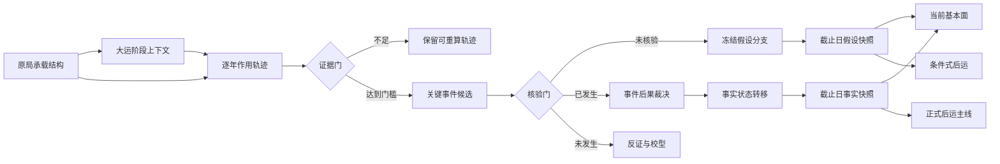
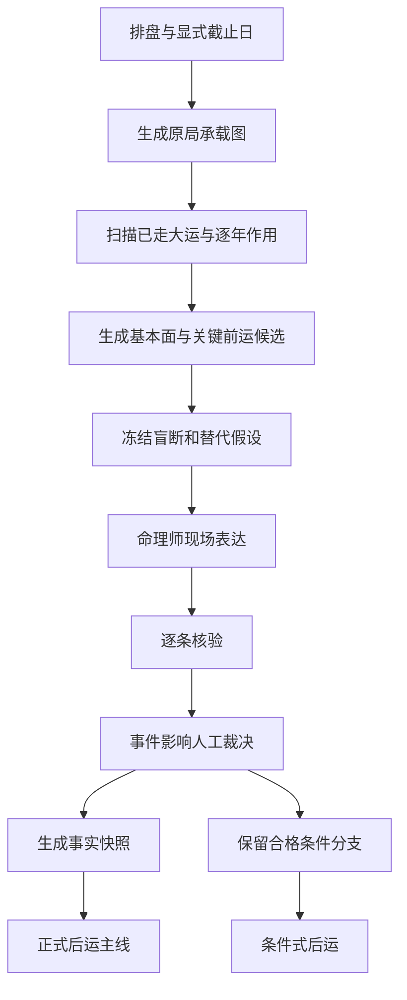

# 原局—大运—流年—截止状态推理系统设计

> 状态：设计已确认，待用户审阅书面规格
> 日期：2026-07-18
> 首个验证领域：事业为主，财富为显式传播领域
>
> **优先级锁定（2026-07-27）**：本方向是当前最高优先级长任务，理由见 [`AGENTS.md`](../AGENTS.md:6) 第 6 节禁止事项。F10 启动决策包收尾、多专家功能域主裁判路由 promotion、v1.4 V7 报告模板默认切换、子平/滴天髓生产规则扩充、八字指纹相似案检索——这五项都必须排在本方向的 as-of 求测闭环之后，理由是它们优化的是现有静态报告生成器（读取全部 known facts 后一次性生成报告）的局部参数，不解决"先盲断、后核验、再从核验后现实位置推演"的认识论缺口；这五项的价值也无法在缺少真实盲断—核验数据的情况下被证实。除非用户明确改变优先级，任何会话不得从这五项或其他局部优化任务重新出发推断当前最高优先级。

## 1. 目标与范围

本设计重构八字系统的核心推理方式，使系统服务于真实命理求测现场：先盲断成年人截至求测日的基本面与关键前运，冻结判断并现场核验，再从核验后的现实位置推演后运。

第一阶段先建立跨领域通用的“原局—大运—流年—重大事件—截止状态”推理宪法与数据模型，不同时实现全部领域规则。首个领域原型选择事业，财富仅作为显式传播领域，用来验证跨领域状态变化。

本设计不依赖短期内无法达到有效规模的前瞻样本，不建设复杂统计学习层。系统以规则、证据、竞争假设、反证、弃权和人工复核为核心。

## 2. 原始语料依据

### 2.1 车、路与动态参与者

段派直接提出“八字是车，大运为路，流年为人，为应期”，并将原局比作车辆、将大运比作道路、将流年比作可能修路或坏路的参与者。参见 [`盲派批命案例集`](../sources/duan/MinerU_markdown_16.《盲派批命案例集》（263例，74页）段建业_2056045601255776256.md:75) 与 [`命理瑰宝段建业修正版`](../sources/duan/MinerU_markdown_34.命理瑰宝段建业修正版_2056044446693916672.md:2430)。

本设计将“流年为人”和用户提出的“流年是环境”统一为：流年是当年的动态参与者、具体环境和事件触发器。

### 2.2 三层分工

任派提出“原局定层次，大运定吉凶，流年定应期”，并描述大运作用原局、流年作用大运再作用命局的判断次序。参见 [`民间实用八字初级班函授资料`](../sources/ren/MinerU_markdown_6_民间实用八字初级班函授资料_2056026893313564672.md:1188) 和 [`民间实用八字初级班函授资料`](../sources/ren/MinerU_markdown_6_民间实用八字初级班函授资料_2056026893313564672.md:1196)。

### 2.3 发动与介入

高派强调命、运、岁之间存在合、冲、刑、害、值等关系后才形成发动，并提出流年可通过大运进入命局；同时将大运视为使命局进入新环境的新时空点。参见 [`2018弟子班_大运流年篇_55页.md`](../sources/gao/2018弟子班_大运流年篇_55页.md:45)、[`2018弟子班_大运流年篇_55页.md`](../sources/gao/2018弟子班_大运流年篇_55页.md:49) 和 [`2018弟子班_大运流年篇_55页.md`](../sources/gao/2018弟子班_大运流年篇_55页.md:121)。

### 2.4 阶段环境与现实语境

杨派提出“大运定乾坤，流年观动静”，并明确将大运解释为政策、形势等大环境，强调命与运及当下现实环境结合。参见 [`清娟盲派八字命理讲座实战篇`](../sources/yang/MinerU_markdown_05清娟盲派八字命理讲座（实战篇）_2056033506518818816.md:39) 和 [`杨清娟命理基础电子书261页`](../sources/yang/MinerU_markdown_01.杨清娟命理基础电子书261页_2056033743757049856.md:3952)。杨派关于“大运不成，流年再好也是虚像”的论述进一步支持大运对流年兑现的阶段约束，参见 [`杨清娟丁酉年宜宾班`](../sources/yang/MinerU_markdown_2017杨清娟盲派八字命理丁酉年宜宾班110页_2056033360473161728.md:1661)。

### 2.5 原局承载与行运兑现

《滴天髓》相关语料强调“富贵虽定于格局，穷通全在运限”以及“命之所重在运”，支持区分原局承载与行运中的现实兑现。参见 [`滴天髓阐微_part3.md`](../sources/tiaohou_ditiansui/滴天髓阐微-清-任铁樵_part3.md:71) 和 [`滴天髓阐微_part2.md`](../sources/tiaohou_ditiansui/滴天髓阐微-清-任铁樵_part2.md:48)。

### 2.6 非加法原则

段派明确指出大运、流年是原局之象在时间上的克应，不是简单的力量对比与迭加。参见 [`命理瑰宝段建业修正版`](../sources/duan/MinerU_markdown_34.命理瑰宝段建业修正版_2056044446693916672.md:107)。因此本设计禁止用“原局分数 + 大运分数 + 流年分数”直接计算吉凶。

## 3. 推理宪法

### 3.1 原局是承载结构

原局定义先天能力、容量、脆弱点、可行路径、限制条件与领域候选。原局不直接等于求测截止日的现实结果。

### 3.2 大运是阶段上下文

大运定义十年阶段中哪些路径被开放、受阻、放大、抑制、修复或改道。大运是相对稳定的道路与大环境，对流年能否兑现形成约束。

### 3.3 流年是动态触发器

流年可以通过大运节点介入，也可以直接触发原局中存在有效关系的节点。只有形成可说明的作用链，才生成事件候选。

流年不会永久改写原局承载结构，也不会回写或篡改大运阶段上下文本身。特别重大流年能够通过已兑现事件改写现实人生状态；后续年份继续使用稳定的命理结构与更新后的现实状态共同推演。

```text
命理结构轨
= 原局承载结构 + 当前大运上下文 + 当年触发关系

现实状态轨
= 上一时点现实状态 + 已核验事件的有效后果

后续推演
= 后续命理结构轨 × 更新后的现实状态轨
```

以上为两条相互约束的轨道，不是数值乘法。命理结构轨负责说明哪些作用和候选具有理论依据；现实状态轨负责说明命主现在实际位于何处、哪些路径仍可达。

### 3.4 关键流年事件是状态转移入口

关键流年中的重大事件不能只用于验证应期。事件一旦核验，应根据类型、现实影响度、持续时间、影响领域与原局根源性决定是否改变本运余年、后续大运以及截止状态。

### 3.5 受约束的路径依赖

原局定义命理上的路径全集与承载边界，大运开放、关闭或强化其中部分路径，流年触发具体节点与事件。已兑现重大事件不会改变原局本体，却可以改变现实位置、资源条件、身份约束与后续可达路径；系统不能仅凭岁运临时组合，推导出原局完全无根的永久高强度能力。

系统必须区分：

- 强根源：原局已有明确结构，大运流年完成兑现；
- 弱根源：原局只有间接条件，主要由岁运临时组织；
- 无根源：只见岁运临时组合，原局无对应承载。

现实核验决定事件是否发生及实际后果；原局根源性约束该后果在纯命理推演中可以延伸多远。原局根源性不得推翻已核验现实事实。

### 3.6 截止状态是历史轨迹归并结果

截至求测日的人生基本面由以下内容共同形成：

```text
原局先天承载
+ 已走大运的阶段作用
+ 已过关键流年的具体触发
+ 已核验事件留下的持续后果
= 截止求测日的人生状态
```

### 3.7 事实与假设严格分离

未核验候选可以形成盲断和条件分支，但不得作为既成事实写入稳定人生状态。已否定候选进入反证记录，不得继续影响事实快照。

## 4. 总体架构

采用“受阶段约束的交互图 + 最小重大事件账本”，而不是单向三层流水线或逐年完整事件重演。



逐年作用轨迹可以重算并用于审计，但只有跨过证据门的关键事件进入持久化事件账本。现有 [`scan_retrospective()`](../engine/yingqi/retrospective.py:282) 可作为逐年作用轨迹的基础；现有 [`FlowYearEnergy`](../engine/yingqi/retrospective.py:42) 仅表达年度命理结构场，不承担现实后果判断；现有 [`RetrospectiveReport`](../engine/yingqi/retrospective.py:110) 是截止状态的上游输入，不是最终人生结论。

## 5. 关键数据对象

### 5.1 `NatalCapacityGraph`

职责：表达原局稳定承载结构。

核心信息：

- 领域能力与容量；
- 主要结构与脆弱点；
- 可行路径与限制条件；
- 命理事实证据；
- 原始语料依据；
- 竞争解释与反证。

### 5.2 `DaiyunContext`

职责：表达一段大运对路径集合的阶段性改写。

核心信息：

- 时间范围；
- 开放、关闭、放大、抑制、修复、改道的路径；
- 与原局节点的有效关系；
- 领域阶段倾向；
- 适用条件与反证。

### 5.3 `AnnualInteractionTrace`

职责：保存或生成某流年的可审计作用轨迹。

核心信息：

- 流年与大运、原局的作用关系；
- 被发动节点；
- 可能涉及领域；
- 支持与反证；
- 命理触发强度；
- 是否越过事件候选证据门。

命理触发强度不得直接映射为现实影响度。

### 5.4 `LifeEventCandidate`

职责：表达值得盲断或核验的关键流年事件候选。

至少包含：

- 事件领域、事件类型与时间窗；
- 原局依据、大运条件、流年触发链；
- 原局根源性及其证据；
- 支持证据、反证和替代假设；
- 冻结版本；
- 核验状态；
- 系统建议影响属性；
- 命理师最终裁决；
- 状态变化与路径变化。

核验状态至少包括：

```text
CANDIDATE
FROZEN
PARTIAL_HIT
CONFIRMED
REJECTED
UNKNOWN
WITHHELD
```

### 5.5 `EventImpactAssessment`

职责：将事件发生与事件后果分离。

系统建议与人工最终裁决并存：

```text
system_suggested_impact
system_suggested_persistence
system_suggested_scope
practitioner_final_impact
practitioner_final_persistence
practitioner_final_scope
adjustment_reason
```

人工裁决不得覆盖或删除冻结时的系统建议。

### 5.6 `VerifiedState`

职责：表达截至指定日期的事实人生状态。

仅接受：

- 排盘确定信息；
- 已核验事件；
- 有证据与理由的命理师最终裁决；
- 截止日仍有效的持续状态与路径改变。

### 5.7 `HypothesisState`

职责：表达未核验重大或转折候选成立时的竞争性人生状态。

不得混入事实快照。每个分支必须说明：

- 成立条件；
- 与事实主线的差异；
- 会改变的基本面和后运结论；
- 最小消歧问题；
- 反证条件。

## 6. 事件影响模型

### 6.1 四级现实影响度

| 影响等级 | 定义 | 状态作用 |
|---|---|---|
| 轻微 | 局部、短暂，未改变稳定现实位置 | 只进入事件历史 |
| 显著 | 对一个或多个领域形成明确但可恢复的影响 | 建立临时状态并设置有效期 |
| 重大 | 形成持续后果，至少影响本运余下阶段 | 建立持续状态，可跨运延续 |
| 转折性 | 改变路径集合或全局现实基线 | 关闭旧路径、打开新路径，后运从新状态出发 |

### 6.2 持续时间

```text
INSTANT
SHORT_TERM
REMAINDER_OF_DAIYUN
CROSS_DAIYUN
PERMANENT
```

### 6.3 影响范围

```text
PRIMARY_DOMAIN
RELATED_DOMAINS
GLOBAL_BASELINE
```

每个跨领域影响必须通过显式传播边表达，不允许默认自动传播。

### 6.4 原局根源性

| 根源性 | 定义 | 命理延伸边界 |
|---|---|---|
| 强根源 | 原局已有明确对应结构，岁运完成或强化原局未尽组合 | 可支持跨运持续或转折性路径，但仍需现实核验 |
| 弱根源 | 原局只有间接条件，事件主要由岁运临时组织 | 可支持显著或本运持续影响；跨运延伸必须重新复核 |
| 无根源 | 只有岁运临时组合，原局缺少对应承载 | 原则上只支持短期机会或波动，不直接推导永久路径 |

根源性判断必须给出原局节点和语料依据。高派关于“大运有完成原局未尽组合”及“后天组合原局无根源，力量很小”的论述是该分级的主要语料依据，参见 [`2018弟子班_大运流年篇_55页.md`](../sources/gao/2018弟子班_大运流年篇_55页.md:139)。段派关于重大事项在原局已有显示的论述构成强原局约束，参见 [`命理瑰宝段建业修正版`](../sources/duan/MinerU_markdown_34.命理瑰宝段建业修正版_2056044446693916672.md:2432)。

根源性采用“功能根源 + 双证据门”，不要求原局与岁运形成完全同构的表面组合。判定时必须同时满足以下两类证据：

1. **命盘结构证据**：原局存在与候选事件相对应的领域、对象、作用方向和承载节点；
2. **原始语料证据**：存在可定位原文，支持该结构与该事件功能之间的映射及岁运补全方式。

多流派支持可以增强证据完整性，但不得仅因支持流派数量增加而自动升级根源等级。二手结构化规则若不能回溯到原始语料，不足以单独通过语料证据门。

功能根源的判定顺序为：

```text
事件功能定义
→ 定位原局对应领域与对象
→ 检查原局是否已有同方向作用或承载
→ 检查大运流年是完成、强化还是临时拼接
→ 核验原始语料适用条件与反证
→ 裁决强根源、弱根源或无根源
```

- 强根源：领域、对象、作用方向与承载节点均明确，岁运主要完成或强化；
- 弱根源：领域或对象可定位，但作用方向、承载节点不完整，主要依靠岁运组织；
- 无根源：无法在原局定位对应功能，只存在岁运临时组合或宽泛类比。

### 6.5 岁运完成方式

根源性回答原局是否存在对应功能与承载；完成方式回答大运、流年对该功能做了什么。两个维度必须分别判断。

| 完成方式 | 定义 | 默认裁决倾向 |
|---|---|---|
| `ACTIVATE_EXISTING` | 原局功能链已相对完整，岁运使节点到位、发动或显现 | 可生成强事件候选 |
| `COMPLETE_LATENT` | 原局已有对象和作用方向，岁运补入缺失连接或承载 | 强弱取决于原局缺失程度 |
| `REPAIR_DEFECT` | 原局已有功能但受阻，岁运解除障碍、补不足或去有余 | 可形成阶段改善；固化成果可进入持续状态 |
| `TEMPORARY_SUBSTITUTE` | 岁运以相似对象临时代替部分功能，现实性质并不等同 | 通常只支持阶段性、临时或借象结果 |
| `INVALID_COMPLETION` | 表面字形或组合似乎补齐，但功能、承载或阶段门槛不成立 | 不生成目标主事件，进入反证、降级或弃权 |

主要语料依据包括：

- 原局既有信息由岁运引发，参见 [`盲派命理案例析2`](../sources/duan/MinerU_markdown_18.盲派命理案例析2_2056045522851651584.md:79)；
- 原局有发财组合、岁运引动为应期，参见 [`2018弟子班_财运篇_43页.md`](../sources/gao/2018弟子班_财运篇_43页.md:247)；
- 岁运补全其质或透干显能，参见 [`2018弟子班_理法篇_31页.md`](../sources/gao/2018弟子班_理法篇_31页.md:431)；
- 大运修补原局瑕疵，参见 [`2018弟子班_大运流年篇_55页.md`](../sources/gao/2018弟子班_大运流年篇_55页.md:83)；
- 岁运临时填补与原对象性质不同，参见 [`杨清娟命理基础电子书261页`](../sources/yang/MinerU_markdown_01.杨清娟命理基础电子书261页_2056033743757049856.md:3369)；
- 岁运表面补齐不必然成立，参见 [`杨清娟教学体系命例集细解`](../sources/yang/MinerU_markdown_01杨清娟-盲派八字命理《教学体系命例集细解》-无水印245页(高清版)_2056033706247389184.md:3012)。

### 6.6 二维裁决与禁配关系

第一版完整定义三级根源性和五种完成方式，但不预先编写全部十五种组合的领域规则。事业原型只启用有语料、有案例且能被核验的组合，其余组合保持未登记状态。

至少设置以下逻辑约束：

- `NO_ROOT + ACTIVATE_EXISTING` 逻辑矛盾：无既有功能可被引动，必须拒绝；
- `NO_ROOT + COMPLETE_LATENT` 原则上降为临时拼接，不得宣称完成潜在结构；
- 任意根源性与 `INVALID_COMPLETION` 配对时，本次岁运不得生成目标主事件；
- `WEAK_ROOT + TEMPORARY_SUBSTITUTE` 只支持阶段性候选，不自动升级为长期层级变化；
- `STRONG_ROOT + REPAIR_DEFECT` 可以产生显著改善，但跨运延续仍需检查现实成果是否固化；
- 不能仅因岁运凑齐表面字形，将弱根源或无根源升级为强根源。

首个事业原型优先登记：

```text
STRONG_ROOT + ACTIVATE_EXISTING
STRONG_ROOT + REPAIR_DEFECT
WEAK_ROOT + COMPLETE_LATENT
WEAK_ROOT + TEMPORARY_SUBSTITUTE
NO_ROOT + TEMPORARY_SUBSTITUTE
任意根源 + INVALID_COMPLETION
```

其他组合必须先补齐原始语料、具体案例、适用条件、反证与核验口径，才能进入生产规则。

### 6.7 影响计算原则

```text
后续状态影响
= 事件类型
× 现实影响等级
× 持续时间
× 影响领域
× 原局根源性
× 岁运完成方式
× 截止日有效性
```

这是裁决框架，不是简单数值乘法。已核验事实优先于命理根源性：根源性和完成方式限制系统对未来持续性的推演，不得否认现实中已经发生并仍然有效的状态。

### 6.8 三类事件后果

- 即时事件：发生但未形成稳定状态；
- 持续状态：学历、职业身份、资产、负债、婚姻身份、长期健康、家庭责任等继续存在；
- 路径改变：旧路径被关闭或显著降权，新路径被打开，后续推演起点改变。

三类后果与四级影响度并非同一维度。即时事件通常为轻微或显著，但也可能是重大事件的发生表现；路径改变通常为转折性，但必须由现实核验确认。

## 7. 双快照与基本面归并

### 7.1 事实快照与假设快照

系统在求测截止日同时维护：

- `VerifiedState`：正式后运主线的唯一事实起点；
- `HypothesisState[]`：盲断和条件式后运的竞争分支。

### 7.2 六大基本面

| 领域 | 截止日状态重点 |
|---|---|
| 原生家庭 | 家境基线、父母角色与关系、资源托举或拖累、当前家庭责任 |
| 学业 | 已兑现最高层次、学习路径、中断与补偿、资质与学历差异 |
| 事业 | 当前职业身份、层级、稳定性、行业路径、上升或受阻状态 |
| 财富 | 收入能力、资产存量、负债责任、财富波动和可持续性 |
| 婚姻 | 当前关系身份、关系质量、历史婚变、责任结构和未来路径 |
| 健康 | 当前长期基线、既往重大事件、功能影响及跨领域传播 |

每个领域至少包含：

- 当前中心判断；
- 合理范围；
- 已核验事实依据；
- 命理结构依据；
- 关键历史转折；
- 仍有效的持续状态；
- 未核验竞争分支；
- 反证和未知项；
- 决策状态。

### 7.3 状态归并优先级

```text
已核验且仍有效的转折性事件
> 已核验且仍有效的重大事件
> 已核验显著事件形成的临时状态
> 原局与当前大运给出的结构倾向
> 未核验流年候选
```

未核验候选只进入假设快照，不进入事实快照。轻微事件保留在历史账本中，但不改变稳定基本面。

### 7.4 现实落点转译

命理功能与现实事件名称必须分离。原局、大运、流年形成的功能候选不因现实身份变化而失效，但其现实落点必须受截止日事实状态约束。

允许转译必须同时满足：

1. **同一领域功能**：转译前后仍属于同一主领域，不得为了迁就事实随意换域；
2. **同一作用方向**：例如权责上升仍须转译为权责、平台或组织能力上升，不能改成无关的感情事件；
3. **明确现实约束**：必须指出哪条已核验状态关闭了原始落点，并说明替代落点为何仍可达。

```text
命理功能候选
+ 截止日事实状态
+ 当前可达路径
→ 原始落点可达则保留
→ 原始落点关闭则检查同域同方向替代落点
→ 无合法替代则弃权或保留条件分支
```

事业领域示例：组织内升迁功能遇到“已核验创业且原雇佣路径关闭”时，可以转译为团队权责扩大、平台资质上升或经营组织化，但不能自动转译成财富增长。财富变化仍需独立的显式传播边。

现实落点转译不得用于事后圆断。系统必须同时保存：原始功能候选、被关闭的原始现实落点、触发转译的事实约束、最终替代落点与反证条件。

### 7.5 转译冻结门与词典缺口

每个命理功能在结果揭晓前必须冻结有限现实落点集合。冻结内容至少包括：

- 一个中心落点；
- 最多两个允许替代落点；
- 弱命中的边界；
- 明确反证；
- 明确排除项。

核验后不得新增现实落点并计作本次命中。若实际结果未被词典覆盖，但同时满足同领域、同方向、明确现实约束，记录为 `TAXONOMY_GAP`：

- 不计作中心命中或替代命中；
- 不允许回写本次冻结记录；
- 暂不按普通错误吞并；
- 必须补充原始语料、命盘结构和案例依据；
- 经后续独立复核后，只能进入下一版本功能—落点词典。

首版只建立事业领域功能—落点词典。初始功能至少包括进入职业、权责上升、职业路径改变、职业稳定性下降、组织关系变化、自主经营建立和职业退出。具体落点集合只登记有原始语料、结构条件、反证与可核验口径的项目。

## 8. 条件分支策略

生产系统采用分层策略：

1. 盲断表达层可以大胆提出最强历史假设，但必须冻结并标记未核验；
2. 正式后运以事实快照给出主线；
3. 未核验重大或转折候选只能给条件式后运；
4. 完成核验后，正式推演收敛到更新后的事实快照；
5. 内部研究视图可保留完整候选树，但生产输出最多两个关键条件分支。

### 8.1 分支准入门

未核验候选只有同时满足以下条件，才能进入条件式后运：

- 现实建议影响度至少为重大；
- 持续时间达到本运持续或更长；
- 会改变至少一个基本面当前状态；
- 会使未来结论发生实质变化；
- 存在明确且最小的核验问题可以消歧。

不满足条件的候选只保留在内部推理轨迹或事件账本中。

## 9. 首次求测运行状态机



硬性规则：

- 输入显式包含 `as_of_date`，禁止隐式使用系统当前日期；
- 首次盲断前不得读取会泄底的履历型事实；
- 中心判断、时间窗、最强替代假设和反证条件一起冻结；
- 核验后可以人工调整现实影响度、持续期和范围，但必须保留系统原判并填写理由；
- 合格条件分支在生产输出中最多两个；
- 后运从截止日事实状态继续推演，不从出生原局重新开始。

## 10. 决策与弃权

每个基本面或事件候选必须落入一种动作：

| 状态 | 含义 |
|---|---|
| `OUTPUT` | 证据闭合，可直接输出 |
| `CONDITIONAL` | 存在会改变结论的关键未核验分支 |
| `ASK` | 一个最小问题即可完成消歧 |
| `ABSTAIN` | 证据不足、分支不可收敛或事件表达过宽 |
| `HUMAN_REVIEW` | 高风险事项或跨流派冲突需要命理师裁决 |

高敏感事项如父母早逝、重大疾病、生死灾祸和明确违法风险，不得由单条规则直接输出，应进入人工复核或弃权。

## 11. 首个事业—财富原型

### 11.1 主领域：事业

首批事件类型建议限制为：

- 首次进入稳定职业；
- 升迁或职责层级显著变化；
- 主动或被动离职；
- 跨行业转职；
- 创业或结束经营；
- 长期职业中断；
- 工作地点迁移并改变职业路径。

### 11.2 传播领域：财富

事业事件不得默认改变财富。只有存在显式传播边时，才更新财富状态，例如：

```text
长期失业
→ 收入中断
→ 储蓄消耗或负债增加
```

```text
升迁
→ 稳定收入能力提高
```

```text
创业
→ 收入结构变化与资产风险暴露
```

每条传播边必须说明：

- 来源事件；
- 目标状态；
- 传播条件；
- 时间延迟；
- 持续期；
- 反证条件；
- 是否已核验。

### 11.3 原型成功标准

- 能从同一命盘在不同截止日生成不同事业事实快照；
- 已核验转行会改变后续事业路径；
- 短期离职不会自动被升级为长期职业转折；
- 未核验转行只生成条件分支；
- 无显式传播边时，事业事件不自动改变财富；
- 命理师调整事件影响度后，原始冻结判断仍可审计；
- 每条事件候选可追溯到原始语料和命盘事实。

## 12. 验证策略

### 12.1 历史截止点回放

选取具有完整历史的案例，将 `as_of_date` 设置在不同年份，验证系统不会读取截止日后的事实，并能随历史状态变化生成不同快照。

### 12.2 状态转移测试

对同一原局和大运注入不同已核验事件，验证轻微、显著、重大和转折性事件分别产生预期状态作用。

### 12.3 候选污染测试

未核验和已否定事件不得进入事实快照；未达到分支准入门的候选不得进入正式条件式后运。

### 12.4 持续期测试

显著临时状态超过有效期后必须失效；本运持续状态在换运时必须重新评估；跨运和永久状态应继续影响后续推演。

### 12.5 跨域传播测试

无显式传播边时不得自动连锁；传播条件不满足时不得更新目标领域；传播边被核验后才可写入事实状态。

### 12.6 分支爆炸测试

内部可保留完整候选，生产输出最多两个关键条件分支。超出部分必须按证据、影响与可消歧性裁剪。

### 12.7 冻结审计测试

人工裁决不得覆盖系统原始建议、首次盲断、时间窗、替代假设和反证条件。

### 12.8 语料追溯测试

每条命理作用链必须能追溯到原始语料和命盘事实。只引用二手结构化规则而无法回到原文的候选，不得达到高证据等级。

## 13. 与现有系统的边界

现有多流派 runner 与命题结构可以作为候选生成层，但不再是最高架构。新系统的最高层是求测状态机与截止日人生状态。

现有逐年回溯模块保留并收窄职责：

- [`FlowYearEnergy`](../engine/yingqi/retrospective.py:42)：年度命理作用信息；
- [`DaiyunSegment`](../engine/yingqi/retrospective.py:76)：阶段上下文的基础时间容器；
- [`RetrospectiveReport`](../engine/yingqi/retrospective.py:110)：已走岁运轨迹报告；
- [`scan_retrospective()`](../engine/yingqi/retrospective.py:282)：逐年关系扫描入口。

需要新增但本设计不直接规定文件布局的能力边界：

- 原局承载图；
- 大运阶段路径改写；
- 事件候选与冻结；
- 现实影响裁决；
- 状态转移；
- 事实与假设双快照；
- 条件分支准入；
- 求测现场状态机。

## 14. 非目标

第一版明确不做：

- 基于少量前瞻样本训练复杂概率模型；
- 对出生至截止日的每一年强行生成现实事件；
- 将所有流派意见平均投票成结论；
- 将所有未核验候选写入当前事实状态；
- 无条件自动传播跨领域影响；
- 一次性实现六大基本面的全部细节规则；
- 输出伪精确的百分比概率；
- 为追求命中而事后改写冻结盲断。

## 15. 实施前必须保持的架构不变量

1. 原局、大运、流年不得简化为加法分数。
2. 命理触发强度与现实影响度必须分离。
3. 关键流年重大事件根据类型、影响度、持续期、范围与原局根源性改变后续状态。
4. 原局根源性分为强根源、弱根源与无根源，并约束命理推演的延伸边界。
5. 原局根源性不得推翻已经核验且仍有效的现实事实。
6. 未核验候选不得污染事实快照。
7. 未核验重大候选可进入假设快照，但必须通过分支准入门。
8. 正式后运以截止日事实快照为主线。
9. 核验后人工裁决不得覆盖原始冻结记录。
10. 跨领域影响必须由显式传播边支持。
11. 生产输出最多两个关键条件分支。
12. 每条结论必须可追溯到命盘事实、作用链与原始语料。
