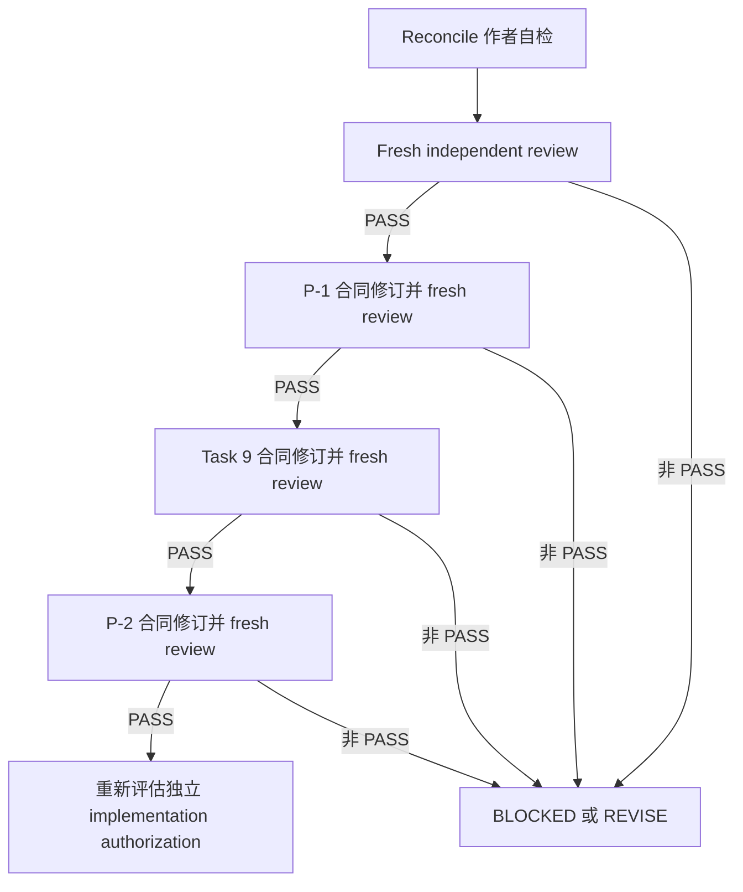

浩哥

# G6 Task 9-P / P-2 上游合同 Reconcile 裁决

- 文档角色：独立上游合同 reconcile adjudicator
- 当前状态：`REVISE — READY FOR FRESH INDEPENDENT REVIEW`；本次作者修订只能移交 fresh independent review，不构成 `PASS`。
- 范围：只裁决 authority/contract 边界；本文件不是实现授权、测试授权、Git 授权或 GitHub 授权。
- 唯一修改文件：[`plans/g6-task9p-p2-upstream-contract-reconcile-adjudication.md`](g6-task9p-p2-upstream-contract-reconcile-adjudication.md)
- P-1 唯一事实：[`plans/g6-task9p-prerequisite-authority-contract.md`](g6-task9p-prerequisite-authority-contract.md:21) 当前 Gate 为 `REVISE`，不是 fresh `PASS`；该文件确认 P-1 仅完成第六轮作者修订、下一步是 fresh independent rereview（见 [`plans/g6-task9p-prerequisite-authority-contract.md`](g6-task9p-prerequisite-authority-contract.md:884)）。P-2 初裁仍为 `BLOCKED`；Task 9 主合同仍 `STILL_OPEN`；所有实现仍未授权。

## 1. 适用权威与历史保留

本文件只作后续合同修订的裁决来源，不追溯性改写任何已存在合同。以下文本均保留为历史事实，且没有因本文件自动变更：

- [`plans/g6-task9p-prerequisite-authority-contract.md`](g6-task9p-prerequisite-authority-contract.md)：P-1 的 `ArtifactOperationAuthority`、artifact authority 与 future revision 边界。
- [`plans/g6-task9-application-orchestrator-contract.md`](g6-task9-application-orchestrator-contract.md)：Task 9 的公开结果形状、停止语义、隔离和 closed write set。
- [`plans/g6-task9p-p2-current-run-identity-authority-adjudication.md`](g6-task9p-p2-current-run-identity-authority-adjudication.md)：P-2 的历史初裁与附录 A；其中 `artifact_authority.manifest`、向 `F09RunResult` 添加 `execution_authority`、未裁决 operation literal、以及 `STAGED_L6` feedback 扩展，均不是已获授权的现行合同。
- [`plans/production-implementation-pi-500-r1-f09-implementation-plan.md`](production-implementation-pi-500-r1-f09-implementation-plan.md)：Task 9 的显式 opt-in 映射与 [`PI-500-A1`](production-implementation-pi-500-r1-f09-implementation-plan.md:7804) 对 Task 9 只能在独立 closed-write task 中变更的限制。
- [`engine/f09/artifacts.py`](../engine/f09/artifacts.py)：当前 artifact lifecycle、`IdempotencyKey` literal 闭集和 `ArtifactSetManifest` 运行时事实。
- [`engine/f09/feedback.py`](../engine/f09/feedback.py)：当前 `PreprodRunAuthority` 和 `PREPROD_RUN_TARGET` consumer 的运行时事实。

本文件不把历史文本中的计划性描述伪称为已实施事实；不修改 P-1、Task 9 主合同或 P-2 历史正文。

## 2. 不变的总边界

1. [`F09RunResult`](g6-task9-application-orchestrator-contract.md) 的既有冻结字段、字段顺序、constructor 数量、`run_f09_slice()` 签名、disabled STOP 语义和 artifact 正常终点保持不变。
2. Task 9 仍没有 feedback phase、feedback DTO、feedback output 或 feedback observation；Task 9 不得调用 `bind_feedback_operation()`、`evaluate_learning_eligibility()` 或 `validate_learning_eligibility()`。
3. `STAGED_AUDIT -> STAGED_L6` 与 `PREPROD_SHADOW -> V5_V6_PREPROD` 的 opt-in 映射保持不变；`PRODUCTION_DEFAULT` 继续是被拒绝的 request mode。
4. 当前 statement artifact lifecycle 不是 run graph：既有 writer 的 required roles 是 statement projection roles，且既有记录的 `run_id` 为 `None`。不得重标、复用或伪装该 statement manifest 为 run manifest。
5. reconcile `PASS` 只允许进入 fresh independent review；它不授权 P-1、Task 9、P-2 或 feedback 的合同修订，更不授权任何实现、测试执行、Git/GitHub 操作。GitHub service-side mutation 永久禁止。

## 3. 裁决 R-01：P-1 manifest carrier

### 观察事实

- P-1 的 `ArtifactOperationAuthority` exact public shape 仅有 `projections` 和 `key`；没有 `manifest` 字段。
- [`ArtifactSetManifest`](../engine/f09/artifacts.py:113) 是 artifact lifecycle 的成功结果类型；[`coordinate_artifact_operation()`](../engine/f09/artifacts.py:1005) 返回该类型。
- P-2 历史附录 A 使用 `artifact_authority.manifest` 生成 run-manifest identity，因此读取了不存在的 DTO 字段。
- 既有 statement manifest 不包含 run graph required roles，且其 records 的 `run_id` 为空。

### 推理

向既已 fresh `PASS` 的两字段 P-1 DTO 增加 manifest，会扩大 P-1 public authority surface，却没有消除 run graph 与 statement graph 的语义差异。更小的正确边界是：artifact operation authority 继续只授权 projections/key；run artifact lifecycle 的 producer 直接持有该 lifecycle 调用返回的 manifest。这样既不虚构 DTO 字段，也不把 statement manifest 当作 run manifest。

### 裁决条款

1. 不扩展 `ArtifactOperationAuthority` 为 manifest carrier；P-2 及任何后续消费者不得读取 `.manifest`。
2. 后续 P-1 contract revision 必须定义独立的 run-artifact lifecycle invocation：它以 run graph projections 和 run-specific key 调用 lifecycle，成功时由同一调用的 `ArtifactSetManifest` return 作为唯一 run-manifest carrier。
3. run manifest 只能含 run graph 的 canonical roles：`RUN_SNAPSHOT`、`DECISION_RUN`，以及仅在实际写入时存在的 `FEEDBACK_ATTACHMENT`；每条 record 必须绑定相同的 canonical `case_id`、`track` 和非空 `run_id`。
4. statement artifact set 与 run artifact set 必须具有不同 canonical key identity、不同 root identity 和不可互换的 manifest；不得通过 role rename、`run_id` 回填或 consumer-side reconstruction 转换。
5. P-2 的 future contract 只能消费独立 run-artifact lifecycle result 中实际返回的 `ArtifactSetManifest`；若没有该 result，必须 STOP，而非从 authority 推断 manifest。

### Falsifier

以下任一项出现即推翻 R-01 并使相关合同修订 `BLOCKED`：

- P-2 代码或合同访问 `ArtifactOperationAuthority.manifest`；
- run manifest 的 records 含 statement-only role 或空 `run_id`；
- 使用 statement artifact manifest 作为 `PreprodRunAuthority.manifest`；
- run lifecycle 没有返回 manifest，却由 caller、DTO 或 consumer 重新构造 manifest；
- P-1 修订改变既有 `ArtifactOperationAuthority` 的 exact 两字段形状。

### STOP

在 P-1 contract revision 经 fresh review `PASS` 前，任何 run-manifest producer/consumer 实现、DTO 扩展、P-2 continuation 或 feedback binding 均 STOP。

## 4. 裁决 R-02：run manifest 的 `IdempotencyKey.operation`

### 观察事实

- 当前 [`IdempotencyKey`](../engine/f09/artifacts.py:48) 的 literal 闭集没有 `PROJECT_ARTIFACT_SET`。
- 既有 `RENDER_REPORT`、`PROJECT_INDEX`、`PROJECT_RECORDS` 分别表达 statement artifact 子操作，不能表达包含 `RUN_SNAPSHOT`、`DECISION_RUN` 和可选 `FEEDBACK_ATTACHMENT` 的完整 run artifact set。
- P-1 历史合同曾把 `PROJECT_ARTIFACT_SET` 列为 future revision 目标，但 current runtime 和 [`tests/f09/test_artifact_lifecycle.py`](../tests/f09/test_artifact_lifecycle.py) 尚未闭合该 literal。

### 推理

复用 statement 子操作 literal 会把不同 artifact graph 压入同一 canonical operation identity，破坏幂等性语义和 root 隔离。唯一最小、语义闭合的方案是新增 `PROJECT_ARTIFACT_SET`，并只用于完整 run-artifact-set lifecycle，而不是让 implementer 在现有 literal 中任选。

### 裁决条款

1. run-artifact set 的唯一 operation literal 为 `PROJECT_ARTIFACT_SET`。
2. 该 literal 的语义为：以一个 canonical `case_id`、一个 canonical non-production `track`、一个 nonempty `run_id`、一个 source identity 和完整 run graph projection set，投影并协调一个 run artifact set；不表示 report render、statement index 或 statement records 的任一子操作。
3. canonical key binding 必须包含既有 `IdempotencyKey` 的所有 canonical identity material，并将 `run_id` 以 P-1 revision 明确拥有的 canonical input 进入 key material；不得把 `run_id` 藏在 path、projection bytes、attempt ID、consumer state 或非 canonical metadata 中。
4. P-1 contract revision 必须精确指定：literal 扩展、`run_id` carrier 的公开/内部归属、`PROJECT_ARTIFACT_SET` 的 input validation、root derivation、record role closure、digest material、retry/no-op 语义和 statement/run separation。
5. 除 P-1 revision 指定的 owner 外，Task 9、P-2 和 feedback 均不得自行扩展 `IdempotencyKey` 或生成该 key。

### Falsifier

以下任一项出现即推翻 R-02：

- run artifact set 使用 `RENDER_REPORT`、`PROJECT_INDEX` 或 `PROJECT_RECORDS`；
- `PROJECT_ARTIFACT_SET` 未进入 `IdempotencyKey.operation` exact literal、canonical key material 或 lifecycle tests；
- 相同 case/track/source 但不同 `run_id` 得到同一 canonical key；
- 不同 run graph role/payload 在相同 key 下被视为 no-op；
- Task 9/P-2 自行增加 literal 或绕过 P-1 key construction。

### STOP

P-1 revision 未同时冻结 literal、canonical key binding 与 falsifier tests 前，禁止实现 run artifact lifecycle；P-2 不得以任何现存 operation literal 代替该裁决。

## 5. 裁决 R-03：冻结 `F09RunResult` 与 execution authority 的兼容

### 观察事实

- Task 9 将 `F09RunResult` 精确冻结为 request、evidence、decision、trace、statement_set、manifest、observations 和 `stopped_at`；明令禁止新增字段或 constructor。
- `run_f09_slice()` 的公开签名和 disabled STOP semantics 同样冻结。
- P-2 历史附录 A 拟增加 `F09RunResult.execution_authority`，与上述冻结边界直接冲突。
- [`PI-500-A1`](production-implementation-pi-500-r1-f09-implementation-plan.md:7871) 要求 Task 9 后续改动另开自身 closed-write task；A1 不授权修改 Task 9 application 文件。

### 推理

内部-only return 无法为 P-2 提供可审查、稳定且可被下游消费的 authority contract；直接改变现有 result 则破坏兼容性。最小兼容策略是在独立 Task 9 contract revision 中增加一个 versioned public callable 和独立 immutable envelope，既不改变既有 caller，也不把 run authority 藏在 observation 或 private side channel。

### 裁决条款

1. `F09RunResult`、其 exact fields、field order、constructor、`run_f09_slice()` signature 和所有既有 STOP semantics 永久保持不变，直到另一个明确版本化 replacement 合同被独立裁决；本 reconcile 未授权此类 replacement。
2. future Task 9 contract revision 必须新增版本化 public callable，建议精确命名为 `run_f09_slice_with_execution_authority()`，并定义独立 immutable `F09RunExecutionResult` envelope。
3. `F09RunExecutionResult` 必须以一个既有的完整 `F09RunResult` 作为其 first-class `run_result` 成员，并以独立 `execution_authority: F09ExecutionAuthority | None` 成员表达 authority；不得修改或 monkeypatch `F09RunResult`。
4. envelope 的 `execution_authority` 只有在 run-artifact lifecycle 成功、其 manifest 为 R-01 的独立 run manifest、且所有 identity/track/run-id invariants 成立时才可非空；任何 disabled request 或任何既有 phase stop 都必须保持 `None`，并完整保留原 `F09RunResult`。
5. `F09ExecutionAuthority` 的 field contract 必须由 Task 9 revision 引用 R-01/R-02 的 run manifest/key，引用既有 [`PreprodRunAuthority`](../engine/f09/feedback.py:190) 仅限 R-04 允许的 track，且不得包含 P-1 DTO 不存在的字段。
6. P-2 future contract 只能消费这个 versioned envelope；不得消费 observation、global cache、private helper output 或 mutated legacy result。

### Falsifier

以下任一项出现即推翻 R-03：

- `F09RunResult` 新增、删除、重排或改名字段；
- `run_f09_slice()` 签名、disabled behavior 或 phase STOP semantics 改变；
- authority 通过 observation 字符串、module global、side channel 或 private return 泄露；
- disabled/stopped execution 产生非空 execution authority；
- 新 envelope 不包含原封不动的 `F09RunResult`，或 P-2 仍消费旧 result 的新字段。

### STOP

Task 9 contract revision 未经 fresh review `PASS` 前，禁止新增 callable/envelope、修改 exports 或实现 execution authority producer；P-2 不得修改 legacy public surface。

## 6. 裁决 R-04：feedback 预生产协议与 `STAGED_L6`

### 观察事实

- 当前 [`PreprodRunAuthority`](../engine/f09/feedback.py:190) 是冻结的六字段 authority。
- 当前 `PREPROD_RUN_TARGET` consumer 对 authority track、manifest records 和 binding validation 均要求 `RunTrack.V5_V6_PREPROD`。
- `RunTrack.STAGED_L6` 虽然存在，却不表示 consumer 已支持它。
- Task 9 的 isolation 明确禁止 feedback phase、binder 与 learning 调用，且其 closed write set 不包括 [`engine/f09/feedback.py`](../engine/f09/feedback.py) 或 [`tests/f09/test_feedback_eligibility.py`](../tests/f09/test_feedback_eligibility.py)。

### 推理

扩展 `PREPROD_RUN_TARGET` 至 `STAGED_L6` 会改变已存在 feedback consumer 的 protocol、validation 和 tests，超出 Task 9 scope。当前唯一可审查的最小方案是拒绝该扩展：仅 `V5_V6_PREPROD` 可在 producer envelope 中形成可供现有 consumer 使用的 `PreprodRunAuthority`；`STAGED_L6` 只能明确声明为不可绑定，不能伪造或调用 consumer。

### 裁决条款

1. 本轮不扩展 `PREPROD_RUN_TARGET` 至 `STAGED_L6`；该 protocol 的可消费 run track 仍唯一为 `V5_V6_PREPROD`。
2. 对 `PREPROD_SHADOW -> V5_V6_PREPROD`，future execution envelope 可在 R-01/R-03 前提全满足后产生 `PreprodRunAuthority`；这只是 authority availability，不是 Task 9 对 binder 的调用授权。
3. 对 `STAGED_AUDIT -> STAGED_L6`，future execution envelope 必须产出 `execution_authority=None` 或一个不含 `PreprodRunAuthority` 的显式 producer-only unsupported binding disposition；不得构造、声称可消费、或传递 `PreprodRunAuthority`。
4. 该 unsupported disposition 必须可由 P-2 consumer fail closed：它不能成为 `PREPROD_RUN_TARGET` 输入、不能触发 binding、不能产生 learning eligibility，且不得伪装为 `V5_V6_PREPROD`。
5. 如未来业务需要 `STAGED_L6` run-target binding，必须另立 feedback contract revision Gate，精确 owner 为 feedback contract；其 future implementation write set 至少包括 [`engine/f09/feedback.py`](../engine/f09/feedback.py) 和 [`tests/f09/test_feedback_eligibility.py`](../tests/f09/test_feedback_eligibility.py)，并需独立 fresh review `PASS`。该 Gate 不属于 Task 9、P-1 或 P-2 implementation authorization。
6. 无论该独立 feedback Gate 是否未来通过，Task 9 都继续零 binder、零 eligibility evaluator、零 learning validator 调用。

### Falsifier

以下任一项出现即推翻 R-04：

- 未经独立 feedback contract revision，`STAGED_L6` 被作为 `PREPROD_RUN_TARGET` 接受；
- Task 9 调用任何 binder、feedback validator、eligibility evaluator 或 learning validator；
- `STAGED_L6` authority 被改写为 `V5_V6_PREPROD`；
- current consumer 未修改却被声称支持 `STAGED_L6`；
- feedback contract revision 的实现 write set 被偷放进 Task 9/P-2 write set。

### STOP

在独立 feedback contract revision 经 fresh review `PASS` 前，所有 `STAGED_L6` run-target binding、feedback runtime/test 修改和 consumer 调用均 STOP；Task 9 仍只完成 isolated artifact normal endpoint。

## 7. 后续合同修订与 future write set

本节列出未来可能的审查对象，不创建写入授权。每个修订必须先获得自身合同 Gate 与 fresh independent review `PASS`，之后才可评估独立实现任务。

| 类别 | future contract revision 的最小责任 | 未来 implementation write set | 本 reconcile 的授权结论 |
|---|---|---|---|
| P-1 contract revision | 落实 R-01/R-02：独立 run lifecycle、`PROJECT_ARTIFACT_SET`、run-id key carrier、run graph role closure、manifest return 与 retry semantics。 | [`engine/f09/artifacts.py`](../engine/f09/artifacts.py)、[`tests/f09/test_artifact_lifecycle.py`](../tests/f09/test_artifact_lifecycle.py)；若精确 contract test owner 另有冻结，须在该 revision 明列。 | 不授权合同写入或实现。 |
| Task 9 contract revision | 落实 R-03：保持 legacy surface，新增 versioned callable 与 immutable `F09RunExecutionResult`，并保持 isolation/STOP。 | [`engine/f09/application.py`](../engine/f09/application.py)、[`engine/f09/__init__.py`](../engine/f09/__init__.py)、[`tests/f09/test_application_opt_in.py`](../tests/f09/test_application_opt_in.py)、[`tests/f09/test_production_isolation.py`](../tests/f09/test_production_isolation.py)；新专用 envelope test 只能在 revision 明确纳入后新增。 | 不授权合同写入或实现。 |
| P-2 contract revision | 删除/替换历史附录 A 中的 `.manifest` 假设、legacy result field 扩展和未决 literal；只消费 R-01/R-03 产生的 versioned authority，并落实 R-04 track disposition。 | 只能在 P-2 contract revision 中另行、精确、closed 地列出；不得自动继承 P-1、Task 9 或 feedback 的 write set。 | 不授权合同写入或实现。 |
| 独立 feedback contract revision | 若以后需要，落实 R-04 的 `STAGED_L6` protocol 扩展、authority validation、target graph 和 falsifier tests。 | [`engine/f09/feedback.py`](../engine/f09/feedback.py)、[`tests/f09/test_feedback_eligibility.py`](../tests/f09/test_feedback_eligibility.py)。 | 未开启；不授权合同写入或实现。 |

任何 future implementation task 改动未在其经 fresh review 通过的 closed write set 中列出的路径，立即 STOP。上述列表不使本次 reconcile 的唯一文档约束失效。

## 8. 精确串行治理与 Gate



1. reconcile 作者只可核对本文件与上游事实；不得在作者步骤改变生产、测试、旧合同或执行任何 Python、pytest、Git/GitHub 操作。
2. fresh independent reviewer 必须独立验证 R-01 至 R-04 的全部 observation、裁决、falsifier 和 STOP；不得以作者摘要代替原始合同与 source 核对。
3. 只有本 reconcile fresh review 为 `PASS` 后，才可按顺序分别撰写 P-1、Task 9、P-2 合同修订并分别 fresh review。任一 Gate 非 `PASS`，后续步骤全部 `BLOCKED`。
4. feedback revision 不是上述三项的隐含子步骤；只有业务明确提出 `STAGED_L6` consumer support，且 P-1/Task 9/P-2 所需前置 Gate 满足后，才可单独开 Gate。
5. 即使 P-1、Task 9、P-2 三份合同均 fresh `PASS`，仍只允许重新评估是否创建独立 implementation authorization；不得将任何合同 PASS 自动等同于实现、测试、Git 或 deployment 授权。

## 9. 作者自检清单

- [x] 唯一新增文档为本文件；未修改 P-1、Task 9 主合同、P-2 历史文档、production 或 tests。
- [x] 每个已阻断冲突均含观察事实、推理、裁决条款、falsifier、STOP。
- [x] R-01 明确禁止读取不存在的 `ArtifactOperationAuthority.manifest`。
- [x] R-02 唯一确定 `PROJECT_ARTIFACT_SET` 及 P-1 owner/key closure。
- [x] R-03 保持 `F09RunResult` 和 `run_f09_slice()` 冻结，并采用 versioned public callable/envelope。
- [x] R-04 明确拒绝当前 `STAGED_L6` 的 `PREPROD_RUN_TARGET` 扩展，并将其列为独立 feedback Gate。
- [x] future write set 按 P-1、Task 9、P-2、feedback 分离，且不包含实现授权。
- [x] 串行 Gate 明确：本文件当前仅 `PASS-READY FOR FRESH INDEPENDENT REVIEW`。

`PASS-READY FOR FRESH INDEPENDENT REVIEW`

---

# 10. 第三轮 Reconcile 修订：对 latest review 的逐项闭合

> **现行效力与历史保留：** 第 1–9 节及其 `PASS-READY` 表述、P-1 `PASS` 表述、历史 review/failure/STOP 记录全部保留，不删除、不重写，也不作为当前 P-1 状态证据。本节是本文件唯一的现行 reconcile 条款；与此前文字冲突时，以本节为准。它不修改任何上游文档，尤其不修改 [`plans/g6-task9p-prerequisite-authority-contract.md`](g6-task9p-prerequisite-authority-contract.md)。

## 10.1 P-1 Gate 事实裁决

1. latest review 关于 P-1 已 fresh `PASS` 的观察，与唯一指定事实源 [`plans/g6-task9p-prerequisite-authority-contract.md`](g6-task9p-prerequisite-authority-contract.md:21) 的明确 `REVISE` 状态相冲突，故该 `PASS` 观察为错误观察。
2. P-1 当前计数、transition 和合法下一步只能取自该 source：`PASS=0`、`REVISE=1`、P-1 第六轮作者修订后仅可进入 fresh independent rereview（见 [`plans/g6-task9p-prerequisite-authority-contract.md`](g6-task9p-prerequisite-authority-contract.md:25) 与 [`plans/g6-task9p-prerequisite-authority-contract.md`](g6-task9p-prerequisite-authority-contract.md:886)）。
3. 本文件不以 reconcile 文字改变 P-1 Gate、P-2 Gate 或总 Gate；P-1 保持 `REVISE`、P-2 保持 `BLOCKED`、Task 9-P 总 Gate 保持 `BLOCKED`、Task 9 amendment 保持 `STILL_OPEN`。

## 10.2 H1 — 独立 run-artifact lifecycle 的完整机械合同

### 10.2.1 唯一 future owner、模块与精确 API

仅 future P-1 contract revision 可以在 [`engine/f09/artifacts.py`](../engine/f09/artifacts.py) 定义下列 versioned API；Task 9、P-2、feedback 不得定义替代 writer、key builder、root builder 或 manifest builder：

```python
@dataclass(frozen=True)
class RunArtifactSetRequestV1:
    key: IdempotencyKey
    run_id: str
    input_snapshot_refs: tuple[VersionedObjectRef, ...]
    schema_version: str
    projections: Mapping[Literal[
        "RUN_SNAPSHOT",
        "DECISION_RUN",
        "FEEDBACK_ATTACHMENT",
    ], bytes]


def coordinate_run_artifact_set_v1(
    root: Path,
    request: RunArtifactSetRequestV1,
    *,
    existing_manifest: ArtifactSetManifest | None,
    attempt_id: str,
    now: str,
) -> ArtifactSetManifest: ...
```

- 输入 exact type 仅如上；输出恒为 [`ArtifactSetManifest`](../engine/f09/artifacts.py:113)。不得把 [`ArtifactOperationAuthority`](g6-task9p-prerequisite-authority-contract.md) 扩为 manifest carrier，亦不得读取不存在的 `.manifest`。
- `request.key.operation` 必须是新增的 `PROJECT_ARTIFACT_SET`；`request.key.statement_set_id is None`、`request.key.feedback_id is None`；`request.key.track` 仅可为 non-production track；`request.run_id` 非空。
- `run_id` 是该 request 的显式 immutable carrier，并须进入 P-1 owner 定义的 canonical key material；它不得置于 path、payload、attempt ID、feedback item 或 consumer state 中代替 canonical identity。
- 既有 statement API [`write_artifact_set()`](../engine/f09/artifacts.py:369)、[`retry_artifact_set()`](../engine/f09/artifacts.py:753)、[`coordinate_artifact_operation()`](../engine/f09/artifacts.py:1005) 的名称、签名、three-role input closure、statement-set identity、`run_id=None` 行为和 ABI 均不得改变。

### 10.2.2 roles、projection、record、root 与 digest 闭包

1. `projections` 的 exact key closure 为必有 `RUN_SNAPSHOT`、`DECISION_RUN`，以及可选且至多一次的 `FEEDBACK_ATTACHMENT`；不得含 `REPORT`、`STATEMENT_INDEX`、`STATEMENT_RECORDS`、`MANIFEST`、`FEEDBACK_SOURCE` 或其他 role。
2. filenames 固定为 `run_snapshot.bin`、`decision_run.bin`、`feedback_attachment.bin`，分别按上述 role 映射；不得复用 statement filenames 或由 caller 指定 filename。
3. 每个 current record 必须具有 `artifact_id = "ARTIFACT:" + key.canonical_key_digest.value + ":" + role`、相同 `case_id`、相同 `track`、相同 nonempty `run_id`、`statement_set_id=None`、该 role 的 payload `expected_digest == observed_digest`、`VERIFIED` state、并恰有自身 retained attempt history。
4. canonical key preimage 固定为 bounded JCS map，字段顺序与集合精确为 `domain="f09.run-artifact-set.v1"`、`operation="PROJECT_ARTIFACT_SET"`、`case_id`、`track.value`、`run_id`、`source_digest`、`schema_versions_digest`、`contract_digest`、`statement_set_id=None`、`feedback_id=None`、`projection_roles`（按 `RUN_SNAPSHOT`、`DECISION_RUN`、`FEEDBACK_ATTACHMENT` 的 canonical role order）以及各 role payload digest；`canonical_key_digest` 为其 RFC8785-JCS-UTF8 lowercase SHA-256。不得加入 path、clock、attempt id、UUID 或 caller label。
5. manifest identity 固定为 `MANIFEST:` 加 canonical key digest；`manifest.digest` 必须由 [`digest_artifact_records()`](../engine/f09/artifacts.py:241) 对完整 ordered records 计算，不能以 payload digest、key digest 或 feedback digest 取代。
6. root 必须仅由 [`resolve_artifact_operation_root()`](../engine/f09/artifacts.py:122) 对完整 canonical key digest 推导；不同 `run_id` 必须产生不同 canonical key 及不同 root。不得从 `run_id` 直接拼接 root，亦不得共用 statement root。
7. `MANIFEST` 是 feedback authority 所需的 target-ref role，但不是 writable projection：future lifecycle 不得写入 self-referential `MANIFEST` record。future authority adapter 只能以 returned manifest 的 `manifest_id`、`digest` 和 canonical key 生成一个 `VersionedObjectRef("MANIFEST", ...)`；该 ref 不得伪称为 manifest record 或 filesystem payload。当前 [`_preprod_target()`](../engine/f09/feedback.py:1715) 会把 `target_refs` 中每个 ref（包括存在时的 `MANIFEST`）统一要求匹配 `manifest.records`，因此该 adapter 与 current consumer **尚不兼容**；不得把 outer-manifest ref 已构造误报为 feedback-ready。

### 10.2.3 inspection、retry、no-op、failure precedence 与副作用

1. future P-1 revision 必须定义同模块的 `inspect_run_artifact_set_v1(root: Path, manifest: ArtifactSetManifest) -> ArtifactSetManifest`，其只接受上述 run role closure，并逐 record 验证 role/cardinality、case/track/run-id、key/root containment、attempt identity、payload bytes、expected/observed digest、outer manifest digest；任何 mismatch 返回或抛出 typed integrity failure，绝不降级为 statement inspection。
2. retry 只能由同一 versioned coordinator 在 `existing_manifest.key == request.key`、same run-id、same schema、same refs、same role closure、same expected payload digests 时执行。保留 history、reconcile `UNKNOWN` committed final、仅重写未验证 role；全 verified 且 bytes/digests 相同必须是 no-op，返回 `COMPLETE_VERIFIED` 且无新增 write/attempt。
3. 首先执行 exact type/closed-domain/nonblank/cardinality validation，失败为 [`F09ContractError`](../engine/f09/errors.py:29) 且零 I/O；其次执行 key/run/root/record/attempt/digest identity validation，失败为 [`F09IntegrityError`](../engine/f09/errors.py:21) 且零新增写；只有二者通过才可 mkdir/atomic write。写入 OSError 仅生成该 role 的 failed attempt、partial manifest 与 returned issue；不得覆盖已经产生的 contract/integrity failure。
4. atomic write 必须延续 [`_atomic_write_verified()`](../engine/f09/artifacts.py:271) 的 write-flush-fsync-replace-readback-RAW-UTF8 digest 模式。失败后不调用 feedback、eligibility、learning、statement writer、global registry 或 cross-run repair。

### 10.2.4 H1 future write set 与验证

P-1 revision 的 conditional implementation write set 恰为 [`engine/f09/artifacts.py`](../engine/f09/artifacts.py) 与 [`tests/f09/test_artifact_lifecycle.py`](../tests/f09/test_artifact_lifecycle.py)：前者拥有 literal、request、writer/inspect/retry/coordinator；后者证明 API/signature、roles/filenames、run-id key/root separation、retained history、UNKNOWN reconciliation、no-op、failure precedence、zero side effects 和 statement ABI unchanged。任何需变更的 artifact literal/field/filename 不在此表时，必须 STOP 并开新的 P-1 contract revision。

## 10.3 H2 — `PROJECT_ARTIFACT_SET` 与 feedback validator 隔离

**选择：run-only literal 不进入 feedback boundary。** 隔离证据如下：

- [`IdempotencyKey.operation`](../engine/f09/artifacts.py:49) 当前是 closed literal；future `PROJECT_ARTIFACT_SET` 只由本节冻结的 `RunArtifactSetRequestV1` 和 P-1 lifecycle 使用。
- feedback 的唯一 operation key在 [`_compute_operation()`](../engine/f09/feedback.py:1768) 中固定构造为 `IdempotencyKey("BIND_FEEDBACK", ...)`；feedback canonical material 只通过 [`_idempotency_key_material()`](../engine/f09/feedback.py:682) 序列化其自身 `BIND_FEEDBACK` key。
- [`PreprodRunAuthority`](../engine/f09/feedback.py:190)、[`_preprod_authority_self_excluded_material()`](../engine/f09/feedback.py:1146)、[`_preprod_target()`](../engine/f09/feedback.py:1715) 与 [`validate_feedback_binding_record()`](../engine/f09/feedback.py:1908) 消费 manifest/target refs/run-id，不接受或校验 producer lifecycle key operation。

因此 `PROJECT_ARTIFACT_SET` 的 P-1 write set 不含 [`engine/f09/feedback.py`](../engine/f09/feedback.py) 或 [`tests/f09/test_feedback_eligibility.py`](../tests/f09/test_feedback_eligibility.py)，也不改变 `PREPROD_RUN_TARGET` 或 binder call。若 P-1 implementation 无法以上述 exact type/call chain 证明 literal 不穿透 feedback canonical material，则必须 STOP，另开独立 feedback contract revision，以这两个路径为最小 write set，且只可更新 shared idempotency validation，不得改变 `PREPROD_RUN_TARGET` 或 binder call。

**独立于 literal isolation 的 current-consumer 缺口：** [`_preprod_target()`](../engine/f09/feedback.py:1720) 当前会把存在于 `target_refs` 的 `MANIFEST` ref 当作普通 artifact record 查找；H1 禁止 self-referential manifest record。故在 authority 真正可进入 feedback consumer 前，必须另开一个独立 future feedback adapter contract revision，closed write set 恰为 [`engine/f09/feedback.py`](../engine/f09/feedback.py) 与 [`tests/f09/test_feedback_eligibility.py`](../tests/f09/test_feedback_eligibility.py)。该 revision 只允许把 `MANIFEST` ref 验证冻结为：`object_id == authority.manifest.manifest_id`、digest 等于 `authority.manifest.digest`、schema/contract version 等于 future P-1 冻结值，并继续对其余 refs 执行 record matching；不得新增 writable `MANIFEST` record、不得改变 `PREPROD_RUN_TARGET` 的 track/protocol、不得改变 binder call。该 adapter Gate fresh `PASS` 前，即使 producer 内部能计算 candidate authority material，versioned public envelope 的 `preprod_authority` 也必须保持 `None`，P-2/feedback binding 继续 STOP；不得把未获 consumer admission 的 object 暴露在类型为 `PreprodRunAuthority | None` 的 public 字段中。

## 10.4 H3 / M1 — versioned execution envelope 与 `PreprodRunAuthority` 映射

future Task 9 contract revision 只能在 [`engine/f09/application.py`](../engine/f09/application.py) 定义、由 [`engine/f09/__init__.py`](../engine/f09/__init__.py) export 下列 exact public surface；独立 run-artifact input 只能是 P-1 H1 owner 已验证的 request，不能从 legacy request、caller label、feedback item 或旧 statement manifest 推导：

```python
@dataclass(frozen=True)
class F09RunExecutionResultV1:
    run_result: F09RunResult
    preprod_authority: PreprodRunAuthority | None
    unsupported_reason: Literal["STAGED_L6_UNSUPPORTED"] | None


def run_f09_slice_with_execution_authority_v1(
    request: F09RunRequest,
    *,
    run_artifact_request: RunArtifactSetRequestV1,
    existing_run_manifest: ArtifactSetManifest | None,
    gate_inputs: tuple[GateEvaluationInput, ...],
    competition_input: CompetitionInput,
    root_input: RootInput,
    timing_input: TimingInput,
) -> F09RunExecutionResultV1: ...
```

1. `F09RunExecutionResultV1` 是 immutable dataclass，field order、type、export 和 constructor order 精确如上；不得向 legacy [`F09RunResult`](g6-task9-application-orchestrator-contract.md:116) 添加字段或修改其 constructor/signature。
2. `run_artifact_request` 与 `existing_run_manifest` 是仅属于 versioned callable 的 exact keyword-only inputs。前者必须由 P-1 owner 交付并完整验证；后者只能是同 key/run 的 H1 previous result 或 `None`。二者都不是 [`F09RunRequest`](g6-task9-application-orchestrator-contract.md:70) 的新增字段；legacy [`run_f09_slice()`](g6-task9-application-orchestrator-contract.md:138) 不接受它们。`run_artifact_request.key.case_id`/`track` 必须和 legacy request 的 canonical mapped execution identity 一致。
3. callable 必须先按原样调用 legacy [`run_f09_slice()`](g6-task9-application-orchestrator-contract.md:138)；`run_result` 是该 returned object，不复制、不重建、不 mutation。仅当该结果 `stopped_at is None` 时，才可用 `request.artifact_root`、`run_artifact_request`、`existing_run_manifest`、`request.attempt_id` 与 `request.now` 调用 H1 [`coordinate_run_artifact_set_v1()`](g6-task9p-p2-upstream-contract-reconcile-adjudication.md:252) 恰一次，并使用其 returned run manifest；legacy statement manifest 绝不作为 run manifest input 或 substitute。
4. disabled 与每一个 existing phase stop（`SOURCE_PREFLIGHT`、`EVIDENCE`、`DECISION`、`TRACE`、`ARTIFACT`）均返回 `preprod_authority=None`、`unsupported_reason=None`，并保持 legacy result 的 exact fields/observations/stop semantics；这些分支的 H1 coordinator call count 为零。
5. 只有 H1 coordinator 返回 `COMPLETE_VERIFIED` run graph 时才可进入 authority mapping。`STAGED_L6` 恒返回 `preprod_authority=None` 与 `unsupported_reason="STAGED_L6_UNSUPPORTED"`。`V5_V6_PREPROD` 还必须满足 10.3 的 feedback adapter Gate 已 fresh `PASS`，才可返回非空 authority 与 `unsupported_reason=None`；该 Gate 未通过时返回 `preprod_authority=None`、`unsupported_reason=None`，但保留已完成的 legacy result/run artifact result。任何 unsupported、optional/absent authority、non-complete manifest 或 identity mismatch 都 fail closed；所有分支都必须在 binder 前终止。
6. producer 对 [`PreprodRunAuthority`](../engine/f09/feedback.py:190) 的逐字段映射冻结为：`case_id <- returned_manifest.key.case_id`；`track <- returned_manifest.key.track` 且必须为 `V5_V6_PREPROD`；`run_id <- run_artifact_request.run_id` 且必须逐 record 相等；`manifest <- H1 returned manifest`；`target_refs <- ordered RUN_SNAPSHOT, DECISION_RUN, optional FEEDBACK_ATTACHMENT, MANIFEST target-ref`；`content_digest <- feedback owner 的 [`_preprod_authority_self_excluded_material()`](../engine/f09/feedback.py:1146) canonical digest。`MANIFEST` target ref 的 object id 为 `returned_manifest.manifest_id`、digest 为 `returned_manifest.digest`；其 schema/contract version 由 future P-1 revision 精确冻结。它不要求、也不得假设 manifest record。所有其他 refs 必须与相应 current record 的 role/artifact id/schema/digest/state/case/track/run-id 逐项闭合。由于 current [`_preprod_target()`](../engine/f09/feedback.py:1726) 对 `MANIFEST` 也要求 record match，该映射在 10.3 的独立 feedback adapter Gate fresh `PASS` 前只能形成 producer-internal candidate material；public envelope 字段必须保持 `None`，且不得传给 binder。
7. Task 9 对 [`bind_feedback_operation()`](../engine/f09/feedback.py:1857)、[`evaluate_learning_eligibility()`](../engine/f09/feedback.py:2031) 和 [`validate_learning_eligibility()`](../engine/f09/feedback.py:2091) 的 call count 永远为零；envelope availability 不等于 binding 或 learning readiness。

## 10.5 M2 — P-2 admission、closed write set 与原子 negative ledger

P-2 仅在 P-1 为 fresh `PASS`、本 reconcile 为 fresh `PASS`、Task 9 versioned-envelope contract 为 fresh `PASS`，且 10.3 的 feedback adapter contract revision 也 fresh `PASS` 后，才可开启独立 admission revision。其 conditional candidate paths、owner/reason 与 required proof 恰为：

| 路径 | 唯一 owner / 原因 | 必需静态与动态证明 |
|---|---|---|
| [`plans/g6-task9p-p2-current-run-identity-authority-adjudication.md`](g6-task9p-p2-current-run-identity-authority-adjudication.md) | P-2 admission 合同 owner；仅追加保留历史的现行 reconcile 条款 | 静态核对引用 H1/H3 exact API，证明无 `.manifest`、无 legacy field 扩展、无 caller-built authority |
| [`tests/f09/test_current_run_authority.py`](../tests/f09/test_current_run_authority.py) | P-2 专用动态 admission proof；只验证已由 P-1/Task 9 owners 交付的 public surface，不拥有 producer implementation | 覆盖逐字段 mapping、MANIFEST target-ref、cross-run swap/relabel、unsupported/absent authority、zero-side-effect ledger |

本 P-2 admission 表明确不含 producer 或 feedback implementation：[`engine/f09/application.py`](../engine/f09/application.py)、[`engine/f09/__init__.py`](../engine/f09/__init__.py)、[`tests/f09/test_application_opt_in.py`](../tests/f09/test_application_opt_in.py)、[`tests/f09/test_production_isolation.py`](../tests/f09/test_production_isolation.py) 属于先行 Task 9 revision；[`engine/f09/artifacts.py`](../engine/f09/artifacts.py) 与 [`tests/f09/test_artifact_lifecycle.py`](../tests/f09/test_artifact_lifecycle.py) 属于先行 P-1 revision；[`engine/f09/feedback.py`](../engine/f09/feedback.py) 与 [`tests/f09/test_feedback_eligibility.py`](../tests/f09/test_feedback_eligibility.py) 仅属于 H2 fallback 或 `MANIFEST` current-consumer adapter 的独立 feedback Gate。P-2 不继承、不重复修改这些 owner 路径，也不修改 legacy `F09RunResult`。若 admission 需要本表两条路径以外的变更，必须 STOP，不能扩大 write set。

| ID | 原子负向条件 | 必须结果 |
|---|---|---|
| R-F01 | lifecycle 缺 role、重复 role、statement role、空/跨 record run-id、跨 run swap/relabel，或 key/root 不一致 | `F09ContractError` 或 `F09IntegrityError`；无 envelope、无写入或仅保留已返回失败 manifest |
| R-F02 | retry 的 refs/schema/run-id/payload digest 与 existing manifest 不同，或 UNKNOWN final 不可读/不匹配 | integrity fail closed；不得 no-op、不得覆盖 history |
| R-F03 | `PROJECT_ARTIFACT_SET` 进入 feedback key/material/validator，或为此改 `PREPROD_RUN_TARGET`/binder call | STOP 并转独立 feedback revision；Task 9 零 feedback 调用不变 |
| R-F04 | disabled 或任一 phase stop 产生 authority，或通过 observation/cache/private side channel 传递 authority | envelope contract failure；legacy result 原样保留 |
| R-F05 | `STAGED_L6` 产生 `PreprodRunAuthority`、伪装为 `V5_V6_PREPROD`、进入 binding 或 learning | closed unsupported branch；零 feedback/learning side effect |
| R-F06 | authority 映射任一 manifest/ref/digest/case/track/run-id 不一致，caller 提供 authority/manifest/run-id，或 adapter Gate 前把无 matching record 的 `MANIFEST` ref 送入 current consumer | fail closed；不得 construct/relabel/borrow/bind |
| R-F07 | 任一 validation failure 后发生 filesystem write、registry mutation、feedback/eligibility/learning 调用 | implementation/admission 不合格，维持 `BLOCKED` |

## 10.6 本轮 Gate transition 与作者自检

- [x] 只修改本目标文档；未实施、未改 production/tests、未执行 Python/pytest、未进行 Git 或 GitHub service-side mutation。
- [x] 以 P-1 prerequisite contract 实际文本核验，明确 P-1 为 `REVISE` 并记录 latest review 的相反观察错误。
- [x] 冻结 H1 lifecycle API、types、run-id carrier、roles/filenames/projections、key/root、record/manifest digest、inspection/retry/no-op、failure precedence、副作用与 statement ABI 保持不变。
- [x] 选择 H2 literal 与 feedback boundary 隔离，并设定不能证明时的独立 feedback write set/STOP；另以 current consumer 源码核出 `MANIFEST` record-matching 缺口，冻结独立 feedback adapter Gate 与同一 closed write set。
- [x] 冻结 H3/M1 versioned envelope、exact inputs/exports、disabled/stops、`STAGED_L6` unsupported branch、`PreprodRunAuthority` 全字段映射、adapter Gate 前 public authority absent 语义及 Task 9 zero feedback calls。
- [x] 冻结不含 producer/feedback/legacy scope 的 P-2 conditional candidate write set、静态/动态 proof 与完整 atomic negative ledger。

**本轮 transition：** 作者修订后唯一下一动作是一次 fresh independent review。即使该 review 给出 `PASS`，也不授权 implementation、不改变 P-1 `REVISE`、不解锁 P-2/总 Gate，亦不改变任何 Git/GitHub 禁令。

---

# 11. 第四轮最小 Reconcile 修订：H-01/H-02 现行覆盖裁决

> **现行效力、上游不改写与历史保留：** 第 1–10 节的全部 historical verdict、失败记录、作者自检和 STOP 均完整保留。第 11 节是本文件唯一的现行第四轮 reconcile 条款；仅在 operation literal、run-graph identity、feedback isolation、future write set、negative ledger、作者 transition 发生冲突时覆盖旧文字。它不修改 [`plans/g6-task9p-prerequisite-authority-contract.md`](g6-task9p-prerequisite-authority-contract.md:90) 的现行 P-1 合同、其 Gate 或其三 statement artifact roles；尤其不得把本节写成 P-1 的合法修订。

## 11.1 H-01 — 上游 operation literal 冲突的 fail-closed 裁决

1. 已核验的上游事实是：现行 P-1 已把 future `PROJECT_ARTIFACT_SET` 绑定到三 statement artifact roles 的原子 operation；其 P-1 key 也固定使用该 literal（见 [`plans/g6-task9p-prerequisite-authority-contract.md`](g6-task9p-prerequisite-authority-contract.md:90)）。因此第 4 节、第 10.2、第 10.3、第 10.5 及第 10.6 中任何将 `PROJECT_ARTIFACT_SET` 说成 run-only、run lifecycle 既定 operation、run request operation 或 feedback-isolated run literal 的文字均自本节起废止；它们只保留为历史记录。
2. 本冲突只能先由 future P-1 contract revision 作唯一选择，不能留给 implementer。为使该 revision 有一个已裁决且不与现行 statement graph 碰撞的候选，future run-artifact lifecycle 的唯一 conditional operation literal 为 `PROJECT_RUN_ARTIFACT_SET`。它只在 P-1 revision 明确把该 literal 加入 [`IdempotencyKey`](../engine/f09/artifacts.py:48) exact closed domain、完成独立 fresh review 后才有效；在此之前它不是 current runtime literal、不是实现授权，也不是 Task 9/P-2/feedback 可用的 operation。
3. `PROJECT_ARTIFACT_SET` 继续保留现行 P-1 的三 statement roles 语义，直至 P-1 合同通过其自身合法修订另行变更；run graph 不得使用、别名、转换、重标或借用它。`PROJECT_RUN_ARTIFACT_SET` 的唯一 future owner 是 P-1 artifact lifecycle owner [`engine/f09/artifacts.py`](../engine/f09/artifacts.py)，唯一 conditional writer/coordinator 是 `coordinate_run_artifact_set_v1()`；Task 9、P-2、feedback、caller 及 adapter 均不得构造该 key、扩展 literal 或从其 digest 推导替代 key。
4. future P-1 revision 必须以 static contract tests 在 [`tests/f09/test_artifact_lifecycle.py`](../tests/f09/test_artifact_lifecycle.py) 同时证明：`PROJECT_ARTIFACT_SET` 只驱动其三 statement roles；`PROJECT_RUN_ARTIFACT_SET` 只驱动 `RUN_SNAPSHOT`、`DECISION_RUN` 和可选 `FEEDBACK_ATTACHMENT`；两者的 key preimage domain、canonical key digest、root、manifest id、record artifact id 和 retained history 全部不同；任一 cross-operation existing manifest、root 或 retry 都 fail closed 且零新增写入。
5. feedback isolation 的现行含义也随之更正：[`engine/f09/feedback.py`](../engine/f09/feedback.py) 仍只拥有其 `BIND_FEEDBACK` operation；它不消费、序列化、验证或映射 `PROJECT_ARTIFACT_SET` 或 conditional `PROJECT_RUN_ARTIFACT_SET` 作为 feedback key material。run manifest/target refs 的 identity 可由已通过 Gate 的 producer adapter 使用，但这不赋予 feedback operation ownership，也不改变 `PREPROD_RUN_TARGET`、binder、learning 或第 10.3 的独立 adapter Gate。若任一 future revision 需要 feedback 消费 producer operation literal，必须 STOP 并另开 feedback contract Gate，不能扩大 P-1、Task 9 或 P-2 write set。

## 11.2 H-02 — `input_snapshot_refs` 的完整 identity closure

### 11.2.1 输入、validation、canonical order 与 error precedence

future P-1 revision 仅可为 `RunArtifactSetRequestV1.input_snapshot_refs` 采用以下 exact closure：

1. runtime type 必须是 `type(value) is tuple`，cardinality 必须为 `1 <= len(value) <= 16`；subclass、list、generator、空 tuple 和超过 16 项均为 `F09ContractError`，`field_path=/input_snapshot_refs`，且零 I/O。
2. 每一项必须 `type(ref) is VersionedObjectRef`，并按原 tuple index 使用 `field_path=/input_snapshot_refs/{index}`。`object_type`、`object_id`、`schema_version` 必须为 nonblank `str`；`revision_id`、`contract_version`、`source_locator_id`、`captured_at` 必须为 `None` 或 nonblank `str`；`digest_binding` 必须为 exact `DigestPresent`，其 `status` 为 `PRESENT`，且内含 exact `DigestRef`：algorithm 为 `sha256`、canonicalization 为 `RFC8785-JCS-UTF8`、value 为 64 位 lowercase hexadecimal。任一 shape/type/nonblank/versioned-ref failure 为 `F09ContractError`，精确 field path 指向失败 field，零 I/O。
3. duplicate policy 是拒绝而非去重：每个 ref 的机械 identity sort key 固定为 `(object_type, object_id, revision_id-or-empty, schema_version, contract_version-or-empty, digest.algorithm, digest.canonicalization, digest.value, source_locator_id-or-empty, captured_at-or-empty)`；任意两个相同 sort key 为 `F09ContractError`，`field_path=/input_snapshot_refs/{second_original_index}`，零 I/O。不得以 object id、digest 或 display text 的部分相等替代该完整 key。
4. caller input order 不属于 identity，也不保留为 manifest/attempt order。validation 完成且无 duplicate 后，owner 必须依上述 sort key 得出唯一 ascending canonical tuple；所有 key material、graph digest、manifest verification 和每个 `ArtifactWriteAttempt.input_snapshot_refs` 都只使用该 canonical tuple。order permutation 因而得到相同 canonical identity；同一 key 与相同 refs 的 permutation 是 no-op 候选，而不是 retry mismatch。
5. validation precedence 固定为：request/ref contract validation、duplicate detection、canonicalization/graph-digest validation、key/run/root/existing-manifest identity validation、retained-history validation、再到 write attempt。前一层失败时不得评估后层，更不得 mkdir、atomic write、new attempt、registry mutation、feedback/eligibility/learning 调用。key/root/history mismatch 为 `F09IntegrityError`，其 field path 精确指向 `/key`、`/run_id`、`/input_snapshot_refs` 或 retained record/attempt 的对应路径；OSError 只能发生于此前各层完全成功后，且不得覆盖既有 contract/integrity error。

### 11.2.2 canonical serializer、graph digest、key 与 manifest material

1. refs canonical material 的唯一 serializer 是 [`canonicalize_bounded_jcs()`](../engine/f09/canonical_json.py:241) 处理的 bounded JCS UTF-8 map：`domain="f09.run-artifact-set.input-snapshot-refs.v1"`、`refs`。`refs` 是按 11.2.1 sort key 排序的 array；每一项 map 的字段全集且仅为 `object_type`、`object_id`、`revision_id`、`schema_version`、`contract_version`、`digest_algorithm`、`digest_canonicalization`、`digest_value`、`source_locator_id`、`captured_at`，nullable source fields 保留 JSON `null`。禁止 `repr`、反射、普通 JSON、隐式 dataclass serialization、输入顺序或未声明字段。
2. `input_snapshot_refs_graph_digest` 定义为该唯一 bytes 的 lowercase SHA-256 `DigestRef`，canonicalization 为 `RFC8785-JCS-UTF8`。domain separator、字段全集、sort key、null encoding 和 JCS bytes 的任一变化均为 graph digest drift，不得被视作 compatibility retry 或 no-op。
3. future `PROJECT_RUN_ARTIFACT_SET` canonical key preimage 必须使用 bounded JCS map，且在第 10.2.2 所列 run fields中以精确字段 `input_snapshot_refs_graph_digest` 纳入该 graph digest；operation 字段改为 `PROJECT_RUN_ARTIFACT_SET`，其余 statement-only semantic 不得混入。此 graph digest 必须进入 `canonical_key_digest`，所以不同 canonical refs 必得不同 key/root/manifest id；不得只写入 payload、path、issue、caller label 或 transient metadata。
4. manifest identity/material 的不新增 public-field carrier 固定为三重闭合：`manifest.key.canonical_key_digest` 的 preimage 含 graph digest；每个 current 与 retained `ArtifactWriteAttempt.input_snapshot_refs` 都逐值保存同一 canonical refs tuple；future `digest_artifact_records()` manifest-digest material 对每个 record 的每个 retained attempt 必须纳入该 exact canonical tuple 的 graph digest。future `inspect_run_artifact_set_v1()` 是唯一 verification owner：它必须从每个 retained attempt refs 重算 canonical serializer/digest，确认其等于 key preimage graph digest、manifest-digest material 和每个 current record 的 attempts；不得新增未冻结的 manifest 字段或以 caller-supplied digest 代替重算。
5. fresh request、retry 与 no-op 的 refs equality 一律按 11.2.1 canonical tuple 和 graph digest 判断。same key/different refs、retry/different refs、existing manifest attempt refs 缺失/重排/不等、key graph digest 与 attempt graph digest 不同，均先于任何 write 以 `F09IntegrityError` fail closed；不得 no-op、不得覆盖或截断 retained history。只有 all-verified records、same canonical key、same canonical refs and graph digest、same roles/schema/run-id/payload digests 时才可 no-op，且无新 write/attempt。

### 11.2.3 future write set、静态 tests 与 negative ledger

P-1 conditional implementation write set 仍严格恰为 [`engine/f09/artifacts.py`](../engine/f09/artifacts.py) 与 [`tests/f09/test_artifact_lifecycle.py`](../tests/f09/test_artifact_lifecycle.py)。前者唯一拥有 `PROJECT_RUN_ARTIFACT_SET`、refs validation/canonical serializer/graph digest、key/root/manifest/attempt verification；后者必须静态及动态证明 11.1 与 11.2 的 exact literals、closed graph、serializer、all fields、sort/no-input-order behavior、typed field paths、retained history 和 zero side effects。不得因此写入 [`engine/f09/feedback.py`](../engine/f09/feedback.py)、Task 9、P-2、production 或其他 tests；需要任何额外路径即 STOP 并重新开 P-1 contract revision。

| ID | 原子负向条件 | seam | 必须结果与无副作用 |
|---|---|---|---|
| R4-F01 | malformed ref、非 exact tuple、空/超限、nonblank/versioned/digest shape 无效 | request validation | `F09ContractError` 和精确 `/input_snapshot_refs` path；零 I/O、零 attempt |
| R4-F02 | full sort-key duplicate | duplicate policy | `F09ContractError` 指向第二原 index；零 I/O、零 attempt |
| R4-F03 | 仅 input order permutation | canonical order | 归一为同一 tuple/graph digest；同 key 时仅可 no-op，绝不产生新 root/attempt |
| R4-F04 | same key 但 different canonical refs 或 graph digest | fresh identity validation | `F09IntegrityError`；零新增 write/attempt，history 原样保留 |
| R4-F05 | retry refs different，或 existing attempt refs 缺失、丢失、重排、不同 | retry and retained-history validation | `F09IntegrityError`；不得 no-op、不得覆盖/截断 retained history |
| R4-F06 | key/manifest material 的 graph digest drift | key/manifest inspection | `F09IntegrityError`；零写入、零 authority/envelope/binding |
| R4-F07 | cross-run swap：将另一 run 的 refs/attempt/manifest 交换或 relabel | run/root/attempt identity | `F09IntegrityError`；不得 borrow、repair、relabel 或写入 |
| R4-F08 | statement literal/root/manifest 与 run literal/root/manifest 相交，或 run operation 穿透 feedback key | operation graph isolation | STOP；P-1/Task 9/P-2/feedback 均不扩 write set，零 binder/learning 调用 |

## 11.3 现行 Gate、历史 transition 与第四轮作者自检

- 历史 verdict 完整保留：本文件此前各轮 `REVISE`/失败记录不被删除；本轮最新 fresh review transition 记录为 **`REVISE`，仅 H-01 与 H-02，高风险 2 项，无 Medium/Low**，并由本第 11 节消费。
- 当前 Gate 不变：P-1 为 `REVISE`、P-2 为 `BLOCKED`、Task 9-P 为 `BLOCKED`、Task 9 amendment 为 `STILL_OPEN`、implementation 未授权。此 reconcile 作者不得把任何自检或本文 revision 称为 `PASS`。
- [x] 只修改本文件；未实施，未改 production/tests，未运行 Python/pytest，未执行 Git 或 GitHub mutation；GitHub service-side mutation 永久禁止。
- [x] H-01 已删除现行 run-only `PROJECT_ARTIFACT_SET` 立场，保留 P-1 三 statement roles 语义，并以 conditional `PROJECT_RUN_ARTIFACT_SET` 切开 operation/key/root/manifest/history graph。
- [x] H-02 已冻结 refs exact type、cardinality、versioned shape、duplicate rejection、canonical sort、bounded-JCS serializer、graph digest、key/manifest/attempt carrier、retry/no-op/retained-history precedence、typed errors与负向 ledger。
- [x] 已复核 PreprodRunAuthority mapping 仍不拥有 producer operation literal；feedback adapter Gate、`STAGED_L6` isolation、future closed write sets和所有 implementation STOP 保持不变。

**本轮 transition：** 作者自检后的唯一下一步是一次 fresh independent review；不得在 review 前或以 review 代替 P-1 合法合同修订，不得实施或解锁任何 Gate。

---

# 12. 第五轮最小 Reconcile 修订：H-01 / M-01 / M-02 现行覆盖裁决

> **现行效力、历史保留与范围：** 第 1–11 节完整保留，包括其历史假设、review 记录、negative ledger、作者自检与 STOP；第 12 节仅在 feedback manifest identity validation、`input_snapshot_refs` field path、run-only manifest bytes/digest、future write set、falsifier 与 Gate transition 冲突时覆盖此前现行文字。本文不修改任何 production 或 tests，更不构成实现、Python/pytest、Git 或 GitHub 授权；GitHub service-side mutation 永久禁止。

## 12.1 H-01 — 唯一选择：独立 feedback adapter revision 的窄化 run-manifest identity admission

本轮唯一选择 review 的**方案 1**：conditional `PROJECT_RUN_ARTIFACT_SET` 仅可由一个独立的 future feedback adapter revision 在 manifest identity validation 路径接受；它绝不成为 feedback operation 的通用 literal，也绝不改变 `PREPROD_RUN_TARGET` tracks、binder/learning 行为或 Task 9 zero-call boundary。第 11.1.5 中 feedback 不验证或序列化 producer operation 的绝对表述据此更正：feedback 仍不拥有、构造、映射或将 producer operation 放入 `FeedbackOperationReceipt` 的 key；但下列狭窄 public-manifest identity 验证可在条件全部满足时读取并接受该 producer operation。

### 12.1.1 唯一 Gate、closed write set 与精确 helper seam

1. 此 Gate 的唯一 owner 是 future **feedback adapter contract revision**；conditional implementation write set 恰为 [`engine/f09/feedback.py`](../engine/f09/feedback.py) 与 [`tests/f09/test_feedback_eligibility.py`](../tests/f09/test_feedback_eligibility.py)。MANIFEST-ref adapter 与 conditional operation admission 必须在同一 Gate、同一 review、同一 closed write set 内完成；不得拆入 P-1、Task 9 或 P-2。
2. 该 revision 仅可更改两个 private helper 的精确签名，并仅从 [`_preprod_authority_self_excluded_material()`](../engine/f09/feedback.py:1146) 的 `PreprodRunAuthority` 分支调用：

```python
def _idempotency_key_material(
    k: IdempotencyKey,
    include_canonical_key_digest: bool,
    *,
    allow_project_run_artifact_set: bool = False,
) -> dict[str, JcsValue]: ...


def _manifest_records_shape(
    m: ArtifactSetManifest,
    *,
    allow_project_run_artifact_set: bool = False,
) -> tuple[ArtifactRecord, ...]: ...
```

3. 所有既有 caller，包括 production-statement material、receipt material、普通 manifest inspection 和任何 `FeedbackOperationReceipt` material，必须继续使用默认 `False`。只有 `_preprod_authority_self_excluded_material()` 先完成 exact authority type、V5_V6_PREPROD track、nonblank case/run-id 这组第一层 authority discriminants 后，才以 `allow_project_run_artifact_set=True` 调用 [`_manifest_records_shape()`](../engine/f09/feedback.py:904)；该 helper 在验证其 key 时唯一以同一 flag 调用 [`_idempotency_key_material()`](../engine/f09/feedback.py:682)，随后由同一 PreprodRunAuthority path 完成其余 key/record/ref/content-digest discriminants。不得新增 public parameter、global toggle、环境开关、duck typing 或由 manifest 自报字段决定 admission。
4. 此 Gate 不改 [`_compute_operation()`](../engine/f09/feedback.py:1768) 构造 `IdempotencyKey("BIND_FEEDBACK", ...)` 的 exact literal；不改 `FeedbackOperationReceipt.key` 的 BIND_FEEDBACK-only semantics；不改 [`_preprod_target()`](../engine/f09/feedback.py:1715) 的 protocol track；不调用 [`bind_feedback_operation()`](../engine/f09/feedback.py:1857)、[`evaluate_learning_eligibility()`](../engine/f09/feedback.py:2031) 或 [`validate_learning_eligibility()`](../engine/f09/feedback.py:2091)。Task 9 对三者的 call count 仍恒为零。

### 12.1.2 exact discriminated acceptance、precedence 与 typed failure

conditional operation 仅在同一次 `_preprod_authority_self_excluded_material()` validation 中同时满足下列**全部**条件时可被 `_idempotency_key_material(..., allow_project_run_artifact_set=True)` 接受：

1. authority 的 exact runtime type 是 [`PreprodRunAuthority`](../engine/f09/feedback.py:190)，不是 [`ProductionStatementAuthority`](../engine/f09/feedback.py:109)，不是 subclass、receipt、caller-built proxy 或任意其他 object；其 exact `track` 是 [`RunTrack.V5_V6_PREPROD`](../engine/f09/contracts.py:21)，`case_id` 与 `run_id` 均为 nonblank `str`。
2. authority 的 `manifest` exact type 是 [`ArtifactSetManifest`](../engine/f09/artifacts.py:113)；`manifest.key.operation == "PROJECT_RUN_ARTIFACT_SET"`、`manifest.key.track is RunTrack.V5_V6_PREPROD`、`manifest.key.case_id == authority.case_id`、`manifest.key.statement_set_id is None`、`manifest.key.feedback_id is None`，且 canonical key digest 完整有效。
3. manifest state 是 `COMPLETE_VERIFIED`；records exact role closure 是一项 `RUN_SNAPSHOT`、一项 `DECISION_RUN`、可选至多一项 `FEEDBACK_ATTACHMENT`，没有 statement role、`MANIFEST` record 或其他 role；每条 record 的 `case_id`、track、nonempty `run_id` 均与 authority 相同，`statement_set_id is None`，并且 expected/observed digest 相等且 state 为 `VERIFIED`。
4. `target_refs` 仍只有 `RUN_SNAPSHOT`、`DECISION_RUN`、可选 `FEEDBACK_ATTACHMENT` 和可选 outer `MANIFEST` target-ref；前述三类逐项匹配 record。outer `MANIFEST` target-ref 只接受 `object_id == manifest.manifest_id`、其 digest 等于 `manifest.digest`、以及 P-1 冻结的 schema/contract version，且不要求或伪造同名 artifact record。

validation precedence 固定为：exact authority/track/field shape → manifest exact type 与 conditional operation closed-domain validation → key case/track/nonstatement-role closure → record role/cardinality 与 indexed record identity/digest → target-ref cardinality与 MANIFEST adapter identity → authority content digest。前层失败不得评估后层。未知 literal（包括 `PROJECT_ARTIFACT_SET`、拼写变体和任何未来 literal）无论 flag 值均为 [`F09ContractError`](../engine/f09/errors.py:29) 且 field path 为 `/key/operation`；discriminant、record identity 或 digest 不匹配为 [`F09IntegrityError`](../engine/f09/errors.py:21) 并定位至相应 `/target_authority/...` path。该 validation 只构造/验证 material，不调用 binder、eligibility evaluator 或 learning validator。

### 12.1.3 static/dynamic falsifiers

[`tests/f09/test_feedback_eligibility.py`](../tests/f09/test_feedback_eligibility.py) 必须以静态 AST/signature gate 和动态对象证明：

- `PROJECT_RUN_ARTIFACT_SET` 只在上述 PreprodRunAuthority manifest identity context 被接受；直接调用、production statement manifest、普通 manifest/receipt material 和任何 BIND_FEEDBACK key 均拒绝或维持 BIND_FEEDBACK。
- statement manifest、`PROJECT_ARTIFACT_SET`、unknown operation literal、key 的 non-`None` statement_set_id/feedback_id、错误 case/track/run-id、statement role、STAGED_L6 和 outer MANIFEST-record 伪造均 typed fail closed。
- valid V5_V6 preprod run manifest 可以通过 identity material/target graph validation；其 operation 不进入 receipt key material，且运行该 identity validation 的 binder、feedback binding、eligibility evaluator、learning validator call counts 全为零。

## 12.2 M-01 — `input_snapshot_refs` 的 indexed negative ledger 修正

第 11.2.1 的逐项 indexed rules 继续有效，并以本节替换第 11.2.3 的 R4-F01 path 简写：只有 tuple exact type 或 cardinality 失败使用 `/input_snapshot_refs`。每个 member 的 exact type 使用 `/input_snapshot_refs/{index}`；member 的 `object_type`、`object_id`、`revision_id`、`schema_version`、`contract_version`、`digest_binding`、`digest_binding/status`、`digest_binding/digest`、`digest_binding/digest/algorithm`、`digest_binding/digest/canonicalization`、`digest_binding/digest/value`、`source_locator_id`、`captured_at` 分别使用 `/input_snapshot_refs/{index}/...` 的 exact indexed nested path。duplicate 继续精确指向第二个原始 index：`/input_snapshot_refs/{second_original_index}`。

| ID | 原子负向条件 | 必须 typed path 与结果 |
|---|---|---|
| R5-F01 | 非 exact tuple、空 tuple 或超过 16 项 | `F09ContractError`，`/input_snapshot_refs`；零 I/O、零 attempt |
| R5-F02 | member 非 exact `VersionedObjectRef` | `F09ContractError`，`/input_snapshot_refs/{index}`；零 I/O、零 attempt |
| R5-F03 | member 或 nested nonblank/versioned/digest field 无效 | `F09ContractError`，相应 `/input_snapshot_refs/{index}/...` indexed exact path；零 I/O、零 attempt |
| R5-F04 | full sort-key duplicate | `F09ContractError`，`/input_snapshot_refs/{second_original_index}`；零 I/O、零 attempt |

## 12.3 M-02 — run-only manifest serializer/digest branch 与 legacy statement bytes 冻结

1. future P-1 artifact lifecycle revision 不得修改 public [`canonicalize_artifact_records()`](../engine/f09/artifacts.py:189) 或 [`digest_artifact_records()`](../engine/f09/artifacts.py:241) 的代码、signature、legacy statement semantics 或 output bytes。statement roles 继续使用现有 [`_versioned_ref_material()`](../engine/f09/artifacts.py:174) bytes 和既有 digest，必须有 byte-for-byte regression proof。
2. 唯一的 run-only private serializer pair 固定在 [`engine/f09/artifacts.py`](../engine/f09/artifacts.py)：

```python
def _canonicalize_run_artifact_records_v1(
    records: tuple[ArtifactRecord, ...],
) -> bytes: ...


def _digest_run_artifact_records_v1(
    records: tuple[ArtifactRecord, ...],
) -> DigestRef: ...
```

其 material 是 bounded JCS UTF-8，顶层 exact map 为 `domain="f09.run-artifact-set.manifest.v1"`、`records`；records 使用 H1 canonical role order。每个 current/retained record material 保留现行 record/attempt field closure，并为每个 `ArtifactWriteAttempt.input_snapshot_refs` 附加（而非替换）`input_snapshot_refs_graph_digest`，该值是从 11.2.2 的 canonical refs bytes 重算的 `DigestRef` material。`_digest_run_artifact_records_v1()` 的 value 是该 exact bytes 的 lowercase SHA-256，canonicalization 为 `RFC8785-JCS-UTF8`。run manifest `digest` 必须等于该 helper result；其 canonical-key preimage 仍以同一 graph digest 纳入 `input_snapshot_refs_graph_digest`，从而 key/root/manifest id、attempt refs material 与 manifest digest 三重闭合。
3. 选择 run branch 不能只依赖不可信 record role、manifest 字符串或 caller flag。只有 versioned run lifecycle 内部，接收 10.2.1 的 exact [`RunArtifactSetRequestV1`](g6-task9p-p2-upstream-contract-reconcile-adjudication.md:240) runtime type、validated conditional `PROJECT_RUN_ARTIFACT_SET` key、nonempty request run_id 及完整 run-role closure时，才可调用该 pair。future [`inspect_run_artifact_set_v1()`](g6-task9p-p2-upstream-contract-reconcile-adjudication.md:279) 也必须先重验同一 request/runtime type、operation、key nonstatement roles、case/track/run-id与 role closure全套 discriminants，才可调用 run serializer；外部 manifest inspection 不满足任一 discriminant必须 typed fail，不得猜测 run branch 或 fallback 为 statement serializer。
4. future [`tests/f09/test_artifact_lifecycle.py`](../tests/f09/test_artifact_lifecycle.py) 必须加入 legacy statement digest regression：既有 statement records 的 [`canonicalize_artifact_records()`](../engine/f09/artifacts.py:189) bytes与 [`digest_artifact_records()`](../engine/f09/artifacts.py:241) digest 在 revision 前后完全相同；并加入 static gate，证明上述两个 public function 未变且仅 `_canonicalize_run_artifact_records_v1()` / `_digest_run_artifact_records_v1()` 可产生 conditional run-manifest bytes/digest。run-role spoof、statement operation、unknown operation、缺 request/runtime discriminant 或外部 inspection bypass 均 fail closed、零新增写入。

## 12.4 第五轮 unified write set、Gate 与作者自检

- P-1 future implementation 的 conditional write set 仍恰为 [`engine/f09/artifacts.py`](../engine/f09/artifacts.py) 与 [`tests/f09/test_artifact_lifecycle.py`](../tests/f09/test_artifact_lifecycle.py)：它拥有 conditional literal、run request/lifecycle、run-only serializer、inspection 和 legacy regression。
- 本轮独立 feedback adapter Gate 的 conditional write set 恰为 [`engine/f09/feedback.py`](../engine/f09/feedback.py) 与 [`tests/f09/test_feedback_eligibility.py`](../tests/f09/test_feedback_eligibility.py)：它同时拥有 MANIFEST target-ref adapter 和 narrow operation identity admission。任何额外路径、track/protocol/binder/learning变化均 STOP 并另开 Gate。
- P-1 为 `REVISE`、P-2 为 `BLOCKED`、Task 9-P 为 `BLOCKED`、Task 9 amendment 为 `STILL_OPEN`、implementation 未授权。feedback adapter Gate 尚未开启；其不解除 P-1 或任何后续 Gate。作者自检不得称 `PASS`。
- [x] 仅修改本文件；未实施、未改 production/tests、未运行 Python/pytest、未执行 Git 或 GitHub mutation。
- [x] 选择且仅选择方案 1：conditional operation 被限制在同一独立 feedback adapter Gate 的 preprod manifest identity validation。
- [x] `BIND_FEEDBACK` receipt key、`PREPROD_RUN_TARGET` tracks、binder/learning 行为、STAGED_L6 拒绝和 Task 9 zero-call boundary 均明确不变。
- [x] R5-F01 至 R5-F04 将 tuple/cardinality 与 member/nested indexed paths 分离。
- [x] 冻结独立 run serializer/digest、graph digest carrier、external inspection discriminants和 legacy statement byte regression，且未修改 public statement functions。

**本轮 transition：** 作者修订后的唯一下一步是一次 fresh independent review；该 review 是唯一允许报告的下一动作，不得将作者自检、任何未来 Gate 或本文件称为 `PASS`，不得实施或解锁任何 Gate。

---

# 13. 第六轮最小 document-only Reconcile 修订：H-01 / H-02 / M-01 / M-02 / L-01 现行覆盖裁决

> **现行效力、历史保留与零实施：** 第 1–12 节的所有历史 verdict、failure、review、作者自检、negative ledger 与 STOP 均完整保留；本节仅覆盖与 private restricted manifest identity context、manifest digest selector、`MANIFEST` outer-ref、feedback 验证矩阵/静态计数和 validation order 相冲突的旧条款。本轮仅修订本文档，不修改 production、tests、其他计划或状态文件；不构成实现、测试执行、Python、pytest、Git 或 GitHub 授权，GitHub service-side mutation 永久禁止。

## 13.1 观察事实与唯一总裁决

1. 当前 [`_idempotency_key_material()`](../engine/f09/feedback.py:682) 只接受既有 closed-domain operation；[`_manifest_records_shape()`](../engine/f09/feedback.py:904) 无 context 参数；[`_manifest_identity()`](../engine/f09/feedback.py:1001) 在 shape validation 后无条件以 legacy [`digest_artifact_records()`](../engine/f09/artifacts.py:241) 重验 digest。因此第五轮所提 caller-visible boolean flag 既可伪造，又会使 `_manifest_identity()` 对合法 run digest 作第二次错误的 legacy 验证。
2. 当前 [`_preprod_authority_self_excluded_material()`](../engine/f09/feedback.py:1146) 在 `case_id`、`track`、`run_id` 尚未完成 exact discriminant 前调用 manifest shape；当前 [`_preprod_target()`](../engine/f09/feedback.py:1715) 对包括 `MANIFEST` 在内的全部 target refs 一律按 record 匹配。后者与禁止 self-referential `MANIFEST` record 的既定边界冲突。
3. 当前 [`tests/f09/test_feedback_eligibility.py`](../tests/f09/test_feedback_eligibility.py:1667) 的 static accounting 将 structural tests 固定为 12、ledger 固定为 P01–P70、总数固定为 82；任何扩展若只改其中一个硬编码数字，都不能机械证明测试矩阵闭合。
4. **唯一裁决：** future feedback adapter revision 必须以 owner-only 构建的 private restricted manifest identity context 替换第五轮的 `allow_project_run_artifact_set` caller boolean；该 context 同时选择 run/legacy digest，并完整、不可伪造地穿透 authority material、manifest identity、manifest shape 与 key material。未获该 context 的所有路径无条件保持 legacy behavior 或 fail closed，绝不以 operation string、record role、manifest 字符串、global/environment toggle 或 caller argument 猜测 run branch。

## 13.2 H-01 — private restricted manifest identity context 与 helper seam

### 13.2.1 唯一 owner、不可伪造 construction 与精确穿透

1. conditional implementation 的唯一 owner 仍是 future feedback adapter contract revision；其 closed write set **恰为** [`engine/f09/feedback.py`](../engine/f09/feedback.py) 与 [`tests/f09/test_feedback_eligibility.py`](../tests/f09/test_feedback_eligibility.py)。不得新增第三路径、不得由 P-1、Task 9 或 P-2 吸收任何 feedback 修改。
2. owner 必须在 [`engine/f09/feedback.py`](../engine/f09/feedback.py) 内定义 immutable private dataclass（例如 `_RestrictedManifestIdentityContext`）或等价不可伪造 private token。它不得 export、不得成为 public dataclass field、不得出现在任何 public/caller signature、不得由 caller、manifest、receipt、global cache 或 environment 创建/传入。唯一 owner helper（例如 `_restricted_preprod_manifest_identity_context(...)`）只能在已经依序确认 **exact** [`PreprodRunAuthority`](../engine/f09/feedback.py:190) → **exact** [`RunTrack.V5_V6_PREPROD`](../engine/f09/contracts.py:21) → nonblank `case_id`/`run_id` → **exact** `PROJECT_RUN_ARTIFACT_SET` → exact run-manifest role/shape 全套条件后返回该 context；任一失败返回 typed failure，绝不返回降级 context。
3. context 必须完整、同一实例或等价不可伪造 capability 地穿透：[`_preprod_authority_self_excluded_material()`](../engine/f09/feedback.py:1146) → [`_manifest_identity()`](../engine/f09/feedback.py:1001) → [`_manifest_records_shape()`](../engine/f09/feedback.py:904) → [`_idempotency_key_material()`](../engine/f09/feedback.py:682)。后三者可仅接受 private keyword-only context；默认 `None` 只能走 legacy branch，且不得由任何 public/caller boolean 代替。禁止第五轮的 `allow_project_run_artifact_set: bool`、任何 public flag、module global、环境开关、manifest 单字符串或 record-role-only trigger。
4. exact run-manifest shape 是：`ArtifactSetManifest` exact type；`key.operation == "PROJECT_RUN_ARTIFACT_SET"`；key track 为 exact `V5_V6_PREPROD`；key case 与 authority case 相等；`statement_set_id is None`、`feedback_id is None`；state 为 `COMPLETE_VERIFIED`；records 仅且恰有一项 `RUN_SNAPSHOT`、一项 `DECISION_RUN`、可选至多一项 `FEEDBACK_ATTACHMENT`；无 statement role、无 `MANIFEST` record、无其他 role；每 record 与 authority 的 case/track/nonblank run 相等、`statement_set_id is None`、`VERIFIED`、expected digest 等于 observed digest。context 不得只由 operation、key、roles 中任一子集建立。

### 13.2.2 typed failure、paths 与 falsifiers

validation failure 必须使用既有 typed surface：closed-domain/type/nonblank/cardinality failure 为 [`F09ContractError`](../engine/f09/errors.py:29)，integrity equality/digest/identity failure 为 [`F09IntegrityError`](../engine/f09/errors.py:21)。精确 path 分别为 `/target_authority`、`/target_authority/track`、`/target_authority/case_id`、`/target_authority/run_id`、`/target_authority/manifest/key/operation`、`/target_authority/manifest/key/{case_id,track,statement_set_id,feedback_id}`、`/target_authority/manifest/state`、`/target_authority/manifest/records/{index}/{artifact_role,case_id,track,run_id,statement_set_id,state,expected_digest,observed_digest}`；不得以裸 `/key`、匿名 `ValueError` 或 silent fallback 替代。前层失败时不得求值后层，不得执行 binder、eligibility 或 learning 调用。

以下任一事实为 H-01 falsifier，立即 `REVISE`/STOP：caller 能传入或构造 context；production/receipt/ordinary manifest path 能获得 context；仅 manifest operation 字符串、任一 role、global toggle 或 boolean 触发 run branch；context 未从 authority path 完整传至任一四个 helper；或 `_manifest_identity()` 在已获 run context 后再次按 legacy digest 拒绝有效 run manifest。

## 13.3 H-02 — context-bound digest selector 与 manifest identity 修复

1. private context 必须携带且只携带由 owner 重算得到的 digest selector；它不是 caller 值，也不从 `manifest.digest`、literal 字符串或单一 role 推断。exact restricted run context 中，owner 必须以 private run serializer 对 exact ordered run records 重算 bytes 和 digest，并只以该结果验证 `manifest.digest`；selector 必须证明 `manifest.digest == recomputed_run_digest`。
2. 非 restricted context 的**所有** manifest（包括 statement、production、receipt、ordinary inspection、unknown/invalid operation）无条件继续以 legacy [`canonicalize_artifact_records()`](../engine/f09/artifacts.py:189) / [`digest_artifact_records()`](../engine/f09/artifacts.py:241) 重算并验证；不得改变其 bytes、signature、statement digest 或兼容行为。
3. [`_manifest_identity()`](../engine/f09/feedback.py:1001) 必须消费同一 private context/selector，恰好选择一次对应 recomputation；不得先调用无 context 的 [`_manifest_records_shape()`](../engine/f09/feedback.py:904)，也不得在 run selector 已验证后重新执行 legacy `digest_artifact_records()`。`_manifest_records_shape()` 对 key 的检查也必须把同一 context 传给 [`_idempotency_key_material()`](../engine/f09/feedback.py:682)。
4. 必须冻结：legacy statement canonical bytes 与 digest byte-for-byte 不变；有效 exact run manifest 接受其 private run digest；同一 record set 的 run digest 伪装为 legacy digest、legacy digest 伪装为 run digest、run selector 用于非 restricted manifest、legacy selector 用于 restricted run manifest，全部以 `/target_authority/manifest/digest` 的 `F09IntegrityError` 拒绝。未知 operation 仍先以 `/target_authority/manifest/key/operation` 的 `F09ContractError` 拒绝，不得进入任一 digest branch。

**H-02 falsifiers：** public serializer 被修改；legacy statement bytes 漂移；valid run digest 被 `_manifest_identity()` 的二次 legacy check 拒绝；或任一 run/legacy digest cross-swap 被接受，均使本裁决 `REVISE` 并 STOP。

## 13.4 M-01 — `_preprod_target()` 的 MANIFEST outer-ref 专用分支

1. future adapter 必须冻结 [`_preprod_target()`](../engine/f09/feedback.py:1715) 的 role precedence：按 `RUN_SNAPSHOT`、`DECISION_RUN`、`FEEDBACK_ATTACHMENT`、`MANIFEST` 建图；前三类 ref 继续逐项走现有 record matching。`MANIFEST` ref 只能走 outer-ref 专用分支，绝不得进入 records 查询或要求/制造 self-referential `MANIFEST` record。
2. outer-ref 的 exact acceptance 为：`ref.object_id == a.manifest.manifest_id`，`ref.digest_binding` 为 exact `DigestPresent` 且 digest 等于由 13.3 selector 已重算验证的 `a.manifest.digest`，`ref.schema_version == P-1 frozen manifest schema_version`，`ref.contract_version == P-1 frozen manifest contract_version`。`object_type` 必须精确为 `MANIFEST`；同角色超过一项仍是 duplicate graph failure。
3. 返回语义与 precedence 精确冻结：raw input/authority/snapshot/captured-at shape 失败 → `INVALID/INVALID_MATERIAL`；`item.target_run_id != a.run_id` → `UNBOUND/REQUIRED_MATCH_FAILED`；缺 `RUN_SNAPSHOT` → `UNBOUND/PROTOCOL_GRAPH_INCOMPLETE`；任一 ref digest shape、outer ref schema/contract/object-id/digest mismatch 或普通 ref schema/digest/state/case/track/run-id/statement-set mismatch → `INVALID/INVALID_MATERIAL`；普通 record 缺失或 outer ref 无相应 verified manifest identity → `UNBOUND/TARGET_NOT_FOUND`；普通 record 多匹配或 duplicate role → `AMBIGUOUS/AMBIGUOUS_CANDIDATES`；最后才执行 snapshot-to-`RUN_SNAPSHOT` comparison。不得以 outer MANIFEST mismatch 改写为普通 record mismatch，也不得在上层失败后访问 record/manifest/snapshot。
4. outer MANIFEST ref 是 authority graph identity，不是 writable artifact、不是 record、不是 projection、不是 feedback operation input；存在 `ArtifactRecord.artifact_role == "MANIFEST"`、为使 ref 匹配而写入/回填该 record、或将它用于 retry/root/key，均为 immediate STOP。

## 13.5 M-02 — 完整 feedback test matrix 与机械 static accounting

future [`tests/f09/test_feedback_eligibility.py`](../tests/f09/test_feedback_eligibility.py) 必须同时拥有静态 AST/signature/call-chain gates 与动态 oracle ledger。静态 gates 必须证明 private context/dataclass/token 不在 public callable、public type、caller parameter、global/environment toggle 或 manifest-derived boolean；其唯一构建 owner 与四 helper 的完整 context call-chain；默认 legacy path 不可获得 run admission；`_preprod_target()` 存在 MANIFEST-only outer branch；[`_compute_operation()`](../engine/f09/feedback.py:1768) 与 receipt key 仍为 `BIND_FEEDBACK`；以及 [`bind_feedback_operation()`](../engine/f09/feedback.py:1857)、[`evaluate_learning_eligibility()`](../engine/f09/feedback.py:2031)、[`validate_learning_eligibility()`](../engine/f09/feedback.py:2091) 在该 validation path 与 `STAGED_L6` 下的 calls 均为零。动态 matrix 至少覆盖：

- exact valid restricted V5_V6 run context、run digest acceptance、完整 four-helper propagation；
- authority/track/case/run/key/roles/record shape 的每一层 negative，且 context 不可伪造；
- selector-only run digest、legacy byte/digest regression、run/legacy cross-swap 拒绝、unknown/statement operation 拒绝；
- MANIFEST outer-ref 正例及 object-id/digest/schema/contract/duplicate/self-referential-record 负例，外加普通 refs legacy record-matching regression；
- production、receipt、ordinary manifest、BIND_FEEDBACK、`STAGED_L6` 的 legacy/fail-closed behavior，且 binder/eligibility/learning 为零 calls。

现有 `test_static_accounting_is_exactly_12_plus_70` 不得保留为可漂移的孤立硬编码。future revision 必须将它改名为反映公式的测试，并在同一测试模块定义唯一可审计常量：`BASE_STRUCTURAL_TEST_COUNT = 12`、`BASE_CONTRACT_FALSIFIER_COUNT = 70`、`RESTRICTED_CONTEXT_STRUCTURAL_TEST_COUNT = <本 revision 新增的非参数化 test 数>`、`RESTRICTED_CONTEXT_FALSIFIER_COUNT = <本 revision 新增 ledger entries 数>`；然后机械断言：

```python
expected_structural = BASE_STRUCTURAL_TEST_COUNT + RESTRICTED_CONTEXT_STRUCTURAL_TEST_COUNT
expected_falsifiers = BASE_CONTRACT_FALSIFIER_COUNT + RESTRICTED_CONTEXT_FALSIFIER_COUNT
assert len(structural) == expected_structural
assert len(CONTRACT_FALSIFIERS) == expected_falsifiers
assert tuple(case_id for case_id, _ in CONTRACT_FALSIFIERS) == tuple(
    f"P{index:02d}" for index in range(1, expected_falsifiers + 1)
)
assert len(nodes) == expected_structural + 1
assert len(CONTRACT_FALSIFIERS) + len(structural) == expected_structural + expected_falsifiers
```

angle-bracket values are not authorization placeholders: before implementation review, the revision must replace each with the exact literal count and add a one-to-one ledger entry/name for every dynamic falsifier; the static test must reject omitted, non-`int`, negative, or count-divergent constants. The existing base 12+70 remains frozen, so every delta is separately visible and mechanically reconciled; no vague total, broad `>=`, or silently edited hard-code is permitted.

## 13.6 L-01 — exact validation order、future write set、Gate 与 STOP

1. exact order is frozen: **exact authority → exact track → case/run nonblank → restricted manifest identity context (operation/key/roles) → manifest digest selector/recomputation → target refs (MANIFEST outer branch) → authority content digest**. A failure at any layer must not evaluate, serialize, digest, resolve, or call a later layer.
2. The future closed write set remains only [`engine/f09/feedback.py`](../engine/f09/feedback.py) + [`tests/f09/test_feedback_eligibility.py`](../tests/f09/test_feedback_eligibility.py). Any required modification to artifacts, application, contracts, exports, production, another test, plan, state, or public API is an immediate STOP and requires a new independent contract Gate.
3. Current authoritative Gate is unchanged: P-1 `REVISE`; P-2 `BLOCKED`; Task 9-P `BLOCKED`; Task 9 amendment `STILL_OPEN`; implementation unauthorized. This author document revision is **`REVISE — ready for fresh independent review`**, never `PASS`; it preserves all historical verdict/failure/STOP and cannot unlock any implementation.
4. **唯一下一动作：** fresh independent review of this sixth-round document-only reconcile. Until that review and all upstream independent Gates separately resolve, implementation, tests execution, P-2 continuation, Task 9 amendment, Python, pytest, Git, and all GitHub service-side mutation remain STOP.

### 第六轮作者自检

- [x] 仅追加本文件第 13 节；未改 production/tests/其他计划或状态文件，未实施、未运行 Python/pytest、未执行 Git 或 GitHub mutation。
- [x] H-01 已以 owner-only private immutable context/token 取代 caller boolean，并冻结四 helper 的完整 context propagation 与不可伪造条件。
- [x] H-02 已冻结 context-bound digest selector、run digest 单次验证、legacy bytes/digest 不变及 cross-swap rejection。
- [x] M-01 已冻结 MANIFEST outer-ref 专用分支、status/category/field precedence 与 self-referential record 禁令。
- [x] M-02 已冻结 AST/signature/call-chain、selector/MANIFEST/legacy/STAGED_L6 zero-call matrix 及 base-plus-delta mechanical accounting formula。
- [x] L-01、closed write set、current Gate、STOP 与唯一 fresh independent review 下一动作均明确保留。

**本轮现行 verdict：`REVISE — ready for fresh independent review`。**

---

# 14. 第七轮现行覆盖裁决：H-01 / H-02 / M-02 / L-01 最小 document-only reconcile

> **现行效力、历史保留与范围：** 第 1–13 节的所有历史 verdict、failure、review、作者自检、negative ledger、M-01 裁决与 STOP 均完整保留。本节仅覆盖与 H-01 private context 的 capability 表述、H-02 跨 owner private seam、M-02 精确测试矩阵/accounting、L-01 串行治理和当前 transition 相冲突的旧文字。M-01 的 MANIFEST outer-ref 分支已经关闭，本节不重新裁决、改写或扩大它。本轮唯一 write 是本文件；不修改 production、tests、其他文档或状态文件；不构成 implementation、测试执行、Python、pytest、Git 或 GitHub 授权，GitHub service-side mutation 永久禁止。

## 14.1 latest review failure history 与当前 Gate

1. latest fresh verdict 为 **`REVISE`：0 Critical / 2 High / 1 Medium / 0 Low**。本节只闭合 H-01、H-02、M-02，并据此重闭合 L-01；M-01 保持已关闭，不得重开或改写。
2. 当前 Gate 的唯一现行记录不变：P-1 为 `REVISE`；P-2 为 `BLOCKED`；Task 9-P 为 `BLOCKED`；Task 9 amendment 为 `STILL_OPEN`；implementation unauthorized。本作者不得将本轮修订、自检或任何历史条款称为 `PASS`。

## 14.2 H-01 已闭合：validated-state carrier 不是安全 capability

1. 撤回第 13 节中 private dataclass/token **本身不可伪造 capability** 的绝对说法。现行机制仅是 module-private validated-state carrier 加受限 orchestrator call graph；它不是 Python 安全边界，private 名称可经反射访问。
2. restricted branch 只能由 [`_preprod_authority_self_excluded_material()`](../engine/f09/feedback.py:1146) 内的唯一 private orchestrator call 调起。context 不得出现在 public callable、public type、public dataclass field、public signature、caller input、manifest、receipt、global cache 或 environment 中。
3. 每一个接收 context 的 helper，包括 [`_manifest_identity()`](../engine/f09/feedback.py:1001)、[`_manifest_records_shape()`](../engine/f09/feedback.py:904) 与 [`_idempotency_key_material()`](../engine/f09/feedback.py:682)，均必须在其自身入口重新核验：
   - `type(context)` 与 module-private context runtime type 精确相等；subclass、proxy、duck-typed object 或 `None` 均不进入 restricted branch；
   - context 绑定的 authority object 与当前 authority object 以 `is` 相同；
   - context 绑定的 manifest object 与当前 manifest object 以 `is` 相同；
   - context 内已重算的 `case_id`、`run_id`、`track`、key material、roles material 与当前 authority/manifest 的相应对象 material 全部一致。
4. 任一 direct helper call、非唯一 orchestrator call-site、stale context、cross-authority context、cross-manifest context、subclass 或 proxy context 都必须 typed fail closed；不得因可反射取得 private 名称而跳过任一全量重验。静态 AST 必须证明 restricted helper call-sites 唯一；动态证明必须覆盖 direct-call、stale 与 swap。
5. H-01 的闭合含义仅限上述合同修复：future feedback adapter implementation 仍未授权，且不因本轮 `REVISE` 消除任何 Gate。

## 14.3 H-02 已闭合：先行 P-1 public run-manifest verifier，feedback 不跨 owner 调 private seam

1. feedback 不得导入任何 artifacts 下划线 helper，不得复制 run serializer/digest。跨 owner private seam 的唯一解决方案是**串行前置**：future P-1/artifacts contract revision 必须先定义并经 fresh review 的受支持 public run-manifest verification surface。
2. P-1 artifact owner 的 exact public surface 冻结为：[`validate_run_artifact_manifest_v1()`](../engine/f09/artifacts.py) `validate_run_artifact_manifest_v1(manifest: ArtifactSetManifest) -> DigestRef`。该 function 的语义为：仅接受 exact `ArtifactSetManifest`；在内部唯一使用 artifact owner 的 private run serializer/digest；完整重验 exact `PROJECT_RUN_ARTIFACT_SET` key、run role closure、attempt refs graph、case、track、nonempty run-id、record/manifest state、identity 与 digest；成功返回重算的 `DigestRef`，任一不符 typed fail closed。
3. future P-1 contract 与其 future implementation/evidence Gate 必须明确：[`engine/f09/artifacts.py`](../engine/f09/artifacts.py) 是该 verifier、其 private serializer/digest 和 run-manifest validation 的唯一 owner；[`tests/f09/test_artifact_lifecycle.py`](../tests/f09/test_artifact_lifecycle.py) 拥有 legacy statement bytes regression、run bytes regression 以及 run/legacy cross-swap regression。当前并不授权写入这些文件、执行这些 tests 或实施该 surface。
4. 只有该 public surface 的 P-1 contract、其独立 implementation/verification/freeze Gate 均在未来获得各自授权并完成后，feedback adapter contract 才可冻结为导入和调用该 public verifier。届时 feedback implementation write set 仍严格仅为 [`engine/f09/feedback.py`](../engine/f09/feedback.py) 与 [`tests/f09/test_feedback_eligibility.py`](../tests/f09/test_feedback_eligibility.py)。当前没有该 surface，故 feedback adapter implementation 为 **STOP**。

## 14.4 M-02 已闭合：literal 测试矩阵、ledger 与 collection accounting

### 14.4.1 structural selector、exact counts 与完整节点公式

1. structural selector 的定义固定为：在 [`tests/f09/test_feedback_eligibility.py`](../tests/f09/test_feedback_eligibility.py) 中，名称以 `test_` 开头、非参数化、且不是 ledger parametrized test function、不是 static accounting test function 的 module-level test function。不得将 parametrized ledger 函数定义误算为 structural。
2. base structural tests 为 `12`；新增非参数化 structural tests 为 `4`；expected structural tests 为 `16`。base falsifiers 为 `70`；新增 ledger entries 为 `24`；expected falsifiers 为 `94`。ledger IDs 的 exact complete sequence 为 `P01` 至 `P94`，两位格式仍容纳 `P94`。
3. four exact new structural test function names 为：
   - `test_restricted_context_contract_ast_is_exact`
   - `test_restricted_context_call_graph_has_one_orchestrator_site`
   - `test_restricted_context_helpers_revalidate_bound_objects`
   - `test_feedback_adapter_uses_public_run_manifest_verifier_only`
4. static accounting test 的 exact name 为 `test_static_accounting_is_exactly_16_plus_94`，它本身不是 structural selector 成员。parametrized ledger collects exactly `94` nodes；structural selector collects exactly `16` nodes；static accounting collects exactly `1` node；总相关 nodes exact 为 `111`，即 `16 + 1 + 94`。
5. static accounting test 必须直接 assert literal exact sets、counts、IDs 与 collected node names：`12`、`4`、`16`、`70`、`24`、`94`、`111`、`P01`–`P94`；不得使用 `<...>`、future `TBD`、`>=`、变量占位、从被测 collection 反推 expected 值或任何绕过 literal freeze 的机制。

### 14.4.2 新增 dynamic falsifier ledger：P71–P94

| ID | exact case name | condition | expected result |
|---|---|---|---|
| P71 | `restricted_context_exact_runtime_type_required` | context 不是 exact private runtime type | typed fail closed；restricted branch 不执行 |
| P72 | `restricted_context_subclass_or_proxy_rejected` | context 为 subclass 或 proxy | typed fail closed；restricted branch 不执行 |
| P73 | `restricted_context_authority_identity_rechecked` | context authority 与当前 authority 非 `is` 同一对象 | typed fail closed |
| P74 | `restricted_context_manifest_identity_rechecked` | context manifest 与当前 manifest 非 `is` 同一对象 | typed fail closed |
| P75 | `restricted_context_stale_case_material_rejected` | context 的重算 case material 与当前对象不一致 | typed fail closed |
| P76 | `restricted_context_stale_run_track_key_roles_material_rejected` | context 的 run、track、key 或 roles material 任一不一致 | typed fail closed |
| P77 | `restricted_helper_direct_call_rejected` | 直接调用任一接收 context 的 helper | typed fail closed |
| P78 | `restricted_call_graph_unique_orchestrator_site` | AST 发现非唯一 restricted helper orchestrator call-site | static gate failure |
| P79 | `public_run_manifest_verifier_accepts_exact_verified_run_manifest` | exact verified `PROJECT_RUN_ARTIFACT_SET` run manifest | 返回 recomputed `DigestRef` |
| P80 | `public_run_manifest_verifier_rejects_non_run_operation` | key operation 不是 exact `PROJECT_RUN_ARTIFACT_SET` | typed fail closed |
| P81 | `public_run_manifest_verifier_rejects_invalid_run_role_closure` | 缺失、重复、statement 或额外 run role | typed fail closed |
| P82 | `public_run_manifest_verifier_rejects_attempt_refs_graph_mismatch` | retained attempt refs graph 不一致 | typed fail closed |
| P83 | `public_run_manifest_verifier_rejects_case_track_run_or_state_mismatch` | case、track、run-id、record state 或 manifest state 任一不一致 | typed fail closed |
| P84 | `public_run_manifest_verifier_preserves_legacy_statement_bytes` | 验证 surface 加入后比较 legacy statement bytes/digest | byte-for-byte unchanged |
| P85 | `public_run_manifest_verifier_rejects_run_legacy_digest_cross_swap` | run digest 与 legacy digest 互换 | typed fail closed |
| P86 | `manifest_outer_ref_valid_restricted_regression` | M-01 valid MANIFEST outer-ref | 保持既有 closed acceptance |
| P87 | `manifest_outer_ref_identity_mismatch_regression` | M-01 outer-ref object-id、digest、schema 或 contract 不匹配 | 保持既有 typed fail closed |
| P88 | `manifest_outer_ref_duplicate_or_self_record_regression` | M-01 duplicate outer ref 或 self-referential MANIFEST record | 保持既有 fail closed |
| P89 | `ordinary_target_refs_record_matching_regression` | 非 MANIFEST refs 使用既有 record matching | 保持既有行为 |
| P90 | `feedback_adapter_has_no_artifacts_private_helper_import` | feedback 导入 artifacts 下划线 helper | static gate failure |
| P91 | `feedback_adapter_has_no_run_serializer_or_digest_copy` | feedback 定义或复制 run serializer/digest | static gate failure |
| P92 | `feedback_adapter_stops_without_frozen_public_verifier` | P-1 public verifier surface 未完成 prerequisite | adapter implementation STOP |
| P93 | `feedback_adapter_calls_only_public_run_manifest_verifier` | restricted feedback validation 验证 run manifest | 仅调用 public verifier；不调 private seam |
| P94 | `serial_owner_gate_preserves_zero_binding_learning_calls` | P-1 surface 或 feedback adapter Gate 未完成，或 validation 失败 | binder、eligibility、learning calls 均为零；typed fail closed 或 STOP |

## 14.5 L-01 已重闭合：串行 owner Gate、closed write sets 与 STOP

1. 唯一可落地顺序冻结为：**P-1 public surface contract fresh PASS → P-1 independent implementation/verify/freeze（仅在未来另获授权时）→ feedback adapter contract fresh PASS → 后续 implementation 重新授权**。reconcile `PASS` 本身不授权其中任一步。
2. future P-1 owner set 与 future feedback owner set 相互独立，不得合并。前者只可在 P-1 独立 Gate 中定义 public verifier，并在其未来 implementation Gate 的 closed write set 内使用 [`engine/f09/artifacts.py`](../engine/f09/artifacts.py) 与 [`tests/f09/test_artifact_lifecycle.py`](../tests/f09/test_artifact_lifecycle.py)；后者仅在其独立 feedback adapter Gate 中使用 [`engine/f09/feedback.py`](../engine/f09/feedback.py) 与 [`tests/f09/test_feedback_eligibility.py`](../tests/f09/test_feedback_eligibility.py)。
3. 在 P-1 public surface 尚不存在、未获 fresh PASS、未独立实现/verify/freeze 前，feedback adapter contract 不得冻结 private seam 调用，feedback adapter implementation 必须 STOP。任何需要额外 owner、额外路径、公共 context signature、feedback serializer copy 或跨 Gate 合并的方案均立即 STOP 并另开独立 contract Gate。
4. 本 reconcile 当前唯一 write 是 [`plans/g6-task9p-p2-upstream-contract-reconcile-adjudication.md`](g6-task9p-p2-upstream-contract-reconcile-adjudication.md)。当前仍为 `REVISE`；作者不能自称 `PASS`；唯一下一动作是本第七轮 document-only reconcile 的 fresh independent review。P-1 `REVISE`、P-2 `BLOCKED`、Task 9-P `BLOCKED`、Task 9 amendment `STILL_OPEN` 与 implementation unauthorized 保持不变。

### 第七轮作者自检

- [x] 仅追加本文件第 14 节；未修改 production、tests、其他文档或状态文件，未运行 Python/pytest，未执行 Git 或 GitHub mutation。
- [x] H-01 已撤回 private token 的安全 capability 绝对说法，并冻结 module-private validated-state carrier、唯一 orchestrator、每 helper 全量重验、AST 唯一 call-site 与 direct/stale/swap fail-closed proof。
- [x] H-02 已以 P-1 public verifier 串行前置取代跨 owner private seam；feedback 未导入下划线 helper、未复制 serializer，当前 implementation STOP。
- [x] M-02 已冻结 four structural tests、P71–P94 exact ledger、`16 + 1 + 94 = 111` collection accounting 与 literal-only static assertions。
- [x] M-01 保持已关闭且未改写；L-01 已重写为独立 owner sets 的串行 Gate，所有 implementation 仍未授权。

**本轮现行 verdict：`REVISE — ready for fresh independent review`；唯一下一动作是 fresh independent review。**

---

# 15. 第八轮现行覆盖裁决：H-01 / H-02 / M-02 可实现接口与计数最小 reconcile

> **现行效力与严格范围：** 本节保留第 1–14 节全部历史、失败记录、STOP、Gate 与已关闭的 M-01/L-01；仅覆盖第 14 节中 H-01 的 carrier 传递缺口、H-02 的单参 verifier schema 缺口，以及 M-02 的 selector/accounting 矛盾。本轮唯一 write 是本文件；不修改 production、tests、其他计划或状态文件；不执行 Python、pytest、Git；不实施或授权 GitHub mutation。

## 15.1 H-01 已闭合：exact private carrier、construction point 与 helper interface

1. future feedback adapter 的 module-private carrier 必须精确为 frozen `_PreprodRestrictedManifestContext`，且仅含以下字段：`authority: PreprodRunAuthority`、`manifest: ArtifactSetManifest`、`case_id: str`、`run_id: str`、`track: RunTrack`、`key: IdempotencyKey`、`roles: tuple[str, ...]`。其中 `authority` 和 `manifest` 保留原 object identity；其余字段是在 construction point 从二者重算的 immutable comparison material，不能由 caller 传入。
2. 唯一 construction point 是 [`_preprod_authority_self_excluded_material()`](../engine/f09/feedback.py:1146) 在完成 exact `PreprodRunAuthority`、exact `ArtifactSetManifest`、nonblank case/run、track、key operation 与 role closure 的前置校验之后、且在首次 restricted helper 调用之前的本地构造表达式。除此处以外不得构造、缓存、返回、序列化或透出该 carrier。
3. restricted helper 的 future private interfaces 精确冻结为：
   ```python
   _idempotency_key_material(
       key: IdempotencyKey,
       include_canonical_key_digest: bool,
       *,
       restricted_context: _PreprodRestrictedManifestContext | None = None,
       current_authority: PreprodRunAuthority | None = None,
       current_manifest: ArtifactSetManifest | None = None,
   ) -> dict[str, JcsValue]

   _manifest_records_shape(
       manifest: ArtifactSetManifest,
       *,
       restricted_context: _PreprodRestrictedManifestContext | None = None,
       current_authority: PreprodRunAuthority | None = None,
   ) -> tuple[ArtifactRecord, ...]

   _manifest_identity(
       manifest: ArtifactSetManifest,
       *,
       restricted_context: _PreprodRestrictedManifestContext | None = None,
       current_authority: PreprodRunAuthority | None = None,
   ) -> dict[str, JcsValue]
   ```
   legacy callers retain the all-`None` branch and their existing statement-manifest semantics. A restricted call requires all listed restricted inputs: `current_manifest` is the positional `manifest` for the latter two helpers; no implicit global/current-object lookup is permitted.
4. A module-private `_validate_preprod_restricted_manifest_context(context, *, authority, manifest, key, roles)` must be invoked at the entry of every restricted branch before record traversal, serialization, digesting or target resolution. It must require exact carrier type; `context.authority is authority`; `context.manifest is manifest`; `context.case_id/run_id/track` equal the recomputed authority/manifest values; `context.key` equal the exact current key material; and `context.roles` equal the exact current role closure. Missing context, any `None` companion, a direct legacy-shaped call that attempts the restricted branch, stale/swap material, subclass or proxy is a typed fail-closed input failure. This is the observable direct-call criterion; caller provenance itself is not treated as observable security evidence.
5. The only restricted call chain is `_preprod_authority_self_excluded_material()` → the three interfaces above, passing the same locally constructed carrier and current objects unchanged. Static proof checks this exact interface/call graph; dynamic falsifiers separately exercise absent carrier, direct restricted-shaped call, stale carrier, authority swap and manifest swap. This is a validated-state and call-graph discipline, not a Python security capability.

## 15.2 H-02 已闭合：single-manifest verifier 的 self-contained future P-1 schema

1. The future P-1 contract must define `PROJECT_RUN_ARTIFACT_SET` as a new exact `IdempotencyKey.operation` member and may not reinterpret `PROJECT_ARTIFACT_SET` or any legacy statement operation. It must additionally freeze that a verifier-eligible `ArtifactSetManifest` is self-contained: every value used below is present in its `key`, `records`, `attempts`, `state`, `digest`, or versioned record fields; absent, inferred-from-filesystem, global, receipt, or caller-supplied values are forbidden.
2. Its exact canonical key preimage is the ordered object `{operation, case_id, track, source_digest, schema_versions_digest, contract_digest, statement_set_id, feedback_id, run_id}`. `run_id` is reconstructed only by requiring one nonblank identical `ArtifactRecord.run_id` across every current required run-role record; `statement_set_id` and `feedback_id` are both `null`; `case_id` and `track` must equal every record's values. `canonical_key_digest` is the bounded-JCS SHA-256 digest of precisely that object. Thus the future P-1 type/schema change needed to retain `run_id` in the run-key preimage is an explicit prerequisite, not an unstated feedback change.
3. Required role closure is exactly one current `RUN_SNAPSHOT` and exactly one current `DECISION_RUN`; `FEEDBACK_ATTACHMENT` is optional with at most one current record; statement roles, `MANIFEST`, `FEEDBACK_SOURCE`, duplicate roles, any other role, non-current state, missing expected/observed digest, or unequal expected/observed digest fail closed. The canonical role-to-record mapping is the lexically role-sorted tuple of `{role, artifact_id, case_id, track, run_id, schema_version, observed_digest}` for that closure.
4. The retained attempt graph is reconstructed from those mapped records only: each record has a nonempty ordered attempt chain; each attempt's `idempotency_key` equals the canonical key digest value; retry links refer to an earlier attempt in that same record only; a current record's terminal attempt is `SUCCEEDED`; and its ordered `input_snapshot_refs` are canonicalized as `{object_type, object_id, revision_id, schema_version, contract_version, digest}`. The manifest run-graph preimage is the exact ordered object `{key_preimage, role_to_record_mapping, retained_attempt_graph, manifest_state}`; the future run-manifest `digest` must equal its bounded-JCS SHA-256 digest. No file read or unretained historical attempt may supplement this graph.
5. Only after that P-1 schema and public contract fresh-pass may the public verifier be defined as [`validate_run_artifact_manifest_v1()`](../engine/f09/artifacts.py) `validate_run_artifact_manifest_v1(manifest: ArtifactSetManifest) -> DigestRef`. It accepts only exact manifests satisfying clauses 1–4, recomputes the canonical key and manifest run-graph digests solely from that manifest, returns the recomputed manifest `DigestRef`, and typed-fails in the stated validation order: exact type → operation → key preimage/run identity → role closure/mapping → attempt graph → record/manifest state → digest. If P-1 instead chooses any non-self-contained schema, this signature is invalid and a separately reviewed request/preimage API is required; feedback may not invent one.
6. [`engine/f09/artifacts.py`](../engine/f09/artifacts.py) and [`tests/f09/test_artifact_lifecycle.py`](../tests/f09/test_artifact_lifecycle.py) remain the sole future P-1 implementation/test owners. The public verifier remains unavailable to feedback until its independent P-1 contract, implementation, verification and freeze Gates complete under separately granted scope.

## 15.3 M-02 已闭合：consistent collection model 与 AST-ledger oracle

1. The structural selector is all module-level, non-parameterized `test_*` functions in [`tests/f09/test_feedback_eligibility.py`](../tests/f09/test_feedback_eligibility.py), excluding only the parameterized ledger function. It explicitly **includes** the static accounting function. The observed base is therefore `12`; the four named additions in section 14.4.1 yield `16` structural nodes.
2. Rename the accounting function to `test_static_accounting_is_exactly_16_plus_94`; it remains a structural node and independently collects once. The complete related-node equation is therefore `16 structural + 94 parameterized ledger = 110`, not `111`; the accounting node is already included in the 16 and must never be added a second time. Literal assertions must freeze `12`, `4`, `16`, `70`, `24`, `94`, `110`, and `P01`–`P94`.
3. P78, P90 and P91 remain parameterized ledger entries, but each has an exact executable static-AST fixture/mutation oracle: P78 mutates the frozen source fixture to add a second restricted-helper orchestrator call; P90 mutates it to add an artifacts underscore import; P91 mutates it to add a run serializer/digest definition or copied canonical preimage. Each entry parses the fixture and passes only when the corresponding static violation is detected. They are not structural functions and therefore do not alter the `16` count.
4. The four structural tests retain precisely the names listed in section 14.4.1. They assert source-level interface/call-chain invariants only; the P71–P94 ledger supplies dynamic and fixture-mutation instances. No new unlisted test, parameter set, collection hook or inferred count may change the literal accounting model.

## 15.4 preserved Gate / STOP and next action

1. M-01 and L-01 remain closed exactly as recorded in section 14; this section neither changes the MANIFEST outer-ref branch nor merges owner/Gate scopes.
2. Current authority remains P-1 `REVISE`; P-2 `BLOCKED`; Task 9-P `BLOCKED`; Task 9 amendment `STILL_OPEN`; implementation unauthorized. This author revision is **`REVISE — ready for fresh independent review`**, never `PASS`.
3. **唯一下一动作：** fresh independent, read-only reconcile review of section 15 against H-01, H-02 and M-02. Until its verdict and all separately governed upstream Gates resolve, implementation, production/test edits, Python, pytest, Git and every GitHub service-side mutation remain STOP.

### 第八轮作者自检

- [x] 仅追加本文件第 15 节；未修改 production、tests、其他文档或状态文件，未运行 Python/pytest，未执行 Git 或 GitHub mutation。
- [x] H-01 已冻结 exact carrier fields、唯一 construction point、private helper signatures、同一对象/重算 material 检查及可观察 direct-call rejection。
- [x] H-02 已冻结 single-manifest run schema、key/digest preimages、role-to-record mapping、attempt graph closure 与 public verifier validation order。
- [x] M-02 已修正 selector/accounting 为 `16 + 94 = 110`，并为 P78/P90/P91 冻结 parameterized AST fixture/mutation oracle。
- [x] M-01/L-01、owner isolation、current Gate 与 STOP 均未重开或扩大。

**本轮现行 verdict：`REVISE — ready for fresh independent review`；唯一下一动作是 fresh independent review。**

---

# 16. 第九轮现行覆盖裁决：H-02 run-key identity closure 最小 reconcile

> **现行效力与范围：** 本节仅以第 11.2.2 的既有 refs-graph identity 约束为准，覆盖第 15.2 中与其不一致或不完整的 run-key preimage 表述；第 15 节的 H-01 与 M-02、以及所有历史 Gate、STOP、M-01/L-01 裁决完整保留。本轮唯一 write 是本文件；不修改 production、tests、其他计划或状态文件；不执行 Python、pytest、Git 或任何 GitHub mutation。

## 16.1 H-02 已闭合：exact self-contained run-key carrier 与 graph closure

1. future P-1 contract 必须将 verifier-eligible run manifest 的 `key` 从现有 statement-key shape 升级为唯一 versioned **`RunArtifactSetKeyV1`** carrier；本条完整替代第 15.2.1 条关于把 `PROJECT_RUN_ARTIFACT_SET` 新增为 legacy `IdempotencyKey.operation` member 的表述：不得为 run graph 扩展 legacy `IdempotencyKey`，`PROJECT_RUN_ARTIFACT_SET` 仅属于 `RunArtifactSetKeyV1.operation`。它不是 [`engine/f09/feedback.py`](../engine/f09/feedback.py) 或 Task 9/P-2 的 type、input 或 write scope。该 carrier 的字段全集且仅为：`operation`、`case_id`、`track`、`run_id`、`source_digest`、`schema_versions_digest`、`contract_digest`、`input_snapshot_refs_graph_digest`、`projection_roles`、`projection_digest_by_role`、`canonical_key_digest`。`statement_set_id` 和 `feedback_id` 不属于 run carrier；遗留 [`IdempotencyKey`](../engine/f09/artifacts.py:48) 及其 statement semantics 保持 byte-for-byte 不变，二者不得互换、别名或隐式转换。
2. `RunArtifactSetKeyV1` 的 exact canonical key preimage 是 bounded-JCS ordered object：`{domain: "f09.run-artifact-set.key.v1", operation, case_id, track, run_id, source_digest, schema_versions_digest, contract_digest, input_snapshot_refs_graph_digest, projection_roles, projection_digest_by_role}`。`canonical_key_digest` 仅为该 object 的 lowercase SHA-256 `DigestRef`；不含自身、filesystem path、manifest id、attempt id、receipt、caller material 或未声明字段。`operation` 必须为 exact `PROJECT_RUN_ARTIFACT_SET`。
3. `input_snapshot_refs_graph_digest` 必须严格复用第 11.2.1–11.2.2 的 canonical tuple、field set、sort key、domain separator 与 bounded-JCS algorithm；其值同时必须等于每个 required current record 和每个 retained attempt 的 canonicalized `input_snapshot_refs` graph digest。缺失、重排、不同 refs 或不同 graph digest 在任何 role/payload/digest 计算之前 typed fail closed。
4. `projection_roles` 是排序后的 exact tuple `("DECISION_RUN", "RUN_SNAPSHOT")`，可选 `FEEDBACK_ATTACHMENT` 只能作为第三项出现；`projection_digest_by_role` 是以该 tuple 顺序表示的 `{role, expected_payload_digest}` entries tuple。每一 role 恰有一个 current mapped record，entry 的 digest 必须等于该 record 的 `expected_digest` 与 `observed_digest`；statement roles、`MANIFEST`、`FEEDBACK_SOURCE`、重复/缺失/额外 role、`null` digest 或 expected/observed mismatch 均 typed fail closed。由此，任何不同 required role payload 或 role closure 必得不同 key/root/manifest identity。
5. [`validate_run_artifact_manifest_v1()`](../engine/f09/artifacts.py) 的 single-manifest verification order 因此精确为：exact manifest/key-carrier type → `PROJECT_RUN_ARTIFACT_SET` operation → nonblank case/track/run identity → canonical refs tuple and graph-digest equality across key/current records/retained attempts → canonical role closure and role-to-record/payload-digest map → retained attempt retry graph → record/manifest state → recomputed canonical key digest → recomputed manifest run-graph digest。它只从 manifest、`RunArtifactSetKeyV1`、records 与 retained attempts 重建，不接受 caller、filesystem、receipt 或 global 补充材料；任一前置差异在计算后续层前 typed fail closed。
6. future P-1 public contract must additionally require that [`ArtifactSetManifest`](../engine/f09/artifacts.py:113) can carry only the exact `RunArtifactSetKeyV1` for the run verifier path, and that `coordinate_run_artifact_set_v1()` rejects any legacy-key/run-key cross-use before root or write creation. The sole future owner/write set remains [`engine/f09/artifacts.py`](../engine/f09/artifacts.py) plus [`tests/f09/test_artifact_lifecycle.py`](../tests/f09/test_artifact_lifecycle.py); this reconcile neither authorizes that schema/API change nor permits feedback to construct, inspect or serialize this carrier.

## 16.2 preserved Gate / STOP and next action

1. The H-02 closure above only freezes the prerequisite P-1 public contract shape. P-1 remains `REVISE`; P-2 remains `BLOCKED`; Task 9-P remains `BLOCKED`; Task 9 amendment remains `STILL_OPEN`; implementation remains unauthorized. This author revision is **`REVISE — ready for fresh independent review`**, never `PASS`.
2. **唯一下一动作：** fresh independent, read-only reconcile review of section 16 for complete run-key identity closure and non-expansion of the H-01/M-02/M-01/L-01 boundaries. Until that review and separate P-1/feedback Gates resolve, production/test edits, implementation, Python, pytest, Git and all GitHub service-side mutation remain STOP.

### 第九轮作者自检

- [x] 仅追加本文件第 16 节；未修改 production、tests、其他文档或状态文件，未运行 Python/pytest，未执行 Git 或 GitHub mutation。
- [x] H-02 已把第 11.2.2 的 refs graph digest、canonical role closure 与 per-role payload digest 纳入 exact versioned run-key preimage，并冻结 single-manifest validation order。
- [x] 未改变 H-01/M-02、M-01/L-01、owner isolation 或任何当前 Gate；P-1 `REVISE`、P-2 `BLOCKED` 与 implementation unauthorized 保持不变。

**本轮现行 verdict：`REVISE — ready for fresh independent review`；唯一下一动作是 fresh independent review。**

---

# 17. 第十轮最小 document-only reconcile：§16.1.4 canonical run-role order 修正

> **现行效力、范围与历史保留：** 第 1–16 节的历史 verdict、failure、STOP、M-01/L-01、H-01 与 M-02 裁决完整保留。本节仅覆盖第 16.1.4 中与已冻结的 P-1 public run-manifest surface 不一致的 `projection_roles` canonical order；唯一 write 是本文件。不得修改 production、tests、其他计划或状态文件；不构成 implementation、Python、pytest、Git 或 GitHub 授权，GitHub service-side mutation 永久禁止。

## 17.1 已消费 review finding 与最小修正

1. fresh independent read-only review 已发现第 16.1.4 把 required-role tuple 写为 `("DECISION_RUN", "RUN_SNAPSHOT")`。该次序与已冻结的 current `RunArtifactSetKeyV1` / `RunArtifactSetRequestV1` run surface 及其 run-key serializer 的 canonical role order 不一致：现行唯一顺序是 `("RUN_SNAPSHOT", "DECISION_RUN")`，可选 `"FEEDBACK_ATTACHMENT"` 仅可作为第三项。
2. 本条完整替代第 16.1.4 的 `projection_roles` 排序表述：`projection_roles` 的 exact tuple 只能为 `("RUN_SNAPSHOT", "DECISION_RUN")` 或 `("RUN_SNAPSHOT", "DECISION_RUN", "FEEDBACK_ATTACHMENT")`；`projection_digest_by_role` 必须按该 tuple 的顺序表示 `{role, expected_payload_digest}` entries。每一 role 恰有一个 current mapped record，entry digest 必须等于该 record 的 `expected_digest` 与 `observed_digest`。
3. 除上述 order 修正外，第 16.1.4 的 closed role set、statement/`MANIFEST`/`FEEDBACK_SOURCE` rejection、duplicate/missing/extra role rejection、typed fail-closed result、key/root/manifest identity separation 与所有既有 negative boundaries均不变。
4. 该修正不改变 legacy `IdempotencyKey`、不扩展任何 owner write set、不修改 R39 已冻结的 feedback adapter/public-verifier事实，且不得推导 P-1 `PASS`、Task 9 amendment authorization 或 P-2 admission。

## 17.2 Gate / STOP 与唯一下一动作

1. 当前 authority 保持：P-1 `REVISE`；P-2 `BLOCKED`；Task 9-P `BLOCKED`；Task 9 amendment `STILL_OPEN`；implementation unauthorized。本作者修订仍为 **`REVISE — ready for fresh independent review`**，绝非 `PASS`。
2. **唯一下一动作：** 对本第十轮 document-only reconcile 进行 fresh independent、read-only review，以核验 §17 的 canonical role order 修正完整消除了 §16.1.4 缺口，且未扩大 H-01/H-02/M-02/M-01/L-01 边界。在该 review 及所有独立上游 Gate 分别完成前，production/test edits、implementation、Python、pytest、Git 与所有 GitHub service-side mutation 继续 STOP。

### 第十轮作者自检

- [x] 仅追加本文件第 17 节；未修改 production、tests、其他文档或状态文件，未运行 Python/pytest，未执行 Git 或 GitHub mutation。
- [x] 仅修正 `projection_roles` 的 canonical order，使其与既有 `RunArtifactSetKeyV1`、run request 和 P-1 run-key serializer 的顺序一致。
- [x] P-1 `REVISE`、P-2 `BLOCKED`、Task 9-P `BLOCKED`、Task 9 amendment `STILL_OPEN` 与 implementation unauthorized 均未改变。

**本轮现行 verdict：`REVISE — ready for fresh independent review`；唯一下一动作是 fresh independent review。**

---

# 18. 第十轮 fresh independent read-only review 记录

- **Gate：** 第十轮 document-only reconcile 的 fresh independent review
- **Reviewer role：** logical fresh Static Reviewer；重新读取本文件第 16–17 节、[`RunArtifactSetKeyV1`](../engine/f09/artifacts.py:88)、[`RunArtifactSetRequestV1`](../engine/f09/artifacts.py:103) 与 [`_digest_run_artifact_set_key_v1()`](../engine/f09/artifacts.py:646)；不采纳作者自检作为证据。
- **授权与副作用边界：** 仅本地只读 review 及本 review record 写回；未执行 Python、pytest、Git、远端或 GitHub-mutating operation。

## 18.1 Observed facts

1. 第 16.1.4 的历史 required-role tuple 是 `("DECISION_RUN", "RUN_SNAPSHOT")`，与 [`_digest_run_artifact_set_key_v1()`](../engine/f09/artifacts.py:659) 冻结的 `("RUN_SNAPSHOT", "DECISION_RUN", "FEEDBACK_ATTACHMENT")` role order 不一致。
2. 第 17.1.2 将 accepted tuples 精确限制为 `("RUN_SNAPSHOT", "DECISION_RUN")` 或 `("RUN_SNAPSHOT", "DECISION_RUN", "FEEDBACK_ATTACHMENT")`，并保持 optional role 仅可为第三项。
3. 该替换与 [`RunArtifactSetKeyV1`](../engine/f09/artifacts.py:88) / [`RunArtifactSetRequestV1`](../engine/f09/artifacts.py:103) 的 current versioned carrier shape 相容，也与 [`_digest_run_artifact_set_key_v1()`](../engine/f09/artifacts.py:646) 的 closed tuple validation 和 digest-material iteration 相容。
4. 第 17 节没有改变 legacy `IdempotencyKey`、H-01/M-02/M-01/L-01、owner/write set，亦明确保留 P-1 `REVISE`、P-2 `BLOCKED`、Task 9-P `BLOCKED`、Task 9 amendment `STILL_OPEN` 和 implementation unauthorized。

## 18.2 Falsifier disposition

- 若第 17 节允许 `DECISION_RUN` 先于 `RUN_SNAPSHOT`、允许 optional role 不在第三位，或改写 run-key digest 之外的 owner boundary，则本 review 为 `REVISE`。
- 上述 falsifiers 均未成立；第 17 节的替换是单点、complete 且 non-expanding 的 document-only 修正。

## 18.3 Verdict、证据边界与唯一下一动作

**Verdict：`PASS`（仅第十轮 document-only reconcile 的 fresh independent review）。**

直接证明：第 17 节完整消除了第 16.1.4 的 canonical run-role order 矛盾，且未扩大既有合同/owner/Gate 边界。

不得推导：P-1 contract `PASS`、P-1/Task 9/P-2 implementation 或测试授权、feedback admission、全仓正确性、GitHub 全局未变化或 GitHub 同步。受控会话未执行 GitHub-mutating operation。

**唯一下一合法动作：** 返回 [`plans/g6-task9p-prerequisite-authority-contract.md`](g6-task9p-prerequisite-authority-contract.md:27) 所定义的现行 P-1 `REVISE` 链，执行其第六轮 document-only revision 的 fresh independent rereview；P-2 继续 `BLOCKED`，不得启动 Task 9/P-2 implementation。
