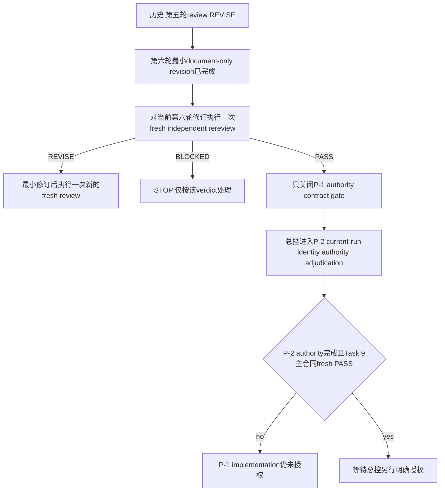

浩哥

# G6 Task 9-P Prerequisite Authority Contract

> **Authority status:** prerequisite drafting only。本文不授权 implementation，不修改 Task 9 合同，不改变 PI-500，也不把缺失的 current-run identity 当成既成事实。P-1 的 filesystem authority 与 failure precedence 唯一上游权威为已 PASS 并冻结的 [`Task 9-P/P-1 validator authority adjudication`](g6-task9p-validator-authority-adjudication.md)。

**Goal:** 对 G6 Task 9 所需的两个 frozen-owner prerequisite 作唯一裁决：P-1 冻结为可实施的 Task 7 public artifact construction authority，并完整吸收 A1——Task 6 validator 对 repository 两个固定文件的读取是 canonical authority；P-1 builder 与 P-1-owned helpers 禁止 direct I/O，仅允许恰一次 validator 调用所触发的该 transitive I/O。P-2 因缺少可证明 current execution 与独立 run manifest 同一性的 public owner而保持 `BLOCKED`。

**非目标:** 不重开或修改 Task 6 validator、其 signature、固定文件选择或读取顺序；不向 P-1 新增 source authority input/port；不允许 builder/P-1 helper 直接 `Path`、`open`、read、filesystem probe 或其他 ambient authority；不修改 adjudication、production、tests、PI-500；不授权 implementation。

**Evidence boundary:** 本合同的历史证据背景包含既有 owner tests；第六至第七轮 document-only 修订与fresh logical reviews只来自本文件、[`Task 9-P/P-1 validator authority adjudication`](g6-task9p-validator-authority-adjudication.md)、[`engine/f09/trace.py`](../engine/f09/trace.py)、[`engine/f09/canonical_json.py`](../engine/f09/canonical_json.py)、[`engine/f09/artifacts.py`](../engine/f09/artifacts.py)、[`engine/f09/errors.py`](../engine/f09/errors.py) 与现有 [`tests/f09/test_artifact_lifecycle.py`](../tests/f09/test_artifact_lifecycle.py) 的静态读取及纯文档自洽检索。本轮未修改tests，未运行 Python、pytest、Git 或 GitHub mutation；因此不把历史 test evidence 重新声明为本轮验证结果。

---

## 1. 总裁决

**Gate：`BLOCKED`。**

| Prerequisite | 当前 Gate | 对 Task 9 缺口的影响 |
|---|---|---|
| P-1 Task 7 artifact construction authority | `PASS` | 第七轮 document-only allowlist completeness 修订已通过fresh logical independent rereview；仅关闭P-1 authority contract gate，不得实施P-1。 |
| P-2 Task 8 non-production feedback authority | `BLOCKED` | 当前类型只能验证 caller 已持有的 run graph，不能证明该 graph 是 Task 9 current execution；不得冻结一个会虚构 `run_id`、`RUN_SNAPSHOT` 或 manifest relation 的 builder。 |
| Task 9 contract amendment | `STILL_OPEN` | P-1与P-2前置authority尚未全部完成，且Task 9主合同尚无fresh PASS；不得修改Task 9主合同。 |

当前 prerequisite 状态计数固定为：`PASS=1`、`REVISE=0`、`BLOCKED=1`、`STILL_OPEN=1`；Task 9-P 总 Gate 另行固定为 `BLOCKED`。历史状态不得覆盖当前 Gate：原作者曾自裁决 P-1 `PASS`；第一至第五轮fresh reviews均给出已消费的`REVISE`或`BLOCKED`；第六轮修订的fresh rereview发现public callable allowlist completeness缺口，随后第七轮最小修订已通过fresh logical independent rereview。[`validator authority adjudication`](g6-task9p-validator-authority-adjudication.md) 独立文件仍为其自身范围内的 `PASS`。当前P-1 `PASS`只来自第七轮fresh logical review，不扩大为implementation、Task 9或P-2结论。

当前动作仅为由总控进入P-2 producer-owned current-run identity authority adjudication；禁止P-1 implementation、P-2 implementation、Task 9主合同、production或tests变更。P-2的 `BLOCKED` 是证据充分的fail-closed裁决，不是开放设计邀请。

---

## 2. 不可变的全局边界

1. Task 9 phase order仍为：

```text
REQUEST_PREFLIGHT
→ EVIDENCE_READ
→ DECISION
→ TRACE
→ STATEMENT_SET
→ ARTIFACT_AUTHORITY_BUILD
  → SIX_EXACT_TOP_LEVEL_GUARDS
  → INTERNAL_EXACT_GRAPH_PROJECTION_VALIDATION
  → STRICT_SUCCESS_GATE
  → P1_EXCLUSIVE_CHECKS
  → PROJECTION_CONSTRUCTION
→ ARTIFACT
→ FEEDBACK
```

六个 top-level exact type guards 是 builder 内唯一允许位于 [`validate_statement_projection()`](../engine/f09/trace.py:874) 之前的检查；`INTERNAL_EXACT_GRAPH_PROJECTION_VALIDATION` 随后执行且不可分离，不是 caller 可先行执行并携入结果的独立 phase。nested shape、identity、source-ref、digest、declaration、statement member 与 card predicate 均不得前移到 validator 之前。

2. P-1 builder 必须对本次传入的 exact graph 内部调用且恰好调用一次 [`validate_statement_projection()`](../engine/f09/trace.py:874)；不得接受 caller 携入的 validation result/token，也不得在 validator strict success 与 P-1-exclusive checks 全部成功前 canonicalize projection。现有 validator 在 [`statement.card_identity_refs`](../engine/f09/trace.py:163) 上只冻结 exact tuple shape与逐项遍历；空 tuple 会使相关 `any(...)` predicate vacuous pass。现有 producer 在 [`_build_standard_statement()`](../engine/f09/trace.py:463) 生成单元素 tuple 是 producer fact，不是 validator proof。
3. A1 authority 固定：builder 本体及 P-1-owned helper call graph 均无 direct I/O，不读 ambient clock，不扫描 prior manifests，不生成 attempt ID。唯一例外是恰一次 validator 调用经 Task 6 frozen call graph 对以下 closed set 的 transitive fixed-file reads：[`engine/contracts/12-real-world-function-evidence-cards-v1.md`](../engine/contracts/12-real-world-function-evidence-cards-v1.md) 与 [`mapping/real-world-function-evidence-cards-v1.yaml`](../mapping/real-world-function-evidence-cards-v1.yaml)。builder 不拥有、不选择、不注入、不替换、不缓存这些 authority，不得提供替代 root、依赖 cwd、retry、fallback、glob 或目录扫描。
4. P-1 不调用其他模块 private helper，包括 [`_canonical_value()`](../engine/f09/trace.py:240)、[`_statement_content_digest()`](../engine/f09/trace.py:298)、[`_statement_set_content_digest()`](../engine/f09/trace.py:374) 与 [`_idempotency_key_material()`](../engine/f09/feedback.py:682)。
5. 唯一 production JCS编码器是 [`canonicalize_bounded_jcs()`](../engine/f09/canonical_json.py:241)。`source_digest`、`schema_versions_digest`、`contract_digest` 唯一使用 [`bounded_jcs_sha256()`](../engine/f09/canonical_json.py:251)，并承认该 helper 每次均 transitive 调用一次 [`canonicalize_bounded_jcs()`](../engine/f09/canonical_json.py:241)。`canonical_key_digest` 按 3.6 的 C2 唯一算法直接复用一次 canonical key preimage bytes，不重复调用 production canonicalizer。
6. 禁止 `pickle`、普通 `json.dumps`、`asdict`、`repr`、`__dict__`、`vars`、`dataclasses.fields`、`__dataclass_fields__` 或任何反射式 serialization。
7. P-2 与 Task 9 feedback path均不得调用 [`evaluate_learning_eligibility()`](../engine/f09/feedback.py:2031)、[`validate_learning_eligibility()`](../engine/f09/feedback.py:2091)、feedback ingest、rule/weight writer或iteration trigger。

---

## 3. P-1：Task 7 artifact construction authority

### 3.1 唯一 production owner 与 public exports

Owner固定为 [`engine/f09/artifacts.py`](../engine/f09/artifacts.py)。模块新增且仅新增以下 public surface；仓库不存在 [`engine/f09/__init__.py`](../engine/f09/) re-export owner，因此不新增 package barrel。

```python
@dataclass(frozen=True)
class ArtifactOperationAuthority:
    projections: Mapping[str, bytes]
    key: IdempotencyKey


def build_artifact_operation_authority(
    package: NormalizedEvidencePackage,
    decision: DecisionEvaluationResult,
    trace: TraceEnvelope,
    statement_set: StatementSet,
    *,
    normative_contract_ref: VersionedObjectRef,
    machine_appendix_ref: VersionedObjectRef,
) -> ArtifactOperationAuthority: ...
```

Exact DTO fields、types与order仅为 `projections: Mapping[str, bytes]`, `key: IdempotencyKey`。Exact return type为 [`ArtifactOperationAuthority`](../engine/f09/artifacts.py)。`projections` 的 runtime concrete value必须是 fresh `MappingProxyType`，其底层 fresh `dict` 不得泄露；value必须是 immutable `bytes`。禁止返回 caller-owned mapping、mutable dict或自定义有副作用 mapping。

[`ProjectionValidationResult`](../engine/f09/trace.py:189) 不是 DTO field、不是参数、不是 semantic material，也不是任何 digest/key preimage。它仅是 builder 对当前 exact inputs 调用 validator 后获得的局部非授权返回值；caller 无法携入、借用或重放 validation token。

[`IdempotencyKey.operation`](../engine/f09/artifacts.py:49) 的 closed literal domain只新增 `PROJECT_ARTIFACT_SET`。P-1 key固定使用该 literal；不得复用 `RENDER_REPORT`、`PROJECT_INDEX` 或 `PROJECT_RECORDS` 来代表三角色原子操作。

### 3.2 Minimal validator-first 调用顺序与 exclusive checks

Builder 必须按以下唯一顺序执行；任一失败均不得开始 projection canonicalization、计算 projection digest、构造 key、返回 partial authority、执行 write/filesystem probe或其他 side effect：

1. 按 builder signature 参数顺序执行六个 exact top-level guards，且 guard 只读取 runtime type identity，不解引用 nested field：
   1. `type(package) is NormalizedEvidencePackage`，canonical class 来源为 [`NormalizedEvidencePackage`](../engine/f09/evidence.py:110)；
   2. `type(decision) is DecisionEvaluationResult`，canonical class 来源为 [`DecisionEvaluationResult`](../engine/f09/decision.py:448)；
   3. `type(trace) is TraceEnvelope`；
   4. `type(statement_set) is StatementSet`；
   5. `type(normative_contract_ref) is VersionedObjectRef`；
   6. `type(machine_appendix_ref) is VersionedObjectRef`。
   subclass、duck type、protocol-compatible substitute 均失败。六个 guard 的 exact error type/code/path 冻结于 3.7 G1–G6。
2. 六个 guards 全部成功后，builder 对同一批对象 identity 执行以下 exact public call，调用次数恰为 `1`：

```python
projection_validation = validate_statement_projection(
    statement_set,
    trace,
    decision,
    package,
    normative_contract_ref=normative_contract_ref,
    machine_appendix_ref=machine_appendix_ref,
)
```

3. validator 抛任一现有 [`F09Error`](../engine/f09/errors.py:4) 时，同一异常对象原样传播：class、`issue_code`、`field_path`、`diagnostic` 与 object identity 均不变；不包装、不重试、不继续。validator 抛非 [`F09Error`](../engine/f09/errors.py:4) 异常时也原样传播，不把未知故障伪装成 projection invalid。
4. validator 正常返回后，先检查 `type(projection_validation) is ProjectionValidationResult`，再检查 strict success：`projection_validation.valid is True` 且 `projection_validation.detected_issues == ()`。non-exact return，包括 subclass、裸布尔、`None`、tuple、mapping 或其他 object；exact result 但 `valid is not True`；issues 非空；malformed success fields——全部统一抛 [`F09IntegrityError`](../engine/f09/errors.py:21)，`issue_code=ARTIFACT.PROJECTION_VALIDATION_FAILED`，`field_path=/artifact_authority/projection_validation`，固定 `diagnostic=statement projection validation did not return strict success`。不得把 issues、对象 repr、路径、文件内容或 ambient data放入 `diagnostic`；[`F09Error`](../engine/f09/errors.py:4) 无 structured details，禁止发明或保存 `details`/`detected_issues`。
5. 仅在 strict success 后执行 P-1-exclusive checks，顺序固定如下：
   1. `P1-CARD`只对 `statement_set.statements` 按producer order逐项检查一个且仅一个predicate：`type(statement.card_identity_refs) is tuple and len(statement.card_identity_refs) == 1`。它只闭合validator strict success未证明的material-container cardinality；不得读取或重新验证唯一成员的字段，不拥有card ID、caller ref identity、field path、source refs、evaluator/declaration/runtime status、nested tuple shapes或业务语义。唯一成员后续只作为“已由strict-success validator证明语义有效”的material输入。
   2. `P1-MATERIAL`再检查artifact role/schema/root/payload exact material可由frozen inputs完整显式构造、nested declaration与digest-binding可按3.4 closed variants/exact keys展开、projection digests/key preimages具备全部material。由于closed-variant serializer需要运行时discriminant，`P1-MATERIAL`还单独要求唯一card成员满足 `type(card_ref) is CardIdentityRef`；这只是serialization type closure，不是Task 6 semantic revalidation，不检查该对象的任何字段语义。

   `P1-CARD`失败唯一抛 [`F09ContractError`](../engine/f09/errors.py:29)，`issue_code=ARTIFACT.AUTHORITY_INVALID`、`field_path=/artifact_authority/statements/{zero_based_ordinal}/card_identity_refs`、`diagnostic=artifact authority requires exactly one card identity ref material container per statement`。`P1-MATERIAL`的CardIdentityRef discriminant或其他closed material失败统一抛 [`F09ContractError`](../engine/f09/errors.py:29)，`issue_code=ARTIFACT.AUTHORITY_INVALID`、`field_path=/artifact_authority/projection_material`、`diagnostic=artifact authority projection material is not serialization-closed`。两者precedence均晚于V1–V6、早于material construction；真实strict-success路径的validator calls=`1`、全调用图 [`bounded_jcs_sha256()`](../engine/f09/canonical_json.py:251) calls=`7`、direct/transitive/total canonicalizer calls=`0/7/7`、两个固定文件各读`1`次；builder在两phase均未开始自己的bounded helper/canonicalizer，且不得产生projection bytes/digest/key/authority/write。Task 6已拥有的card ID、caller ref identity、field path、source refs、evaluator/declaration/runtime status、nested tuple shapes、业务语义、graph identity、digest/shape、declaration consistency与detection order不得复制、前移、重新命名或覆盖。
6. exclusive checks 全部成功后才开始 canonicalization、digest 与 key 构造。不得 second validation、retry 或 local validator substitute。

`package` 是 validator 证明当前 graph package digest binding 所需的精确强类型输入；外部 validation result 完全移除。每个 statement 的 `card_identity_refs` 只由 `P1-CARD`补足exact tuple与len恰为`1`的container closure；producer当前生成恰一card仅是正例来源。唯一成员的semantic validity完全继承validator strict success；只有serializer所需的exact [`CardIdentityRef`](../engine/f09/trace.py:130) runtime type discriminant归`P1-MATERIAL`。

### 3.3 唯一 role顺序与 schema literals

Canonical role tuple固定为：

```python
("REPORT", "STATEMENT_RECORDS", "STATEMENT_INDEX")
```

Projection mapping迭代顺序必须与该tuple一致。三个 projection root的公共字段与literal：

| Role | `artifact_role` | `schema_version` | `contract_version` |
|---|---|---|---|
| REPORT | `REPORT` | `f09.report-projection.v1` | `f09.artifact-projection.v1` |
| STATEMENT_RECORDS | `STATEMENT_RECORDS` | `f09.statement-records-projection.v1` | `f09.artifact-projection.v1` |
| STATEMENT_INDEX | `STATEMENT_INDEX` | `f09.statement-index-projection.v1` | `f09.artifact-projection.v1` |

为冻结role/schema material conversion及P1-N15 seam，future owner必须定义且只按以下exact private signature实现：

```python
def _artifact_role_material(
    role: Literal["REPORT", "STATEMENT_RECORDS", "STATEMENT_INDEX"],
    *,
    field_path: str,
) -> dict[str, JcsValue]: ...
```

module-qualified symbol唯一为 [`engine.f09.artifacts._artifact_role_material()`](../engine/f09/artifacts.py)。参数名/order、`field_path` keyword-only边界、closed Literal输入与返回type均不得变化。返回mapping exact keys仅为`artifact_role`、`schema_version`、`contract_version`，值分别取本节对应row；payload与其他root字段由builder显式组合，不由该helper接收或推导。该helper只做pure bounded material conversion；不调用validator、[`bounded_jcs_sha256()`](../engine/f09/canonical_json.py:251)、[`canonicalize_bounded_jcs()`](../engine/f09/canonical_json.py:241)或I/O。若`type(role) is not str`或role不属于closed tuple，则唯一抛 [`F09ContractError`](../engine/f09/errors.py:29)：`issue_code=ARTIFACT.AUTHORITY_INVALID`、`field_path`原样使用传入的nonblank `field_path`、`diagnostic=artifact authority projection material is not serialization-closed`；不得fallback、包装或返回partial mapping。P1-N15必须以`field_path=/artifact_authority/projection_material`直接module-qualified调用该exact symbol。private symbol不计入public allowlist，不得为测试新增public API。

每份root exact key set均为：

```text
artifact_role
schema_version
contract_version
case_id
track
statement_set_id
statement_set_schema_version
statement_set_content_digest
source_package_ref
normative_contract_ref
machine_appendix_ref
payload
```

`track`编码为 [`RunTrack.value`](../engine/f09/contracts.py:21)。三个digest/ref material均使用下节统一exact representation。

### 3.4 Exact primitive materials

所有object保持为JCS object；所有sequence保持producer order并编码为JCS array。禁止排序statement、evidence refs、relation IDs、source locator IDs、card refs或issue IDs。

`DigestRef` exact material：

```text
algorithm
canonicalization
value
```

`DigestPresent` exact material（exact runtime type必须为 [`DigestPresent`](../engine/f09/trace.py:36)，exact key set如下）：

```text
status <- PRESENT
digest -> DigestRef material
```

`DigestMissing` 是受支持的第二个且最后一个 closed variant；不拒绝、不写“其他variant类似处理”。其 exact runtime type必须为 [`DigestMissing`](../engine/f09/trace.py:42)，exact key set如下：

```text
status   <- MISSING
digest   <- null
issue_id <- binding.issue_id
```

JSON object成员顺序不具语义；上述每个variant的key set必须exact，不得缺失、额外或把 `issue_id` 放入 `DigestPresent`。unknown exact type或任一variant material closure缺失在strict success后归 `P1-MATERIAL`，其失败与调用/read约束见3.7。

为使该closed conversion及P1-N14 seam唯一可调用，future owner必须定义且只按以下exact private signature实现：

```python
def _digest_binding_material(
    binding: DigestPresent | DigestMissing,
    *,
    field_path: str,
) -> dict[str, JcsValue]: ...
```

module-qualified symbol唯一为 [`engine.f09.artifacts._digest_binding_material()`](../engine/f09/artifacts.py)。参数名/order、`field_path` keyword-only边界、输入union与返回type均不得变化。该helper只执行本节两variant的pure bounded material conversion；不调用validator、[`bounded_jcs_sha256()`](../engine/f09/canonical_json.py:251)、[`canonicalize_bounded_jcs()`](../engine/f09/canonical_json.py:241)或I/O。若`type(binding)`既非exact `DigestPresent`亦非exact `DigestMissing`，或所选variant无法按本节exact keys取出closed material，则唯一抛 [`F09ContractError`](../engine/f09/errors.py:29)：`issue_code=ARTIFACT.AUTHORITY_INVALID`、`field_path`原样使用传入的nonblank `field_path`、`diagnostic=artifact authority projection material is not serialization-closed`；不得fallback、包装或返回partial mapping。P1-N14必须以`field_path=/artifact_authority/projection_material`直接module-qualified调用该exact symbol。private symbol不计入public allowlist，不得为测试新增public API。

`VersionedObjectRef` exact material：

```text
object_type
object_id
revision_id
schema_version
contract_version
digest_binding
source_locator_id
captured_at
```

[`FrozenDeclarationRef`](../engine/f09/contracts.py:492) exact material 的 key set、顺序与值来源固定为：

```text
declaration_id              <- ref.declaration_id
declaration_type            <- ref.declaration_type
card_id                     <- ref.card_id
contract_version            <- ref.contract_version
declaration_schema_version <- ref.declaration_schema_version
content_digest              <- ref.content_digest 的 DigestRef exact material:
  algorithm                 <- content_digest.algorithm
  canonicalization          <- content_digest.canonicalization
  value                     <- content_digest.value
```

`FrozenDeclarationBinding` 只支持以下 closed exact variants，并按所列顺序显式构造；禁止通用反射、开放 mapping、runtime field enumeration 或隐式沿用 dataclass 字段：

```text
ResolvedDeclarationBinding:
  presence <- binding.presence
  ref      <- 完整 FrozenDeclarationRef exact material

AbsentDeclarationBinding:
  presence    <- binding.presence
  reason_code <- binding.reason_code

NotApplicableDeclarationBinding:
  presence    <- binding.presence
  reason_code <- binding.reason_code

UnavailableDeclarationBinding:
  presence    <- binding.presence
  reason_code <- binding.reason_code
  issue_ids   <- binding.issue_ids，保持 producer order

UnresolvableDeclarationBinding:
  presence      <- binding.presence
  attempted_ref <- 完整 FrozenDeclarationRef exact material
  reason_code   <- binding.reason_code
  issue_ids     <- binding.issue_ids，保持 producer order
```

对应类型仅为 [`ResolvedDeclarationBinding`](../engine/f09/contracts.py:507)、[`AbsentDeclarationBinding`](../engine/f09/contracts.py:518)、[`NotApplicableDeclarationBinding`](../engine/f09/contracts.py:526)、[`UnavailableDeclarationBinding`](../engine/f09/contracts.py:534)、[`UnresolvableDeclarationBinding`](../engine/f09/contracts.py:547)。unknown exact type或 material closure缺失在 validator strict success 后归 P-1-exclusive structural failure；不得把 validator 已覆盖的 declaration consistency drift 重命名为 builder failure。

`CardIdentityRef` exact material：serializer在`P1-MATERIAL`仅用 `type(card_ref) is CardIdentityRef` 选择该closed variant；该type check不重新验证以下字段，字段语义均视为已由validator strict success证明。

```text
card_identity_ref_id
card_id
normative_contract_ref
machine_appendix_ref
field_path
source_field_state
evaluator_state
declaration_status
runtime_capability_status
source_locator_ids
issue_ids
```

`StandardStatement` full material必须显式包含且仅包含 [`StandardStatement`](../engine/f09/trace.py:146) 的全部public fields，顺序固定为：

```text
statement_id
statement_revision_id
statement_schema_version
case_id
statement_set_id
track
semantic_scope
domain
statement_text
display_section
decision_result_id
action_id
basis_record_ids
evidence_refs
relation_ids
source_locator_ids
card_identity_refs
confidence_snapshot_ref
output_precision_binding
validation_plan_binding
feedback_policy
content_digest
integrity
issue_ids
```

`basis_record_ids` 按其frozen tuple成员顺序编码；enum使用 `.value`；nested refs、card refs、declaration bindings与digests必须使用本节exact material。禁止只投影statement ID而丢失statement semantics。任一合法重建后的 [`FrozenDeclarationRef`](../engine/f09/contracts.py:492) 六个字段或 nested digest 三个字段变化，必须改变包含该 binding 的 STATEMENT_RECORDS bytes 与 RAW digest，并继续改变 `source_digest` 与 `canonical_key_digest`；若该 material 同时出现在 REPORT 或 STATEMENT_INDEX 的 frozen payload 字段，则对应 projection bytes/digest 同步敏感，未承载该 material 的 payload 不得伪造依赖。

### 3.5 三份 exact payload与 provenance

三个projection payload的共同字段来源逐字段冻结如下：

- `generated_at` 必须且只能取 `statement_set.generated_at`，并满足 exact equality；不得取ambient clock、`trace.created_at`、`decision.produced_at`或caller另传时间。
- `publication_state` 必须且只能取 `statement_set.publication_state`，并满足 exact equality；不得从trace integrity、decision structural validity或其他状态推导、映射、覆盖。

这两个字段均属于三份最终projection bytes，因此任何合法重建后 `statement_set.generated_at` 或 `statement_set.publication_state` 的变化必须改变三个projection digests、`source_digest`与`canonical_key_digest`。builder signature不得新增clock、`generated_at`或`publication_state`参数。

#### REPORT payload

Exact key set与顺序：

```text
generated_at
publication_state
statement_count
sections
```

- `statement_count` 必须编码为十进制字符串，不使用JCS number。
- `sections` 是按statement producer order的一一对应array；每个entry exact keys：

```text
statement_id
statement_revision_id
domain
semantic_scope
display_section
statement_text
feedback_policy
integrity
issue_ids
content_digest
```

#### STATEMENT_RECORDS payload

Exact key set：

```text
generated_at
publication_state
statements
```

`statements` 为每个statement的full material，保持producer order。

#### STATEMENT_INDEX payload

Exact key set：

```text
generated_at
publication_state
entries
```

每个entry与statement一一对应且保持producer order，exact keys：

```text
ordinal
statement_id
statement_revision_id
statement_schema_version
domain
semantic_scope
display_section
feedback_policy
integrity
content_digest
```

`ordinal` 从 `1` 开始并编码为十进制字符串。禁止number、offset推断或重新排序。

三份root分别且只调用一次 [`canonicalize_bounded_jcs()`](../engine/f09/canonical_json.py:241)，产出UTF-8、无BOM、bounded RFC 8785/JCS `bytes`。canonicalizer的typed错误原样传播；builder不得fallback。

### 3.6 Digest与 key preimages

先对三份最终bytes逐一计算：

```python
DigestRef("sha256", "RAW-UTF8", sha256(projection_bytes).hexdigest())
```

`source_digest` 是以下exact JCS material的 [`bounded_jcs_sha256()`](../engine/f09/canonical_json.py:251)：

```text
operation = PROJECT_ARTIFACT_SET
case_id
track
statement_set_id
statement_set_content_digest
projection_digests = ordered array of:
  artifact_role
  digest
```

`schema_versions_digest` exact JCS preimage：

```text
authority_schema_version = f09.artifact-operation-authority.v1
projection_contract_version = f09.artifact-projection.v1
projection_schemas = ordered array of:
  artifact_role
  schema_version
statement_schema_version
trace_schema_version
```

`contract_digest` exact JCS preimage：

```text
normative_contract_ref
machine_appendix_ref
decision_contract_ref:
  normative_contract_path
  machine_appendix_path
  contract_version
  content_digest
```

其中 `decision.contract_ref` 的字段必须按 [`ContractVersionRef`](../engine/f09/contracts.py:69) declaration order显式构造；四个字段均必须是nonblank string，禁止把path字段解释为可读取文件的授权，也不得反射。

最终先构造zero-digest candidate key：

```python
IdempotencyKey(
    operation="PROJECT_ARTIFACT_SET",
    case_id=statement_set.case_id,
    track=statement_set.track,
    source_digest=source_digest,
    schema_versions_digest=schema_versions_digest,
    contract_digest=contract_digest,
    statement_set_id=statement_set.statement_set_id,
    feedback_id=None,
    canonical_key_digest=DigestRef("sha256", "RFC8785-JCS-UTF8", "0" * 64),
)
```

`canonical_key_digest` 的self-excluded exact JCS preimage：

```text
operation
case_id
track
source_digest
schema_versions_digest
contract_digest
statement_set_id
feedback_id
```

`canonical_key_digest` 不调用 [`bounded_jcs_sha256()`](../engine/f09/canonical_json.py:251)。唯一算法为：builder对上述self-excluded material直接调用 [`canonicalize_bounded_jcs()`](../engine/f09/canonical_json.py:241) 恰一次，得到fresh immutable `canonical_key_material_bytes`；production candidate value为 `sha256(canonical_key_material_bytes).hexdigest()`。C2随后复用同一bytes，由test-injectable但production无共享digest实现的独立SHA-256重算一次并作constant exact string equality；C2禁止再次canonicalize、禁止再次走 [`bounded_jcs_sha256()`](../engine/f09/canonical_json.py:251)、禁止重建preimage。最终key只替换 `canonical_key_digest`。任何projection byte变化必改变对应RAW digest、`source_digest`及`canonical_key_digest`；任何schema或contract material变化必须改变相应digest及canonical key。

#### 3.6.1 完整 exact call graph

计数口径固定：`direct canonicalizer`只计builder直接调用 [`canonicalize_bounded_jcs()`](../engine/f09/canonical_json.py:241)；`transitive canonicalizer`计每次 [`bounded_jcs_sha256()`](../engine/f09/canonical_json.py:251) 内部引起的调用。validator strict-success自身精确执行7次 [`bounded_jcs_sha256()`](../engine/f09/canonical_json.py:251)，源码顺序与调用点冻结为：decision result经 [`_canonical_digest()`](../engine/f09/trace.py:219) 1次；statement identity经 [`_statement_identity()`](../engine/f09/trace.py:270) 1次；package经 [`_canonical_digest()`](../engine/f09/trace.py:219) 1次；statement revision经 [`_statement_revision_digest()`](../engine/f09/trace.py:285) 1次；statement content经 [`_statement_content_digest()`](../engine/f09/trace.py:298) 1次；statement-set identity经 [`_statement_set_identity()`](../engine/f09/trace.py:345) 1次；statement-set content经 [`_statement_set_content_digest()`](../engine/f09/trace.py:374) 1次。此前遗漏的是在identity comparison之前执行的statement identity digest；这7次各产生1次transitive canonicalizer调用。builder成功路径增量保持不变：三个projection roots direct `3`；source/schema/contract preimages各 [`bounded_jcs_sha256()`](../engine/f09/canonical_json.py:251) 1次，共builder bounded helper `3`与transitive `3`；canonical key preimage direct `1`；C2只对既有bytes执行两套SHA-256实现比较，不增加canonicalizer/helper调用。

因此完整S1/C2 accounting唯一为：validator calls=`1`；全调用图 [`bounded_jcs_sha256()`](../engine/f09/canonical_json.py:251) calls=`10`；direct/transitive/total [`canonicalize_bounded_jcs()`](../engine/f09/canonical_json.py:241) calls=`4/10/14`；fixed-file reads=两个文件各`1`次。projection RAW digests与C2两次plain SHA-256不计入bounded helper或canonicalizer。

### 3.7 完整 failure precedence 与 ownership

下表是唯一 production precedence；同一路径只报告最早gate。`BJS`为全调用图 [`bounded_jcs_sha256()`](../engine/f09/canonical_json.py:251) 次数；`D/T/ΣC`依次为direct/transitive/total canonicalizer次数。表中 `P1-CARD` 与 `P1-MATERIAL` 的 `7` 次 BJS、`0/7/7` canonicalizer及两文件各一次读取描述真实 public builder strict-success validator path。4.5 中明确写作 `strict-success validator seam` 或 `zero-internal-call validator seam` 的row是受控collaborator seam：它只证明P-1 phase ownership、precedence与后续零工作，其 `0` 次validator-internal BJS/canonicalizer/read不得解释为真实strict-success production accounting，也不得反向覆盖本表。V1/V2对真实validator内部已发生次数取决于其Task 6抛出点，故合同verification evidence只能使用4.5冻结的零内部调用validator seam；不得为任意真实异常路径伪造统一计数。所有real-validator rows必须按实际failure phase逐调用点累加，禁止机械统一增量：top-level guards与zero-internal helper/AST seams保持零；identity comparison前已发生decision result与statement identity两次digest；package digest、fixed reads及后续四个identity/content digests仅在控制流实际到达时计入。

4.5 的P1-N14与P1-N15另行冻结为**isolated helper seam**：测试不调用public builder，而在同一owner测试模块 [`tests/f09/test_artifact_lifecycle.py`](../tests/f09/test_artifact_lifecycle.py) 中通过module-qualified private symbol直接调用未来 [`engine/f09/artifacts.py`](../engine/f09/artifacts.py) 的P-1 private material helper。该private helper仅是future implementation detail，不是public export、不得跨测试模块复用；seam只测试closed-variant/type material rejection，因此exact V=`0`、BJS=`0`、D/T/ΣC=`0/0/0`、fixed reads=`0/0`。除这两个明确列出的isolated helper rows外，普通P1-MATERIAL证据必须走public builder并服从本节真实path accounting；不得把普通helper seam写成zero-internal seam。

| Phase | Exact condition | Owner/result | Exact code/path | V | BJS | D/T/ΣC | Filesystem reads | 后续material/canonicalization |
|---|---|---|---|---:|---:|---:|---|---|
| G1–G6 | 对应exact top-level guard失败 | P-1；[`F09ContractError`](../engine/f09/errors.py:29) | `ARTIFACT.AUTHORITY_INVALID`；对应top-level path | 0 | 0 | 0/0/0 | 0 | 0 |
| V1 | zero-internal-call validator seam抛既有 [`F09Error`](../engine/f09/errors.py:4) | Task 6异常对象原样传播 | validator-owned | 1 | 0 | 0/0/0 | 0 | 0 |
| V2 | zero-internal-call validator seam抛非 [`F09Error`](../engine/f09/errors.py:4) | 原异常源原样传播 | 原异常语义 | 1 | 0 | 0/0/0 | 0 | 0 |
| V3–V6 | zero-internal-call validator seam返回non-exact/非strict success | P-1 wrapper；[`F09IntegrityError`](../engine/f09/errors.py:21) | `ARTIFACT.PROJECTION_VALIDATION_FAILED`；`/artifact_authority/projection_validation` | 1 | 0 | 0/0/0 | 0 | 0 |
| P1-CARD | strict success后任一statement的`card_identity_refs` runtime type不恰为tuple，或其len不恰为1 | P-1 exclusive；[`F09ContractError`](../engine/f09/errors.py:29) | `ARTIFACT.AUTHORITY_INVALID`；`/artifact_authority/statements/{zero_based_ordinal}/card_identity_refs`；`artifact authority requires exactly one card identity ref material container per statement` | 1 | 7 | 0/7/7 | 两固定文件各1次 | 0 |
| P1-MATERIAL | strict success后唯一card成员runtime type不恰为exact [`CardIdentityRef`](../engine/f09/trace.py:130)，或role/schema/root/payload、declaration、digest-binding closed material不能完整显式构造 | P-1 serialization closure；[`F09ContractError`](../engine/f09/errors.py:29) | `ARTIFACT.AUTHORITY_INVALID`；`/artifact_authority/projection_material`；`artifact authority projection material is not serialization-closed` | 1 | 7 | 0/7/7 | 两固定文件各1次 | 0 |
| C1-REPORT | REPORT root direct canonicalizer拒绝material | canonicalizer typed error原样传播 | canonicalizer-owned | 1 | 7 | 1/7/8 | 两固定文件各1次 | 无authority/write；后续roots/digests/key为0 |
| C1-RECORDS | REPORT成功后，STATEMENT_RECORDS root direct canonicalizer拒绝material | canonicalizer typed error原样传播 | canonicalizer-owned | 1 | 7 | 2/7/9 | 两固定文件各1次 | 无authority/write；后续root/digests/key为0 |
| C1-INDEX | 前两roots成功后，STATEMENT_INDEX root direct canonicalizer拒绝material | canonicalizer typed error原样传播 | canonicalizer-owned | 1 | 7 | 3/7/10 | 两固定文件各1次 | 无authority/write；后续digests/key为0 |
| D1-SOURCE | 三roots成功后，source preimage的bounded helper/transitive canonicalizer拒绝material | canonicalizer typed error原样传播 | canonicalizer-owned | 1 | 8 | 3/8/11 | 两固定文件各1次 | 无authority/write；后续digests/key为0 |
| D2-SCHEMA | source digest成功后，schema preimage的bounded helper/transitive canonicalizer拒绝material | canonicalizer typed error原样传播 | canonicalizer-owned | 1 | 9 | 3/9/12 | 两固定文件各1次 | 无authority/write；后续digests/key为0 |
| D3-CONTRACT | source/schema成功后，contract preimage的bounded helper/transitive canonicalizer拒绝material | canonicalizer typed error原样传播 | canonicalizer-owned | 1 | 10 | 3/10/13 | 两固定文件各1次 | 无authority/write；key为0 |
| K1 | canonical key preimage direct canonicalizer拒绝material | canonicalizer typed error原样传播 | canonicalizer-owned | 1 | 10 | 4/10/14 | 两固定文件各1次 | 无authority/write；C2未执行 |
| C2 | 两套plain SHA-256对同一canonical key bytes结果不一致 | P-1；[`F09IntegrityError`](../engine/f09/errors.py:21) | `IDEMPOTENCY.DIGEST_MISMATCH`；`/artifact_authority/key/canonical_key_digest` | 1 | 10 | 4/10/14 | 两固定文件各1次 | 无authority/write；不再canonicalize |
| S1 | 全部成功 | P-1；exact [`ArtifactOperationAuthority`](../engine/f09/artifacts.py) | 不适用 | 1 | 10 | 4/10/14 | 两固定文件各1次 | 返回fresh authority；无write |

V3–V6 wrapper的 `diagnostic` 固定为 `statement projection validation did not return strict success`。validator issues仅作为局部strict-success判定输入，不得保存或改写。`P1-CARD`可达性只由empty tuple对现有validator逐项遍历vacuous pass证明，ownership严格限于tuple exact type与len恰为1；`P1-MATERIAL`可达性来自strict success不蕴含artifact serialization closure，其中exact [`CardIdentityRef`](../engine/f09/trace.py:130)仅作closed-variant discriminant。两者均不得重开Task 6 semantic authority。禁止把任一失败转成空mapping、partial DTO、issue list或布尔返回。

---

## 4. P-1 closed implementation write set与验证合同

### 4.1 Closed write set

仅允许：

- Modify [`engine/f09/artifacts.py`](../engine/f09/artifacts.py)
- Modify [`tests/f09/test_artifact_lifecycle.py`](../tests/f09/test_artifact_lifecycle.py)

禁止修改 [`engine/f09/canonical_json.py`](../engine/f09/canonical_json.py)、[`engine/f09/trace.py`](../engine/f09/trace.py)、[`engine/f09/decision.py`](../engine/f09/decision.py)、[`engine/f09/feedback.py`](../engine/f09/feedback.py)、Task 9 application、Task 10 matrix及其他文件。

### 4.2 Focused与regression selectors

P-1 implementation获得另行授权后，focused selector固定为：

```text
pytest tests/f09/test_artifact_lifecycle.py -q
```

Regression selector固定为：

```text
pytest tests/f09/test_trace_contract.py tests/f09/test_artifact_lifecycle.py tests/f09/test_feedback_eligibility.py -q
```

本文未运行这些命令；它们是未来evidence gate，不是当前完成声明。

### 4.3 Exact AST与 public allowlist gates

Future tests必须机械冻结：

1. public frozen dataclass shape gate新增且只新增：
   - `ArtifactOperationAuthority: (projections, key)`，并逐项断言exact type hints为 `Mapping[str, bytes]`, `IdempotencyKey`。
2. 禁止用“4→5”或任何裸数量代表public callable surface。当前 [`engine/f09/artifacts.py`](../engine/f09/artifacts.py) 已有resolver、canonicalizer、digest、writer、inspection、retry与lifecycle coordinator；P-1后模块级public function exact allowlist必须为：

```text
resolve_artifact_operation_root
canonicalize_artifact_records
digest_artifact_records
write_artifact_set
inspect_artifact_set
retry_artifact_set
coordinate_artifact_operation
build_artifact_operation_authority
provision_verified_run_manifest_fixture_v1
validate_run_artifact_manifest_v1
inspect_run_artifact_set_v1
coordinate_run_artifact_set_v1
reconcile_run_artifact_set_v1
```

   相对P-1 construction owner既有surface新增且仅新增 `build_artifact_operation_authority`；已冻结的run-manifest public surface（fixture、verifier、inspection、coordinate与reconcile）必须保留在模块级allowlist内，不得删除、重命名、漏计或以P-1 implementation替代。测试应从模块AST提取非underscore顶层function names并与该13-name allowlist exact equality。
3. [`build_artifact_operation_authority()`](../engine/f09/artifacts.py) signature必须逐参数名、kind、order与annotation冻结；其中不存在 `projection_validation`、clock、`generated_at`或`publication_state`参数。
4. [`IdempotencyKey.operation`](../engine/f09/artifacts.py:49) literal count从9增为10，唯一新增member是 `PROJECT_ARTIFACT_SET`。
5. Required projection role count仍严格为3，顺序严格为 `REPORT`, `STATEMENT_RECORDS`, `STATEMENT_INDEX`。
6. builder必须直接调用public [`validate_statement_projection()`](../engine/f09/trace.py:874) 恰好一次，使用exact positional graph与两个exact keyword refs；AST与spy同时证明无alias token入口、无重试、无本地validator复制，并冻结G1–G6→V1–V6→P1→C1/C2/S1顺序。
7. production AST禁止出现：`pickle`、`json`、`asdict`、`repr`、`__dict__`、`vars`、`dataclasses.fields`、`__dataclass_fields__`，以及从 [`trace.py`](../engine/f09/trace.py) 或 [`feedback.py`](../engine/f09/feedback.py) import任何underscore-prefixed helper。
8. builder函数体与P-1-owned helpers AST禁止 direct I/O/ambient authority：`open`、`Path`、任何read/write filesystem API、`os` mutation、`uuid`、`time`、`datetime`、`subprocess`、`socket`、`requests`、`tools`。spy必须以validator调用边界区分owner，并证明 observed reads只发生于validator期间且只指向 [`engine/contracts/12-real-world-function-evidence-cards-v1.md`](../engine/contracts/12-real-world-function-evidence-cards-v1.md) 与 [`mapping/real-world-function-evidence-cards-v1.yaml`](../mapping/real-world-function-evidence-cards-v1.yaml)：strict success每个文件各一次；invalid/exception保留 [`_card_source_ref_valid()`](../engine/f09/trace.py:453) 布尔短路，reads可为该固定集合的顺序前缀；任何路径无retry或额外read。不得错误断言所有失败路径必读两文件。
9. 测试中每个canonical material helper必须有exact key-set assertion及逐字段sensitivity assertion，含 [`FrozenDeclarationRef`](../engine/f09/contracts.py:492) 与 Resolved/Unresolvable nested展开；禁止只做snapshot字符串比较。

### 4.4 Focused fixture/oracle rule

Focused tests的正例必须通过public producers构造完整 graph：[`build_f09_evidence_package()`](../engine/f09/evidence.py:355) 产出package，随后调用 [`evaluate_f09()`](../engine/f09/decision.py:870)、[`build_trace()`](../engine/f09/trace.py:593)、[`build_statement_set()`](../engine/f09/trace.py:824)，最后只调用builder，由builder内部完成projection validation。允许复用只负责提供规范输入参数的fixture，但不得以手工构造的裸布尔、[`ProjectionValidationResult`](../engine/f09/trace.py:189)、mock success token或预先计算的valid flag替代该producer graph。

对projection bytes、materials、digests与key的expected values，测试必须使用与production helper无共享实现的独立完整逐字段oracle：显式声明exact key order、enum/literal encoding、nested material与preimage，再用public canonicalizer计算expected bytes/digest。禁止expected端调用builder private helper、复制builder内部helper、仅断言自等或只做snapshot字符串比较。negative tests可从真实producer graph做单点mutation，但必须重新形成与目标falsifier一致的输入，并证明失败来自目标边界。

caller tuple ownership不再设置runtime mutation row：exact [`ArtifactOperationAuthority`](../engine/f09/artifacts.py) DTO静态shape仅含immutable `bytes` projection mapping与key，不含statement、statement tuple或caller graph字段；P1-N103 aggregate assembly oracle再证明public builder只返回该exact两字段DTO及fresh immutable projection mapping。两项共同证明authority不保留caller graph，无需且禁止引入`object.__setattr__`等unsafe mutation seam。

### 4.5 P-1 typed verification ledger

IDs在第六轮修订后冻结为连续唯一的P1-N01至P1-N103，共103 rows；旧P1-N66 caller tuple mutation row已删除，原其后rows连续前移一位，并在末尾保留唯一aggregate assembly oracle。不可达graph drift不伪称public input，而通过validator seam作structural mutant。每项只属且只能出现四分类之一：`INPUT`、`STRUCTURAL_MUTANT`、`ORACLE`、`SIDE_EFFECT`。P1-N18至P1-N27均为上游四分类中的`SIDE_EFFECT`：固定、未变的AST gate对受审production owner source-mutant AST作拒绝；mutation只能向 [`build_artifact_operation_authority()`](../engine/f09/artifacts.py) 或其P-1-owned helper AST注入恰一个具体forbidden symbol/member/call，绝不修改测试gate自身的forbidden set，且不执行runtime call/read。下表中的“wrapper统一failure”均exact展开为 [`F09IntegrityError`](../engine/f09/errors.py:21)、`issue_code=ARTIFACT.PROJECTION_VALIDATION_FAILED`、`field_path=/artifact_authority/projection_validation`、`diagnostic=statement projection validation did not return strict success`；“P1-CARD failure”均exact展开为 [`F09ContractError`](../engine/f09/errors.py:29)、`issue_code=ARTIFACT.AUTHORITY_INVALID`、对应statement ordinal的`field_path=/artifact_authority/statements/{zero_based_ordinal}/card_identity_refs`、`diagnostic=artifact authority requires exactly one card identity ref material container per statement`；“P1-MATERIAL failure”均exact展开为 [`F09ContractError`](../engine/f09/errors.py:29)、`issue_code=ARTIFACT.AUTHORITY_INVALID`、`field_path=/artifact_authority/projection_material`、`diagnostic=artifact authority projection material is not serialization-closed`。这些缩写不形成可选结果。明确标注zero-internal-call/strict-success seam的rows按受控seam计数；P1-N14/P1-N15按3.7冻结的同模块module-qualified exact private material helper isolated seam计数；其他真实production phase accounting仍唯一服从3.7。P1-N103是唯一aggregate assembly oracle，只验证DTO聚合装配，不承担projection bytes或digest sensitivity。

| ID | Type | Target predicate | Mutation/input | Seam | Expected phase | Owner/result | exact V | exact BJS | exact direct/transitive/total canonicalizer | exact fixed-file reads |
|---|---|---|---|---|---|---|---:|---:|---:|---|
| P1-N01 | INPUT | `package` exact top-level type | exact `dict`作为`package` | public builder call | G1 | P-1；[`F09ContractError`](../engine/f09/errors.py:29)；`ARTIFACT.AUTHORITY_INVALID`；`/artifact_authority/package` | 0 | 0 | 0/0/0 | contract=0；appendix=0 |
| P1-N02 | STRUCTURAL_MUTANT | strict success要求`valid is True` | exact result的`valid=False` | zero-internal-call validator return | V4 | P-1 wrapper；[`F09IntegrityError`](../engine/f09/errors.py:21)；`ARTIFACT.PROJECTION_VALIDATION_FAILED`；`/artifact_authority/projection_validation` | 1 | 0 | 0/0/0 | contract=0；appendix=0 |
| P1-N03 | STRUCTURAL_MUTANT | strict success要求empty issues | exact result的`detected_issues`含一个item | zero-internal-call validator return | V5 | P-1 wrapper；[`F09IntegrityError`](../engine/f09/errors.py:21)；`ARTIFACT.PROJECTION_VALIDATION_FAILED`；`/artifact_authority/projection_validation` | 1 | 0 | 0/0/0 | contract=0；appendix=0 |
| P1-N04 | INPUT | signature排除portable validation token | 增加`projection_validation` keyword | public builder call | Python signature | Python；`TypeError` | 0 | 0 | 0/0/0 | contract=0；appendix=0 |
| P1-N05 | STRUCTURAL_MUTANT | validator return exact runtime type | 返回裸`True` | zero-internal-call validator return | V3 | P-1 wrapper；[`F09IntegrityError`](../engine/f09/errors.py:21)；`ARTIFACT.PROJECTION_VALIDATION_FAILED`；`/artifact_authority/projection_validation` | 1 | 0 | 0/0/0 | contract=0；appendix=0 |
| P1-N06 | STRUCTURAL_MUTANT | typed validator exception object identity | 抛fixture预置 [`F09Error`](../engine/f09/errors.py:4)实例 | zero-internal-call validator exception | V1 | Task 6；同一exception object原样传播 | 1 | 0 | 0/0/0 | contract=0；appendix=0 |
| P1-N07 | STRUCTURAL_MUTANT | unexpected exception object identity | 抛fixture预置`RuntimeError`实例 | zero-internal-call validator exception | V2 | 原异常源；同一exception object原样传播 | 1 | 0 | 0/0/0 | contract=0；appendix=0 |
| P1-N08 | STRUCTURAL_MUTANT | case identity由validator拥有 | `statement_set.case_id`换成另一nonblank值 | real validator call | V4 | P-1 wrapper；[`F09IntegrityError`](../engine/f09/errors.py:21)；`ARTIFACT.PROJECTION_VALIDATION_FAILED`；`/artifact_authority/projection_validation` | 1 | 2 | 0/2/2 | contract=0；appendix=0 |
| P1-N09 | STRUCTURAL_MUTANT | caller contract ref identity由validator拥有 | `normative_contract_ref.object_id`换成另一nonblank值 | real validator call | V4 | P-1 wrapper；[`F09IntegrityError`](../engine/f09/errors.py:21)；`ARTIFACT.PROJECTION_VALIDATION_FAILED`；`/artifact_authority/projection_validation` | 1 | 3 | 0/3/3 | contract=1；appendix=0 |
| P1-N10 | STRUCTURAL_MUTANT | declaration binding semantics由validator拥有 | `output_precision_binding`换成另一closed variant | real validator call | V4 | P-1 wrapper；[`F09IntegrityError`](../engine/f09/errors.py:21)；`ARTIFACT.PROJECTION_VALIDATION_FAILED`；`/artifact_authority/projection_validation` | 1 | 2 | 0/2/2 | contract=0；appendix=0 |
| P1-N11 | STRUCTURAL_MUTANT | `card_identity_refs` len恰为1 | first statement的`card_identity_refs=()` | zero-internal-call strict-success validator return | P1-CARD | P-1；[`F09ContractError`](../engine/f09/errors.py:29)；`ARTIFACT.AUTHORITY_INVALID`；`/artifact_authority/statements/0/card_identity_refs` | 1 | 0 | 0/0/0 | contract=0；appendix=0 |
| P1-N12 | STRUCTURAL_MUTANT | `card_identity_refs` runtime type恰为tuple | first statement的`card_identity_refs=[]` | zero-internal-call strict-success validator return | P1-CARD | P-1；[`F09ContractError`](../engine/f09/errors.py:29)；`ARTIFACT.AUTHORITY_INVALID`；`/artifact_authority/statements/0/card_identity_refs` | 1 | 0 | 0/0/0 | contract=0；appendix=0 |
| P1-N13 | STRUCTURAL_MUTANT | card serializer discriminant为exact [`CardIdentityRef`](../engine/f09/trace.py:130) | 单成员替换为exact `object` | zero-internal-call strict-success validator return | P1-MATERIAL | P-1 serialization closure；[`F09ContractError`](../engine/f09/errors.py:29)；`ARTIFACT.AUTHORITY_INVALID`；`/artifact_authority/projection_material` | 1 | 0 | 0/0/0 | contract=0；appendix=0 |
| P1-N14 | STRUCTURAL_MUTANT | digest-binding closed variant | 向digest-binding material helper传入一个unknown exact type | 同owner测试模块直接module-qualified调用 [`engine.f09.artifacts._digest_binding_material()`](../engine/f09/artifacts.py)，参数为unknown exact binding与keyword-only `field_path=/artifact_authority/projection_material`；isolated helper seam，不走public builder | P1-MATERIAL helper rejection | P-1 serialization closure；[`F09ContractError`](../engine/f09/errors.py:29)；`ARTIFACT.AUTHORITY_INVALID`；`/artifact_authority/projection_material`；`artifact authority projection material is not serialization-closed` | 0 | 0 | 0/0/0 | contract=0；appendix=0 |
| P1-N15 | STRUCTURAL_MUTANT | role material closed variant | 向role material helper传入一个unknown exact role type | 同owner测试模块直接module-qualified调用 [`engine.f09.artifacts._artifact_role_material()`](../engine/f09/artifacts.py)，参数为unknown exact role与keyword-only `field_path=/artifact_authority/projection_material`；isolated helper seam，不走public builder | P1-MATERIAL helper rejection | P-1 serialization closure；[`F09ContractError`](../engine/f09/errors.py:29)；`ARTIFACT.AUTHORITY_INVALID`；`/artifact_authority/projection_material`；`artifact authority projection material is not serialization-closed` | 0 | 0 | 0/0/0 | contract=0；appendix=0 |
| P1-N16 | STRUCTURAL_MUTANT | REPORT canonicalizer typed rejection传播 | REPORT material注入一个unpaired surrogate | REPORT material helper | C1-REPORT | canonicalizer-owned；[`F09ContractError`](../engine/f09/errors.py:29)原样传播 | 1 | 7 | 1/7/8 | contract=1；appendix=1 |
| P1-N17 | STRUCTURAL_MUTANT | C2 digest equality | 独立SHA-256返回另一lowercase64hex | C2 SHA-256 collaborator | C2 | P-1；[`F09IntegrityError`](../engine/f09/errors.py:21)；`IDEMPOTENCY.DIGEST_MISMATCH`；`/artifact_authority/key/canonical_key_digest` | 1 | 10 | 4/10/14 | contract=1；appendix=1 |
| P1-N18 | SIDE_EFFECT | owner AST不含filesystem symbol `Path` | 向受审P-1 helper AST注入恰一个`Path` name reference | 固定未变的owner AST forbidden-symbol selector检查source-mutant AST | static owner gate | static rejection；direct filesystem authority forbidden | 0 | 0 | 0/0/0 | contract=0；appendix=0 |
| P1-N19 | SIDE_EFFECT | owner AST不含filesystem call `open` | 向受审builder AST注入恰一个`open()` call | 固定未变的owner AST forbidden-call selector检查source-mutant AST | static owner gate | static rejection；direct filesystem authority forbidden | 0 | 0 | 0/0/0 | contract=0；appendix=0 |
| P1-N20 | SIDE_EFFECT | owner AST不含filesystem member `read_bytes` | 向受审P-1 helper AST注入恰一个`.read_bytes` member reference | 固定未变的owner AST forbidden-member selector检查source-mutant AST | static owner gate | static rejection；direct filesystem authority forbidden | 0 | 0 | 0/0/0 | contract=0；appendix=0 |
| P1-N21 | SIDE_EFFECT | owner AST不含filesystem member `read_text` | 向受审P-1 helper AST注入恰一个`.read_text` member reference | 固定未变的owner AST forbidden-member selector检查source-mutant AST | static owner gate | static rejection；direct filesystem authority forbidden | 0 | 0 | 0/0/0 | contract=0；appendix=0 |
| P1-N22 | SIDE_EFFECT | owner AST不含ambient symbol `time` | 向受审builder AST注入恰一个`time` name reference | 固定未变的owner AST forbidden-symbol selector检查source-mutant AST | static owner gate | static rejection；ambient clock forbidden | 0 | 0 | 0/0/0 | contract=0；appendix=0 |
| P1-N23 | SIDE_EFFECT | owner AST不含ambient symbol `datetime` | 向受审builder AST注入恰一个`datetime` name reference | 固定未变的owner AST forbidden-symbol selector检查source-mutant AST | static owner gate | static rejection；ambient clock forbidden | 0 | 0 | 0/0/0 | contract=0；appendix=0 |
| P1-N24 | SIDE_EFFECT | owner AST不含random call `uuid4` | 向受审builder AST注入恰一个`uuid4()` call | 固定未变的owner AST forbidden-call selector检查source-mutant AST | static owner gate | static rejection；random authority forbidden | 0 | 0 | 0/0/0 | contract=0；appendix=0 |
| P1-N25 | SIDE_EFFECT | owner AST不含random symbol `random` | 向受审P-1 helper AST注入恰一个`random` name reference | 固定未变的owner AST forbidden-symbol selector检查source-mutant AST | static owner gate | static rejection；random authority forbidden | 0 | 0 | 0/0/0 | contract=0；appendix=0 |
| P1-N26 | SIDE_EFFECT | owner AST不含learning call `evaluate_learning_eligibility` | 向受审builder AST注入恰一个`evaluate_learning_eligibility()` call | 固定未变的owner AST forbidden-call selector检查source-mutant AST | static owner gate | static rejection；learning call forbidden | 0 | 0 | 0/0/0 | contract=0；appendix=0 |
| P1-N27 | SIDE_EFFECT | owner AST不含learning call `validate_learning_eligibility` | 向受审builder AST注入恰一个`validate_learning_eligibility()` call | 固定未变的owner AST forbidden-call selector检查source-mutant AST | static owner gate | static rejection；learning call forbidden | 0 | 0 | 0/0/0 | contract=0；appendix=0 |
| P1-N28 | SIDE_EFFECT | strict-success contract read count恰为1 | canonical producer graph | validator-scoped contract read spy | S1 | Task 6 read authority；count=1 | 1 | 10 | 4/10/14 | contract=1；appendix=1 |
| P1-N29 | SIDE_EFFECT | strict-success appendix read count恰为1 | canonical producer graph | validator-scoped appendix read spy | S1 | Task 6 read authority；count=1 | 1 | 10 | 4/10/14 | contract=1；appendix=1 |
| P1-N30 | SIDE_EFFECT | invalid contract ref read prefix | caller contract ref identity drift | validator-scoped read spy | V4 | P-1 wrapper；[`F09IntegrityError`](../engine/f09/errors.py:21)；`ARTIFACT.PROJECTION_VALIDATION_FAILED`；`/artifact_authority/projection_validation` | 1 | 3 | 0/3/3 | contract=1；appendix=0 |
| P1-N31 | SIDE_EFFECT | validator call count不为0 | 删除validator call | builder AST call site | static call-count gate | static rejection；observed validator calls=0 | 0 | 0 | 0/0/0 | contract=0；appendix=0 |
| P1-N32 | SIDE_EFFECT | validator call count不为2 | 复制validator call一次 | builder AST call site | static call-count gate | static rejection；observed validator calls=2 | 0 | 0 | 0/0/0 | contract=0；appendix=0 |
| P1-N33 | SIDE_EFFECT | validator exception path无retry | typed exception handler增加一次validator call | builder AST exception branch | static call-count gate | static rejection；retry forbidden | 0 | 0 | 0/0/0 | contract=0；appendix=0 |
| P1-N34 | SIDE_EFFECT | strict-success path无second validation | strict-success branch增加一次validator call | builder AST success branch | static call-count gate | static rejection；second validation forbidden | 0 | 0 | 0/0/0 | contract=0；appendix=0 |
| P1-N35 | SIDE_EFFECT | G1失败不canonicalize | exact dict作为`package` | canonicalizer spy | G1 | P-1 guard failure；canonicalizer count=0 | 0 | 0 | 0/0/0 | contract=0；appendix=0 |
| P1-N36 | SIDE_EFFECT | G1失败不write | exact dict作为`package` | write spy | G1 | P-1 guard failure；write count=0 | 0 | 0 | 0/0/0 | contract=0；appendix=0 |
| P1-N37 | SIDE_EFFECT | V4失败不canonicalize | exact result的`valid=False` | canonicalizer spy after zero-internal-call validator | V4 | P-1 wrapper failure；canonicalizer count=0 | 1 | 0 | 0/0/0 | contract=0；appendix=0 |
| P1-N38 | SIDE_EFFECT | V4失败不write | exact result的`valid=False` | write spy after zero-internal-call validator | V4 | P-1 wrapper failure；write count=0 | 1 | 0 | 0/0/0 | contract=0；appendix=0 |
| P1-N39 | SIDE_EFFECT | P1-CARD失败不canonicalize | `card_identity_refs=()` | canonicalizer spy after zero-internal-call strict-success validator | P1-CARD | P-1 card failure；canonicalizer count=0 | 1 | 0 | 0/0/0 | contract=0；appendix=0 |
| P1-N40 | SIDE_EFFECT | P1-CARD失败不write | `card_identity_refs=()` | write spy after zero-internal-call strict-success validator | P1-CARD | P-1 card failure；write count=0 | 1 | 0 | 0/0/0 | contract=0；appendix=0 |
| P1-N41 | SIDE_EFFECT | success BJS count恰为10 | canonical producer graph | bounded-helper spy | S1 | P-1；exact authority；BJS count=10 | 1 | 10 | 4/10/14 | contract=1；appendix=1 |
| P1-N42 | SIDE_EFFECT | success direct canonicalizer count恰为4 | canonical producer graph | direct-canonicalizer spy | S1 | P-1；exact authority；direct count=4 | 1 | 10 | 4/10/14 | contract=1；appendix=1 |
| P1-N43 | SIDE_EFFECT | success transitive canonicalizer count恰为10 | canonical producer graph | transitive-canonicalizer spy | S1 | P-1；exact authority；transitive count=10 | 1 | 10 | 4/10/14 | contract=1；appendix=1 |
| P1-N44 | SIDE_EFFECT | success total canonicalizer count恰为14 | canonical producer graph | total-canonicalizer spy | S1 | P-1；exact authority；total count=14 | 1 | 10 | 4/10/14 | contract=1；appendix=1 |
| P1-N45 | ORACLE | canonical role tuple exact equality | canonical producer graph | independent role oracle | S1 | P-1；`REPORT, STATEMENT_RECORDS, STATEMENT_INDEX` exact equality | 1 | 10 | 4/10/14 | contract=1；appendix=1 |
| P1-N46 | ORACLE | REPORT root exact key set equality | canonical producer graph | independent REPORT-root-key oracle | S1 | P-1；REPORT root key set exact equality | 1 | 10 | 4/10/14 | contract=1；appendix=1 |
| P1-N47 | ORACLE | STATEMENT_RECORDS root exact key set equality | canonical producer graph | independent RECORDS-root-key oracle | S1 | P-1；STATEMENT_RECORDS root key set exact equality | 1 | 10 | 4/10/14 | contract=1；appendix=1 |
| P1-N48 | ORACLE | STATEMENT_INDEX root exact key set equality | canonical producer graph | independent INDEX-root-key oracle | S1 | P-1；STATEMENT_INDEX root key set exact equality | 1 | 10 | 4/10/14 | contract=1；appendix=1 |
| P1-N49 | ORACLE | REPORT payload exact key set equality | canonical producer graph | independent REPORT-key oracle | S1 | P-1；REPORT payload key set exact equality | 1 | 10 | 4/10/14 | contract=1；appendix=1 |
| P1-N50 | ORACLE | STATEMENT_RECORDS payload exact key set equality | canonical producer graph | independent RECORDS-key oracle | S1 | P-1；STATEMENT_RECORDS payload key set exact equality | 1 | 10 | 4/10/14 | contract=1；appendix=1 |
| P1-N51 | ORACLE | STATEMENT_INDEX payload exact key set equality | canonical producer graph | independent INDEX-key oracle | S1 | P-1；STATEMENT_INDEX payload key set exact equality | 1 | 10 | 4/10/14 | contract=1；appendix=1 |
| P1-N52 | ORACLE | public callable exact allowlist | canonical future source | module-level function AST | static gate | static acceptance；13个exact names，含已冻结run-manifest public surface | 0 | 0 | 0/0/0 | contract=0；appendix=0 |
| P1-N53 | SIDE_EFFECT | focused positive graph来源为public producers | canonical focused fixture | focused-fixture AST | static evidence gate | static acceptance；public producer chain | 0 | 0 | 0/0/0 | contract=0；appendix=0 |
| P1-N54 | ORACLE | REPORT expected projection bytes无共享实现 | canonical producer graph | independent REPORT-expected-bytes oracle | S1 | P-1；REPORT expected bytes exact equality | 1 | 10 | 4/10/14 | contract=1；appendix=1 |
| P1-N55 | ORACLE | STATEMENT_RECORDS expected projection bytes无共享实现 | canonical producer graph | independent RECORDS-expected-bytes oracle | S1 | P-1；STATEMENT_RECORDS expected bytes exact equality | 1 | 10 | 4/10/14 | contract=1；appendix=1 |
| P1-N56 | ORACLE | STATEMENT_INDEX expected projection bytes无共享实现 | canonical producer graph | independent INDEX-expected-bytes oracle | S1 | P-1；STATEMENT_INDEX expected bytes exact equality | 1 | 10 | 4/10/14 | contract=1；appendix=1 |
| P1-N57 | ORACLE | REPORT expected RAW digest无共享实现 | canonical producer graph | independent REPORT-RAW-digest oracle | S1 | P-1；REPORT RAW digest exact equality | 1 | 10 | 4/10/14 | contract=1；appendix=1 |
| P1-N58 | ORACLE | STATEMENT_RECORDS expected RAW digest无共享实现 | canonical producer graph | independent RECORDS-RAW-digest oracle | S1 | P-1；STATEMENT_RECORDS RAW digest exact equality | 1 | 10 | 4/10/14 | contract=1；appendix=1 |
| P1-N59 | ORACLE | STATEMENT_INDEX expected RAW digest无共享实现 | canonical producer graph | independent INDEX-RAW-digest oracle | S1 | P-1；STATEMENT_INDEX RAW digest exact equality | 1 | 10 | 4/10/14 | contract=1；appendix=1 |
| P1-N60 | ORACLE | source digest dependency无共享实现 | 以三份expected RAW digests组成source preimage | independent source-digest oracle | S1 | P-1；source digest exact equality | 1 | 10 | 4/10/14 | contract=1；appendix=1 |
| P1-N61 | ORACLE | schema digest dependency无共享实现 | canonical producer graph | independent schema-digest oracle | S1 | P-1；schema digest exact equality | 1 | 10 | 4/10/14 | contract=1；appendix=1 |
| P1-N62 | ORACLE | contract digest dependency无共享实现 | canonical producer graph | independent contract-digest oracle | S1 | P-1；contract digest exact equality | 1 | 10 | 4/10/14 | contract=1；appendix=1 |
| P1-N63 | ORACLE | canonical key dependency无共享实现 | canonical producer graph | independent canonical-key oracle | S1 | P-1；canonical key digest exact equality | 1 | 10 | 4/10/14 | contract=1；appendix=1 |
| P1-N64 | SIDE_EFFECT | future changed paths exact equality | future implementation diff paths | changed-path monitor | static evidence gate | static acceptance；[`engine/f09/artifacts.py`](../engine/f09/artifacts.py)与[`tests/f09/test_artifact_lifecycle.py`](../tests/f09/test_artifact_lifecycle.py) | 0 | 0 | 0/0/0 | contract=0；appendix=0 |
| P1-N65 | SIDE_EFFECT | returned projection mapping不可变 | item assignment | returned `MappingProxyType` | S1后 | Python；`TypeError` | 1 | 10 | 4/10/14 | contract=1；appendix=1 |
| P1-N66 | ORACLE | card material exact field projection | canonical card member | independent card-material oracle | S1 | P-1；序列化字段exact equality | 1 | 10 | 4/10/14 | contract=1；appendix=1 |
| P1-N67 | ORACLE | Resolved declaration改变STATEMENT_RECORDS bytes | 仅改Resolved ref `declaration_id`后合法重建 | independent RECORDS-bytes oracle | S1 | P-1；STATEMENT_RECORDS bytes变化 | 1 | 10 | 4/10/14 | contract=1；appendix=1 |
| P1-N68 | ORACLE | Resolved declaration改变STATEMENT_RECORDS RAW digest | 仅改Resolved ref `declaration_id`后合法重建 | independent RECORDS-RAW oracle | S1 | P-1；STATEMENT_RECORDS RAW digest变化 | 1 | 10 | 4/10/14 | contract=1；appendix=1 |
| P1-N69 | ORACLE | Resolved declaration改变source digest | 仅改Resolved ref `declaration_id`后合法重建 | independent source-digest sensitivity oracle | S1 | P-1；source digest变化 | 1 | 10 | 4/10/14 | contract=1；appendix=1 |
| P1-N70 | ORACLE | Resolved declaration改变canonical key | 仅改Resolved ref `declaration_id`后合法重建 | independent key-sensitivity oracle | S1 | P-1；canonical key digest变化 | 1 | 10 | 4/10/14 | contract=1；appendix=1 |
| P1-N71 | ORACLE | Unresolvable declaration改变STATEMENT_RECORDS bytes | 仅改attempted ref `declaration_id`后合法重建 | independent RECORDS-bytes oracle | S1 | P-1；STATEMENT_RECORDS bytes变化 | 1 | 10 | 4/10/14 | contract=1；appendix=1 |
| P1-N72 | ORACLE | Unresolvable declaration改变STATEMENT_RECORDS RAW digest | 仅改attempted ref `declaration_id`后合法重建 | independent RECORDS-RAW oracle | S1 | P-1；STATEMENT_RECORDS RAW digest变化 | 1 | 10 | 4/10/14 | contract=1；appendix=1 |
| P1-N73 | ORACLE | Unresolvable declaration改变source digest | 仅改attempted ref `declaration_id`后合法重建 | independent source-digest sensitivity oracle | S1 | P-1；source digest变化 | 1 | 10 | 4/10/14 | contract=1；appendix=1 |
| P1-N74 | ORACLE | Unresolvable declaration改变canonical key | 仅改attempted ref `declaration_id`后合法重建 | independent key-sensitivity oracle | S1 | P-1；canonical key digest变化 | 1 | 10 | 4/10/14 | contract=1；appendix=1 |
| P1-N75 | ORACLE | `generated_at` provenance只取statement set | canonical producer graph | independent generated-at provenance oracle | S1 | P-1；值exact equality | 1 | 10 | 4/10/14 | contract=1；appendix=1 |
| P1-N76 | ORACLE | `generated_at`改变REPORT bytes | 仅改`statement_set.generated_at`后合法重建 | independent REPORT-bytes oracle | S1 | P-1；REPORT bytes变化 | 1 | 10 | 4/10/14 | contract=1；appendix=1 |
| P1-N77 | ORACLE | `generated_at`改变STATEMENT_RECORDS bytes | 仅改`statement_set.generated_at`后合法重建 | independent RECORDS-bytes oracle | S1 | P-1；STATEMENT_RECORDS bytes变化 | 1 | 10 | 4/10/14 | contract=1；appendix=1 |
| P1-N78 | ORACLE | `generated_at`改变STATEMENT_INDEX bytes | 仅改`statement_set.generated_at`后合法重建 | independent INDEX-bytes oracle | S1 | P-1；STATEMENT_INDEX bytes变化 | 1 | 10 | 4/10/14 | contract=1；appendix=1 |
| P1-N79 | ORACLE | `generated_at`改变REPORT RAW digest | 仅改`statement_set.generated_at`后合法重建 | independent REPORT-RAW oracle | S1 | P-1；REPORT RAW digest变化 | 1 | 10 | 4/10/14 | contract=1；appendix=1 |
| P1-N80 | ORACLE | `generated_at`改变STATEMENT_RECORDS RAW digest | 仅改`statement_set.generated_at`后合法重建 | independent RECORDS-RAW oracle | S1 | P-1；STATEMENT_RECORDS RAW digest变化 | 1 | 10 | 4/10/14 | contract=1；appendix=1 |
| P1-N81 | ORACLE | `generated_at`改变STATEMENT_INDEX RAW digest | 仅改`statement_set.generated_at`后合法重建 | independent INDEX-RAW oracle | S1 | P-1；STATEMENT_INDEX RAW digest变化 | 1 | 10 | 4/10/14 | contract=1；appendix=1 |
| P1-N82 | ORACLE | `generated_at`改变source digest | 仅改`statement_set.generated_at`后合法重建 | independent source-digest oracle | S1 | P-1；source digest变化 | 1 | 10 | 4/10/14 | contract=1；appendix=1 |
| P1-N83 | ORACLE | `generated_at`改变canonical key | 仅改`statement_set.generated_at`后合法重建 | independent key oracle | S1 | P-1；canonical key digest变化 | 1 | 10 | 4/10/14 | contract=1；appendix=1 |
| P1-N84 | ORACLE | `publication_state` provenance只取statement set | canonical producer graph | independent publication-state provenance oracle | S1 | P-1；值exact equality | 1 | 10 | 4/10/14 | contract=1；appendix=1 |
| P1-N85 | ORACLE | `publication_state`改变REPORT bytes | 仅改`statement_set.publication_state`后合法重建 | independent REPORT-bytes oracle | S1 | P-1；REPORT bytes变化 | 1 | 10 | 4/10/14 | contract=1；appendix=1 |
| P1-N86 | ORACLE | `publication_state`改变STATEMENT_RECORDS bytes | 仅改`statement_set.publication_state`后合法重建 | independent RECORDS-bytes oracle | S1 | P-1；STATEMENT_RECORDS bytes变化 | 1 | 10 | 4/10/14 | contract=1；appendix=1 |
| P1-N87 | ORACLE | `publication_state`改变STATEMENT_INDEX bytes | 仅改`statement_set.publication_state`后合法重建 | independent INDEX-bytes oracle | S1 | P-1；STATEMENT_INDEX bytes变化 | 1 | 10 | 4/10/14 | contract=1；appendix=1 |
| P1-N88 | ORACLE | `publication_state`改变REPORT RAW digest | 仅改`statement_set.publication_state`后合法重建 | independent REPORT-RAW oracle | S1 | P-1；REPORT RAW digest变化 | 1 | 10 | 4/10/14 | contract=1；appendix=1 |
| P1-N89 | ORACLE | `publication_state`改变STATEMENT_RECORDS RAW digest | 仅改`statement_set.publication_state`后合法重建 | independent RECORDS-RAW oracle | S1 | P-1；STATEMENT_RECORDS RAW digest变化 | 1 | 10 | 4/10/14 | contract=1；appendix=1 |
| P1-N90 | ORACLE | `publication_state`改变STATEMENT_INDEX RAW digest | 仅改`statement_set.publication_state`后合法重建 | independent INDEX-RAW oracle | S1 | P-1；STATEMENT_INDEX RAW digest变化 | 1 | 10 | 4/10/14 | contract=1；appendix=1 |
| P1-N91 | ORACLE | `publication_state`改变source digest | 仅改`statement_set.publication_state`后合法重建 | independent source-digest oracle | S1 | P-1；source digest变化 | 1 | 10 | 4/10/14 | contract=1；appendix=1 |
| P1-N92 | ORACLE | `publication_state`改变canonical key | 仅改`statement_set.publication_state`后合法重建 | independent key oracle | S1 | P-1；canonical key digest变化 | 1 | 10 | 4/10/14 | contract=1；appendix=1 |
| P1-N93 | ORACLE | `statement_text`改变REPORT bytes | 仅改一个statement的`statement_text`后合法重建 | independent REPORT-bytes oracle | S1 | P-1；REPORT bytes变化 | 1 | 10 | 4/10/14 | contract=1；appendix=1 |
| P1-N94 | ORACLE | `statement_text`改变STATEMENT_RECORDS bytes | 仅改一个statement的`statement_text`后合法重建 | independent RECORDS-bytes oracle | S1 | P-1；STATEMENT_RECORDS bytes变化 | 1 | 10 | 4/10/14 | contract=1；appendix=1 |
| P1-N95 | ORACLE | `statement_text`改变REPORT RAW digest | 仅改一个statement的`statement_text`后合法重建 | independent REPORT-RAW oracle | S1 | P-1；REPORT RAW digest变化 | 1 | 10 | 4/10/14 | contract=1；appendix=1 |
| P1-N96 | ORACLE | `statement_text`改变STATEMENT_RECORDS RAW digest | 仅改一个statement的`statement_text`后合法重建 | independent RECORDS-RAW oracle | S1 | P-1；STATEMENT_RECORDS RAW digest变化 | 1 | 10 | 4/10/14 | contract=1；appendix=1 |
| P1-N97 | ORACLE | `statement_text`改变source digest | 仅改一个statement的`statement_text`后合法重建 | independent source-digest oracle | S1 | P-1；source digest变化 | 1 | 10 | 4/10/14 | contract=1；appendix=1 |
| P1-N98 | ORACLE | `statement_text`改变canonical key | 仅改一个statement的`statement_text`后合法重建 | independent key oracle | S1 | P-1；canonical key digest变化 | 1 | 10 | 4/10/14 | contract=1；appendix=1 |
| P1-N99 | ORACLE | REPORT schema literal改变schema digest | 仅改REPORT schema literal的expected material | independent schema-digest oracle | S1 | P-1；schema digest不相等 | 1 | 10 | 4/10/14 | contract=1；appendix=1 |
| P1-N100 | ORACLE | REPORT schema literal改变canonical key | 仅改REPORT schema literal的expected material | independent key oracle | S1 | P-1；canonical key digest不相等 | 1 | 10 | 4/10/14 | contract=1；appendix=1 |
| P1-N101 | ORACLE | contract content改变contract digest | 仅改`decision.contract_ref.content_digest`后合法重建 | independent contract-digest oracle | S1 | P-1；contract digest变化 | 1 | 10 | 4/10/14 | contract=1；appendix=1 |
| P1-N102 | ORACLE | contract content改变canonical key | 仅改`decision.contract_ref.content_digest`后合法重建 | independent key oracle | S1 | P-1；canonical key digest变化 | 1 | 10 | 4/10/14 | contract=1；appendix=1 |
| P1-N103 | ORACLE | aggregate authority assembly exact equality | canonical producer graph调用public builder | independent aggregate-assembly oracle；仅检查返回DTO装配，不检查projection bytes或digest sensitivity | S1 | P-1；返回值runtime type exact为[`ArtifactOperationAuthority`](../engine/f09/artifacts.py)，DTO exact两字段为`projections`与`key`且bindings分别为fresh `MappingProxyType` immutable bytes projection mapping与exact [`IdempotencyKey`](../engine/f09/artifacts.py:47)；最终`key`与独立oracle按3.6组装的expected [`IdempotencyKey`](../engine/f09/artifacts.py:47)作exact value equality，含`operation=PROJECT_ARTIFACT_SET`；mapping keys按`REPORT, STATEMENT_RECORDS, STATEMENT_INDEX`排列 | 1 | 10 | 4/10/14 | contract=1；appendix=1 |

### 4.6 P-1 review checklist与 evidence gate

Fresh reviewer必须逐项确认：

- public names、DTO field types/order、signature、return type逐字符一致，且无外部validation参数；
- public function surface与exact allowlist相等，唯一新增construction builder；
- mapping确为不可变fresh surface；
- 三份root与payload exact key sets一致，两个共同payload字段只来自statement set；
- roles、schemas、contracts、恰一card cardinality与producer order一致；validator strict success不证明cardinality，失败由strict-success后的`P1-CARD` P-1-exclusive predicate拥有；
- 所有nested material均显式构造且无reflection；除本合同冻结的两个owner-private pure material helpers外，不调用其他private helper；Resolved/Unresolvable均嵌入完整 [`FrozenDeclarationRef`](../engine/f09/contracts.py:492)；
- builder按六个exact top-level guards后对当前exact graph调用public validator恰好一次，严格要求exact result、`True`加空tuple；typed与unexpected exception按3.7传播，invalid/unexpected return统一wrapper且不保存issues；
- builder/P-1 helper无direct I/O；唯一transitive reads由validator拥有，spy满足固定两文件closed set与短路前缀规则；
- focused正例来自public package→decision→trace→statement-set producers，expected来自独立完整逐字段oracle；
- source/schema/contract/key preimages无漏项；
- 所有negative matrix可达且fail closed；
- changed paths严格等于P-1 closed write set；若无法维持则P-1立即回退为`BLOCKED`，不得扩写集；
- focused和regression selectors全部通过；
- 没有P-2、Task 9或learning变更。

以上条目只是未来implementation evidence contract，不构成当前授权。即使未来本文件获得P-1 fresh PASS，也只关闭P-1 authority contract gate；P-1 implementation继续未授权，直到P-1/P-2前置authority均完成、Task 9主合同获得fresh PASS，且总控另行明确授权。

---

## 5. P-2：证据型 `BLOCKED` 裁决

### 5.1 已存在的可证明事实

当前 [`PreprodRunAuthority`](../engine/f09/feedback.py:190) exact fields为：

```text
case_id
track
run_id
manifest
target_refs
content_digest
```

现有 [`PREPROD_RUN_TARGET`](../engine/f09/feedback.py:45) protocol要求：

- authority track当前严格为 [`RunTrack.V5_V6_PREPROD`](../engine/f09/feedback.py:1166)；
- target refs role order为 `RUN_SNAPSHOT`, `DECISION_RUN`, `FEEDBACK_ATTACHMENT`, `MANIFEST`；
- `RUN_SNAPSHOT` 恰好一个且必需；其他role每种至多一个；
- 每个ref必须由manifest中同 `case_id`、同 `track`、同 `run_id`、`statement_set_id=None`、state为 `VERIFIED` 且expected/observed/ref digest一致的唯一record支持；
- raw feedback item必须提供同一nonblank `target_run_id`，且statement/revision/prediction IDs为 `None`；
- run-target binding永远不产生learning target，现有P59证明其learning status为 `INELIGIBLE`。

### 5.2 无法闭合的 identity relation

Task 9通过 [`coordinate_artifact_operation()`](../engine/f09/artifacts.py:1005) 产生的三角色manifest只包含 `REPORT`、`STATEMENT_RECORDS`、`STATEMENT_INDEX`。其records由 [`_record()`](../engine/f09/artifacts.py:330) 固定写入 `run_id=None`，并绑定 `statement_set_id`；它既不含 `RUN_SNAPSHOT`，也不是run-only graph。

仓库不存在一个public DTO、port或function能够证明：

```text
Task 9 current execution
== caller提供的独立 run_id
== caller提供的独立 ArtifactSetManifest
== manifest中的 RUN_SNAPSHOT current run graph
```

仅检查字符串 `case_id`、mapped track与caller给定 `run_id` 不构成current-execution provenance；仅把 `target_records` 拼进新manifest会伪造manifest authority；从Task 9 statement artifact records重标role/run会伪造records；从raw submission反推run identity会形成caller自签名循环。

### 5.3 被撤回且禁止实现的草案surface

上游方向性草案 [`NonProductionRunFeedbackInput`](g6-task9-authority-adjudication.md:224) 与 [`build_nonproduction_feedback_authority()`](g6-task9-authority-adjudication.md:233) 在本合同中**不冻结、不授权、不得实现**。原因是其参数同时接受 `target_records` 与 `manifest`，却没有authoritative relation证明二者属于Task 9 current run；实现者将被迫在以下未授权选择中择一：信任caller、重建manifest、忽略records或发明新identity owner。

P-2 exact public API裁决为：**无新增API**。

P-2 public exports裁决为：**无新增export**。

P-2 semantic material、digest/key preimage与builder signature裁决为：**不得定义，直到独立upstream current-run identity authority获批**。

### 5.4 P-2 closed write set

当前P-2 closed write set为空：

```text
no files
```

尤其不得修改：

- [`engine/f09/feedback.py`](../engine/f09/feedback.py)
- [`tests/f09/test_feedback_eligibility.py`](../tests/f09/test_feedback_eligibility.py)
- [`engine/f09/artifacts.py`](../engine/f09/artifacts.py)
- [`engine/f09/contracts.py`](../engine/f09/contracts.py)
- Task 9 application或合同

未来若用户另行授权upstream architecture adjudication，必须新开独立合同并重新确定owner与closed write set；不得把该未来授权追溯解释为本文授权。

### 5.5 P-2 falsifier matrix

| ID | 伪闭合尝试 | 必须裁决 |
|---|---|---|
| P2-N01 | 使用Task 9三角色manifest直接构造run authority | `BLOCKED`：无RUN_SNAPSHOT且run_id为None |
| P2-N02 | 给statement artifact record补写run_id | `BLOCKED`：伪造record identity |
| P2-N03 | 把REPORT或STATEMENT role重标为RUN_SNAPSHOT | `BLOCKED`：伪造role/schema/digest provenance |
| P2-N04 | 接受caller独立manifest但只比较case/track/run字符串 | `BLOCKED`：缺current-execution relation |
| P2-N05 | 接受caller独立target_records并重建manifest | `BLOCKED`：builder越权成为manifest producer |
| P2-N06 | 从raw feedback `target_run_id`建立authority | `BLOCKED`：caller自签名循环 |
| P2-N07 | application生成run_id或RUN_SNAPSHOT ref | `BLOCKED`：future/current identity fabrication |
| P2-N08 | 将STAGED_L6伪装为PRODUCTION_STATEMENT | `BLOCKED`：protocol/track语义错误 |
| P2-N09 | 只扩现有hard-coded track检查到STAGED_L6 | `BLOCKED`：扩track不提供current-run provenance |
| P2-N10 | 调用learning eligibility来证明target | `BLOCKED`：违反binding-without-learning |

### 5.6 P-2 STOP conditions与唯一解阻证据

出现以下任一情况立即STOP：

- 需要新增run ID、run snapshot、manifest record或adapter才能让正例成立；
- 需要Task 9 application解释、重标或签署run graph；
- 需要信任未被既有public owner签署的caller records/refs；
- 需要修改P-1 artifact semantics来承载run graph；
- 需要把 `STAGED_L6` 当成production statement feedback；
- 需要调用learning owner或产生learning refs。

P-2唯一解阻证据必须来自另行批准的upstream authority contract，并提供一个public、producer-owned、不可变的 current-run identity object或read port，能够在不由Task 9/application/caller自签名的前提下证明current execution、case、track、run ID、manifest digest与RUN_SNAPSHOT graph的同一性。该证据还必须明确 `STAGED_L6` 是否获准使用run-target protocol。

在该证据出现前，不存在focused selector、regression selector、AST/count增量或positive matrix可以合法解锁P-2 implementation；运行现有tests也不能弥补缺失authority。

---

## 6. 分段顺序与互不污染



强制顺序：

1. 历史状态是第五轮fresh review的`REVISE`；当前动作是对已完成的第六轮最小document-only revision执行一次fresh independent rereview，不得进入implementation、P-2或Task 9主合同。
2. 通用transition为：fresh review给出`REVISE`时，只允许最小document-only revision后再执行一次新的fresh review；给出`BLOCKED`时立即STOP；给出`PASS`时只关闭P-1 authority contract gate。
3. 本节第1项所指当前fresh rereview在其给出verdict后即被消费；它不是递归追加一次无条件review的要求。只有新verdict为`REVISE`并发生新的最小修订，才产生下一次fresh review。
4. P-1 authority contract gate关闭后，唯一下一动作由总控按现行顺序进入P-2 producer-owned current-run identity authority adjudication；P-2在此之前始终 `BLOCKED`。
5. P-1 implementation持续未授权，直到P-1/P-2前置authority均完成、Task 9主合同获得fresh PASS，且总控另行明确授权。
6. P-2只能由新的upstream current-run identity authority解阻，并必须另开fresh contract review；不得修改本文来暗中扩大授权。
7. Task 9主合同与任何implementation均不得由本文件的future PASS自动解锁。

---

## 7. 本合同实际写集与审查门禁

### 7.1 实际写集

本次document-only bounded revision仅修改：

- [`plans/g6-task9p-prerequisite-authority-contract.md`](g6-task9p-prerequisite-authority-contract.md)

未修改production code、tests、其他计划、[`PI-500`](production-implementation-pi-500-r1-f09-implementation-plan.md)、JSON、YAML、META或handoff。

### 7.2 文档自洽检查

Fresh reviewer应确认：

- P-1 API exact，外部 [`ProjectionValidationResult`](../engine/f09/trace.py:188) 参数已移除，builder按G1–G6后对当前exact graph内部验证恰好一次；
- A1是唯一filesystem authority：builder/P-1 helpers无direct I/O，validator transitive reads只落在两个固定文件并保留短路前缀；
- typed [`F09Error`](../engine/f09/errors.py:4)与unexpected非F09异常均原样传播，V3–V6统一wrapper且不把issues塞入diagnostic/details；
- validator-owned surface与strict-success后的`P1-CARD`/`P1-MATERIAL`已在precedence table完整分离；
- `package`、decision、trace、statement set及两个contract refs已形成validator semantic binding；
- `P1-CARD`对每个statement只拥有`card_identity_refs` exact tuple与len恰为1；唯一成员语义完全继承validator strict success，不重验card predicate；serializer所需exact [`CardIdentityRef`](../engine/f09/trace.py:130) runtime type discriminant只归`P1-MATERIAL`；
- `DigestPresent`与`DigestMissing`均有closed exact material，unknown variant无开放处理；
- 三个payload的`generated_at`与`publication_state`唯一来自statement set，且drift/sensitivity falsifiers完整；
- P-1 material、schemas、role order与key preimages均唯一，成功与每个早停phase的BJS及direct/transitive/total canonicalizer计数exact；
- C2只复用既有canonical key material bytes作无共享SHA-256比较，不重复调用production canonicalizer；
- public callable使用13-name exact allowlist；P-1 construction owner唯一新增builder，已冻结run-manifest public surface保留在该allowlist内，无旧“4→5”计数域；
- focused evidence必须来自public producer graph与独立完整oracle，不接受裸success token；
- P-1 closed write set与P-2空写集完全分离；若P-1不能维持两文件写集则回退`BLOCKED`；
- P-2没有残留可被误读为implementation authorization的DTO/function；
- P-2 `BLOCKED`理由同时覆盖manifest role、run ID、RUN_SNAPSHOT与current-execution provenance；
- 总Gate没有因P-1作者合同`PASS`而错误升级为`PASS`；
- 所有test commands仅为未来selectors，本文没有声称已运行；
- 唯一下一动作不修改production owner。

### 7.3 缺口 reconciliation 与 Gate规则

| Review finding | 闭合证据 | 作者裁决 |
|---|---|---|
| A1 filesystem authority冲突 | 以冻结adjudication为唯一上游；builder/P-1 helper禁止direct I/O，唯一例外是恰一次validator对两固定文件的transitive reads；spy规则含success各一次与failure短路前缀 | `CLOSED` |
| Validator-first precedence冲突 | 六个exact guards→validator恰1次→typed/unknown exception原样传播→V3–V6统一wrapper→strict-success后P1-exclusive→canonicalization；删除builder-specific graph failure | `CLOSED` |
| Declaration nested material缺失 | 冻结 [`FrozenDeclarationRef`](../engine/f09/contracts.py:492) 六字段、nested digest三字段、五variants及Resolved/Unresolvable嵌套与sensitivity | `CLOSED` |
| 历史negative ledger类型混淆 | 历史聚合行已被连续原子ledger取代；每row独立列出target predicate、mutation/input、seam、phase、owner/result、V、BJS、D/T/ΣC与fixed-file reads | `CLOSED` |
| 历史H-1 portable validation authority laundering | exact signature移除外部result；builder对当前exact graph与refs调用public validator恰好一次，strict result fail closed | `CLOSED` |
| 第四轮H1 helper seam accounting | P1-N14/P1-N15仅通过同owner测试模块module-qualified private material helper isolated seam测试closed rejection；不走public builder，计数冻结为V=0、BJS=0、D/T/ΣC=0/0/0、reads=0/0；普通P1-MATERIAL路径不得借用该计数 | `CLOSED BY FIFTH-ROUND REVISION` |
| 第四轮H2 static negative mutation方向 | P1-N18至P1-N27统一为向受审production builder/P-1 helper AST注入恰一个forbidden symbol/member/call，由固定未变AST selector拒绝；不修改gate forbidden set | `CLOSED BY FIFTH-ROUND REVISION` |
| 第四轮H3 verdict transition | 保留第四轮REVISE历史；第五轮fresh rereview已给出REVISE并由第六轮最小修订消费；通用REVISE/BLOCKED/PASS transition分离，PASS只关闭P-1 gate并进入P-2 adjudication | `CLOSED BY FIFTH-ROUND REVISION` |
| 第四轮M1 builder整体成功oracle | P1-N103唯一aggregate assembly oracle以canonical producer graph调用public builder，检查exact DTO runtime type、两字段bindings、fresh immutable mapping及operation/key组合；不承担bytes/digest sensitivity | `CLOSED BY FIFTH-ROUND REVISION` |
| 第四轮M2 caller tuple ownership falsifier | 删除不可执行caller tuple mutation row；由DTO无caller graph字段的静态shape与P1-N103整体success oracle共同证明不保留caller graph；ledger重编号后仍连续P1-N01至P1-N103，共103 rows | `CLOSED BY FIFTH-ROUND REVISION` |
| 第五轮H1 exact call graph accounting | 按源码到达点补入statement identity digest：validator strict success为7次BJS；builder增量为3次BJS与4次direct canonicalizer；成功总计V=1、BJS=10、D/T/ΣC=4/10/14、reads=1/1；N08/N09/N10及所有真实路径逐phase重算，zero-internal/static seams保持0 | `CLOSED BY SIXTH-ROUND REVISION; PENDING FRESH REREVIEW` |
| 第五轮H2 exact private helper contracts | 唯一冻结 [`engine.f09.artifacts._digest_binding_material()`](../engine/f09/artifacts.py) 与 [`engine.f09.artifacts._artifact_role_material()`](../engine/f09/artifacts.py) 的module-qualified symbol、参数顺序、keyword-only边界、closed输入、返回type与exact P1-MATERIAL error；N14/N15直接引用相应symbol | `CLOSED BY SIXTH-ROUND REVISION; PENDING FRESH REREVIEW` |
| 第五轮M1 ledger taxonomy | 删除第五类；P1-N18至P1-N27保持source-mutant AST方向、固定selector与零runtime accounting，并归入`SIDE_EFFECT`；ledger仅允许`INPUT`、`STRUCTURAL_MUTANT`、`ORACLE`、`SIDE_EFFECT` | `CLOSED BY SIXTH-ROUND REVISION; PENDING FRESH REREVIEW` |
| 第六轮H3 public callable allowlist completeness | P1-N52与4.3必须把已冻结的run-manifest public functions纳入模块级exact allowlist；P-1唯一新增construction builder，不得把既有run-manifest surface误写为不存在 | `CLOSED BY SEVENTH-ROUND REVISION; PENDING FRESH REREVIEW` |
| 已通过P1-CARD ownership | `P1-CARD`只拥有exact tuple与len恰为1；exact CardIdentityRef runtime discriminant只归`P1-MATERIAL`，不重验Task 6语义 | `UNCHANGED` |
| 历史H2 canonicalizer/digest helper call graph | 冻结projection roots、source/schema/contract/key preimages的direct/transitive/total exact calls；C2复用既有bytes作无共享SHA-256比较 | `UNCHANGED` |
| 历史H3 DigestMissing closure | 将 [`DigestMissing`](../engine/f09/trace.py:42) 冻结为第二且最后一个closed exact material variant，含`status`/`digest=null`/`issue_id` exact key set | `UNCHANGED` |

第七轮最小document-only修订已完成fresh logical independent rereview；不得把该review扩大为implementation或跨unit evidence。因此当前裁决为：

- P-1 Gate：**`PASS`**；第七轮修订使4.3/P1-N52的13-name allowlist与现有静态AST assertion及已冻结run-manifest public surface一致。该PASS只关闭P-1 authority contract gate。
- P-2 Gate：**`BLOCKED`**；空写集、无新增API、无implementation authority。
- Task 9-P 总 Gate：**`BLOCKED`**；P-2未闭合，Task 9 amendment仍`STILL_OPEN`。
- 若未来P-1 fresh review为`PASS`，只关闭P-1 authority contract gate；总控随后按现行顺序进入P-2 producer-owned current-run identity authority adjudication。
- P-1 future implementation写集仍只能是 [`engine/f09/artifacts.py`](../engine/f09/artifacts.py) 与 [`tests/f09/test_artifact_lifecycle.py`](../tests/f09/test_artifact_lifecycle.py)；但implementation持续未授权，直到P-1/P-2前置authority均完成、Task 9主合同fresh PASS且总控另行明确授权；若未来无法维持两文件写集则P-1回退`BLOCKED`，不得扩写集。
- production implementation：未授权。
- 行为tests、Git、GitHub service-side mutation：未授权且未执行。

---

## 8. 证据边界与唯一下一合法动作

本轮证据仅来自静态读取本合同、已冻结 [`Task 9-P/P-1 validator authority adjudication`](g6-task9p-validator-authority-adjudication.md)、[`validate_statement_projection()`](../engine/f09/trace.py:874)、[`canonicalize_bounded_jcs()`](../engine/f09/canonical_json.py:241)、[`bounded_jcs_sha256()`](../engine/f09/canonical_json.py:251)、[`engine/f09/artifacts.py`](../engine/f09/artifacts.py)、[`DigestMissing`](../engine/f09/trace.py:42)、以及现有 [`tests/f09/test_artifact_lifecycle.py`](../tests/f09/test_artifact_lifecycle.py) 的静态AST allowlist assertion。第六轮fresh logical review确认H1/H2/M1各自没有新的不一致，但发现P1-N52/4.3把模块public surface错误缩减为八个names；第七轮最小document-only修订将其与13-name static AST allowlist一致化。随后fresh logical independent rereview逐项复核13个names、P-1新增边界与P-2/Task 9未变边界，verdict为`PASS`。未运行行为测试、Python、pytest、Git或任何GitHub service-side mutation；未修改adjudication、production、tests、Task 9主合同或PI-500，因此没有implementation/runtime/behavior通过声明。

当前唯一下一合法动作：由总控进入P-2 producer-owned current-run identity authority adjudication；P-2在该adjudication前仍为`BLOCKED`。不得启动P-1/P-2 implementation或tests，且P-1 contract `PASS`不直接授权implementation。