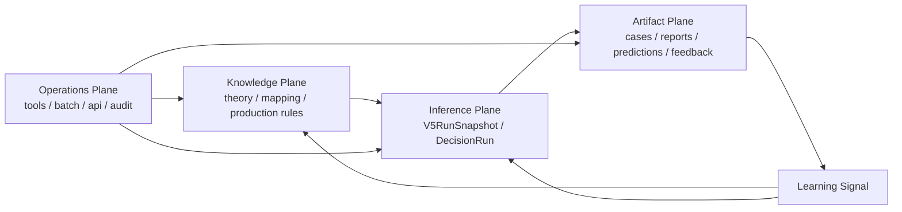

# 格局判断 · mangpai-fusion 全系统总架构重构方案

> 重写日期：2026-07-09。  
> 本方案以 [`META/project-state.json`](../META/project-state.json)、[`AGENTS.md`](../AGENTS.md)、[`STATUS.md`](../STATUS.md)、[`tools/README.md`](../tools/README.md)、[`engine/contracts/00-OVERVIEW.md`](../engine/contracts/00-OVERVIEW.md)、[`engine/v5/`](../engine/v5/) 与 [`engine/decision/`](../engine/decision/) 为当前事实源。  
> 编写顺序固定为：**geju 定新版架构靶心 → ponytail 压缩范围 → writing-plans 阶段化落地 → verification-before-completion 事实校验 → requesting-code-review + ponytail-review 最终审查**。

---

## 0. 使用方式

这份文档不是“架构感想”，而是后续全系统重构的中心方案。后续所有重构任务必须按以下顺序推进：

1. **geju**：先定新版架构靶心，判断系统到底应该成为什么。
2. **ponytail**：再压缩范围，防止方案变成大而空的总纲。
3. **writing-plans**：把重写内容变成阶段化、可执行、可验收的方案。
4. **verification-before-completion**：写完前用现有代码事实校验，不凭感觉声称完成。
5. **requesting-code-review + ponytail-review**：最终做正确性审查和删繁审查。

一句话：**先用 geju 打开格局，再用 ponytail 把它压成最短可执行路径，最后用 writing-plans 和 verification-before-completion 把文档变成可落地的工程路线。**

---

## 1. geju：定新版架构靶心

### 1.1 Thesis

**mangpai-fusion 的长期主对象不是规则、工具、报告或 case 目录，而是一次可复现、可裁决、可反馈、可升级的分析运行：`Run`。**

系统的目标形态不是“更干净的 Python 脚本仓库”，而是一个以 `Run` 为中心的命理推理工厂：

```text
Knowledge Plane  ->  Inference Plane  ->  Artifact Plane
                         ^                    |
                         |                    v
                   Operations Plane  <-  Feedback / Learning
```

### 1.2 当前完成度判断

| 口径 | 完成度 | 判断 |
|---|---:|---|
| 目标架构完成度 | 68% | `Run` 中心、artifact binding、case manifest、feedback attachment、decision ledger 都已有实体；四层边界、工具收口、默认入口切换尚未完成。 |
| 工程落地完成度 | 58% | v5/v6 预生产链路已能生成报告、run json、decision-run json、feedback attachment、manifest；但正式入口仍以旧 [`tools/render_report.py`](../tools/render_report.py) 与旧反馈链为主。 |

### 1.3 Confidence

**中高置信度。**

置信度来自三类代码事实：

1. [`engine/v5/__init__.py`](../engine/v5/__init__.py) 已明确 v5 是 staged clean path：可运行、可测试、可落盘，但不替换旧正式出口。
2. [`engine/v5/domain.py`](../engine/v5/domain.py) 已存在 [`V5RunSnapshot`](../engine/v5/domain.py)、[`V5CaseManifest`](../engine/v5/domain.py)、[`V5FeedbackAttachment`](../engine/v5/domain.py) 三件套。
3. [`engine/decision/models.py`](../engine/decision/models.py) 已存在 [`DecisionRun`](../engine/decision/models.py) 与 [`DecisionRun.validate_trace()`](../engine/decision/models.py)，能表达 L0-L9 裁判链路。

不判高置信度，是因为：

1. 默认生产报告入口仍是 [`tools/render_report.py`](../tools/render_report.py)，而不是 [`tools/render_report_v6.py`](../tools/render_report_v6.py)。
2. [`META/project-state.json`](../META/project-state.json) 仍把 active report entrypoints 标为 [`tools/render_report.py`](../tools/render_report.py) 与 [`tools/output_linter.py`](../tools/output_linter.py)。
3. 真实 case 的 run-centric proof slice 尚未作为正式验收物归档。
4. v6 预生产报告是否完整覆盖正式统一报告要求，还需要真实案例验证。

### 1.4 The Trap

真正陷阱不是代码脏，而是：

1. 把文件夹当领域边界。
2. 把历史入口当长期架构。
3. 把 Markdown 报告当事实源。
4. 把 CLI 工具数量当系统能力。
5. 把过渡适配器写成永久层。

| 继承形态 | 表象 | 是否真实 | 判断 |
|---|---|---|---|
| 旧 [`engine/pipeline.py`](../engine/pipeline.py) 像主入口 | 大量旧工具和报告链路依赖它 | 部分真实 | 它是真实兼容入口，不是长期架构中心。 |
| [`tools/`](../tools/) 很多 active 工具 | 似乎工具越多能力越强 | 不真实 | 这是 Operations Plane 膨胀信号。 |
| [`cases/`](../cases/) 与 [`reports/`](../reports/) 已沉淀大量文件 | 似乎它们就是事实源 | 部分真实 | 它们是真实归档，不应继续承担推理真相。 |
| v5 / decision / legacy 并存 | 似乎应继续多线兼容 | 不真实 | 多主线会稀释判断，应收口为一主两辅。 |
| 物理目录不理想 | 似乎必须先大搬目录 | 不真实 | 先治理生命周期和事实源，后讨论目录。 |

### 1.5 Target Model

```text
Knowledge Plane
  theory sources
  extracted rules
  normalized rule registry
  production rule pack
  school profile / applicability signal

Inference Plane
  canonical input
  run snapshot
  school claims
  structure graph
  arbitration
  prediction ledger
  decision ledger
  learning signal

Artifact Plane
  case manifest
  report view
  prediction export
  feedback attachment
  archived proof bundle

Operations Plane
  CLI
  batch
  API
  audit
  migration
  registry checks
```

### 1.6 Source-of-Truth Matrix

| 对象 | 事实源 | 派生物 / 禁止误用 |
|---|---|---|
| 产品版本 | [`VERSION`](../VERSION) | 不从阶段名或计划文档推断。 |
| 项目状态 | [`META/project-state.json`](../META/project-state.json) | 不从旧 handoff 推断长期状态。 |
| 工具状态 | [`tools/README.md`](../tools/README.md) + [`tools/tool_registry.py`](../tools/tool_registry.py) | 不把 missing / historical 当 active。 |
| 规则状态 | [`tools/rule_status_scan.py`](../tools/rule_status_scan.py) 运行时扫描 | 不在普通文档硬编码易漂移数量。 |
| Run 事实快照 | [`V5RunSnapshot`](../engine/v5/domain.py) | 报告 Markdown 不是推理事实源。 |
| Case 绑定 | [`V5CaseManifest`](../engine/v5/domain.py) | case 目录不是数据库，也不是推理执行器。 |
| 反馈挂载 | [`V5FeedbackAttachment`](../engine/v5/domain.py) | feedback 不应只绑定自然语言段落。 |
| 裁判链路 | [`DecisionRun`](../engine/decision/models.py) | 它是 decision ledger，不是第二个事实 run。 |
| 报告出口 | report view model -> Markdown | Markdown 只读消费结构化输出。 |

### 1.7 一主两辅

| 线路 | 角色 | 保留原则 |
|---|---|---|
| run-centric inference | 正式目标主线 | 围绕 [`V5RunSnapshot`](../engine/v5/domain.py) 与 [`DecisionRun`](../engine/decision/models.py) 收口。 |
| legacy facade | 兼容辅线 | 保留旧入口稳定性，但不新增长期领域能力。 |
| incubation | 实验辅线 | 新派别、新规则、新裁判策略先旁路验证，成功后并入主线。 |

超过这三条线的叙事都应删除或合并。

---

## 2. ponytail：压缩范围，防止大而空

### 2.1 最懒可行原则

后续重构不追求“看起来最完整”，只追求“最短路径证明架构方向”。

优先级如下：

1. 复用现有 [`V5RunSnapshot`](../engine/v5/domain.py)，不新建第三套 run 模型。
2. 复用现有 [`V5CaseManifest`](../engine/v5/domain.py)，不另写 case binding 框架。
3. 复用现有 [`V5FeedbackAttachment`](../engine/v5/domain.py)，不另写反馈挂载协议。
4. 复用现有 [`DecisionRun`](../engine/decision/models.py)，把它定位成 decision ledger，而不是事实源。
5. 复用现有 [`tools/render_report_v6.py`](../tools/render_report_v6.py) 做 proof，不先切默认入口。
6. 不大搬目录，先用现有目录承载四层心智模型。

### 2.2 Kill / Merge / Split / Reframe

#### Kill

1. 杀掉“工具即能力”的概念。
2. 杀掉“报告即结果”的概念。
3. 杀掉“case 目录即事实源”的概念。
4. 杀掉“pipeline 兼容层即系统核心”的概念。
5. 杀掉“新增 shim 就等于兼容完成”的概念。

#### Merge

1. 把 run snapshot 草案合并到现有 [`V5RunSnapshot`](../engine/v5/domain.py)。
2. 把 case manifest 草案合并到现有 [`V5CaseManifest`](../engine/v5/domain.py)。
3. 把反馈挂载草案合并到现有 [`V5FeedbackAttachment`](../engine/v5/domain.py)。
4. 把 L0-L9 裁判账本合并为 [`DecisionRun`](../engine/decision/models.py) 的定位说明。

#### Split

1. Split `Run Snapshot` 与 `DecisionRun`：前者是结构化事实快照，后者是裁判链路视图。
2. Split artifact 与 truth：report / prediction export / feedback file 是 artifact，不是推理真相。
3. Split CLI 与 domain：[`tools/`](../tools/) 只编排，领域逻辑回到 [`engine/`](../engine/)。
4. Split legacy 与 target：旧入口保稳定，新入口做 proof，不混成一锅。

#### Reframe

1. [`engine/`](../engine/) 不是“总入口目录”，而是 Inference Plane。
2. [`tools/`](../tools/) 不是产品层，而是 Operations Plane。
3. [`reports/`](../reports/) 不是结果数据库，而是视图归档。
4. [`cases/`](../cases/) 不是推理系统，而是事实容器和 run binding。
5. [`theory/`](../theory/) 不是静态资料库，而是 Knowledge Plane。

### 2.3 明确不做

1. 不新增第三套 run 模型。
2. 不现在大搬目录。
3. 不把 [`DecisionRun`](../engine/decision/models.py) 与 [`V5RunSnapshot`](../engine/v5/domain.py) 做成两个平权事实源。
4. 不继续把新领域能力塞进 [`tools/`](../tools/)。
5. 不从 Markdown 报告反推结构化状态。
6. 不把兼容 shim 写成永久架构层。
7. 不在普通文档硬编码 git HEAD、N_eff、规则状态数量、flagged 清单。
8. 不把 [`META/project-state.json`](../META/project-state.json) 的 `current_phase` 当产品版本。

### 2.4 Options

| Option | Description | 优点 | 代价 | Verdict |
|---|---|---|---|---|
| Conservative path | 保留现目录和旧主线，只在 [`tools/`](../tools/) 与旧 pipeline 上继续补丁 | 风险最低 | 工具继续膨胀，run-centric 永远旁路 | Reject |
| Clean target | 直接物理重排为 knowledge / inference / artifacts / operations，并切换默认入口 | 终态最干净 | 迁移面大，容易破坏现有报告和反馈闭环 | Not now |
| Staged clean path | 不大搬目录，先以 [`V5RunSnapshot`](../engine/v5/domain.py) + [`DecisionRun`](../engine/decision/models.py) 跑通纵切片，再逐步降级旧入口 | 最短、可验、风险可控 | 会有一段双轨期 | Recommend |

**结论：选 Staged clean path。**

目标模型按 Clean target 定，但第一阶段按 ponytail 原则执行：不大搬目录，不造新模型，不扩工具，只证明纵切片。

---

## 3. writing-plans：阶段化、可执行、可验收

### 3.1 P0：正式 case 的 run-centric proof slice

目标：用一个正式 case 跑通：

```text
input.md
  -> V5Output
  -> .run.json
  -> .decision-run.json
  -> report markdown
  -> manifest.json
  -> .feedback-attachment.json
```

最小动作：

1. 选一个现有正式 case input。
2. 用 [`tools/render_report_v6.py`](../tools/render_report_v6.py) 生成预生产报告与 JSON 产物。
3. 校验 [`V5RunSnapshot.output_hash_matches()`](../engine/v5/domain.py)。
4. 校验 [`V5FeedbackAttachment.validate_targets()`](../engine/v5/domain.py)。
5. 校验 [`DecisionRun.validate_trace()`](../engine/decision/models.py)。
6. 归档 proof 结果，不切默认入口。

完成标准：artifact binding 能定位 report、v5 json、run json、decision-run json、feedback attachment、input、feedback，且三个校验为空。

### 3.2 P1：标记 legacy / preprod 入口边界

目标：停止把旧入口当新能力承载点。

最小动作：

1. 在 [`tools/README.md`](../tools/README.md) 明确 [`tools/render_report.py`](../tools/render_report.py) 是 legacy standard report。
2. 在 [`tools/README.md`](../tools/README.md) 明确 [`tools/render_report_v6.py`](../tools/render_report_v6.py) 是 run-centric preprod。
3. 新增约束：新报告字段必须先进入 run / decision 结构，再渲染。

完成标准：工具索引能清楚回答哪个入口是 legacy，哪个入口是 preprod。

### 3.3 P2：反馈闭环绑定 run attachment

目标：反馈先绑定 run / prediction / claim，再进入学习。

最小动作：

1. 继续使用 [`V5FeedbackAttachment`](../engine/v5/domain.py)。
2. 在反馈入口中优先发现 case 目录下的 `.feedback-attachment.json` 与 `.run.json`。
3. 先做只读校验和 summary，不重写整条反馈摄入链。

完成标准：反馈可证明命中了 run_id 与 prediction_id / claim_id，而不是只命中 Markdown 段落。

### 3.4 P3：固化 [`V5RunSnapshot`](../engine/v5/domain.py) / [`DecisionRun`](../engine/decision/models.py) 关系

目标：避免双事实源。

最小动作：

1. 文档明确 [`V5RunSnapshot`](../engine/v5/domain.py) 是 run-centric 结构化事实快照。
2. 文档明确 [`DecisionRun`](../engine/decision/models.py) 是裁判派生账本。
3. 测试或 proof 中展示 v5 output / run snapshot 可派生 decision-run，并可校验链路。

完成标准：任何新贡献者能从文档判断：Run Snapshot 是事实对象，DecisionRun 是裁判视图。

### 3.5 P4：工具层瘦身

目标：把 Operations Plane 拉回“只编排”。

最小动作：

1. 扫 [`tools/README.md`](../tools/README.md) active 工具。
2. 标为三类：正式入口、预生产入口、迁移 / 历史入口。
3. 把只服务历史迁移的 active 工具降为 historical。
4. 被两个以上工具复用的长期逻辑，下沉到 [`engine/`](../engine/) 或现有 application / infrastructure 层。

完成标准：active 工具数下降，每个 active 工具都能说明它只编排什么。

### 3.6 P5：最后才讨论物理目录迁移

目标：先证明边界，再搬目录。

最小动作：

1. 继续用现目录承载四层心智模型。
2. 只有当 P0-P4 证明目录结构阻碍边界表达时，才讨论物理迁移。
3. 迁移目标必须是减少长期歧义，而不是让仓库看起来更干净。

完成标准：没有证据证明目录阻碍 run-centric 主线时，不搬目录。

### 3.7 Next Executable Todo

- [x] 选择一个正式 case input，作为 P0 proof slice 样本。（C-2026-001-乾-庚申戊寅壬子辛丑）
- [x] 运行 [`tools/render_report_v6.py`](../tools/render_report_v6.py) 生成预生产 artifact bundle。
- [x] 读取 `.run.json` 并校验 [`V5RunSnapshot.output_hash_matches()`](../engine/v5/domain.py)。
- [x] 读取 `.feedback-attachment.json` 并校验 [`V5FeedbackAttachment.validate_targets()`](../engine/v5/domain.py)。
- [x] 读取 `.decision-run.json` 并校验 `decision-run-v1` 基本结构。
- [x] 如可由现有适配器重建 [`DecisionRun`](../engine/decision/models.py)，运行 [`DecisionRun.validate_trace()`](../engine/decision/models.py)。（已改为 `decision_run_from_snapshot` 从 snapshot 派生）
- [x] 把 proof 结果写入一份短报告，作为是否推进 P1 的依据。（[`META/run-centric-proof-slice-2026-07-09.md`](../META/run-centric-proof-slice-2026-07-09.md)）
- [x] 更新 [`tools/README.md`](../tools/README.md) 标记 legacy / preprod 入口边界。
- [x] P2：反馈入口优先通过 manifest 发现 `.feedback-attachment.json` / `.run.json`，输出 target_samples summary。
- [x] P3：新增 `decision_run_from_snapshot()`，preprod 写 decision-run 改为由 snapshot 派生并 validate_trace。
- [x] P4：工具层瘦身，6 个迁移辅助工具从 active 移入 historical，active 列表聚焦正式入口。

---

## 4. verification-before-completion：用现有代码事实校验

> 不在本文硬编码易漂移状态；需要数量、HEAD、规则状态时运行事实源工具。

### 4.1 Proof Slice 必须验证

1. `.run.json` 可被 [`V5RunSnapshot.from_json()`](../engine/v5/domain.py) 读取。
2. [`V5RunSnapshot.output_hash_matches()`](../engine/v5/domain.py) 返回 true。
3. `.feedback-attachment.json` 可被 [`V5FeedbackAttachment.from_json()`](../engine/v5/domain.py) 读取。
4. [`V5FeedbackAttachment.validate_targets()`](../engine/v5/domain.py) 返回空列表。
5. `.decision-run.json` 符合 `decision-run-v1`。
6. [`DecisionRun.validate_trace()`](../engine/decision/models.py) 返回空列表或列出可解释的迁移期断点。

### 4.2 项目元数据

```bash
pytest tests/test_project_metadata.py -q
```

### 4.3 v5 / run snapshot / report proof

```bash
pytest tests/v5/test_render_report_v6.py tests/v5/test_v5_contracts.py tests/v5/test_v5_prediction_feedback.py -q
```

### 4.4 decision ledger

```bash
pytest tests/test_decision_mvp.py tests/test_decision_v5_adapter.py -q
```

### 4.5 工具索引与规则状态

```bash
python tools/tool_registry.py --check
python tools/rule_status_scan.py --check
```

### 4.6 完整相关验证

```bash
pytest tests/test_decision_mvp.py tests/test_decision_v5_adapter.py tests/v5/test_v5_output_linter.py tests/v5/test_render_report_v6.py tests/test_production_service.py tests/test_project_metadata.py -q
```

### 4.7 Falsifiers

以下证据会推翻或削弱本方案：

1. 真实工作流必须依赖 [`cases/`](../cases/) 中非结构化人工编辑态，且无法被 run snapshot / manifest 替代。
2. 报告 Markdown 本身才是主要产品事实源，结构化输出只是临时中间态。
3. v6 / v5 输出无法覆盖正式统一报告要求的主要事项、十五层判断、反馈链和归档要求。
4. [`DecisionRun.validate_trace()`](../engine/decision/models.py) 在真实 v5 输出上经常断链，且断点不是迁移期可解释问题。
5. 多数 active 工具包含不可下沉的独特领域逻辑，说明 Operations / Inference 分界过于理想化。
6. 生产使用长期只是单机、单命理师、低频批处理，且不需要 run-level reproducibility，那么系统化重构收益会下降。

---

## 5. requesting-code-review + ponytail-review：正确性与删繁审查

### 5.1 requesting-code-review 审查清单

完成任一阶段后，必须审查：

1. 是否违反 [`AGENTS.md`](../AGENTS.md) 的事实源矩阵。
2. 是否把 [`META/project-state.json`](../META/project-state.json) 的 `current_phase` 当产品版本。
3. 是否绕过 [`tools/README.md`](../tools/README.md) / [`tools/tool_registry.py`](../tools/tool_registry.py) 自行判断工具状态。
4. 是否让报告 Markdown 反向定义结构化事实。
5. 是否让旧 [`engine/pipeline.py`](../engine/pipeline.py) 继续承担新主线职责。
6. 是否有测试或 proof 输出支撑“已完成”声明。

### 5.2 ponytail-review 审查清单

完成任一阶段后，必须删繁：

1. 能复用 [`V5RunSnapshot`](../engine/v5/domain.py) 时，不新增 run 模型。
2. 能复用 [`V5CaseManifest`](../engine/v5/domain.py) 时，不新增 manifest 框架。
3. 能复用 [`V5FeedbackAttachment`](../engine/v5/domain.py) 时，不新增反馈绑定协议。
4. 能在 [`tools/README.md`](../tools/README.md) 调整分类时，不新增工具。
5. 能通过 proof slice 验证时，不先做物理目录迁移。
6. 能保留 legacy facade 时，不为了“干净”删除生产入口。

### 5.3 Review Gate

任一阶段进入下一阶段前，需要回答：

| 问题 | 必须答案 |
|---|---|
| 是否有可运行验证？ | 有命令和输出，或明确说明未运行原因。 |
| 是否新增了不必要模型？ | 没有；如有，必须说明为什么现有模型不能承载。 |
| 是否扩大 [`tools/`](../tools/) active 面？ | 没有；如有，必须说明为什么不能下沉。 |
| 是否让 artifact 变成事实源？ | 没有。 |
| 是否能回滚？ | 能回到 legacy facade 或 preprod 旁路。 |

---

## 6. Open Decisions

| 决策 | 当前建议 | 何时裁决 | 状态 |
|---|---|---|---|
| 何时切默认报告入口 | v6 preprod 覆盖 9 个正式 case、output_linter errors=0、覆盖审计 9/9 通过后，建议切换 | 完成一个正式 case proof 后 | **证据充分，可启动切换讨论**：9 个 case 全通过覆盖审计，output_linter errors=0，建议讨论切换计划 |
| [`DecisionRun`](../engine/decision/models.py) 是否从 `.run.json` 而不是 v5 output 派生 | 倾向从 run snapshot 派生 | P0 / P3 阶段验证后 | **已裁决**：P3 已落地 `decision_run_from_snapshot()`，由 snapshot 派生 |
| 旧 [`engine/pipeline.py`](../engine/pipeline.py) 何时降级 | 先标 legacy，不删除 | v6 preprod 覆盖正式报告要求后 | **条件已满足**：v6 preprod 已覆盖 9 个正式 case，output_linter 0 error；可进入 pipeline 降级讨论 |
| [`tools/`](../tools/) active 工具如何瘦身 | 先分类，再降级历史迁移工具 | P4 阶段 | **已裁决**：P4 已落地，6 个工具移入 historical |
| 是否物理迁移目录 | 暂不迁移 | P0-P4 完成且证明目录阻碍边界后 | **待裁决**：P0-P4 完成，无目录阻碍证据，继续不迁移 |

---

## 7. Mermaid · 新边界总览



---

## 8. Final Call

**目标架构按 geju 的 Clean target 定，执行路径按 ponytail 的 Staged clean path 走，落地方式按 writing-plans 的 P0-P5 阶段推进，完成声明必须经过 verification-before-completion，最终进入 requesting-code-review + ponytail-review。**

当前最短、最稳、也最有格局的第一步是：不切默认入口、不大搬目录、不发明新模型，先用现有 [`V5RunSnapshot`](../engine/v5/domain.py)、[`V5CaseManifest`](../engine/v5/domain.py)、[`V5FeedbackAttachment`](../engine/v5/domain.py)、[`DecisionRun`](../engine/decision/models.py) 证明一次完整的 run-centric 分析运行。
