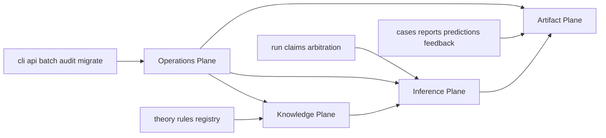

# 格局判断 · mangpai-fusion 全系统总架构重构方案

> 基于当前事实源 [`META/project-state.json`](../META/project-state.json)、[`engine/contracts/00-OVERVIEW.md`](../engine/contracts/00-OVERVIEW.md)、[`tools/README.md`](../tools/README.md)、[`handoff.md`](../handoff.md) 与现有方案 [`plans/geju-bazi-analysis-redesign.md`](geju-bazi-analysis-redesign.md)、[`plans/production-system-geju-judgment.md`](production-system-geju-judgment.md) 的进一步拔高版判断。

---

## Thesis

**这个系统不该再被组织成一个以 [`engine/`](../engine/) 为核心、[`tools/`](../tools/) 为外围、[`cases/`](../cases/) 和 [`reports/`](../reports/) 为归档目录的脚本仓库；它应该被重构为一个 以 判案 为中心 的 推理工厂。**

更直接地说：当前仓库的真正主对象不是规则、不是工具、也不是报告，而是一次次可复现、可裁决、可反馈、可升级的“分析运行”。因此，正确的目标模型应是：**`Run` 作为唯一主生命周期，`engine` 只负责纯推理，`tools` 只负责入口编排，`theory` 只负责知识供给，`cases` 只负责事实沉淀，`reports` 只负责派生视图。**

---

## Confidence

**中高置信度。**

之所以不是高置信度，是因为当前仓库已经存在两轮重构叠加：

- 一轮是 [`engine/pipeline.py`](../engine/pipeline.py) 背后的旧兼容主线
- 一轮是 [`engine/v5/runner.py`](../engine/v5/runner.py) 与 [`engine/contracts/10-ziping-fusion-v5.md`](../engine/contracts/10-ziping-fusion-v5.md) 背后的新目标主线
- 再叠加一层生产/归档/反馈工具现实，形成“契约比实现更先进”的状态

所以这个判断很可能是对的方向，但具体切分点仍需用一次小规模 proof 验证。

---

## The Trap

### 被继承的约束

当前系统容易被以下历史形态绑住：

1. [`engine/pipeline.py`](../engine/pipeline.py) 仍像总入口，所以大家会默认它是架构中心
2. [`tools/render_report.py`](../tools/render_report.py) 与 [`tools/output_linter.py`](../tools/output_linter.py) 已经很重，于是展示出口反过来塑造了内部结构
3. [`cases/`](../cases/) 与 [`reports/`](../reports/) 同时承担归档、事实、回放、审计、工作流入口，边界混在一起
4. [`tools/README.md`](../tools/README.md) 中 active 工具很多，说明“系统能力”正被 CLI 集合代替，而不是被明确领域边界承接
5. 旧 D1-D4、v2、v5、并行 domain、production MVP 几条线并行存在，导致仓库像一层层沉积，而不是一个清晰终态

### 这些约束是真是假

| 约束 | 是否真实 | 判断 |
|---|---|---|
| 必须保留历史入口兼容一段时间 | 是 | 因为已有大量 [`tools/*.py`](../tools/README.md) 调用链和测试绑定 |
| `cases/` 与 `reports/` 必须继续存在 | 是 | 它们是产品工作流和归档可追踪性的真实契约 |
| 旧 [`engine/pipeline.py`](../engine/pipeline.py) 必须继续作为长期主心骨 | 否 | 这是兼容外观，不是真正目标模型 |
| 报告 Markdown 必须主导内部数据结构 | 否 | 报告是派生物，不应反向规定推理核心 |
| 工具目录越全越说明架构成熟 | 否 | 很可能恰恰说明领域职责没收口，工具在替代应用层 |

### 真陷阱

真正的陷阱不是技术债本身，而是**把文件形态误认为领域模型，把历史入口误认为长期边界，把 CLI 流程误认为系统架构。**

---

## High-格局 Direction

### 核心判断

目标不是继续把仓库整理得更像一个“干净的 Python 项目”，而是要把它重构成一个**四层分明的命理推理工厂**：

1. **Knowledge Plane**：理论与规则供给面
2. **Inference Plane**：分析运行与裁决面
3. **Artifact Plane**：报告、案例、预测、反馈等派生产物面
4. **Operations Plane**：CLI、批处理、API、审计、迁移等运维面

当前仓库最大的问题不是代码脏，而是**这四个面发生了穿透**。

- [`theory/`](../theory/) 不只是知识，还隐含生命周期状态
- [`engine/`](../engine/) 不只是推理，还背着归档与兼容负担
- [`tools/`](../tools/) 不只是入口，还代替 application 做了很多长期编排
- [`cases/`](../cases/) 不只是样本，还承载输入、反馈、事件、追踪、回灌
- [`reports/`](../reports/) 不只是视图，还在实践中充当事实快照

所以总架构的正确重构不是微调模块，而是**先重画边界，再决定迁移**。

### 目标模型

```text
Knowledge Plane
  theory sources -> extracted rules -> production rules -> school registry

Inference Plane
  canonical input -> run -> claims -> arbitration -> prediction ledger -> run snapshot

Artifact Plane
  case file <- binds to run
  report file <- renders from run snapshot
  prediction file <- extracts from prediction ledger
  feedback file <- attaches to case and updates learning signal

Operations Plane
  cli / batch / api / audits / migrations
    only orchestrate
    never define domain truth
```

### 推荐的目录心智模型

```text
repo/
  knowledge/       理论原文、抽取、规则注册、生命周期
  inference/       纯推理内核与契约
  artifacts/       case、report、prediction、feedback 的结构化归档
  operations/      cli、api、batch、审计、迁移
  docs/            README、STATUS、plans、contracts 人类文档
```

这不一定要求立刻物理改目录，但**必须先按这个心智模型治理现有目录**：

- [`theory/`](../theory/) ≈ `knowledge/`
- [`engine/`](../engine/) ≈ `inference/`
- [`cases/`](../cases/)、[`reports/`](../reports/)、[`predictions/`](../predictions/) ≈ `artifacts/`
- [`tools/`](../tools/) ≈ `operations/`
- [`plans/`](./)、[`README.md`](../README.md)、[`STATUS.md`](../STATUS.md)、[`AGENTS.md`](../AGENTS.md) ≈ `docs/`

---

## Frame-Opening Move

### Move used

- zero-legacy thought experiment
- kill the wrong concept
- end-state backcasting

### 它揭示了什么

如果今天从零开始，不带任何历史包袱设计这个系统，没有人会把它命名为“一个有很多工具脚本、顺便有个引擎目录、再加若干报告模板的仓库”。

从零设计时，你会天然得到：

- 一个可复现的分析运行对象
- 一个统一的知识供给入口
- 一个与运行绑定的案例/反馈系统
- 一个只读消费运行快照的报告系统
- 一个不拥有真相、只负责编排的 operations 层

这说明当前很多概念应该被杀掉，而不是继续修补：

- “工具即能力” 这个概念要杀
- “报告即结果” 这个概念要杀
- “case 目录即事实源” 这个概念要杀
- “pipeline 兼容层即系统核心” 这个概念要杀

---

## Bold Takes

### 1. 把 `Run` 提升为系统第一实体

全系统应该围绕一个统一运行实体重构，例如 `AnalysisRun` 或 `InferenceRun`，它至少拥有：

- canonical input
- engine version
- schema version
- selected rule snapshot
- school claims
- arbitration result
- prediction ledger
- statement ledger
- artifact bindings
- learning signals

没有这个第一实体，系统就会继续散落在 [`cases/`](../cases/)、[`reports/`](../reports/)、[`predictions/`](../predictions/)、[`tools/`](../tools/) 之间互相影射。

### 2. `engine` 必须去归档化、去工具化、去展示化

[`engine/`](../engine/) 只应该做三件事：

- 读取标准输入
- 运行推理和裁决
- 返回稳定结构化输出

不应该再让 [`engine/`](../engine/) 隐式知道：

- 报告 Markdown 怎么拼
- case 目录怎么命名
- 哪个 batch 工具会调用它
- 哪些历史文件要兼容写回

### 3. `tools` 不是产品层，`tools` 是运维层

[`tools/README.md`](../tools/README.md) 展示了一个明显信号：工具数量非常多，而且很多工具已经承担“流程定义”职责。这个趋势如果继续，仓库会变成“脚本编排平台”，而不是“推理系统”。

所以应明确：

- [`tools/`](../tools/) 只允许编排，不允许沉淀长期领域逻辑
- 凡是被两个以上工具复用的稳定逻辑，都应下沉到应用层或基础设施层
- `active` 工具的数量应该长期下降，而不是继续增长

### 4. `cases` 不应再同时扮演五种角色

[`cases/`](../cases/) 目前实际上混合了：

- 输入归档
- 分析绑定
- 反馈入口
- 审计定位
- 学习样本

这五件事最好通过一个 `case manifest + run binding` 机制拆开。case 是事实容器，不是推理执行器。

### 5. `reports` 只能是派生视图，不能是事实源

任何需要从 [`reports/*.md`](../reports/README.md) 反向恢复领域状态的地方，原则上都是架构错误。报告只消费 run snapshot 或 report view model。

### 6. `theory` 不是静态资料库，而是受治理的知识平面

[`theory/`](../theory/) 目前已经接近知识平面，但还混有抽取产物、对齐 IR、cleaning 报告、生产规则状态。下一步不该只是继续塞文件，而是明确四层：

- source material
- extraction workspace
- normalized rule registry
- production rule pack

### 7. 旧线不要长期共存三套，只允许 一主两辅

现状近似：

- 旧 [`engine/pipeline.py`](../engine/pipeline.py)
- v2 子系统 [`engine/v2/`](../engine/v2/)
- v5 子系统 [`engine/v5/`](../engine/v5/)
- 一批 application 并行组件

这不是演进态，这是认知负担。应尽快收口为：

- **一条正式主线**：run-centric inference
- **一条兼容辅线**：legacy facade
- **一条实验辅线**：new school/rule incubation

超过三条线，就会持续稀释判断力。

---

## Options

| Option | Description | 优点 | 代价 | Verdict |
|---|---|---|---|---|
| Conservative path | 保留现目录结构，仅继续在 [`engine/application/`](../engine/application/) 与 [`tools/`](../tools/) 内局部清理 | 改动最小，短期风险低 | 不解决边界错位，工具继续膨胀，v5 继续像附线 | reject |
| Clean target | 直接围绕 `Run` 重画全仓边界，按 knowledge / inference / artifacts / operations 重构目录与心智模型 | 终态最清晰，长期成本最低 | 初期迁移面大，需要强迁移纪律 | recommend |
| Staged clean path | 先不大搬目录，先引入统一 `Run` 契约、artifact manifest、tool boundary，再分期移动物理目录 | 兼顾方向正确与落地可控 | 一段时间内会出现“新边界 + 旧目录”双语期 | strongest practical recommendation |

### 结论

推荐 **Staged clean path**，但前提是**目标模型按 Clean target 定**，不能为了迁移方便把目标降级成“继续在旧目录上打补丁”。

---

## What Not To Do

### 不要做的事

1. 不要继续把新逻辑塞进 [`engine/application/`](../engine/application/) 而不先说明它属于 inference、operations 还是 artifact binding
2. 不要继续新增只被单个流程调用的重型工具脚本来承接长期职责
3. 不要为了保留 [`engine/pipeline.py`](../engine/pipeline.py) 的表面稳定性，而让新主流程永远挂在旁边
4. 不要从 Markdown 报告反推结构化状态
5. 不要把 [`cases/`](../cases/) 当数据库、把 [`reports/`](../reports/) 当审计账本、把 [`tools/`](../tools/) 当应用层
6. 不要同时维护旧 D1-D4 叙事、v2 叙事、v5 叙事、production MVP 叙事四套对外心智模型
7. 不要再增加“过渡适配器永久化”的代码，例如只为避免改调用方而长期保留的 shim

---

## First Proof Point

最小验证物不应是“大搬目录”，而应是**先做一个以 `Run` 为中心的纵切片**。

### 建议 proof slice

选一个正式案例，跑通以下链路：

```text
input.md
  -> canonical input
  -> single run snapshot.json
  -> report render
  -> case binding
  -> feedback attach
  -> learning signal append
```

要求是：

1. 报告来自 run snapshot，而不是来自旧拼接中间产物
2. case 只保存事实与绑定，不保存推理真相副本
3. feedback 绑定到 run / statement，而不是绑定到 Markdown 片段
4. [`tools/render_report.py`](../tools/render_report.py) 与 [`tools/output_linter.py`](../tools/output_linter.py) 只消费新视图层
5. 能证明 [`engine/pipeline.py`](../engine/pipeline.py) 可退化为 facade，而不是继续做中枢

如果这个 slice 成功，整个重构方向基本成立。

---

## Falsifier

以下证据会推翻或显著削弱本 thesis：

1. 发现大量真实工作流必须直接依赖 [`cases/`](../cases/) 目录中的非结构化人工编辑态，且无法被 run snapshot 替代
2. 发现报告生成本身就是主要产品，而结构化输出只是临时中间态，那就不能把 report 降为纯派生物
3. 发现 v5 契约无法覆盖现有主要事项、反馈链和归档要求，说明 `Run` 中心设计还不够承载全系统
4. 发现多数 active 工具的差异并非编排层，而是不可抽象的独特领域逻辑，那说明 operations/inference 分界现在定得过理想化
5. 发现生产使用永远只是单机、单命理师、低频批处理，且长期不需要 run-level reproducibility，那么大规模系统化重构收益会下降

---

## 建议执行顺序

1. 先冻结目标词汇：统一采用 `Run / Knowledge / Artifact / Operations` 四层话语
2. 定义统一 `Run Snapshot` 契约，作为新系统第一事实对象
3. 定义 `Case Manifest` 与 `Artifact Binding`，把 [`cases/`](../cases/) 从混合角色中解耦
4. 让 [`tools/render_report.py`](../tools/render_report.py) 只消费新的 report view model
5. 让 [`tools/README.md`](../tools/README.md) 中 active 工具按四层边界重新分类
6. 把 [`engine/pipeline.py`](../engine/pipeline.py) 明确降级为 legacy facade
7. 最后再讨论是否需要物理搬迁目录

---

## 给下一模式的可执行 todo

- [ ] 盘点全仓所有“事实对象”并归类为 knowledge / inference / artifact / operations
- [ ] 产出 `Run Snapshot` 最小字段草案，映射现有 [`engine/v5/domain.py`](../engine/v5/domain.py)
- [ ] 产出 `Case Manifest` 草案，映射 [`cases/`](../cases/) 当前最小必需文件
- [ ] 梳理 [`tools/README.md`](../tools/README.md) 中 active/internal 工具，标出应下沉与应删除项
- [ ] 识别 [`engine/pipeline.py`](../engine/pipeline.py) 到 [`engine/v5/runner.py`](../engine/v5/runner.py) 的真实兼容边界
- [ ] 设计一个单案例纵切片验证方案，验证 run-centric 架构可行性

---

## Mermaid · 新边界总览


