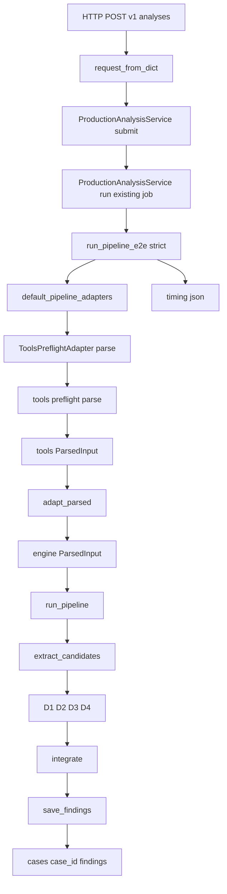

# PI-110 输入／管线现状审计

> 任务编号：PI-110  
> 审计性质：G1 补证；只记录当前仓库可复核事实，不改变实现、冻结语义或生产默认行为。  
> 裁决边界：本文不裁决 G1。G1 是否通过只能由 PI-190 基于 PI-110、PI-120、PI-130 的持久化证据独立裁决。

## 1. 范围与方法

### 1.1 本次范围

本审计追踪以下现状：

1. `production-default` 从 HTTP／应用服务入口，经 preflight、两层 `ParsedInput`、适配器、候选提取、pipeline runner 到 findings 持久化的实际调用链。
2. `questions`、`known_facts` 与时间信息在当前链路中的解析、传递和运行时消费状态。
3. `staged/preprod` 与 `production-default` 的边界。
4. F01–F12 机器附录是否存在当前运行时消费者。
5. 可复用组件、当前缺口、不可触碰边界和证据索引。

### 1.2 不在范围内

- 不修改 [`production/`](../production/)、[`mapping/`](../mapping/)、[`engine/`](../engine/)、[`tools/`](../tools/)、[`tests/`](../tests/)、[`templates/`](../templates/)、[`META/`](../META/)、[`cases/`](../cases/) 或 [`reports/`](../reports/)。
- 不修改 F01–F12 冻结语义，不把声明性 YAML 翻译成运行时判断。
- 不改变 `production-default` 路由、输入协议、错误策略或输出行为。
- 不设计 G5，不提出学习闭环实现。
- 不以本文自验替代 PI-190 独立裁决。

### 1.3 证据方法与结论强度

本文以治理文件、实际源码调用链及全仓静态引用搜索为证据。关于“无运行时消费者”的表述，严格限定为：**在本次核查的当前仓库源码、默认调用链和文件名／字段引用静态搜索中未发现消费者**；不宣称仓库外部系统或运行时动态注入绝对不存在。

治理依据：总控把 PI-110 定义为 G1 输入／pipeline 盘点项，并把 PI-190 定义为独立汇总裁决项，见 [`plans/production-implementation-control.md`](production-implementation-control.md:79)、[`plans/production-implementation-control.md`](production-implementation-control.md:82)、[`plans/production-implementation-control.md`](production-implementation-control.md:193)；现有阻断说明要求补建 PI-110、PI-120、PI-130 后再由 PI-190 裁决，见 [`plans/production-implementation-g1-calibration-blocker.md`](production-implementation-g1-calibration-blocker.md:89)。

## 2. 审计结论摘要

| 核查项 | `production-default` 结论 | `staged/preprod` 结论 |
|---|---|---|
| 输入入口 | API 接收 `input_path` 等服务参数；服务调用端到端 pipeline | v6 preprod 由请求布尔值显式 opt-in；staged parallel 是独立显式对照入口 |
| preflight | 默认 adapter 调用 [`tools.preflight.parse()`](../tools/preflight.py:733) | v6 preprod 直接读取 Markdown／YAML，不复用默认 preflight adapter |
| `questions` | 被解析并跨 adapter 保留，但默认候选提取不读取它；本次未发现后续默认消费者 | v6 chart 构造未纳入；staged parallel 明确不注入上下文事实 |
| `known_facts` | 被解析并跨 adapter 保留；默认候选提取只消费有 `year` 且有 `event` 或 `content` 的子集 | v6 chart 构造未纳入；staged parallel 转换不注入上下文事实 |
| 时间范围 | 没有请求级统一 `start_year`／`end_year` 输入协议；默认 D3 使用单条事实的 `year` | staged/claims 内部存在自己的时间窗口概念，但不能视为生产默认统一时间范围 |
| F01–F12 YAML | 本次未发现 Python 运行时装载或消费；文件本身禁止表达可执行逻辑 | 同样未发现 staged/preprod 对该 YAML 的装载证据 |
| findings | 默认链写 D1–D4、support、`analysis_output.json`，并另写 `timing.json` | v6 preprod 写独立报告与 v5/run/decision/feedback artifacts；staged parallel 明确不落盘 |

## 3. `production-default` 实际调用链

### 3.1 调用链总图

### 3.2 分段证据

1. **HTTP 入口 → 请求 DTO → service**  
   [`tools.production_api.ProductionAPIHandler.do_POST()`](../tools/production_api.py:86) 读取 JSON，并在 [`tools/production_api.py`](../tools/production_api.py:101) 至 [`tools/production_api.py`](../tools/production_api.py:114) 调用 [`engine.application.production_service.request_from_dict()`](../engine/application/production_service.py:416) 与 service submit／queue。请求 DTO 定义见 [`engine.application.production_service.SubmitAnalysisRequest`](../engine/application/production_service.py:40)。

2. **service → production-default pipeline**  
   [`engine.application.production_service.ProductionAnalysisService._run_existing_job()`](../engine/application/production_service.py:141) 在 [`engine/application/production_service.py`](../engine/application/production_service.py:149) 至 [`engine/application/production_service.py`](../engine/application/production_service.py:158) 调用 [`engine.application.pipeline_runner.run_pipeline_e2e()`](../engine/application/pipeline_runner.py:174)，固定 `do_self_iter=False`、标准模板／报告变体和 `error_policy=strict`。因此 production service 的默认执行语义不能由独立调用 [`engine.application.pipeline_runner.run_pipeline()`](../engine/application/pipeline_runner.py:33) 时的容错行为替代描述。

3. **默认 adapters → preflight**  
   [`engine.application.pipeline_runner._load_default_adapters()`](../engine/application/pipeline_runner.py:294) 延迟装载 [`engine.infrastructure.adapters.pipeline_adapters.default_pipeline_adapters()`](../engine/infrastructure/adapters/pipeline_adapters.py:71)。[`engine.infrastructure.adapters.pipeline_adapters.ToolsPreflightAdapter.parse()`](../engine/infrastructure/adapters/pipeline_adapters.py:25) 调用 [`tools.preflight.parse()`](../tools/preflight.py:733)，随后调用 [`engine.predicates.types.adapt_parsed()`](../engine/predicates/types.py:385)。[`tools/pipeline_adapters.py`](../tools/pipeline_adapters.py:1) 只是向后兼容 re-export，不是另一套默认实现。

4. **preflight → 工具层 `ParsedInput`**  
   工具层 [`tools.preflight.ParsedInput`](../tools/preflight.py:160) 包含 `known_facts` 与 `questions`。[`tools.preflight.parse()`](../tools/preflight.py:733) 读取并合并 YAML 块，见 [`tools/preflight.py`](../tools/preflight.py:750)；校验 known facts，见 [`tools/preflight.py`](../tools/preflight.py:790)；解析 `提问` 并构造返回对象，见 [`tools/preflight.py`](../tools/preflight.py:799)。排盘校验硬门位于 [`tools.preflight._check_chart_validation()`](../tools/preflight.py:823)。

5. **工具层 `ParsedInput` → engine `ParsedInput`**  
   engine 数据类定义在 [`engine.predicates.types.ParsedInput`](../engine/predicates/types.py:263)。[`engine.predicates.types.adapt_parsed()`](../engine/predicates/types.py:385) 转换八字、大运和 known facts，并在 [`engine/predicates/types.py`](../engine/predicates/types.py:420) 至 [`engine/predicates/types.py`](../engine/predicates/types.py:435) 保留 `known_facts`、`questions`、`case_meta`、fingerprint 与 schema version。

6. **端到端 runner → 核心 runner**  
   [`engine.application.pipeline_runner.run_pipeline_e2e()`](../engine/application/pipeline_runner.py:174) 在 [`engine/application/pipeline_runner.py`](../engine/application/pipeline_runner.py:226) 至 [`engine/application/pipeline_runner.py`](../engine/application/pipeline_runner.py:235) 执行 adapter preflight，再于 [`engine/application/pipeline_runner.py`](../engine/application/pipeline_runner.py:237) 至 [`engine/application/pipeline_runner.py`](../engine/application/pipeline_runner.py:245) 调用核心 [`engine.application.pipeline_runner.run_pipeline()`](../engine/application/pipeline_runner.py:33)，并暂不让核心层自行落盘。

7. **候选提取 → D1–D4 → integration**  
   [`engine.application.pipeline_runner.run_pipeline()`](../engine/application/pipeline_runner.py:33) 在 [`engine/application/pipeline_runner.py`](../engine/application/pipeline_runner.py:75) 至 [`engine/application/pipeline_runner.py`](../engine/application/pipeline_runner.py:98) 编排 D1–D4 和 integration；D3 前调用 [`engine.application.candidates._extract_candidates()`](../engine/application/candidates.py:7)，见 [`engine/application/pipeline_runner.py`](../engine/application/pipeline_runner.py:83)。汇聚函数为 [`engine.application.integration.integrate()`](../engine/application/integration.py:171)。

8. **findings 持久化**  
   端到端 runner 在 [`engine/application/pipeline_runner.py`](../engine/application/pipeline_runner.py:279) 至 [`engine/application/pipeline_runner.py`](../engine/application/pipeline_runner.py:286) 调用 [`engine.infrastructure.findings_repository._save_findings()`](../engine/infrastructure/findings_repository.py:11)，并另写 timing。仓储在 [`engine/infrastructure/findings_repository.py`](../engine/infrastructure/findings_repository.py:16) 至 [`engine/infrastructure/findings_repository.py`](../engine/infrastructure/findings_repository.py:65) 创建 `cases/<case_id>/findings/`，写入：
   - `energy.json`
   - `picture.json`
   - `gate_results.json`
   - `support.json`
   - `analysis_output.json`

[`engine/pipeline.py`](../engine/pipeline.py:1) 是兼容外观和 re-export 层，不是独立 pipeline 实现。

## 4. 字段级运行时消费审计

### 4.1 `questions`

**解析与传递：存在。**

- `提问` 不是 preflight 必需顶层键；必需键清单见 [`tools/preflight.py`](../tools/preflight.py:259)。
- [`tools.preflight.parse()`](../tools/preflight.py:733) 在 [`tools/preflight.py`](../tools/preflight.py:799) 至 [`tools/preflight.py`](../tools/preflight.py:817) 把 `提问` 解析为列表并写入工具层 `ParsedInput.questions`。
- [`engine.predicates.types.adapt_parsed()`](../engine/predicates/types.py:385) 在 [`engine/predicates/types.py`](../engine/predicates/types.py:429) 保留该列表。

**默认候选／pipeline 语义消费：未发现。**

- [`engine.application.candidates._extract_candidates()`](../engine/application/candidates.py:7) 的 docstring 声称从 `known_facts + questions` 提取候选，但实际循环在 [`engine/application/candidates.py`](../engine/application/candidates.py:34) 至 [`engine/application/candidates.py`](../engine/application/candidates.py:43) 只遍历 `parsed.known_facts`。
- 当前核查的 production-default 后续调用链未发现读取 `parsed.questions` 的运行时逻辑。

**结论：** `questions` 当前是“可进入并保留的数据”，不是已证明影响默认 D1–D4、候选生成或 findings 的输入。docstring 与实现存在漂移，不能用 docstring 证明消费能力。

### 4.2 `known_facts`

**解析与传递：存在。**

- 工具层类型见 [`tools.preflight.KnownFact`](../tools/preflight.py:144)。
- 校验器 [`tools.preflight._check_known_facts()`](../tools/preflight.py:595) 接受类型、可选年份和 `event`／`content`；年份若存在则限制在 1900–2100，见 [`tools/preflight.py`](../tools/preflight.py:595) 至 [`tools/preflight.py`](../tools/preflight.py:626)。
- engine 类型见 [`engine.predicates.types.KnownFact`](../engine/predicates/types.py:255)，适配发生在 [`engine.predicates.types.adapt_parsed()`](../engine/predicates/types.py:385)。

**默认运行时消费：存在，但只消费子集。**

[`engine.application.candidates._extract_candidates()`](../engine/application/candidates.py:7) 的实际条件是：

- `fact.year` 与 `fact.event` 同时为真；或
- `fact.year` 与 `fact.content` 同时为真。

证据见 [`engine/application/candidates.py`](../engine/application/candidates.py:34) 至 [`engine/application/candidates.py`](../engine/application/candidates.py:43)。因此：

- 有年份且有事件／内容的事实会形成 D3 候选；
- 无年份事实不会形成默认 D3 候选；
- 只有类型或状态描述、但无年份的事实不会由该函数消费；
- 不能把“成功进入 `ParsedInput`”等同于“被 D1–D4 全面消费”。

此外，输入契约声称 known facts 可用于 D2、D3 与 self-iteration，见 [`engine/contracts/01-input-schema.md`](../engine/contracts/01-input-schema.md:202)；但 production service 明确固定 `do_self_iter=False`，见 [`engine/application/production_service.py`](../engine/application/production_service.py:149)。本审计以当前源码实际路径为准，不据契约描述扩张实现能力。

### 4.3 时间范围与时间信息

必须区分四类不同概念：

| 时间概念 | 当前证据 | 是否为 `production-default` 请求级统一范围 |
|---|---|---|
| known fact 单年 | [`tools.preflight.KnownFact`](../tools/preflight.py:144) 的可选年份；候选提取用它形成 D3 候选 | 否，只是单条事实时间点 |
| 大运起讫 | 工具层大运结构及校验位于 [`tools/preflight.py`](../tools/preflight.py:127) 与 [`tools.preflight._check_dayun()`](../tools/preflight.py:389) | 否，是排盘／运程数据，不是用户查询窗口 |
| production API 请求范围 | [`engine.application.production_service.SubmitAnalysisRequest`](../engine/application/production_service.py:40) 与 [`engine.application.production_service.request_from_dict()`](../engine/application/production_service.py:416) 未定义统一的请求起止年份 | **不存在已证明协议** |
| production 内部预测窗口 | 默认 runner 把 engine 输入传给预测层，见 [`engine/application/pipeline_runner.py`](../engine/application/pipeline_runner.py:119)；预测层根据 D3 gate、大运或当前年份推导输出窗口，见 [`engine.application.prediction_layer._estimate_time_window()`](../engine/application/prediction_layer.py:51) | 否，这是运行时推导的输出，不是外部请求范围 |
| retrospective 截止年 | 默认 runner 以运行时当前年份调用回溯扫描，见 [`engine/application/pipeline_runner.py`](../engine/application/pipeline_runner.py:139) | 否，这是内部扫描边界 |
| staged/claims 时间窗口 | claims 类型定义独立时间窗口，见 [`engine.claims.domain.TimeWindow`](../engine/claims/domain.py:21) | 否，不得投射为生产默认输入能力 |

**结论：** 当前 `production-default` 没有统一、外部可提交并贯穿 pipeline 的请求级时间范围协议。已存在的事实年份、大运起讫、预测层推导窗口和 retrospective 截止年分属输入事实、排盘数据、输出推导和内部扫描边界，不能合并命名为统一请求时间范围。staged/claims 的窗口能力也不能据此宣称默认生产已支持外部时间范围输入。

### 4.4 F01–F12 YAML

核查对象为 [`mapping/real-world-function-evidence-cards-v1.yaml`](../mapping/real-world-function-evidence-cards-v1.yaml:1)。

**声明边界：**

- `only_transcribe_frozen_decisions: true`
- `infer_missing_fields: false`
- `executable_logic_allowed: false`

以上见 [`mapping/real-world-function-evidence-cards-v1.yaml`](../mapping/real-world-function-evidence-cards-v1.yaml:5) 至 [`mapping/real-world-function-evidence-cards-v1.yaml`](../mapping/real-world-function-evidence-cards-v1.yaml:10)。正式契约同时规定机器附录不得表达可执行逻辑，生产实现须另行设计、评审和测试，见 [`engine/contracts/12-real-world-function-evidence-cards-v1.md`](../engine/contracts/12-real-world-function-evidence-cards-v1.md:429)。

**运行时消费核查：未发现。**

- 当前核查的 API、production service、默认 adapters、preflight、candidate extractor、pipeline runner、integration、findings repository、v6 preprod 和 staged parallel 路径均未装载该文件。
- 全仓按完整文件名、F01 标识及 YAML loader 静态检索，未发现 Python 运行时代码指向该 YAML；命中项为契约、mapping、治理／交接文档等声明性引用。

**结论：** 当前证据只支持“F01–F12 契约和机器附录存在”，不支持“F01–F12 已成为 production-default 或 staged/preprod 的运行时判定逻辑”。由于附录明确禁止可执行逻辑，也不得直接把 YAML 当作 if/else 规则加载。

## 5. `staged/preprod` 独立分账

### 5.1 v6 preprod 是 production 请求上的显式 opt-in 附加链

- [`engine.application.production_service.SubmitAnalysisRequest`](../engine/application/production_service.py:40) 将 `render_v6_preprod` 默认设为 `False`。
- production-default pipeline 先在 [`engine/application/production_service.py`](../engine/application/production_service.py:149) 至 [`engine/application/production_service.py`](../engine/application/production_service.py:158) 完整执行。
- 只有 opt-in 时，service 才在 [`engine/application/production_service.py`](../engine/application/production_service.py:160) 至 [`engine/application/production_service.py`](../engine/application/production_service.py:168) 额外调用 v6 preprod renderer。

因此 v6 preprod 不是默认主链替代品，也不能反向证明默认 pipeline 具有 v5/preprod 能力。

### 5.2 v6 preprod 自行构建 chart

[`engine.v5.preprod.build_chart_from_input()`](../engine/v5/preprod.py:120) 直接从 input Markdown／YAML 构建 v5 chart；实际 chart 字段组装见 [`engine/v5/preprod.py`](../engine/v5/preprod.py:172) 至 [`engine/v5/preprod.py`](../engine/v5/preprod.py:180)。该结构包含 case、性别、当前大运／流年、大运摘要和四柱等，但没有把 `questions` 或 `known_facts` 作为 chart 字段送入 v5。

[`engine.v5.preprod.render_v6_preprod_case()`](../engine/v5/preprod.py:215) 生成独立报告、v5 JSON、run JSON、decision-run JSON、feedback attachment 和 case manifest，见 [`engine/v5/preprod.py`](../engine/v5/preprod.py:215) 至 [`engine/v5/preprod.py`](../engine/v5/preprod.py:302)。这些 artifacts 与默认 findings repository 分账。

### 5.3 staged parallel 是显式、无落盘的对照链

- [`engine.application.staged_parallel_runner.chart_to_parsed_input()`](../engine/application/staged_parallel_runner.py:63) 的契约明确“仅从 ChartFactLedger 构造 legacy ParsedInput，不注入上下文事实”；构造范围见 [`engine/application/staged_parallel_runner.py`](../engine/application/staged_parallel_runner.py:63) 至 [`engine/application/staged_parallel_runner.py`](../engine/application/staged_parallel_runner.py:98)。因此 known facts 与 questions 使用默认空值。
- [`engine.application.staged_parallel_runner.run_parallel()`](../engine/application/staged_parallel_runner.py:124) 显式并跑 legacy 与 claim 链，并在 [`engine/application/staged_parallel_runner.py`](../engine/application/staged_parallel_runner.py:132) 声明不落盘；legacy 分支使用 `write_findings=False`。
- staged arbitration 位于 [`engine.application.staged_parallel_runner.run_parallel_with_arbitration()`](../engine/application/staged_parallel_runner.py:185)，不能当作 production-default 自动仲裁。

## 6. 可复用组件

以下组件已存在且边界清楚，可作为后续独立任务的事实基础；本任务不改变或扩展它们：

1. **输入校验器**：[`tools.preflight.parse()`](../tools/preflight.py:733) 及排盘验证硬门 [`tools.preflight._check_chart_validation()`](../tools/preflight.py:823)。
2. **稳定输入端口**：[`engine.application.ports.PreflightPort`](../engine/application/ports.py:17) 与 adapter 容器 [`engine.application.ports.PipelineAdapters`](../engine/application/ports.py:50)。
3. **工具层到 engine 的适配函数**：[`engine.predicates.types.adapt_parsed()`](../engine/predicates/types.py:385)。
4. **默认 adapter wiring**：[`engine.infrastructure.adapters.pipeline_adapters.default_pipeline_adapters()`](../engine/infrastructure/adapters/pipeline_adapters.py:71)。
5. **候选提取函数**：[`engine.application.candidates._extract_candidates()`](../engine/application/candidates.py:7)，现状逻辑窄且可独立测试，但不得误称已消费 questions。
6. **核心与端到端 runner 分层**：[`engine.application.pipeline_runner.run_pipeline()`](../engine/application/pipeline_runner.py:33) 与 [`engine.application.pipeline_runner.run_pipeline_e2e()`](../engine/application/pipeline_runner.py:174)。
7. **汇聚点**：[`engine.application.integration.integrate()`](../engine/application/integration.py:171)。
8. **结构化 findings 仓储**：[`engine.infrastructure.findings_repository._save_findings()`](../engine/infrastructure/findings_repository.py:11)。
9. **生产服务严格入口**：[`engine.application.production_service.ProductionAnalysisService`](../engine/application/production_service.py:54)。
10. **隔离的 preprod renderer**：[`engine.v5.preprod.render_v6_preprod_case()`](../engine/v5/preprod.py:215)。
11. **隔离的 staged 对照 runner**：[`engine.application.staged_parallel_runner.run_parallel()`](../engine/application/staged_parallel_runner.py:124)。
12. **F01–F12 声明性事实源**：[`engine/contracts/12-real-world-function-evidence-cards-v1.md`](../engine/contracts/12-real-world-function-evidence-cards-v1.md:1) 与 [`mapping/real-world-function-evidence-cards-v1.yaml`](../mapping/real-world-function-evidence-cards-v1.yaml:1)，仅可按冻结职责使用。

## 7. 当前缺口

本节只记录现状差距，不给出 G5 设计，也不授权直接修改生产行为。

1. **`questions` 有传递、无已证明的默认语义消费者。** 候选函数 docstring 与实现不一致，见 [`engine/application/candidates.py`](../engine/application/candidates.py:10) 和 [`engine/application/candidates.py`](../engine/application/candidates.py:34)。
2. **`known_facts` 消费覆盖有限。** 默认 D3 只接受带年份且带 event/content 的事实；无年份状态事实虽然通过输入层，但不会形成候选。
3. **缺少 production-default 请求级统一时间范围。** API DTO 和 pipeline 输入没有统一起止年份协议；现有事实单年、大运起讫、内部推导窗口与 retrospective 截止年不能代替外部请求范围。
4. **契约描述与生产实际存在能力漂移。** 输入契约对 known facts、questions、自迭代的用途描述宽于 production service 当前实际路径；后者固定关闭 self-iteration。
5. **F01–F12 未形成已证明的运行时连接。** 当前只有冻结契约和声明性机器附录；未发现 production-default 或 staged/preprod loader／consumer。
6. **preprod 输入链与默认 preflight 分叉。** v6 preprod 自行读取 Markdown／YAML 并构造 chart，因此不能假设默认 preflight 的字段、警告和校验结果全部进入 v5。
7. **staged parallel 不带上下文事实且不落盘。** 它适合作为隔离对照证据，不能作为默认输入消费或 findings 持久化能力证明。
8. **工具 preflight 存在 canonical raw 返回分支边界。** [`tools.preflight.parse()`](../tools/preflight.py:733) 的返回注解同时允许工具层 `ParsedInput` 与 [`tools.preflight.CanonicalRawInput`](../tools/preflight.py:152)，而默认 adapter 无条件调用 [`engine.predicates.types.adapt_parsed()`](../engine/predicates/types.py:385)。本任务未验证 canonical raw 分支是否满足默认 adapter 所需字段，故只记录为旁支风险，不作缺陷裁决或修复设计。

## 8. 不可触碰边界

1. **G1 裁决边界**：PI-110 只提供输入／pipeline 证据，不得把 G1 标记为 PASS、COMPLETED 或解除阻断；PI-190 才能独立裁决。
2. **生产默认边界**：不得把 v6 preprod、staged parallel、claims 时间窗口或未来目标流程描述为当前 `production-default`。
3. **冻结语义边界**：不得改写 F01–F12 卡片、竞争矩阵、弃权／人工复核语义及 `null`／未决字段含义。
4. **声明／执行边界**：[`mapping/real-world-function-evidence-cards-v1.yaml`](../mapping/real-world-function-evidence-cards-v1.yaml:1) 明确禁止可执行逻辑；不得直接转成条件脚本或静默推断缺失值。
5. **分账边界**：现实／理论、状态／事件、根源／应期、覆盖／证据、输出精度／置信度必须继续分账；相关契约边界见 [`engine/contracts/12-real-world-function-evidence-cards-v1.md`](../engine/contracts/12-real-world-function-evidence-cards-v1.md:26)。
6. **持久化边界**：默认 findings、v6 preprod artifacts 与 staged 无落盘输出属于不同路径，不得合并声称为同一生产证据链。
7. **本任务写入边界**：除本文外不修改任何文件；不修改源码、测试、模板、数据、案例或报告。
8. **阶段边界**：不启动 G2–G5，不设计 G5，不以盘点结论替代后续实现、验收或治理裁决。

## 9. 精确证据索引

| 主题 | 证据 |
|---|---|
| PI-110 与 PI-190 职责 | [`plans/production-implementation-control.md`](production-implementation-control.md:79)、[`plans/production-implementation-control.md`](production-implementation-control.md:82) |
| G1 阻断与补证要求 | [`plans/production-implementation-g1-calibration-blocker.md`](production-implementation-g1-calibration-blocker.md:89) |
| production HTTP POST | [`tools.production_api.ProductionAPIHandler.do_POST()`](../tools/production_api.py:86) |
| production 请求 DTO | [`engine.application.production_service.SubmitAnalysisRequest`](../engine/application/production_service.py:40) |
| production strict 调用 | [`engine/application/production_service.py`](../engine/application/production_service.py:149) |
| preprod 默认关闭／显式追加 | [`engine/application/production_service.py`](../engine/application/production_service.py:40)、[`engine/application/production_service.py`](../engine/application/production_service.py:160) |
| 工具层 known fact／ParsedInput | [`tools.preflight.KnownFact`](../tools/preflight.py:144)、[`tools.preflight.ParsedInput`](../tools/preflight.py:160) |
| preflight 主入口 | [`tools.preflight.parse()`](../tools/preflight.py:733) |
| known facts 校验 | [`tools.preflight._check_known_facts()`](../tools/preflight.py:595) |
| questions 解析 | [`tools/preflight.py`](../tools/preflight.py:799) |
| 默认 preflight adapter | [`engine.infrastructure.adapters.pipeline_adapters.ToolsPreflightAdapter.parse()`](../engine/infrastructure/adapters/pipeline_adapters.py:25) |
| engine ParsedInput | [`engine.predicates.types.ParsedInput`](../engine/predicates/types.py:263) |
| 跨层适配 | [`engine.predicates.types.adapt_parsed()`](../engine/predicates/types.py:385) |
| 默认候选实际逻辑 | [`engine.application.candidates._extract_candidates()`](../engine/application/candidates.py:7)、[`engine/application/candidates.py`](../engine/application/candidates.py:34) |
| production 内部预测窗口 | [`engine/application/pipeline_runner.py`](../engine/application/pipeline_runner.py:119)、[`engine.application.prediction_layer._estimate_time_window()`](../engine/application/prediction_layer.py:51) |
| retrospective 当前年边界 | [`engine/application/pipeline_runner.py`](../engine/application/pipeline_runner.py:139) |
| 核心 runner | [`engine.application.pipeline_runner.run_pipeline()`](../engine/application/pipeline_runner.py:33) |
| 端到端 runner | [`engine.application.pipeline_runner.run_pipeline_e2e()`](../engine/application/pipeline_runner.py:174) |
| pipeline 汇聚 | [`engine.application.integration.integrate()`](../engine/application/integration.py:171) |
| findings 仓储 | [`engine.infrastructure.findings_repository._save_findings()`](../engine/infrastructure/findings_repository.py:11) |
| v6 preprod chart | [`engine.v5.preprod.build_chart_from_input()`](../engine/v5/preprod.py:120) |
| v6 preprod artifacts | [`engine.v5.preprod.render_v6_preprod_case()`](../engine/v5/preprod.py:215) |
| staged 无上下文转换 | [`engine.application.staged_parallel_runner.chart_to_parsed_input()`](../engine/application/staged_parallel_runner.py:63) |
| staged 无落盘并跑 | [`engine.application.staged_parallel_runner.run_parallel()`](../engine/application/staged_parallel_runner.py:124) |
| F01–F12 禁止执行 | [`mapping/real-world-function-evidence-cards-v1.yaml`](../mapping/real-world-function-evidence-cards-v1.yaml:5) |
| F01–F12 契约实现边界 | [`engine/contracts/12-real-world-function-evidence-cards-v1.md`](../engine/contracts/12-real-world-function-evidence-cards-v1.md:429) |

## 10. 自检记录

- [x] 只创建 PI-110 指定交付物。
- [x] 明确区分 `production-default`、v6 preprod 与 staged parallel。
- [x] 追踪 preflight、两层 `ParsedInput`、adapter、candidate extractor、pipeline runner、integration 与 findings repository。
- [x] 分别核查 `questions`、`known_facts`、时间范围和 F01–F12 YAML 的运行时消费状态。
- [x] 对“未发现消费者”限定了仓库内静态证据和已核调用链边界。
- [x] 列出可复用组件、缺口、不可触碰边界及精确证据位置。
- [x] 未修改冻结语义、生产默认行为、源码、测试、模板、数据、案例或报告。
- [x] 未设计 G5，未启动后续阶段。
- [x] 未裁决 G1；保留 PI-190 独立裁决职责。
