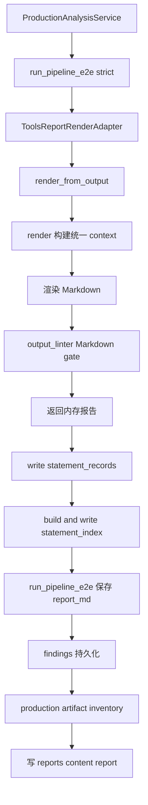
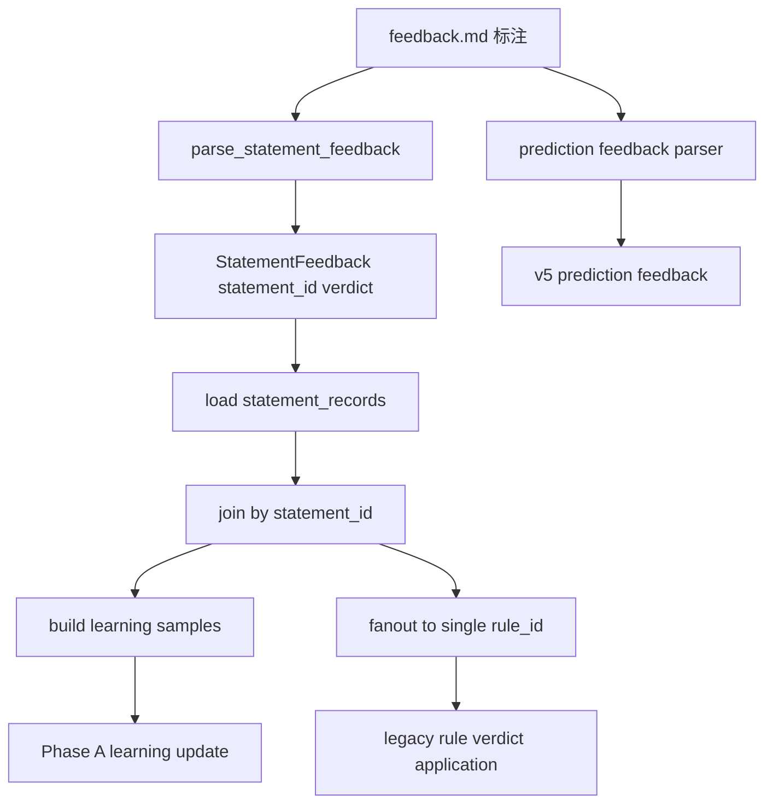

# PI-130 · 报告／statement／feedback 现状审计

> 任务编号：PI-130  
> 文档性质：G1 补证任务的静态现状审计  
> 审计日期：2026-07-19  
> 审计边界：仅记录当前仓库事实；不裁决 G1，不设计 G5，不修改生产实现、冻结语义、案例或报告

---

## 1. 审计目的、范围与方法

本审计落实 [`production-implementation-control.md`](production-implementation-control.md:82) 中 PI-130“盘点报告、statement index 与反馈回路”的要求，并回答报告成功与 statement artifacts 成功是否原子一致、legacy `statement_index.json` 的结构化反馈 fanout 边界、`statement_records.json` 的追踪职责、反馈如何绑定 statement，以及 F01–F12 是否已经进入报告和反馈闭环。

治理边界如下：

1. [`production-implementation-control.md`](production-implementation-control.md:66) 将 G1 保持为 `BLOCKED`；本文无权改变阶段状态。
2. [`production-implementation-g1-calibration-blocker.md`](production-implementation-g1-calibration-blocker.md:62) 已预告标准报告链会尝试生成两类 statement artifact，但 artifact 失败可警告降级；本文补充源码和测试证据。
3. [`production-implementation-pi-110-input-pipeline-audit.md`](production-implementation-pi-110-input-pipeline-audit.md:35) 与 [`production-implementation-pi-120-findings-decision-conflict-audit.md`](production-implementation-pi-120-findings-decision-conflict-audit.md:51) 已建立 `production-default`、旁路／staged 和 v5/v6 preprod 的分账口径；本文沿用该口径。
4. 本次静态阅读 [`tools/render_report.py`](../tools/render_report.py:124)、[`engine/statement_runtime.py`](../engine/statement_runtime.py:1)、[`tools/feedback_ingest.py`](../tools/feedback_ingest.py:859)、[`tools/output_linter.py`](../tools/output_linter.py:498)、生产 artifact 编目、v5/v6 feedback attachment 及必要测试。
5. 对“未发现”类结论严格限定为：本次当前仓库 Python／模板静态搜索和已核调用链未定位到消费者；不证明仓库外部或动态注入绝对不存在。
6. 本审计不运行会写案例、报告、反馈、权重或 META 状态的生产命令。

---

## 2. 结论摘要

### 2.1 总结论

当前仓库存在两套不同的报告—反馈追踪链，不能合并为一个统一闭环：

- `production-default` 以标准 Markdown、`statement_index.json`、`statement_records.json` 和标注式 `feedback.md` 为核心；规则学习 fanout 的唯一结构化来源是 `statement_records.json`。
- v5/v6 preprod 以 v5 output、run snapshot、DecisionRun、feedback attachment 及 prediction ID 为核心；attachment 能证明 feedback 文件与某次 run 的目标 ID 集合相连，但不会替代 production-default 的 statement-record bridge，也不会单独解锁规则学习。

报告成功与 statement artifacts 成功**不是文件事务层面的原子一致**。标准 renderer 先在内存中完成并 lint 报告，再在一个 `try` 中顺序写 `statement_records.json` 和 `statement_index.json`；任何 artifact 异常只发 warning 并返回报告。生产服务后续另有 artifact hard gate，但该 gate 要求的是 `statement_index.json` 与 legacy `statement_rule_map.json`，没有要求 `statement_records.json`，而当前 renderer 又不生成 `statement_rule_map.json`。所以 production job 的准入门与当前反馈学习事实源并未对齐，也不能把 job `completed`、报告文件存在、statement index 存在和 statement-record bridge 完整视为同一原子事实。

F01–F12 当前未发现进入报告渲染、statement artifact、feedback attachment 或结构化反馈 fanout 的运行时消费链。报告源码中出现的 `F5`、`F6`、`F8`、`F9` 是内部注释编号，不能等同于冻结证据卡 ID。

### 2.2 核查矩阵

| 核查项 | `production-default` 结论 | v5/v6 preprod／staged 结论 |
|---|---|---|
| 报告入口 | [`run_pipeline_e2e()`](../engine/application/pipeline_runner.py:174) 经默认 report adapter 调用标准 renderer | [`render_v6_preprod_case()`](../engine/v5/preprod.py:215) 是显式 opt-in 独立 artifact 链 |
| 出口 lint | 标准 [`render()`](../tools/render_report.py:2025) 对 Markdown 执行 lint，ERROR 抛异常 | DecisionRun 和 v5 output 由 linter 的独立 schema 分支检查；preprod renderer先做 DecisionRun trace validation |
| statement index | 从同一 render context 构建展示／追踪索引；不是当前规则学习 fanout 事实源 | `render_from_v5_output()` 只尝试写 index；独立 preprod renderer不以它为主账本 |
| statement records | 从同一 context 生成每个 statement 的单条 runtime anchor record | feedback attachment 绑定 claim／prediction／signal IDs，不是 statement record |
| 反馈绑定 | `feedback.md` 中 `[S-...]` 先绑定 `statement_id`，再 join records | attachment 绑定 `case_id + run_id + target IDs`；prediction feedback另按 prediction ID 处理 |
| rule fanout | 只从 records 的单个 `rule_id` fanout；legacy index 不解锁学习 | attachment 校验摘要不会解锁 statement 学习 |
| 原子性 | renderer 非原子；生产 artifact gate 与 records 事实源不一致 | 多文件顺序写入，无事务／临时整体提交证据 |
| F01–F12 | 未发现进入报告、records、index 或 ingest | 未发现进入 report items、attachment 或 preprod ingest |

---

## 3. `production-default` 报告调用链

### 3.1 调用链

精确调用证据：

1. [`ProductionAnalysisService._run_existing_job()`](../engine/application/production_service.py:141) 以 `do_render=request.render`、`do_self_iter=False` 和 `error_policy=strict` 调用 [`run_pipeline_e2e()`](../engine/application/pipeline_runner.py:174)，见 [`production_service.py`](../engine/application/production_service.py:149) 至 [`production_service.py`](../engine/application/production_service.py:158)。
2. [`run_pipeline_e2e()`](../engine/application/pipeline_runner.py:174) 的 Step 7 调用 report adapter，并把返回 Markdown 附挂为 `output.report_md`，见 [`pipeline_runner.py`](../engine/application/pipeline_runner.py:247) 至 [`pipeline_runner.py`](../engine/application/pipeline_runner.py:261)。strict 只会传播实际抛出的异常，见 [`pipeline_runner.py`](../engine/application/pipeline_runner.py:262)。
3. 默认 [`ToolsReportRenderAdapter.render()`](../engine/infrastructure/adapters/pipeline_adapters.py:42) 委托 [`render_from_output()`](../tools/render_report.py:188)，见 [`pipeline_adapters.py`](../engine/infrastructure/adapters/pipeline_adapters.py:51)。
4. [`render_from_output()`](../tools/render_report.py:188) 拆包 AnalysisOutput、构建最小 parsed fallback、调用 [`render()`](../tools/render_report.py:2025) 并捕获 context，见 [`render_report.py`](../tools/render_report.py:226) 至 [`render_report.py`](../tools/render_report.py:257)。
5. [`render()`](../tools/render_report.py:2025) 当前统一收敛为标准命理师报告，默认使用 v6 模板，见 [`render_report.py`](../tools/render_report.py:2041) 和 [`render_report.py`](../tools/render_report.py:2073)。它在 [`render_report.py`](../tools/render_report.py:2083) 至 [`render_report.py`](../tools/render_report.py:2215) 构建完整 context，先复制给 artifact builder，再渲染 Markdown。
6. Markdown 出口 lint 位于 [`render_report.py`](../tools/render_report.py:2217) 至 [`render_report.py`](../tools/render_report.py:2225)；ERROR 触发 `RenderGuardrailError`，warning 不阻断。
7. lint 通过后，外层 renderer 在 [`render_report.py`](../tools/render_report.py:259) 至 [`render_report.py`](../tools/render_report.py:272) 顺序写 records 和 index。
8. 生产服务在 pipeline 返回后调用 artifact inventory，见 [`production_service.py`](../engine/application/production_service.py:169) 至 [`production_service.py`](../engine/application/production_service.py:183)；报告文件最终由 [`write_report_artifact()`](../engine/application/artifact_inventory.py:103) 写入 [`reports/`](../reports/)。

### 3.2 output linter 的职责边界

[`tools.output_linter.lint()`](../tools/output_linter.py:498) 是多 schema 出口门禁：

- Markdown 分支检查内部 ID 禁显、断语数量、全局措辞、跨域耦合、社会时钟、关系误用、画像框线、parallel Markdown、v6 结构与公历年—干支一致性，见 [`output_linter.py`](../tools/output_linter.py:509) 至 [`output_linter.py`](../tools/output_linter.py:534)。
- production-default 结构化输出检查 conclusions、gate results、全局字段与 parallel trace，见 [`output_linter.py`](../tools/output_linter.py:547) 至 [`output_linter.py`](../tools/output_linter.py:564)。
- 单条结论要求双轨置信度、派别标签、evidence、应期证伪等，见 [`_lint_one_conclusion()`](../tools/output_linter.py:577)。
- parallel statement index 追踪检查位于 [`_lint_parallel_domain_traceability()`](../tools/output_linter.py:745)。
- DecisionRun 走独立 [`_lint_decision_run()`](../tools/output_linter.py:802) 分支。

边界：标准 [`render()`](../tools/render_report.py:2025) lint 的是 Markdown 文本，不是随后写出的 `statement_records.json`／`statement_index.json`。因此“报告通过 lint”不证明两个 statement artifacts 存在、彼此同版本或字段完整。结构化 index 只有在被显式传给 [`lint()`](../tools/output_linter.py:498) 时才会触发 parallel trace 检查；当前标准 artifact 写入段没有再次 lint index 或 records。

---

## 4. statement artifacts 的职责与能力边界

### 4.1 `statement_index.json`：报告视图追踪索引

[`_build_statement_index()`](../tools/render_report.py:1779) 从与报告相同的 context 遍历十类 section，按 `statement_id` 去重，并写入 domain、摘要、section、rule IDs、流派和 runtime metadata，见 [`render_report.py`](../tools/render_report.py:1786) 至 [`render_report.py`](../tools/render_report.py:1839)。parallel adjudication／reading／consistency 还附加 reading、adjudication、expert、conflict 和 note 追踪字段，见 [`render_report.py`](../tools/render_report.py:1840) 至 [`render_report.py`](../tools/render_report.py:1876)。

当前职责可归纳为：

- 将报告 context 中的可回测断语映射到稳定 `statement_id`；
- 保留展示 section、摘要、domain 与多 evidence `rule_ids`；
- 对 parallel-domain 保存 reading／adjudication 追踪链；
- 为反馈人工标注、回测、重算 binding 检查及兼容工具提供 statement 目录。

它**不再是 Dynamic Confidence 规则 fanout 的事实源**。虽然 builder docstring 仍称可让 feedback ingest 直接 fanout，见 [`render_report.py`](../tools/render_report.py:1782)，当前 ingest 明确改为 records-only，见 [`feedback_ingest.py`](../tools/feedback_ingest.py:925)。这是文档注释与当前运行语义的漂移。

### 4.2 legacy index 的结构化反馈 fanout 边界

当前边界由源码和测试同时证明：

1. [`fanout_to_rules()`](../tools/feedback_ingest.py:346) 参数语义是 records envelope，并通过 [`_record_map()`](../tools/feedback_ingest.py:252) 读取顶层 `records`。
2. legacy index 的顶层是 `statements`；即使含 statement ID，传入 fanout 后也得不到 record map。
3. acceptance test [`test_h3_standard_list_schema_without_rule_ids_is_blocked_from_learning()`](../tests/v1_3_acceptance/test_h3_feedback_parsing.py:160) 证明仅有标准 list index 时规则结果为空且 statement ID 被列为 unknown。
4. [`test_h3_statement_records_enable_fanout()`](../tests/v1_3_acceptance/test_h3_feedback_parsing.py:184) 证明 records 才能解锁规则 fanout。
5. [`ingest()`](../tools/feedback_ingest.py:859) 在 records 缺失、无效或为空时只登记反馈完成并阻断旧启发式学习，见 [`feedback_ingest.py`](../tools/feedback_ingest.py:936) 至 [`feedback_ingest.py`](../tools/feedback_ingest.py:963)。

因此 legacy index 的能力上限是 statement 目录、报告追踪、部分 parallel feedback 旁路和兼容审计；它不能单独把 statement verdict fanout 到 Dynamic Confidence 的规则更新。

### 4.3 `statement_records.json`：不可变 statement→rule 运行时桥

[`engine/statement_runtime.py`](../engine/statement_runtime.py:1) 明确把该模块定位为 facts-only artifact builder，不更新 family、school、canon 或动态置信权重。

[`build_statement_records_envelope()`](../engine/statement_runtime.py:70) 的关键语义是：

- 每个唯一 `statement_id` 生成一条 record；缺 ID、缺文本或重复 ID 的项被跳过，见 [`statement_runtime.py`](../engine/statement_runtime.py:84) 至 [`statement_runtime.py`](../engine/statement_runtime.py:93)。
- 同一可见 statement 有多条 evidence rule 时，仅选择第一条有 rule ID 的 evidence 作为 runtime anchor，见 [`statement_runtime.py`](../engine/statement_runtime.py:78) 至 [`statement_runtime.py`](../engine/statement_runtime.py:101)。
- record 保存 case、rule、family、school、canon、rule type、statement text、静态 confidence snapshot、生成时间及 engine/rule schema version，见 [`statement_runtime.py`](../engine/statement_runtime.py:102) 至 [`statement_runtime.py`](../engine/statement_runtime.py:127)。
- 缺少 Phase-A 关键字段会被填为 `UNMAPPED`，见 [`enforce_statement_record()`](../engine/statement_runtime.py:152)；完整性统计由 [`validate_statement_records()`](../engine/statement_runtime.py:163) 计算，但 builder 不因 `missing_field_count > 0` 自动抛错。
- [`write_statement_records()`](../engine/statement_runtime.py:131) 直接向目标文件写完整 JSON；没有临时文件 + rename 或跨文件事务。

职责结论：records 是反馈 statement ID 到单个稳定 rule anchor 的运行时桥和版本快照，不是完整多规则 evidence 图。index 可以保留 `rule_ids` 多值，而 records 当前只保留第一条 anchor rule；因此规则 fanout 的能力边界是“一条 statement 最多 fanout 到 records 中那一个 `rule_id`”，不是向 index 所列全部证据规则扩散。

### 4.4 两类 artifact 的覆盖范围

两者从相同 section 列表取数：作功路径、生产规则结论、共识、互补、铁断、婚姻旁证、健康旁证、parallel 结论、parallel readings 和 consistency notes。records 的 section 列表见 [`_iter_statement_items()`](../engine/statement_runtime.py:230)，index 列表见 [`_build_statement_index()`](../tools/render_report.py:1786)。

但是它们不是同一写入：records 先写，index 后写，且外层一个 exception handler 包住二者。若 records 成功、index 失败，会留下新 records 与旧／缺失 index；若 records 失败，index 不会尝试写；若二者成功后后续 production artifact gate 失败，两个文件仍会留在案例目录。

---

## 5. 报告与 statement artifacts 的原子一致性审计

### 5.1 renderer 层：明确非原子

[`render_from_output()`](../tools/render_report.py:188) 的执行顺序是：

1. 可选保存 findings；失败 warning 降级，见 [`render_report.py`](../tools/render_report.py:214)。
2. 构建并 lint Markdown；lint ERROR 会抛异常。
3. 顺序调用 [`write_statement_records()`](../engine/statement_runtime.py:131) 和 [`_build_statement_index()`](../tools/render_report.py:1779)，见 [`render_report.py`](../tools/render_report.py:265)。
4. 任一 statement artifact 异常只发 RuntimeWarning，仍返回报告，见 [`render_report.py`](../tools/render_report.py:273) 至 [`render_report.py`](../tools/render_report.py:281)。

所以在 renderer API 层，以下状态均可能出现：

- 报告字符串成功 + records 缺失 + index 缺失；
- 报告字符串成功 + records 已更新 + index 缺失或仍为旧版本；
- 报告字符串成功 + 两类 artifact 成功；
- lint 失败时 context 已构建但 statement artifacts 尚未写。

### 5.2 production service 层：有准入 hard gate，但与反馈事实源错位

[`collect_analysis_artifacts()`](../engine/application/artifact_inventory.py:40) 要求六类 findings、`statement_index.json`、`statement_rule_map.json`，render 开启时再要求报告，见 [`artifact_inventory.py`](../engine/application/artifact_inventory.py:18) 至 [`artifact_inventory.py`](../engine/application/artifact_inventory.py:29) 和 [`artifact_inventory.py`](../engine/application/artifact_inventory.py:52)。缺失时抛 [`ArtifactGateError`](../engine/application/artifact_inventory.py:32)，production job 被置为 failed，见 [`production_service.py`](../engine/application/production_service.py:194)。

但存在三个关键错位：

1. hard gate **不要求 `statement_records.json`**，而 feedback ingest 明确以 records 为规则学习事实源。
2. hard gate 要求 `statement_rule_map.json`，但本次对当前 [`tools/render_report.py`](../tools/render_report.py:1) 的静态搜索未发现生成该文件；当前 renderer 生成的是 records 和 index。生产是否成功可能依赖案例目录里预先存在／由其他流程生成的 legacy map。
3. artifact inventory 在最终检查 missing 之前会先把内存报告写入 reports，见 [`artifact_inventory.py`](../engine/application/artifact_inventory.py:80) 至 [`artifact_inventory.py`](../engine/application/artifact_inventory.py:99)。因此 job 最终 failed 时，报告文件仍可能已经存在；这不是回滚事务。

测试 [`test_submit_hard_fails_when_required_artifact_is_missing()`](../tests/test_production_service.py:360) 证明缺少 required artifact 会使 job failed，并明确断言缺 `statement_rule_map`，见 [`test_production_service.py`](../tests/test_production_service.py:403)。现有 production service fixture 在成功路径中手工创建 legacy map，见 [`test_production_service.py`](../tests/test_production_service.py:125)。本次未定位到 production service 测试要求 `statement_records.json` 存在。

### 5.3 结论

必须区分三个层次：

- **renderer 成功**：只证明返回了 lint 通过的 Markdown；statement artifacts 可能 warning 降级。
- **production job completed**：证明 artifact inventory 当时看到了其 required 集合；不证明 records 存在或是同次 render 生成。
- **反馈桥完整**：要求 feedback statement ID 可 join 到完整 mapped records；这由 [`build_learning_samples()`](../tools/feedback_ingest.py:281) 和 [`fanout_to_rules()`](../tools/feedback_ingest.py:346) 判定，不能由报告文件或 index 文件存在替代。

当前三者不具备原子一致性。

---

## 6. 反馈摄入如何绑定 statement

### 6.1 production-default 结构化绑定

[`ingest()`](../tools/feedback_ingest.py:859) 的实际链为：

具体语义：

1. feedback parser 从 `feedback.md` 解析 `[S-...] [y/n/?/skip]`，入口步骤见 [`feedback_ingest.py`](../tools/feedback_ingest.py:902) 至 [`feedback_ingest.py`](../tools/feedback_ingest.py:906)。
2. ingest 读取 `statement_records.json`，明确不再以 legacy index/map 作为 bridge fanout 来源，见 [`feedback_ingest.py`](../tools/feedback_ingest.py:925)。
3. [`build_learning_samples()`](../tools/feedback_ingest.py:281) 按 `statement_id` join record；record 还必须具备 statement、rule、family、school、canon、rule type 且不能是 `UNMAPPED`，判定见 [`_record_is_mapped()`](../tools/feedback_ingest.py:270)。无法 join 或 metadata 不完整的行标记 `needs_mapping_repair` 并排除学习，见 [`feedback_ingest.py`](../tools/feedback_ingest.py:287) 至 [`feedback_ingest.py`](../tools/feedback_ingest.py:342)。
4. [`fanout_to_rules()`](../tools/feedback_ingest.py:346) 将每条反馈映射到 record 的单个 rule ID；同一 rule 收到多条 verdict 时按 miss > hit > abstain > no_data 选择更强结果，优先级定义见 [`feedback_ingest.py`](../tools/feedback_ingest.py:177)，执行见 [`feedback_ingest.py`](../tools/feedback_ingest.py:356)。
5. unknown statement ID 被忽略并写审计 note，见 [`feedback_ingest.py`](../tools/feedback_ingest.py:1008)。
6. records 缺失或无结构化反馈时不更新规则，但非 dry-run 仍会把案例计入“完成反馈”状态，见 [`feedback_ingest.py`](../tools/feedback_ingest.py:936) 至 [`feedback_ingest.py`](../tools/feedback_ingest.py:963)。所以“完成反馈案计数增加”不等于“形成了可学习样本”。
7. production service 默认固定 `do_self_iter=False`，见 [`production_service.py`](../engine/application/production_service.py:154)；报告生成和反馈摄入不是单次 production submit 中自动闭合的事务。

### 6.2 parallel-domain 旁路边界

[`fanout_to_parallel_feedback()`](../tools/feedback_ingest.py:383) 能从 `statement_index.json` 的 parallel 追踪字段产生 reading／adjudication 级日志；这是一条局部旁路，不是 Dynamic Confidence 规则 fanout。当前 [`ingest()`](../tools/feedback_ingest.py:859) 的主路径初始化 parallel counts，但本次所读片段未定位到调用该函数的语句；因此不能仅凭函数存在宣称默认 ingest 已实际执行该旁路。

### 6.3 重算 binding 检查边界

[`_build_feedback_binding_check()`](../engine/application/recompute.py:168) 用 index statement IDs 对照 feedback 文本和结构化反馈，输出 unknown IDs 与 ready 状态。它证明 index-level 可引用性，不检查 records 是否完整，也不能证明规则 fanout 可学习。重算 hard gate 只要求非空 index，见 [`_assert_statement_index_ready()`](../engine/application/recompute.py:160)。

---

## 7. v5/v6 preprod feedback attachment 分账

### 7.1 artifact 链

[`render_v6_preprod_case()`](../engine/v5/preprod.py:215) 是独立 opt-in 预生产链。它生成：

- v6 preprod report；
- `.v5.json`；
- `.run.json`；
- `.decision-run.json`；
- `.feedback-attachment.json`；
- case `manifest.json`。

路径绑定建立于 [`preprod.py`](../engine/v5/preprod.py:243) 至 [`preprod.py`](../engine/v5/preprod.py:264)，写入顺序位于 [`preprod.py`](../engine/v5/preprod.py:278) 至 [`preprod.py`](../engine/v5/preprod.py:301)。这些是多个顺序写文件，也没有整体事务提交或失败回滚证据。

### 7.2 attachment 的职责

[`V5FeedbackAttachment`](../engine/v5/domain.py:562) 只记录：

- `case_id`；
- `run_id`；
- `feedback_path`；
- target claim IDs；
- target prediction IDs；
- target signal IDs。

其设计明确是不解析 Markdown、不写反馈数据库，而先证明 feedback 能绑定 run snapshot 而非报告文本片段，见 [`domain.py`](../engine/v5/domain.py:563) 至 [`domain.py`](../engine/v5/domain.py:568)。[`from_run_snapshot()`](../engine/v5/domain.py:579) 从 snapshot 构建目标集合；[`validate_targets()`](../engine/v5/domain.py:597) 只验证目标 ID 是否存在于相同 snapshot。

### 7.3 ingest 消费边界

[`_validate_v5_feedback_attachment()`](../tools/feedback_ingest.py:778) 在 ingest 开始时校验 attachment 与 run snapshot 的 case、run 和目标 ID，并把摘要放入结果，调用见 [`feedback_ingest.py`](../tools/feedback_ingest.py:894)。但：

- attachment 本身不把 statement feedback 映射到 statement records；
- attachment `ok` 不解锁 Dynamic Confidence 学习；
- test [`test_ingest_includes_v5_feedback_attachment_summary_without_unblocking_learning()`](../tests/v1_3_acceptance/test_h3_feedback_parsing.py:474) 证明 attachment 有效但 records 缺失时仍 `skipped_no_index=True`、学习样本数为 0；
- prediction feedback 是 ingest 中独立解析和应用的 ID 通道，见 [`feedback_ingest.py`](../tools/feedback_ingest.py:902) 至 [`feedback_ingest.py`](../tools/feedback_ingest.py:923)。

测试 [`test_render_report_v6_generates_report_and_v5_json()`](../tests/v5/test_render_report_v6.py:56) 证明 preprod 正常路径生成 report、run、DecisionRun、attachment，并验证 attachment 与 snapshot 目标一致，见 [`test_render_report_v6.py`](../tests/v5/test_render_report_v6.py:62) 至 [`test_render_report_v6.py`](../tests/v5/test_render_report_v6.py:112)。这只能证明 preprod artifact 绑定，不可外推为 production-default statement bridge 已完整。

### 7.4 staged 边界

PI-110 已证明 staged parallel runner 明确不落盘，见 [`production-implementation-pi-110-input-pipeline-audit.md`](production-implementation-pi-110-input-pipeline-audit.md:194)；因此 staged arbitration 结果不能被描述为默认存在 statement artifact 或 feedback attachment。本文未发现 staged runner 进入标准 feedback ingest 的绑定链。

---

## 8. F01–F12 报告与反馈闭环核查

核查对象是 [`mapping/real-world-function-evidence-cards-v1.yaml`](../mapping/real-world-function-evidence-cards-v1.yaml:1) 及冻结契约 [`12-real-world-function-evidence-cards-v1.md`](../engine/contracts/12-real-world-function-evidence-cards-v1.md:1)。

### 8.1 静态核查结果

对当前仓库以下范围执行文件名和 `F01`–`F12` 标识静态搜索：

- [`engine/`](../engine/) Python：未发现完整 mapping 文件名或证据卡 ID 的运行时引用；
- [`tools/`](../tools/) Python：未发现完整 mapping 文件名或证据卡 ID 的运行时引用；
- [`templates/`](../templates/) Markdown：未发现 F01–F12 卡 ID；
- 标准 renderer、statement runtime、feedback ingest、output linter、v5/v6 preprod 与 attachment 模型中均未定位到该 YAML loader 或卡片字段消费者。

### 8.2 逐卡闭环状态

| 卡片 | 进入标准报告 | 进入 statement index／records | 可由 feedback statement 绑定 | 可 fanout 到规则学习 | 进入 preprod attachment | 当前结论 |
|---|---|---|---|---|---|---|
| F01 | 未发现 | 未发现 | 未发现 | 未发现 | 未发现 | 未接入闭环 |
| F02 | 未发现 | 未发现 | 未发现 | 未发现 | 未发现 | 未接入闭环 |
| F03 | 未发现 | 未发现 | 未发现 | 未发现 | 未发现 | 未接入闭环 |
| F04 | 未发现 | 未发现 | 未发现 | 未发现 | 未发现 | 未接入闭环 |
| F05 | 未发现 | 未发现 | 未发现 | 未发现 | 未发现 | 未接入闭环 |
| F06 | 未发现 | 未发现 | 未发现 | 未发现 | 未发现 | 未接入闭环 |
| F07 | 未发现 | 未发现 | 未发现 | 未发现 | 未发现 | 未接入闭环 |
| F08 | 未发现 | 未发现 | 未发现 | 未发现 | 未发现 | 未接入闭环 |
| F09 | 未发现 | 未发现 | 未发现 | 未发现 | 未发现 | 未接入闭环 |
| F10 | 未发现 | 未发现 | 未发现 | 未发现 | 未发现 | 未接入闭环 |
| F11 | 未发现 | 未发现 | 未发现 | 未发现 | 未发现 | 未接入闭环 |
| F12 | 未发现 | 未发现 | 未发现 | 未发现 | 未发现 | 未接入闭环 |

### 8.3 防误判说明

[`render()`](../tools/render_report.py:2025) 内注释出现 `F5`、`F6`、`F8`、`F9`，见 [`render_report.py`](../tools/render_report.py:2135) 至 [`render_report.py`](../tools/render_report.py:2171)。这些是不带前导零的历史功能／测试标记，分别指 15 层显示、流年回溯、结构总览和大运全表；没有证据把它们连接到冻结证据卡 F05／F06／F08／F09。不得据此声称任一证据卡已进入报告。

结论仅限于当前仓库静态和已核调用链：F01–F12 仍是冻结声明性事实源，未证明成为报告 statement、feedback attachment target 或可学习 rule anchor。

---

## 9. 可复用组件

“可复用”只表示当前组件职责和调用证据清楚，不构成后续设计裁决。

| 组件 | 已确认能力 | 轨道 | 证据 |
|---|---|---|---|
| [`ToolsReportRenderAdapter`](../engine/infrastructure/adapters/pipeline_adapters.py:39) | 稳定 report port 到工具 renderer 的默认接线 | production-default | [`pipeline_adapters.py`](../engine/infrastructure/adapters/pipeline_adapters.py:42) |
| [`render_from_output()`](../tools/render_report.py:188) | 从 AnalysisOutput 生成标准报告并尝试写 statement artifacts | production-default | [`render_report.py`](../tools/render_report.py:214) |
| [`render()`](../tools/render_report.py:2025) | 统一 context、标准 Markdown 与出口 lint | production-default | [`render_report.py`](../tools/render_report.py:2083) |
| [`_build_statement_index()`](../tools/render_report.py:1779) | statement 目录、多规则 evidence 与 parallel 追踪字段 | production-default／parallel | [`render_report.py`](../tools/render_report.py:1786) |
| [`build_statement_records_envelope()`](../engine/statement_runtime.py:70) | statement→单一 rule anchor 的不可变 facts envelope | production-default | [`statement_runtime.py`](../engine/statement_runtime.py:84) |
| [`validate_statement_records()`](../engine/statement_runtime.py:163) | records 缺字段计数 | production-default | [`statement_runtime.py`](../engine/statement_runtime.py:166) |
| [`lint()`](../tools/output_linter.py:498) | Markdown、production、DecisionRun、v5 多分支门禁 | 多轨道 | [`output_linter.py`](../tools/output_linter.py:509) |
| [`parse_statement_feedback`](../engine/application/feedback_parser.py) | 标注式 feedback 解析为 statement verdict | production-default feedback | 引入点 [`feedback_ingest.py`](../tools/feedback_ingest.py:61) |
| [`build_learning_samples()`](../tools/feedback_ingest.py:281) | records join、mapping repair 标记和可学习样本 | production-default feedback | [`feedback_ingest.py`](../tools/feedback_ingest.py:292) |
| [`fanout_to_rules()`](../tools/feedback_ingest.py:346) | statement verdict 到单一 rule anchor | production-default feedback | [`feedback_ingest.py`](../tools/feedback_ingest.py:352) |
| [`collect_analysis_artifacts()`](../engine/application/artifact_inventory.py:40) | production job artifact 编目和缺失 hard fail | production service | [`artifact_inventory.py`](../engine/application/artifact_inventory.py:50) |
| [`V5FeedbackAttachment`](../engine/v5/domain.py:562) | feedback 与 run snapshot 的 claim／prediction／signal 目标绑定 | v5/v6 preprod | [`domain.py`](../engine/v5/domain.py:579) |
| [`_validate_v5_feedback_attachment()`](../tools/feedback_ingest.py:778) | 校验 attachment 的 case、run 和 target IDs | preprod ingest 辅助 | [`feedback_ingest.py`](../tools/feedback_ingest.py:835) |

---

## 10. 缺口与失败模式

### 10.1 当前缺口

1. **报告与 statement artifacts 非原子。** report lint／返回、records 写入、index 写入、reports 落盘和 job complete 分属多个步骤，无跨文件事务。
2. **production artifact gate 与当前学习事实源错位。** gate 要求 legacy `statement_rule_map.json`，不要求 `statement_records.json`；renderer 恰好生成后者而不生成前者。
3. **records 完整性不是 hard gate。** `missing_field_count` 会统计，但不会自动阻断写入、renderer 返回或 production job。
4. **index docstring 与 ingest 语义漂移。** index builder 仍称可直接 fanout；当前 ingest 已 records-only。
5. **多规则证据在 fanout 时收缩。** index 可保留多个 `rule_ids`，records 只取第一条 anchor；反馈不会向所有 supporting rules fanout。
6. **完成反馈计数与学习成功不等价。** records 缺失／反馈无结构化映射时仍可能登记案例完成。
7. **标准 report lint 不验证随后写出的 records/index。** parallel index lint 需要显式结构化调用；records 没有接入 output linter。
8. **preprod attachment 与 statement bridge 分离。** attachment `ok` 只证明 run target 完整，不形成 statement learning sample。
9. **preprod 多 artifact 写入非原子。** report、v5、run、attachment、manifest、DecisionRun 顺序写入，中途失败可留下部分集合。
10. **production 默认不自动 ingest。** `do_self_iter=False` 使报告→反馈必须是后续独立操作。
11. **F01–F12 无已证明报告／反馈接线。** 当前没有卡片 loader、report item、statement record 或 feedback target 证据。
12. **parallel feedback 默认消费证据不足。** 存在旁路函数，但本次未定位到主 ingest 调用；不得把可调用能力写成默认行为。

### 10.2 失败模式表

| 失败模式 | 可观察结果 | 是否阻断 renderer | 是否阻断 production job | 对反馈的影响 |
|---|---|---:|---:|---|
| Markdown lint ERROR | 抛 `RenderGuardrailError` | 是 | strict 路径是 | 不写本次 statement artifacts |
| findings 保存失败于 renderer 内 | warning | 否 | 后续 inventory 通常会因缺 findings 失败 | 溯源材料缺失 |
| records 写失败 | warning，index 不再尝试 | 否 | records 本身不在 required gate；结果取决于其他 artifacts | 规则学习被阻断或使用旧 records |
| records 成功、index 写失败 | 新 records + 旧／缺 index | 否 | index 缺失会阻断；旧 index 可能通过存在性 gate | 人工目录与学习桥可能版本错位 |
| records 含 `UNMAPPED` | 文件存在且统计 missing | 否 | 不因 records 内容阻断 | 相关反馈标记 repair，不进入学习 |
| legacy map 缺失 | 报告可能已写，job failed | 否 | 是 | 与实际 records 完整性无直接等价关系 |
| stale legacy map／index 已存在 | existence gate 可能通过 | 否 | 可能不阻断 | 不能证明与本次 report 同源同版本 |
| feedback statement ID 不在 records | unknown sid 审计 | 不适用 | 不适用 | 忽略该 statement 的规则更新 |
| records 缺失／为空 | 反馈完成可计数 | 不适用 | 不适用 | 学习样本 0，旧启发式被阻断 |
| attachment 缺失／mismatch | ingest 摘要为 missing／mismatch | 不适用 | 不影响 production-default report | preprod run target 追踪不完整，但不决定 statement fanout |
| preprod 中途写失败 | 部分 artifact 遗留 | preprod 调用抛异常 | opt-in production service 会 failed | run／attachment／manifest 可能不齐 |
| F01–F12 未接线 | 报告和反馈无卡片身份 | 否 | 否 | 无法按卡片判定形成闭环样本 |

---

## 11. 不可触碰边界

1. 不修改 [`production/`](../production/)、[`mapping/`](../mapping/)、[`engine/`](../engine/)、[`tools/`](../tools/)、[`tests/`](../tests/)、[`templates/`](../templates/)、[`META/`](../META/)、[`cases/`](../cases/) 或 [`reports/`](../reports/)。
2. 不把 v5/v6 preprod report、DecisionRun 或 feedback attachment 描述为 `production-default` 的 statement 协议。
3. 不把 legacy index／map 重新解释为当前 Dynamic Confidence fanout 事实源。
4. 不把 `statement_records.json` 描述为完整多规则 evidence 图；当前每 statement 只保留一个 anchor rule。
5. 不把 report lint PASS、artifact 文件存在、production job completed 或 feedback case 完成计数等同于可学习闭环成功。
6. 不把 attachment target validation 等同于 statement feedback mapping。
7. 不把 staged runner 的模型能力外推成默认持久化或反馈消费能力。
8. 不把 renderer 注释中的 `F5`／`F6`／`F8`／`F9` 当成冻结证据卡 F05／F06／F08／F09。
9. 不修改或重新裁决 F01–F12 业务语义，不把声明性 YAML 直接变成执行逻辑。
10. 不裁决 G1，不改变 PI-195 `BLOCKED`，不启动 G2–G5，不设计 G5。
11. 本任务唯一写入是本审计文件。

---

## 12. 精确证据索引

### 12.1 治理与分账

- PI-130 定义：[`production-implementation-control.md`](production-implementation-control.md:82)
- G1 阻断：[`production-implementation-control.md`](production-implementation-control.md:66)
- PI-130 已知边界：[`production-implementation-g1-calibration-blocker.md`](production-implementation-g1-calibration-blocker.md:62)
- 生产／preprod 分账：[`production-implementation-g1-calibration-blocker.md`](production-implementation-g1-calibration-blocker.md:72)
- PI-110 分账口径：[`production-implementation-pi-110-input-pipeline-audit.md`](production-implementation-pi-110-input-pipeline-audit.md:35)
- PI-120 多轨道 linter：[`production-implementation-pi-120-findings-decision-conflict-audit.md`](production-implementation-pi-120-findings-decision-conflict-audit.md:202)

### 12.2 production-default 报告

- strict production 调用：[`ProductionAnalysisService._run_existing_job()`](../engine/application/production_service.py:141)
- render 与 self-iteration 参数：[`production_service.py`](../engine/application/production_service.py:149)
- e2e render step：[`run_pipeline_e2e()`](../engine/application/pipeline_runner.py:174)、[`pipeline_runner.py`](../engine/application/pipeline_runner.py:247)
- 默认 report adapter：[`ToolsReportRenderAdapter.render()`](../engine/infrastructure/adapters/pipeline_adapters.py:42)
- 高级 renderer：[`render_from_output()`](../tools/render_report.py:188)
- report context 与 lint：[`render()`](../tools/render_report.py:2025)、[`render_report.py`](../tools/render_report.py:2212)
- statement artifact warning 降级：[`render_report.py`](../tools/render_report.py:259)
- report artifact 写入：[`write_report_artifact()`](../engine/application/artifact_inventory.py:103)

### 12.3 statement index 与 records

- index builder：[`_build_statement_index()`](../tools/render_report.py:1779)
- index 基础字段：[`render_report.py`](../tools/render_report.py:1826)
- parallel index 字段：[`render_report.py`](../tools/render_report.py:1840)
- records schema 与必需字段：[`statement_runtime.py`](../engine/statement_runtime.py:18)
- records builder：[`build_statement_records_envelope()`](../engine/statement_runtime.py:70)
- 单一 anchor rule：[`statement_runtime.py`](../engine/statement_runtime.py:78)
- records 写入：[`write_statement_records()`](../engine/statement_runtime.py:131)
- UNMAPPED enforcement：[`enforce_statement_record()`](../engine/statement_runtime.py:152)
- records validation：[`validate_statement_records()`](../engine/statement_runtime.py:163)
- records section 范围：[`_iter_statement_items()`](../engine/statement_runtime.py:230)
- records 生成 smoke：[`test_F_render_from_output_writes_statement_records()`](../tests/track_f_smoke/test_f_render.py:349)

### 12.4 artifact gate 与原子性

- required findings／case artifacts：[`artifact_inventory.py`](../engine/application/artifact_inventory.py:18)
- production hard gate 说明：[`artifact_inventory.py`](../engine/application/artifact_inventory.py:50)
- report 先写、最终再 raise missing：[`artifact_inventory.py`](../engine/application/artifact_inventory.py:80)
- 缺 artifact job failure test：[`test_submit_hard_fails_when_required_artifact_is_missing()`](../tests/test_production_service.py:360)
- legacy map failure assertion：[`test_production_service.py`](../tests/test_production_service.py:403)

### 12.5 feedback bridge

- records map：[`_record_map()`](../tools/feedback_ingest.py:252)
- mapped record 门：[`_record_is_mapped()`](../tools/feedback_ingest.py:270)
- learning samples：[`build_learning_samples()`](../tools/feedback_ingest.py:281)
- rule fanout：[`fanout_to_rules()`](../tools/feedback_ingest.py:346)
- parallel feedback 旁路：[`fanout_to_parallel_feedback()`](../tools/feedback_ingest.py:383)
- ingest 主入口：[`ingest()`](../tools/feedback_ingest.py:859)
- records-only 路径：[`feedback_ingest.py`](../tools/feedback_ingest.py:925)
- records 缺失时只计完成：[`feedback_ingest.py`](../tools/feedback_ingest.py:936)
- legacy index 被阻断测试：[`test_h3_standard_list_schema_without_rule_ids_is_blocked_from_learning()`](../tests/v1_3_acceptance/test_h3_feedback_parsing.py:160)
- records 解锁 fanout 测试：[`test_h3_statement_records_enable_fanout()`](../tests/v1_3_acceptance/test_h3_feedback_parsing.py:184)
- recompute index binding check：[`_build_feedback_binding_check()`](../engine/application/recompute.py:168)

### 12.6 output linter

- lint 主入口：[`lint()`](../tools/output_linter.py:498)
- Markdown 分支：[`output_linter.py`](../tools/output_linter.py:509)
- production／v5 分派：[`output_linter.py`](../tools/output_linter.py:540)
- 单条结论门：[`_lint_one_conclusion()`](../tools/output_linter.py:577)
- parallel index trace：[`_lint_parallel_domain_traceability()`](../tools/output_linter.py:745)
- DecisionRun lint：[`_lint_decision_run()`](../tools/output_linter.py:802)

### 12.7 v5/v6 preprod attachment

- preprod renderer：[`render_v6_preprod_case()`](../engine/v5/preprod.py:215)
- artifact 路径：[`preprod.py`](../engine/v5/preprod.py:243)
- 多 artifact 顺序写入：[`preprod.py`](../engine/v5/preprod.py:278)
- attachment 模型：[`V5FeedbackAttachment`](../engine/v5/domain.py:562)
- attachment 构建：[`V5FeedbackAttachment.from_run_snapshot()`](../engine/v5/domain.py:579)
- target validation：[`V5FeedbackAttachment.validate_targets()`](../engine/v5/domain.py:597)
- ingest attachment 校验：[`_validate_v5_feedback_attachment()`](../tools/feedback_ingest.py:778)
- attachment 不解锁学习测试：[`test_ingest_includes_v5_feedback_attachment_summary_without_unblocking_learning()`](../tests/v1_3_acceptance/test_h3_feedback_parsing.py:474)
- preprod artifact 测试：[`test_render_report_v6_generates_report_and_v5_json()`](../tests/v5/test_render_report_v6.py:56)

### 12.8 F01–F12

- 正式契约：[`12-real-world-function-evidence-cards-v1.md`](../engine/contracts/12-real-world-function-evidence-cards-v1.md:1)
- 声明性机器附录：[`real-world-function-evidence-cards-v1.yaml`](../mapping/real-world-function-evidence-cards-v1.yaml:1)
- 禁止可执行逻辑：[`real-world-function-evidence-cards-v1.yaml`](../mapping/real-world-function-evidence-cards-v1.yaml:5)
- renderer 内部历史 F 注释：[`render_report.py`](../tools/render_report.py:2135)

---

## 13. 自检记录

| 自检项 | 结果 |
|---|---|
| 是否只执行 PI-130、未递归委派 | 通过 |
| 是否先读取四份指定治理／审计文件 | 通过 |
| 是否明确区分 `production-default` 与 v5/v6 preprod／staged | 通过 |
| 是否追踪标准报告入口、renderer、context 与 report 落盘 | 通过 |
| 是否追踪 `statement_index.json` 与 `statement_records.json` 的生产者和职责 | 通过 |
| 是否核查报告成功与 statement artifacts 是否原子一致 | 通过；结论为非原子，且 production gate 与 records 事实源错位 |
| 是否核查 legacy index 的结构化 feedback fanout 边界 | 通过；不能单独解锁规则学习 |
| 是否核查 records 的追踪职责和单一 anchor 限制 | 通过 |
| 是否说明 feedback 如何按 statement ID 绑定并 fanout | 通过 |
| 是否追踪 feedback attachment 及其 run target 边界 | 通过 |
| 是否追踪 output linter 与各 schema 分支 | 通过 |
| 是否引用必要测试证据 | 通过 |
| 是否逐项核查 F01–F12 报告／反馈闭环 | 通过；当前均未发现接线 |
| 是否列出可复用组件、缺口、失败模式、不可触碰边界与精确证据 | 通过 |
| 是否修改 production、mapping、engine、tools、tests、templates、META、cases、reports | 否 |
| 是否裁决 G1、改变 PI-195 或设计 G5 | 否 |
| 本任务写入文件 | 仅 [`production-implementation-pi-130-report-statement-feedback-audit.md`](production-implementation-pi-130-report-statement-feedback-audit.md:1) |

---

## 14. 审计结语

PI-130 的当前证据表明：标准报告 renderer、statement index、statement records、标注式 feedback ingest、规则 fanout、output linter 与 preprod feedback attachment 都已有可定位组件，但它们没有形成一个跨文件、跨轨道、原子一致的统一事务。`statement_records.json` 已是规则学习 bridge 的事实源，legacy index 不能单独 fanout；production artifact gate 却仍要求 legacy map 而不要求 records。v5/v6 attachment 可验证 feedback 与 run targets 的绑定，但不会替代 statement bridge。F01–F12 当前未发现进入报告或反馈闭环。

本结论只完成 PI-130 持久化现状补证，不改变 G1 阶段门、生产行为或冻结业务语义。
