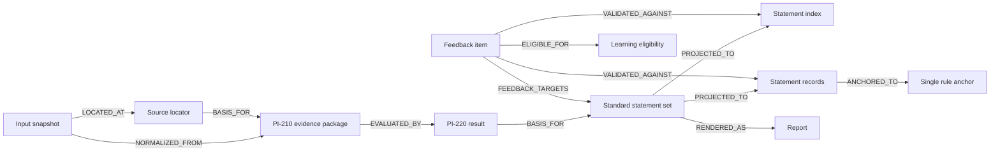

# PI-230：审计轨迹、来源绑定、standard statement 与 feedback 追溯契约

> `task_id`: PI-230  
> `parent_task_id`: PI-200  
> 状态：G2 设计产物，待 PI-290 独立汇总与验收  
> 边界：仅定义可追溯性与绑定协议；不修改生产代码、默认行为、冻结业务语义或判定逻辑

## 1. 目的与结论

本文在 [`production-implementation-pi-210-normalized-evidence-model.md`](production-implementation-pi-210-normalized-evidence-model.md) 的规范化证据模型和 [`production-implementation-pi-220-decision-interface.md`](production-implementation-pi-220-decision-interface.md) 的判定输出边界之上，定义从输入来源到反馈学习准入的完整审计协议：

```text
input / source locator
  → normalized evidence
  → gate / decision
  → standard statement
  → statement_records / statement_index
  → feedback
```

核心设计结论如下：

1. 使用稳定对象 ID、不可变快照引用和有类型的 trace edge 建立全链引用图；自由文本、文件路径或列表位置均不能单独充当稳定身份。
2. PI-230 只引用 PI-220 的 `DecisionEvaluationResult`、`DecisionActionEnvelope`、记录 ID、issue ID 与 source decision ref，不重做门、竞争、反证、根源、时序或五动作判定。
3. `StandardStatement` 是判定输出到展示与反馈之间的规范中间对象；`statement_index` 和 `statement_records` 是它的两个不同投影，而不是彼此的替代品。
4. 多规则证据链降为单 anchor 是显式 `LOSSY` 转换；必须保留完整来源集合、选中 anchor、未进入 fanout 的规则和转换记录。
5. 报告、records、index、manifest 与反馈绑定按独立 artifact 状态建模；任何单文件成功都不代表整组原子提交成功。
6. 重试以已冻结的 run、statement set 和内容摘要为边界；artifact 重试不得重新判定、重新生成 statement 身份或重复摄入反馈。
7. production-default 与 v5/v6 preprod 使用不同账本和不同学习准入协议；只能在审计图中引用，不能语义合并。
8. 未知、未映射、跨 run、跨版本、摘要不匹配或来源链不完整的 statement feedback 必须 fail closed，不得进入学习。
9. F01–F12 card identity 可以作为冻结声明审计引用进入链路，但该引用只证明使用了哪个冻结字段，不证明 runtime consumer、门判定或生产接线已经实现。

## 2. 规范性事实源与优先级

1. [`engine/contracts/12-real-world-function-evidence-cards-v1.md`](../engine/contracts/12-real-world-function-evidence-cards-v1.md)：F01–F12 正式冻结语义。
2. [`mapping/real-world-function-evidence-cards-v1.yaml`](../mapping/real-world-function-evidence-cards-v1.yaml)：声明性机器附录，只允许精确读取字段、枚举、路径和值；不得作为脚本执行。
3. [`production-implementation-pi-210-normalized-evidence-model.md`](production-implementation-pi-210-normalized-evidence-model.md)：规范化证据、来源定位、关系图和转换记录的上游模型。
4. [`production-implementation-pi-220-decision-interface.md`](production-implementation-pi-220-decision-interface.md)：gate／decision 的唯一预期输出边界。
5. [`production-implementation-pi-130-report-statement-feedback-audit.md`](production-implementation-pi-130-report-statement-feedback-audit.md)：现有报告、statement artifacts、feedback bridge 与 preprod attachment 的事实审计。
6. [`production-implementation-control.md`](production-implementation-control.md)：阶段、依赖与独立验收治理。

冲突时按以上顺序处理。PI-230 不覆盖 PI-210 或 PI-220，也不以现有 legacy 文件形状反向限制规范身份模型。

## 3. 明确非目标

PI-230 不包含以下内容：

- 不定义任何 F01–F12 的必要门解释、竞争胜负、反证效果、根源判断、时序判断或卡片结论；
- 不定义评分、权重、排序、投票、置信度重算或动作选择算法；
- 不把声明性 YAML 的自然语言字段编译为代码；
- 不修改 `statement_records.json`、`statement_index.json`、renderer、feedback ingest、DecisionRun 或 attachment 的现有实现；
- 不修改 production artifact hard gate；只记录其与当前学习事实源的已知错位；
- 不把 `null`、unresolved、absent、unknown 或 conflicting values 静默合并；
- 不把 `validation_timepoints` 与 `output_precision` 合并或互相派生；
- 不设计 G3 生产接线，不设计 G5 实现或测试执行；
- 不自验 G2，不改变 PI-200、PI-290 或总控状态。

## 4. 现状基线与设计落点

### 4.1 production-default 已确认事实

根据 [`production-implementation-pi-130-report-statement-feedback-audit.md`](production-implementation-pi-130-report-statement-feedback-audit.md)：

- 标准 renderer 在报告 lint 后，顺序写入 `statement_records.json` 和 `statement_index.json`；异常仅 warning，报告仍可返回。
- `statement_index.json` 可保留同一 statement 的多个 `rule_ids`，用于报告审计和人工追踪。
- `statement_records.json` 当前为规则学习 bridge 的结构化事实源；每条 statement 仅保存第一条有效 evidence rule 作为 anchor。
- records 缺失、为空、metadata 不完整或 statement ID 未匹配时，statement feedback 不进入规则学习。
- production artifact gate 当前要求 index 和 legacy map，却不要求 records；文件存在也不证明与本次报告同源。

PI-230 将这些事实表达为兼容投影和失败状态，不把当前限制误写成理想语义。

### 4.2 v5/v6 preprod 已确认事实

- `V5RunSnapshot` 以 `case_id + output schema version + output hash` 派生稳定 run ID，并保存 output hash 与 artifact bindings。
- `DecisionRun` 保存 run、case、L0–L9 对象链和 schema version，其 trace validation 校验 ID 引用完整性。
- `V5FeedbackAttachment` 绑定 `case_id + run_id + claim IDs + prediction IDs + signal IDs`。
- preprod report、v5 output、run snapshot、attachment、manifest 与 DecisionRun 为顺序写入，无整体事务。
- attachment 校验成功不等于 production statement bridge 完整，也不会自动解锁 statement 规则学习。

### 4.3 F01–F12 已确认事实

当前仓库尚未证明 F01–F12 进入 renderer、statement runtime、feedback attachment 或 production learning fanout。PI-230 只定义未来可使用的 `CardIdentityRef`，不得把引用能力描述为 runtime 已接线。

## 5. 全链身份域

### 5.0 共享规范类型

PI-230 不建立同职责别名，直接复用上游规范类型：

- PI-210：`RunTrack`、`SourceFieldState`、`DigestRef`、`FrozenDeclarationRef`、`TransformationRecord`；
- PI-220：`FieldEvaluatorState`、`BasisRecordIds`。

为便于阅读，相关枚举值如下；其规范定义仍以上游文档为准：

```text
RunTrack =
  PRODUCTION_DEFAULT | PARALLEL_DOMAIN | STAGED_L6 |
  V5_V6_PREPROD | MANUAL_IMPORT

SourceFieldState =
  PRESENT_VALUE | EXPLICIT_NULL | LISTED_UNRESOLVED |
  BOTH_NULL_AND_UNRESOLVED | ABSENT

FieldEvaluatorState =
  EVALUATED | MISSING | CONFLICT | UNKNOWN | NOT_EVALUATED

BasisRecordIds = nonempty list<string>
```

所有 `track` 字段必须使用唯一 `RunTrack`；所有冻结来源字段状态必须使用唯一 `SourceFieldState`；所有 evaluator 状态必须使用唯一 `FieldEvaluatorState`；所有动作与 statement basis 必须使用唯一非空 `BasisRecordIds`。PI-230 不扩展这些类型。

### 5.1 身份原则

1. 每个可追溯对象必须有 `object_type + object_id`。
2. ID 在所属 scope 内稳定；内容变化必须产生新 revision、snapshot 或 run，不允许在同一 ID 下静默改写。
3. ID 不依赖数组序号、渲染 section 顺序、文件修改时间或可变摘要文本。
4. 路径仅用于定位；内容摘要用于证明；schema／contract version 用于解释；三者不能互相替代。
5. 引用外部对象时必须带 source locator 或 artifact ref；裸字符串 ID 不足以跨 artifact 绑定。
6. 所有摘要默认指向 canonical serialization；摘要算法必须显式声明。

### 5.2 稳定 ID 目录

| 对象 | 规范 ID | 稳定 scope | 说明 |
|---|---|---|---|
| case | `case_id` | repository | 业务案例身份，不等于一次运行 |
| source locator | `source_id` | source snapshot | 复用 PI-210 来源定位器 |
| source snapshot | `source_snapshot_id` | repository | 同一输入内容和 schema 的不可变快照 |
| evidence package | `package_id` | case + normalization run | 复用 PI-210 |
| evidence | `evidence_id` | package | 复用 PI-210 |
| evidence relation | `relation_id` | package | 复用 PI-210 |
| transformation | `transformation_id` | trace envelope | 复用并扩展 PI-210 账本 |
| decision request | `request_id` | package | 复用 PI-220 |
| decision result | `result_id` | request | 复用 PI-220 |
| action | `action_id` | result | 复用 PI-220 |
| decision basis record | record ID | result | gate、competition、disposition、ledger、issue 等 PI-220 ID |
| standard statement | `statement_id` | statement set | 稳定语义断语身份 |
| statement revision | `statement_revision_id` | statement | 同一 statement 的不可变内容 revision |
| statement set | `statement_set_id` | report run | 一次标准输出消费的完整 statement 集合 |
| artifact | `artifact_id` | trace envelope | 文件逻辑身份，不等于路径 |
| artifact attempt | `attempt_id` | artifact revision | 每次写入尝试 |
| feedback submission | `feedback_id` | case + feedback source | 一次原始反馈身份 |
| feedback item | `feedback_item_id` | feedback submission | 一条 verdict／annotation |
| feedback binding | `feedback_binding_id` | feedback item | feedback 到目标对象的绑定判定 |
| learning eligibility | `eligibility_id` | feedback binding | 学习准入审计结论 |
| frozen card ref | `card_identity_ref_id` | contract snapshot | 卡片与冻结字段引用，不代表执行能力 |
| output precision declaration | `declaration_id` | contract snapshot | PI-210 `FrozenDeclarationRef`，类型为 `OUTPUT_PRECISION` |
| validation plan declaration | `declaration_id` | contract snapshot | PI-210 `FrozenDeclarationRef`，类型为 `VALIDATION_PLAN` |

### 5.3 ID 派生约束

PI-230 不规定编程语言实现，但规定派生输入：

```text
source_snapshot_id := digest source type + canonical content + source schema
statement_id := digest case_id + semantic scope + normalized basis identity
statement_revision_id := digest statement_id + canonical statement payload
statement_set_id := digest case_id + decision result ref + ordered statement revision IDs
artifact_id := digest track + case_id + artifact role + statement_set_id or run_id
feedback_item_id := digest feedback_id + target syntax + verdict + source offset
```

约束：

- `statement_id` 不得由 statement 文本单独生成，否则措辞修订会破坏反馈连续性。
- `statement_revision_id` 必须随规范 payload 变化。
- `canonical statement payload` 固定指 `StandardStatement` 的全部规范字段，但排除 `statement_set_id`、`statement_revision_id` 与 `content_digest`。`statement_set_id` 是集合成员绑定，不参与 statement revision 身份。实现必须先按该投影派生每个 `statement_revision_id`，再按 `case_id + decision result ref + ordered statement revision IDs` 派生 `statement_set_id`，最后把该 `statement_set_id` 写回全部成员 statement；不得通过固定点迭代或 fallback ID 解释该派生关系。
- 排序参与摘要时必须使用规范排序规则；不得依赖 Python dict、文件系统或 renderer 遍历的偶然顺序。
- 无法获得派生输入时，ID 状态为 unresolved 并阻断跨 artifact 绑定；不得生成伪稳定 fallback。

## 6. 顶层审计 envelope 与引用图

### 6.1 TraceEnvelope

```text
TraceEnvelope {
  trace_id: string required
  trace_schema_version: string required
  case_id: string required
  track: RunTrack required

  source_snapshot_refs: nonempty list<SnapshotRef> required
  normalized_package_ref: VersionedObjectRef required
  decision_result_ref: VersionedObjectRef required
  statement_set_ref: VersionedObjectRef | null required

  nodes: nonempty list<TraceNode> required
  edges: list<TraceEdge> required
  transformations: list<TransformationRecord> required
  artifacts: list<ArtifactRecord> required
  feedback_bindings: list<FeedbackBinding> required

  integrity: TraceIntegrityState required
  blocking_issue_ids: list<string> required
  created_at: datetime required
}
```

`statement_set_ref=null` 仅允许表达 PI-220 的 `ASK`、`ABSTAIN`、`HUMAN_REVIEW` 或下游 statement 生成失败；必须同时给出原因和状态，不能解释为空 statement set 成功。

### 6.2 TraceNode 与 TraceEdge

```text
TraceNode {
  object_ref: VersionedObjectRef required
  object_role: SOURCE | NORMALIZED_EVIDENCE | DECISION_INPUT |
               DECISION_OUTPUT | STANDARD_STATEMENT | ARTIFACT |
               FEEDBACK | LEARNING_ELIGIBILITY required
  track: RunTrack required
  integrity: VALID | INVALID | UNRESOLVED required
}

TraceEdge {
  edge_id: string required
  edge_type:
    LOCATED_AT | SNAPSHOT_OF | NORMALIZED_FROM | DERIVED_FROM |
    EVALUATED_BY | BASIS_FOR | RENDERED_AS | PROJECTED_TO |
    ANCHORED_TO | FEEDBACK_TARGETS | VALIDATED_AGAINST |
    ELIGIBLE_FOR | SUPERSEDES required
  from_ref: VersionedObjectRef required
  to_ref: VersionedObjectRef required
  transformation_id: string | null required
  fidelity: LOSSLESS | PARTIAL | LOSSY | UNSUPPORTED required
  track_crossing: NONE | AUDIT_ONLY required
  issue_ids: list<string> required
}
```

边只表达 provenance、投影、绑定或校验关系，不携带门是否满足、候选胜负或动作优先级。

### 6.3 全链引用图



最小可接受 provenance 路径为：

```text
feedback item
  → exact statement revision
  → statement set
  → PI-220 action and basis records
  → PI-210 evidence IDs and relations
  → source locators and immutable source snapshots
```

任何断边都必须使 trace integrity 降级；不能以报告摘要或人工猜测补链。

## 7. 快照、版本与内容哈希

### 7.1 通用 VersionedObjectRef

```text
VersionedObjectRef {
  object_type: string required
  object_id: string required
  revision_id: string | null required
  schema_version: string required
  contract_version: string | null required
  digest_binding: DigestBinding required
  source_locator_id: string | null required
  captured_at: datetime | null required
}

DigestBinding =
  | DigestPresent {
      status: PRESENT required
      digest: DigestRef required
    }
  | DigestMissing {
      status: MISSING required
      digest: null required
      issue_id: string required
    }

DigestRef {
  algorithm: SHA-256 | registered algorithm required
  canonicalization: string required
  value: string required
}
```

`digest_binding=PRESENT` 时必须提供完整 `DigestRef`；`digest_binding=MISSING` 时必须提供 `issue_id` 且 `digest=null`。缺失摘要的对象可以保留用于人工审计，但其 digest integrity 必须为 `UNRESOLVED`，不得被认定为可安全跨文件绑定的同一 revision，不得发布 statement、建立 `BOUND` feedback 或进入学习。

### 7.2 SnapshotRef

```text
SnapshotRef {
  source_snapshot_id: string required
  source_type: INPUT | CONTRACT | MACHINE_APPENDIX | FINDING |
               DECISION | REPORT_CONTEXT | ARTIFACT | FEEDBACK required
  source_locator_ids: nonempty list<string> required
  schema_version: string | null required
  contract_version: string | null required
  content_digest: DigestRef required
  captured_at: datetime required
  immutability: IMMUTABLE | MUTABLE_SOURCE_CAPTURE required
}
```

对可变文件的引用必须先形成 `MUTABLE_SOURCE_CAPTURE`，绑定的是捕获内容摘要，不是“当前路径上的最新文件”。

### 7.3 版本一致性矩阵

| 绑定 | 必须核对 | 不匹配处理 |
|---|---|---|
| input → PI-210 package | input snapshot digest、input schema、normalizer version | package 不可消费 |
| PI-210 → PI-220 | package ID、package digest、PI-210 schema、contract binding | decision trace invalid |
| PI-220 → statement set | result ID、result digest、action ID、basis refs | statement set 不可发布 |
| statement set → report/index/records | statement set ID、revision IDs、projection schema、artifact digest | artifact 状态 stale 或 mismatch |
| statement → feedback | statement ID、revision ID、statement set ID、case ID、track | feedback 不可学习 |
| feedback → learning | binding ID、records anchor、metadata、source digests、eligibility policy version | fail closed |
| F01–F12 ref → frozen source | contract path/version/digest、appendix path/digest、field path | card ref invalid |

版本不匹配不得通过“文件存在”“ID 相同”或“文本相似”放行。

## 8. PI-220 判定输出引用边界

PI-230 只消费以下 PI-220 对象：

- `DecisionEvaluationResult.result_id`、`request_id`、`package_id` 与 `contract_ref`；
- `DecisionActionEnvelope.action_id`、`selected_action`、`basis_record_ids`、issue IDs、source decision refs 与结构有效性；
- gate record、competition、candidate disposition、root／timing ledger、constraint check 和 field path issue 的稳定 ID；
- 独立的 `output_precision_binding` 与 `validation_plan_binding`。

```text
DecisionTraceRef {
  result_ref: VersionedObjectRef required
  action_id: string required
  selected_action: OUTPUT | CONDITIONAL | ASK | ABSTAIN | HUMAN_REVIEW required
  basis_record_ids: BasisRecordIds required
  blocking_issue_ids: list<string> required
  nonblocking_issue_ids: list<string> required
  source_decision_refs: list<string> required
  output_precision_binding: FrozenDeclarationBinding required
  validation_plan_binding: FrozenDeclarationBinding required
  structural_validity: VALID | INVALID required
}
```

PI-230 校验器只验证引用存在、版本一致、判别分支同一和结构可追溯，不重新计算任何状态。两个声明 binding 必须逐值复制 PI-220 envelope，并复用 PI-210 唯一 `FrozenDeclarationBinding`：`RESOLVED.ref` 按 `declaration_id + declaration_type + card_id + contract_version + declaration_schema_version + content_digest` 精确解析到 PI-210 不可变声明；`OUTPUT_PRECISION` 与 `VALIDATION_PLAN` 类型不得互换。output precision 声明存在且声明值为 explicit null 时仍必须保持 `RESOLVED` 与完整非 null `ref`；validation plan 按其独立上游存在性保留相应分支。`UNAVAILABLE` 或 `UNRESOLVABLE` 必须保留原 issue／reason 且令 trace `structural_validity=INVALID`。`structural_validity=INVALID` 的结果不得产生可发布 standard statement；可保留失败审计记录。

## 9. StandardStatement 契约

### 9.1 StatementSet

```text
StatementSet {
  statement_set_id: string required
  statement_schema_version: string required
  case_id: string required
  track: RunTrack required
  source_package_ref: VersionedObjectRef required
  decision_trace_ref: DecisionTraceRef required
  statements: list<StandardStatement> required
  content_digest: DigestRef required
  generated_at: datetime required
  publication_state: DRAFT | PUBLISHABLE | BLOCKED | SUPERSEDED required
  issue_ids: list<string> required
}
```

`StatementSet.content_digest` 必须是对 StatementSet 全部规范字段的 canonical serialization 摘要，仅排除 `content_digest` 自身；`generated_at` 必须参与摘要。字段顺序按规范字段顺序，集合成员顺序按 `statements` 的规范顺序；实现不得额外排除 required metadata。

### 9.2 StandardStatement

```text
StandardStatement {
  statement_id: string required
  statement_revision_id: string required
  statement_schema_version: string required
  case_id: string required
  statement_set_id: string required
  track: RunTrack required

  semantic_scope: string required
  domain: string required
  statement_text: string required
  display_section: string | null required

  decision_result_id: string required
  action_id: string required
  basis_record_ids: BasisRecordIds required
  evidence_refs: nonempty list<VersionedObjectRef> required
  relation_ids: list<string> required
  source_locator_ids: nonempty list<string> required
  card_identity_refs: list<CardIdentityRef> required

  confidence_snapshot_ref: VersionedObjectRef | null required
  output_precision_binding: FrozenDeclarationBinding required
  validation_plan_binding: FrozenDeclarationBinding required

  feedback_policy: FEEDBACK_ALLOWED | HUMAN_REVIEW_ONLY | NOT_FEEDBACK_TARGET required
  content_digest: DigestRef required
  integrity: VALID | INVALID | UNRESOLVED required
  issue_ids: list<string> required
}
```

约束：

1. `statement_text` 是展示内容，不是 provenance 主键。
2. `basis_record_ids` 必须来自同一 PI-220 result。
3. `evidence_refs` 必须可回溯到 PI-210 package；不能只保存 rule ID 文本。
4. `output_precision_binding` 与 `validation_plan_binding` 始终分账，并逐值复用 PI-210 的同一 `FrozenDeclarationBinding` 契约。statement 必须与 `DecisionTraceRef` 保持同一 `presence` 分支；`RESOLVED` 时完整 `FrozenDeclarationRef` 逐字段相同，其他分支的 `reason_code`、`issue_ids` 与 `attempted_ref`（若有）也必须逐值相同。禁止 statement 自行降级、升级、补默认或重解释。
5. explicit-null 只允许表现为 output precision binding 为 `RESOLVED`，且其引用解析到 `OutputPrecisionRef.declared_precision=null`；任何非 `RESOLVED` 分支都不是声明值 null。
6. `UNAVAILABLE` 或 `UNRESOLVABLE` 的 statement 只能作为失败审计对象：`integrity=INVALID`、`feedback_policy=NOT_FEEDBACK_TARGET`，所属 `StatementSet.publication_state=BLOCKED`，不得发布、建立有效反馈绑定或进入学习。
7. `ASK`、`ABSTAIN`、`HUMAN_REVIEW` 是否产生可反馈文本由后续展示策略决定，但不得伪装成 `OUTPUT` statement。
8. statement 内容修订产生新 revision；旧 feedback 继续绑定旧 revision，不得静默迁移到新文本。
9. 删除或合并 statement 必须用 `SUPERSEDES` 边记录 lineage；不得复用旧 ID 表达不同语义对象。

## 10. statement_index 与 statement_records 双投影

### 10.1 投影职责

| 投影 | 规范职责 | 当前兼容事实 | 不得声称 |
|---|---|---|---|
| `statement_index` | statement 目录、展示定位、多规则 evidence chain、审计查询 | 当前可保存 `rule_ids` 和 parallel trace | 可单独解锁 Dynamic Confidence 学习 |
| `statement_records` | statement 到学习 anchor 的运行时桥、metadata snapshot | 当前每 statement 只保存第一条有效 rule | 是完整多规则 evidence 图 |

两个投影都必须携带或可反查：`case_id + statement_set_id + statement_id + statement_revision_id + source result digest + projection schema version`。缺少这些绑定字段的现有 artifact 应标记为 `LEGACY_UNBOUND`，而不是猜测同源。

### 10.2 ProjectionRecord

```text
StatementProjectionRecord {
  projection_id: string required
  projection_type: STATEMENT_INDEX | STATEMENT_RECORDS required
  statement_set_id: string required
  statement_id: string required
  statement_revision_id: string required
  source_statement_digest: DigestRef required
  projected_object_ref: VersionedObjectRef required
  transformation_id: string required
  fidelity: LOSSLESS | PARTIAL | LOSSY | UNSUPPORTED required
  dropped_refs: list<VersionedObjectRef> required
  synthesized_fields: list<string> required
  issue_ids: list<string> required
}
```

### 10.3 多规则到单 anchor 的显式信息损失

```text
AnchorSelectionRecord {
  anchor_selection_id: string required
  statement_id: string required
  statement_revision_id: string required
  all_rule_refs: nonempty list<VersionedObjectRef> required
  selected_anchor_rule_ref: VersionedObjectRef | null required
  non_anchor_rule_refs: list<VersionedObjectRef> required
  selection_policy_id: string required
  selection_policy_version: string required
  source_order_digest: DigestRef required
  fidelity: LOSSY | UNSUPPORTED required
  fanout_scope: SELECTED_ANCHOR_ONLY | NONE required
  issue_ids: list<string> required
}
```

对当前“第一条有效 evidence rule”兼容投影，必须记录：

- 完整 `all_rule_refs`；
- 实际被选中的 anchor；
- 因单 anchor bridge 未进入学习 fanout 的 `non_anchor_rule_refs`；
- 使用的来源顺序及其摘要；
- `fidelity=LOSSY`；
- 该损失不能通过 index 中仍存在多 rule IDs 而降级为 lossless。

若没有有效 anchor，则为 `UNSUPPORTED + fanout_scope=NONE`，不得写入伪造的 `UNMAPPED` anchor 后仍允许学习。现有 `UNMAPPED` 可作为 legacy 数据状态被记录，但规范学习准入必须阻断。

## 11. 转换账本

PI-230 顶层与所有下游投影只使用 PI-210 `TransformationRecord`；不存在 `TraceTransformationRecord` 或其他竞争元素类型。PI-210 的 `ObjectRef` 是转换账本中的规范身份引用，PI-230 通过 trace node 中相同 `object_type + object_id` 的 `VersionedObjectRef` 取得版本、摘要和快照信息。若二者无法唯一对应，转换链为 `UNRESOLVED`，不得另建隐式适配关系。

`TraceEnvelope.transformations`、`StatementProjectionRecord.transformation_id`、`TraceEdge.transformation_id` 与查询端口均指向同一 `TransformationRecord.transformation_id`。目标为空、dropped object、fidelity 和 issue 的约束以 PI-210 唯一契约为准。

必须登记转换的边界包括：

1. input source → PI-210 normalized evidence；
2. PI-210／PI-220 refs → standard statement；
3. standard statement set → report view；
4. standard statement set → statement index；
5. standard statement set → statement records；
6. feedback parser source span → feedback item；
7. feedback item + records anchor → learning sample candidate；
8. production 与 preprod 之间任何 audit-only cross reference。

禁止行为：

- 对 `null`、unresolved、absent 或 unknown 填默认值而不登记 synthesized field；
- 将 `validation_timepoints` 映射为 `output_precision`；
- 将多值证据 silently first-win；
- 将 legacy decision、winner、abstain 或普通 question 直接升级为 PI-220 动作；
- 从 YAML 自然语言条件合成可执行判断。

## 12. Artifact 生命周期与非原子失败

### 12.1 ArtifactRecord

```text
ArtifactRecord {
  artifact_id: string required
  artifact_role: REPORT | STATEMENT_INDEX | STATEMENT_RECORDS |
                 RUN_SNAPSHOT | DECISION_RUN | FEEDBACK_ATTACHMENT |
                 MANIFEST | FEEDBACK_SOURCE required
  track: RunTrack required
  case_id: string required
  statement_set_id: string | null required
  run_id: string | null required
  path_locator: string required
  schema_version: string | null required
  expected_digest: DigestRef | null required
  observed_digest: DigestRef | null required
  state: NOT_ATTEMPTED | WRITING | WRITTEN_UNVERIFIED | VERIFIED |
         FAILED | STALE | MISMATCH | SUPERSEDED required
  attempts: list<ArtifactWriteAttempt> required
  issue_ids: list<string> required
}

ArtifactWriteAttempt {
  attempt_id: string required
  artifact_id: string required
  idempotency_key: string required
  attempt_number: integer required
  retry_of_attempt_id: string | null required
  input_snapshot_refs: nonempty list<VersionedObjectRef> required
  started_at: datetime required
  finished_at: datetime | null required
  outcome: SUCCEEDED | FAILED | UNKNOWN required
  observed_digest: DigestRef | null required
  error_class: string | null required
  error_message_digest: DigestRef | null required
}
```

### 12.2 集合状态

```text
ArtifactSetStatus {
  artifact_set_id: string required
  required_artifact_ids: list<string> required
  optional_artifact_ids: list<string> required
  states_by_artifact_id: map required
  consistency:
    COMPLETE_VERIFIED |
    PARTIAL |
    STALE_MIXED_REVISION |
    DIGEST_MISMATCH |
    FAILED required
  report_delivery_state: NOT_DELIVERED | DELIVERED required
  feedback_bridge_state: NOT_READY | READY_FOR_BINDING | READY_FOR_LEARNING required
  issue_ids: list<string> required
}
```

`report_delivery_state=DELIVERED` 不推导 `feedback_bridge_state=READY_FOR_LEARNING`。同理，production job completed、index 存在、records 存在、feedback 完成计数增加都不能互相替代。

### 12.3 已知非原子场景的规范表达

| 现象 | artifact set 状态 | feedback bridge |
|---|---|---|
| 报告成功，records 失败，index 未尝试 | `PARTIAL` | `NOT_READY` |
| records 成功，index 失败 | `PARTIAL` | 最多 `READY_FOR_BINDING`，不得假设同 revision |
| 新 records + 旧 index | `STALE_MIXED_REVISION` | `NOT_READY`，直到 revision／digest 对齐 |
| report、records、index 全写但未核摘要 | `PARTIAL` 或 written-unverified | `NOT_READY` |
| 全部同 statement set 且摘要验证 | `COMPLETE_VERIFIED` | 可继续计算学习准入 |
| preprod attachment 成功但 run snapshot 缺失 | `PARTIAL` | preprod target binding 不可用 |
| production hard gate 通过但 records 缺失 | 按当前 gate 可完成；trace 为 `PARTIAL` | `NOT_READY` |

## 13. 幂等与重试边界

### 13.1 IdempotencyKey

```text
IdempotencyKey {
  operation: NORMALIZE | DECIDE | BUILD_STATEMENT_SET | RENDER_REPORT |
             PROJECT_INDEX | PROJECT_RECORDS | BIND_FEEDBACK |
             EVALUATE_LEARNING_ELIGIBILITY | INGEST_FEEDBACK required
  case_id: string required
  track: RunTrack required
  source_digest: DigestRef required
  schema_versions_digest: DigestRef required
  contract_digest: DigestRef | null required
  statement_set_id: string | null required
  feedback_id: string | null required
  canonical_key_digest: DigestRef required
}
```

### 13.2 重试不变量

1. artifact 单项重试必须复用同一冻结输入、decision result、statement set 与预期摘要。
2. 重试 records 或 index 不得重新运行 PI-220 判定。
3. 重试 report 投影不得改变 statement IDs 或 statement revisions。
4. 若输入、contract、schema、decision result 或 statement payload 任一变化，必须启动新 operation identity，而不是沿用旧 idempotency key。
5. 对同一 key 且目标已有相同 digest，结果为 `NO_OP_ALREADY_VERIFIED`；不得重复写出新的语义对象。
6. 对同一 key 但目标 digest 不同，状态为 `MISMATCH` 并阻断覆盖；不得 last-write-wins。
7. feedback ingest 的幂等 key 必须包含 feedback source digest、feedback item IDs、statement revision 与 eligibility policy version。
8. 同一 feedback item 的重复摄入不得重复更新学习计数或权重；应引用第一次成功的 ingest attempt。
9. `UNKNOWN` outcome 必须先通过 artifact digest／learning receipt 核对再重试，避免重复副作用。
10. PI-230 只定义上述边界，不指定锁、事务、临时文件、队列或数据库实现。

## 14. FeedbackBinding 与 fail-closed 学习准入

### 14.1 FeedbackSubmission、TrackSourceBinding 与 FeedbackItem

`FeedbackSubmission.track` 继续使用 PI-210 唯一、非 nullable 的 `RunTrack`。track 值与“该值能否由指定来源可靠取得并用于比较”是两个正交事实：前者不得承载 `UNKNOWN`，后者只能由以下有类型、可摘要审计的 binding 表达。

```text
TrackSourceState =
  AVAILABLE_RESOLVED | SOURCE_MISSING | UNPARSABLE |
  AMBIGUOUS | INTEGRITY_FAILED

TrackSourceBinding {
  track_source_binding_id: string required
  side: SUBMISSION_SOURCE | BINDING_TARGET required
  track: RunTrack required
  state: TrackSourceState required
  source_evidence_ref: VersionedObjectRef required
  parser_ref: VersionedObjectRef required
  schema_version: string required
  contract_version: string required
  content_digest: DigestRef required
  state_reason_codes: list<TrackSourceReasonCode> required
  captured_at: datetime required
}

TrackSourceReasonCode =
  TRACK_SOURCE_MISSING | TRACK_SOURCE_UNPARSABLE |
  TRACK_SOURCE_AMBIGUOUS | TRACK_SOURCE_INTEGRITY_FAILED

FeedbackSubmission {
  feedback_id: string required
  case_id: string required
  track: RunTrack required
  track_source_binding: TrackSourceBinding required
  source_snapshot_ref: SnapshotRef required
  parser_id: string required
  parser_version: string required
  feedback_items: list<FeedbackItem> required
  content_digest: DigestRef required
  captured_at: datetime required
}

FeedbackItem {
  feedback_item_id: string required
  feedback_id: string required
  source_span_locator: string required
  target_statement_id: string | null required
  target_statement_revision_id: string | null required
  target_run_id: string | null required
  target_prediction_id: string | null required
  verdict: string required
  annotation: string required
  integrity: VALID | INVALID | UNRESOLVED required
  issue_ids: list<string> required
}
```

每个 `FeedbackSubmission` 必须恰有一个内嵌的 `track_source_binding`，且其 `side=SUBMISSION_SOURCE`、`track=FeedbackSubmission.track`。`source_evidence_ref` 必须指向承载或本应承载 track 的不可变来源捕获；即使字段缺失，也必须引用能够证明该缺失的捕获对象，不得使用裸路径或自由文本。`parser_ref` 必须以 `VersionedObjectRef` 指向实际 parser／resolver 的稳定 identity、版本与 digest；它必须与 submission 的 `parser_id + parser_version` 指向同一 parser revision。binding 自身由 `track_source_binding_id + schema_version + contract_version + content_digest` 定版。

只有 `state=AVAILABLE_RESOLVED` 时 `state_reason_codes` 才必须为空，并表示来源存在、唯一解析为 binding 中的非空 `track`，且来源与 parser 完整性验证成功。其余状态必须恰有对应的 `TrackSourceReasonCode`；binding 中的非空 `track` 仅保留提交或目标对象所声明的合法值，不得据此覆盖失败状态，也不得在失败状态下参与相等性比较。`FeedbackItem.integrity`、自由文本 `issue_ids`、`record_anchor_ref` 是否为空或任何隐式约定都不得生成、替代或提升 `TrackSourceState`。

### 14.2 FeedbackBinding

```text
FeedbackBinding {
  feedback_binding_id: string required
  feedback_item_ref: VersionedObjectRef required
  binding_protocol: PRODUCTION_STATEMENT | PREPROD_RUN_TARGET required
  source_track_binding_ref: VersionedObjectRef required
  target_track_source_binding: TrackSourceBinding required
  case_match: MATCH | MISMATCH | UNKNOWN required
  track_match: MATCH | MISMATCH | UNKNOWN required
  run_match: MATCH | MISMATCH | NOT_APPLICABLE | UNKNOWN required
  statement_match: MATCH | MISMATCH | NOT_APPLICABLE | UNKNOWN required
  revision_match: MATCH | MISMATCH | NOT_APPLICABLE | UNKNOWN required
  statement_set_match: MATCH | MISMATCH | NOT_APPLICABLE | UNKNOWN required
  artifact_digest_match: MATCH | MISMATCH | UNKNOWN required
  target_object_refs: list<VersionedObjectRef> required
  record_anchor_ref: VersionedObjectRef | null required
  status: BOUND | UNBOUND | AMBIGUOUS | INVALID required
  issue_ids: list<string> required
}
```

每个 `FeedbackBinding` 必须恰有一个 `source_track_binding_ref` 和一个内嵌的 `target_track_source_binding`。前者必须按 identity、schema／contract version 与 digest 精确引用所属 `FeedbackSubmission.track_source_binding`；后者必须满足 `side=BINDING_TARGET`，并引用用于确定目标 statement／run track 的独立来源捕获和 parser／resolver revision。两侧 binding 均是 binder 的 canonical typed input；不得从其他字段反推任一侧状态。

`track_match` 的确定性 truth table 如下：

| submission source-side state | target-side state | track 可比较性 | 唯一合法 `track_match` |
|---|---|---|---|
| `AVAILABLE_RESOLVED` | `AVAILABLE_RESOLVED` | 两侧 binding 完整，且 `source.track == target.track` | `MATCH` |
| `AVAILABLE_RESOLVED` | `AVAILABLE_RESOLVED` | 两侧 binding 完整，且 `source.track != target.track` | `MISMATCH` |
| `SOURCE_MISSING` / `UNPARSABLE` / `AMBIGUOUS` / `INTEGRITY_FAILED` | 任意状态 | 不可比较 | `UNKNOWN` |
| 任意状态 | `SOURCE_MISSING` / `UNPARSABLE` / `AMBIGUOUS` / `INTEGRITY_FAILED` | 不可比较 | `UNKNOWN` |
| binding 缺失，或 identity／schema／contract／digest 无效、不一致、无法解析（不含结构有效的多候选歧义） | 任意状态 | canonical input 无效 | `UNKNOWN`，且 `FeedbackBinding.status=INVALID` |
| 任意状态 | binding 缺失，或 identity／schema／contract／digest 无效、不一致、无法解析（不含结构有效的多候选歧义） | canonical input 无效 | `UNKNOWN`，且 `FeedbackBinding.status=INVALID` |

除前两行外的组合全部 fail closed；不得用非空占位 track 比较得到 `MATCH`／`MISMATCH`。`track_match=UNKNOWN` 只表达 track 比较不可成立，不改变其他六维 match 的输入、值域或独立计算结果。`record_anchor_ref` 与两侧 track 来源状态独立：anchor 存在不能提升来源状态，anchor 缺失不能制造 `UNKNOWN`，track 来源失败也不能通过删除 anchor 表达。

`FeedbackBinding.status` 必须在七维 match 均独立算出后，按 `INVALID > AMBIGUOUS > UNBOUND > BOUND` 的固定优先级聚合。以下各行按表序求值；命中首行即停止，高优先级结果不得被后续低优先级条件覆盖。表中“canonical input”包括 feedback item 引用、两侧 track source bindings、各 protocol 要求的目标对象／artifact／anchor 以及用于解释这些对象的 identity、schema version、contract version 与 digest；“required dimension”仅指 `binding_protocol` 既有协议要求核对的维度，不把协议已明示 `NOT_APPLICABLE` 的维度改成 required，也不改变七维值域或各维独立计算规则。

| 优先级 | 互斥命中条件（均隐含“未命中任何更高行”） | 唯一 `status` |
|---:|---|---|
| 1 | 任一 required canonical input 缺失，或 identity／schema／contract／digest 无效、不一致、无法解析（不含下一行结构有效的多候选歧义）；任一侧 `TrackSourceBinding.state=INTEGRITY_FAILED`；或 legacy submission 缺 required binding | `INVALID` |
| 2 | 结构与完整性均有效，但任一 canonical identity resolution 存在 genuinely ambiguous 的多个合法候选而不能唯一选择；或任一侧 `TrackSourceBinding.state=AMBIGUOUS` | `AMBIGUOUS` |
| 3 | 结构与完整性均有效且不存在歧义，但任一侧 `state=SOURCE_MISSING` 或 `UNPARSABLE`；或双方 `AVAILABLE_RESOLVED` 且 `track_match=MISMATCH`；或任一 protocol-required dimension 为 `MISMATCH`／`UNKNOWN`；或 required target／artifact／anchor 缺失、不满足该 protocol 既有最低绑定条件 | `UNBOUND` |
| 4 | 双方均 `AVAILABLE_RESOLVED` 且 `track_match=MATCH`；所有 protocol-required dimensions 均为 `MATCH`；仅该 protocol 明示不适用的维度为 `NOT_APPLICABLE`；required target／artifact／anchor 均存在并满足下述既有最低条件；且无前三行事实 | `BOUND` |

该表是穷尽式决策：合法输入若尚不能证明第 4 行的全部条件，只能命中前三行之一，不得 default 为 `BOUND`。双方 `AVAILABLE_RESOLVED` 且 `track_match=MATCH` 时，其他六维仍逐维独立聚合：其中任何 required `UNKNOWN`／`MISMATCH` 唯一导致 `UNBOUND`；protocol 明示允许的 `NOT_APPLICABLE` 不阻断；非该 protocol 明示允许的 `NOT_APPLICABLE` 不得用来绕过 required match，并按 required 条件未满足输出 `UNBOUND`。`track_match=UNKNOWN` 永远不满足第 4 行，因此不得 `BOUND` 或自动 `ELIGIBLE`。

production statement feedback 的 `BOUND` 最低条件：

- case、track、statement ID、statement revision 和 statement set 均精确匹配；其中 track 必须由两侧 `AVAILABLE_RESOLVED` binding 确定性产生 `MATCH`；
- statement 存在于已验证的 statement set；
- records 投影存在且与同一 statement revision／set／digest 对齐；
- anchor rule 和所需 family／school／canon／rule type metadata 完整；
- index 用于审计核对时与同一 set 对齐；index 不能替代 records；
- feedback source span、verdict 与 parser version 可定位；
- 没有 blocking trace issue。

### 14.3 LearningEligibility

```text
LearningEligibility {
  eligibility_id: string required
  feedback_binding_id: string required
  policy_id: string required
  policy_version: string required
  status: ELIGIBLE | INELIGIBLE | HUMAN_REVIEW required
  learning_target_refs: list<VersionedObjectRef> required
  excluded_supporting_rule_refs: list<VersionedObjectRef> required
  blocking_reason_codes: list<string> required
  evaluated_at: datetime required
}
```

`ELIGIBLE` 只表示绑定和 metadata 满足学习入口契约，不表示 verdict 正确，也不规定如何更新权重。`track_match=UNKNOWN` 不满足 `BOUND` 最低条件，因而不得自动产生 `ELIGIBLE`；可保留为 `INELIGIBLE` 或按显式策略进入 `HUMAN_REVIEW`，但不得学习。

### 14.4 必须 fail closed 的情况

缺少 `track_source_binding` 的 legacy `FeedbackSubmission` 不得静默迁移为 `AVAILABLE_RESOLVED`。在显式生成并验证两侧 binding 之前，binder 必须输出 `track_match=UNKNOWN`、`FeedbackBinding.status=INVALID`，学习准入必须 fail closed。迁移只能从可定位的原始 source snapshot 和有版本 parser／resolver 重建 binding；无法重建时保持无效，不允许仅复制既有非空 track 值补齐。

以下任一条件均不得进入 production statement 学习：

- unknown statement ID；
- statement 存在于 index 但不存在于同 revision records；
- records 为空、无效或 metadata 为 `UNMAPPED`；
- statement revision 未提供且存在多个可匹配 revision；
- case、track、run、statement set、schema、contract 或 digest 不匹配；
- 任一侧 track source binding 缺失、非 `AVAILABLE_RESOLVED`、无法精确解析，或 identity／version／digest 校验失败；
- report／records／index 为 mixed revisions；
- feedback 仅绑定可见文本片段，未绑定稳定 statement；
- preprod attachment `ok` 但没有 production statement bridge；
- anchor selection 为 unsupported；
- 来源链、转换链或卡字段引用断裂；
- parser 无法区分缺失、unknown、abstain、no-data 或 skip；
- feedback item 已被成功摄入且本次是无新 revision 的重复请求。

未知或未映射 feedback 可以登记为完成、待修复或人审，但“已登记”不得计为可学习样本。

## 15. Production-default 与 preprod 分账

### 15.1 账本隔离

| 维度 | Production statement 协议 | V5/V6 preprod 协议 |
|---|---|---|
| 主运行身份 | production run／statement set | `V5RunSnapshot.run_id` |
| 展示目标 | `StandardStatement` | `ReportViewItem` 或 preprod report item |
| 反馈桥 | `statement_records` 单 anchor | `V5FeedbackAttachment` target IDs |
| 审计目录 | `statement_index` | run snapshot、DecisionRun、manifest |
| 学习目标 | mapped rule anchor | claim／prediction／signal 的 preprod 通道 |
| 默认行为 | production-default | explicit opt-in preprod |
| 跨轨规则 | 不接受 attachment 替代 records | 不接受 production statement ID 冒充 run target |

### 15.2 Audit-only 交叉引用

允许建立 `track_crossing=AUDIT_ONLY` 的边，例如：

- 同一 case 的 production statement 与 preprod report item 语义对照；
- production source snapshot 与 preprod canonical input 的 digest 对照；
- production decision trace 与 legacy DecisionRun 的来源对照。

这些边不得：

- 把 preprod decision 变成 PI-220 action；
- 把 preprod attachment 变成 production learning eligibility；
- 把 production rule anchor 变成 preprod claim／prediction target；
- 改变任何默认运行行为或 promotion 状态。

`PARALLEL_DOMAIN` 与 `STAGED_L6` 同样保留独立 track；局部 abstain、yes/no、winner 或 staged decision 只作为 source ref，不能直接升级为统一动作。

## 16. F01–F12 CardIdentityRef

### 16.1 引用对象

```text
CardIdentityRef {
  card_identity_ref_id: string required
  card_id: F01..F12 required
  normative_contract_ref: VersionedObjectRef required
  machine_appendix_ref: VersionedObjectRef required
  field_path: string required
  source_field_state: SourceFieldState required
  evaluator_state: FieldEvaluatorState required
  declaration_status: FROZEN_DECLARATION required
  runtime_capability_status:
    REFERENCE_ONLY_NOT_IMPLEMENTATION_PROOF required
  source_locator_ids: nonempty list<string> required
  issue_ids: list<string> required
}
```

### 16.2 必须保留的身份材料

- `card_id`；
- 正式契约路径、版本与内容摘要；
- 机器附录路径、schema version 与内容摘要；
- 精确字段路径；
- 该字段的观测状态和值摘要；
- 来源定位器；
- 如适用，snapshot SHA-256、session／message range、终局确认时间和 body digest 等冻结来源材料。

`normative_contract_ref.digest_binding` 必须绑定正式契约冻结字节的内容摘要；`machine_appendix_ref.digest_binding` 必须绑定机器附录冻结字节的内容摘要。摘要输入不得是路径、object ID、版本标签或这些元数据的组合。构建端必须从两个独立的不可变 source binding 或可信只读 source port 取得各自的路径、schema／contract version、captured_at 与 content digest。任一来源材料不可得时，对应引用必须使用 `DigestMissing` 并令 CardIdentityRef 无效；不得复制另一来源的摘要或生成标签摘要作为替代。

### 16.3 非实现证明声明

每个 `CardIdentityRef` 必须固定写入：

```text
runtime_capability_status = REFERENCE_ONLY_NOT_IMPLEMENTATION_PROOF
```

该状态表示：

- 审计链知道引用的是哪张卡、哪个冻结字段；
- 不表示存在 YAML loader、runtime consumer、门 evaluator、statement renderer 或 feedback fanout；
- 不表示卡片条件已执行、候选已成立、动作已选择或生产已接线；
- 在 G3 接线和独立验证完成前不得升级为其他状态。

### 16.4 空值与字段分账

- 显式 `null` 保留为 `EXPLICIT_NULL`；
- 列入 unresolved 保留为 `LISTED_UNRESOLVED`；
- 两者同时存在保留为 `BOTH_NULL_AND_UNRESOLVED`；
- 字段不存在为 `ABSENT`；
- 来源状态只写入 `source_field_state`，evaluator 的缺失、冲突、未知或未执行只写入 `evaluator_state`；二者不得合并成单一状态；
- `PRESENT_VALUE` 不自动成为 `EVALUATED`，`EXPLICIT_NULL` 不自动成为 `MISSING`，`LISTED_UNRESOLVED`／`BOTH_NULL_AND_UNRESOLVED` 不得改写为 `ABSENT` 或默认 `UNKNOWN`，`ABSENT` 不得伪造为 null；
- evaluator `UNKNOWN`／`CONFLICT` 不得反向创造来源 unresolved／conflicting 状态；所有状态组合必须遵循 PI-220 的禁止折叠矩阵，不在矩阵中的组合 fail closed；
- 不得以其他卡片、相似命名、自由文本或默认枚举补值；
- F09／F10 的 `validation_timepoints` 只能形成 `VALIDATION_PLAN` 声明引用，不能形成 `OUTPUT_PRECISION`；
- `output_precision=null` 继续保留 null 状态；F11/F12 的完整对象形状通过 `OUTPUT_PRECISION` 声明引用逐值追溯，不得抽取或展平。

## 17. 查询与校验接口

```text
interface TraceabilityReadPort {
  get_trace(trace_id) -> TraceEnvelope
  get_object(ref) -> immutable object snapshot
  trace_to_sources(object_ref) -> list<SourceLocator>
  trace_to_evidence(statement_revision_id) -> list<VersionedObjectRef>
  trace_to_decision(statement_revision_id) -> DecisionTraceRef
  list_transformations(object_ref) -> list<TransformationRecord>
  get_artifact_set(statement_set_id or run_id) -> ArtifactSetStatus
  get_feedback_binding(feedback_item_id) -> FeedbackBinding
  get_learning_eligibility(feedback_item_id) -> LearningEligibility
  get_card_identity_refs(object_ref) -> list<CardIdentityRef>
}

interface TraceabilityValidationPort {
  validate_reference_integrity(trace_id) -> TraceIntegrityResult
  validate_version_and_digest_binding(trace_id) -> TraceIntegrityResult
  validate_statement_projection(statement_set_id) -> ProjectionIntegrityResult
  validate_feedback_binding(feedback_item_id) -> FeedbackBinding
  evaluate_learning_eligibility(feedback_binding_id) -> LearningEligibility
}
```

Statement projection validation 必须取得被引用的不可变 `NormalizedEvidencePackage` snapshot，或取得能够按 `source_package_ref` 返回该 snapshot 的可信只读端口，并重新计算 canonical package digest，与 `StatementSet.source_package_ref.digest_binding` 及 trace 中同一 package ref 比较。`DecisionEvaluationResult.consumption_check`、package ID 一致或先前的 consumable 状态只能作为上游判定证据，不得替代本次 package digest 的机械核对。snapshot 不可得时，digest integrity 必须为 `UNRESOLVED` 或 `INVALID`，不得返回投影有效。

校验端口只做引用、版本、摘要、轨道和必填 metadata 检查；不产生业务判断，不更新权重，不修复未知值。

## 18. 完整性状态与结构 reason codes

```text
TraceIntegrityState {
  reference_integrity: VALID | INVALID | UNRESOLVED required
  version_integrity: VALID | INVALID | UNRESOLVED required
  digest_integrity: VALID | INVALID | UNRESOLVED required
  track_integrity: VALID | INVALID required
  projection_integrity: VALID | INVALID | PARTIAL required
  artifact_set_integrity: COMPLETE | PARTIAL | INVALID required
  feedback_binding_integrity: VALID | INVALID | NOT_EVALUATED required
  learning_ready: boolean required
}
```

最小 reason code 目录：

| Code | 结构含义 |
|---|---|
| `TRACE.REFERENCE_BROKEN` | 对象或边引用断裂 |
| `TRACE.SOURCE_LOCATOR_MISSING` | 外部来源缺少定位器 |
| `TRACE.VERSION_MISMATCH` | schema／contract／revision 不匹配 |
| `TRACE.DIGEST_MISSING` | 绑定所需摘要缺失 |
| `TRACE.DIGEST_MISMATCH` | 观察摘要与预期不一致 |
| `TRACE.TRACK_CROSSING_NOT_AUDIT_ONLY` | 跨轨边错误地携带运行语义 |
| `STATEMENT.BASIS_MISSING` | statement 缺 PI-220 basis refs |
| `STATEMENT.REVISION_AMBIGUOUS` | feedback 无法唯一定位 revision |
| `PROJECTION.MULTI_RULE_TO_SINGLE_ANCHOR_LOSSY` | 多规则链降为单 anchor |
| `PROJECTION.ANCHOR_UNMAPPED` | anchor 或 metadata 不完整 |
| `PROJECTION.MIXED_REVISION` | index／records／report 不同 revision |
| `ARTIFACT.PARTIAL_WRITE` | artifact set 部分成功 |
| `ARTIFACT.STALE_EXISTING_FILE` | 既有文件不属于当前 statement set／run |
| `ARTIFACT.RETRY_DIGEST_CONFLICT` | 同 key 重试遇到不同摘要 |
| `FEEDBACK.TRACK_SOURCE_MISSING` | track 来源字段缺失或其证明捕获缺失 |
| `FEEDBACK.TRACK_SOURCE_UNPARSABLE` | track 来源存在但 parser／resolver 无法解析 |
| `FEEDBACK.TRACK_SOURCE_AMBIGUOUS` | track 来源可解析为多个候选，无法唯一确定 |
| `FEEDBACK.TRACK_SOURCE_INTEGRITY_FAILED` | track 来源、parser 或 binding identity／version／digest 完整性失败 |
| `FEEDBACK.UNKNOWN_STATEMENT` | feedback statement ID 未知 |
| `FEEDBACK.STATEMENT_SET_MISMATCH` | feedback 与 statement set 不匹配 |
| `FEEDBACK.ATTACHMENT_NOT_STATEMENT_BRIDGE` | preprod attachment 不能解锁 production 学习 |
| `LEARNING.BINDING_INCOMPLETE` | feedback binding 未闭合 |
| `LEARNING.DUPLICATE_INGEST` | 同一反馈已成功摄入 |
| `CARD.REFERENCE_ONLY` | 卡 identity 仅为声明引用 |
| `CARD.FIELD_STATE_PRESERVED` | null／unresolved 等字段状态已保真 |
| `CARD.RUNTIME_CONSUMER_UNPROVEN` | 无 runtime 接线证明 |

reason code 只能描述可机械核对的结构事实，不能隐藏业务门逻辑。

## 19. 不变量汇总

1. 全链对象均有稳定身份、版本和可核对来源；摘要以 `DigestBinding` 显式表达 present／missing，missing 一律 fail closed。
2. 文件路径不等于对象身份；文件存在不等于同源同 revision。
3. PI-230 只引用 PI-220 输出，不生成 gate／decision 业务状态。
4. StandardStatement 必须引用 PI-220 basis 和 PI-210 evidence／source。
5. 两类声明 binding 必须从 PI-220 decision 到 trace 再到 statement 保持判别分支与内容逐值同一；explicit-null 声明值不得令稳定引用消失。
6. statement 文本不是反馈绑定主键。
6. index 与 records 是不同投影，不能互相替代。
7. 多规则降为单 anchor 必须标记 `LOSSY` 并保留未 fanout 规则。
8. `UNMAPPED`、未知 statement、断链和版本不匹配均不得学习。
9. 报告成功、job completed、artifact 存在、feedback 已登记和 learning eligible 五者互不等价。
10. artifact set 非原子；每个 artifact 和每次 attempt 独立表达状态。
11. 重试复用冻结输入和预期摘要，不得重新判定或改变 statement identity。
12. 同一 idempotency key 的摘要冲突不得 last-write-wins。
13. production-default 与 preprod 分账；跨轨边仅 audit-only。
14. preprod attachment 不替代 production statement records。
15. CardIdentityRef 只证明冻结字段引用，不证明 runtime 已实现。
16. YAML 只读、非执行。
17. 来源 `null`、unresolved、absent 与 evaluator unknown、missing、conflict 使用不同字段和类型分别保真，禁止折叠。
18. `validation_timepoints` 与 `output_precision` 永久分账，并通过同一稳定声明引用契约分别追溯。
19. 非空 `RunTrack` 与 `TrackSourceState` 正交；只有 source-side 和 target-side 均为 `AVAILABLE_RESOLVED` 才能比较 track 并产生 `MATCH` 或 `MISMATCH`，其余组合固定为 `UNKNOWN`。
20. track 来源状态不得由 `FeedbackItem.integrity`、自由文本 issue、anchor 缺失或隐式约定推导；`record_anchor_ref` 与 track 来源 binding 永久分账。
21. `FeedbackBinding.status` 只按 `INVALID > AMBIGUOUS > UNBOUND > BOUND` 聚合，首个命中状态唯一且不可被低优先级覆盖；canonical input 无效或 `INTEGRITY_FAILED` 为 `INVALID`，结构有效的 genuine ambiguity 为 `AMBIGUOUS`，确定缺失／不可解析／mismatch／required binding 条件不足为 `UNBOUND`，只有全部 protocol-required 条件满足才为 `BOUND`。
22. legacy submission 缺少 required track source binding 时固定为 invalid／unknown 并 fail closed，不得静默假设来源可用。
23. `track_match=UNKNOWN` 不得成为 `BOUND` 或自动进入 `ELIGIBLE`，且不改变七维 binding 的其他六维。
24. 所有学习准入 fail closed；人工修复不能静默覆盖原 trace。
25. 本协议不修改任何当前默认行为、冻结业务语义或 production-default。

## 20. PI-230 自检

| 检查项 | 结果 | 说明 |
|---|---|---|
| 唯一交付物 | 符合 | 仅本 PI-230 设计文档 |
| PI-210 基线 | 符合 | 复用规范化证据、source locator、`RunTrack`、`SourceFieldState`、`FrozenDeclarationRef` 与唯一 `TransformationRecord` |
| PI-220 边界 | 符合 | 复用 `FieldEvaluatorState`、非空 `BasisRecordIds`，仅引用 result／action／basis／issue，不重做判定 |
| 全链稳定标识 | 符合 | 定义 source、evidence、decision、statement、artifact、feedback 身份域 |
| 引用图 | 符合 | 定义 nodes、typed edges 与最小 provenance 路径 |
| 快照／版本／摘要 | 符合 | `VersionedObjectRef` 以 `DigestBinding` 表达 present／missing，missing fail closed；规范新建 snapshot／statement 自身仍要求摘要 present |
| StandardStatement | 符合 | 定义 statement set、revision、basis、evidence 与反馈策略 |
| 双投影分账 | 符合 | index 为多规则审计投影，records 为单 anchor bridge |
| 信息损失显式化 | 符合 | 多规则到单 anchor 固定为 `LOSSY`，保留 non-anchor refs |
| 非原子失败 | 符合 | artifact 与 artifact set 分层状态，不把报告成功等同闭环成功 |
| 幂等／重试边界 | 符合 | 只定义 key、attempt、digest conflict 与副作用防重契约 |
| Feedback fail closed | 符合 | unknown／unmapped／摘要缺失／跨版本／混合 revision 均不可学习；track 来源 binding 缺失或不可比较时 `track_match=UNKNOWN`，aggregate status 按固定优先级唯一落入 `INVALID`／`AMBIGUOUS`／`UNBOUND`，不得成为 `BOUND` |
| Track 来源正交性 | 符合 | 非空 `RunTrack` 不扩展；两侧 typed binding 独立携带状态、版本、摘要与 parser/source 证据，anchor 不替代来源状态 |
| Production／preprod 分账 | 符合 | 不允许 attachment 替代 production statement bridge |
| F01–F12 identity | 符合 | `REFERENCE_ONLY_NOT_IMPLEMENTATION_PROOF` 明确非实现证明 |
| YAML 非执行 | 符合 | 只允许声明读取与精确引用 |
| 来源／evaluator 状态保真 | 符合 | 分别复用 `SourceFieldState` 与 `FieldEvaluatorState`，声明引用存在性另用 `FrozenDeclarationBinding`，不静默折叠 |
| 时间点／输出精度分账 | 符合 | 独立 binding 使用不同 `declaration_type` 的稳定 `FrozenDeclarationRef`，禁止互推；explicit-null 值仍保留 resolved 引用 |
| 无具体门或卡片结论 | 符合 | 未定义任何业务判断、评分或胜负算法 |
| 无 G3／G5 | 符合 | 未设计生产接线或实现测试 |
| 整改实例自检边界 | 符合 | 本节仅记录 PI-230 文档结构与范围自检，不作独立 G2 验收，不宣称 G2 PASS |
| 不修改生产行为 | 符合 | 文档只描述契约与现状边界 |

## 21. 治理声明

本文件完成 PI-230 的设计交付，但不代表：

- PI-200 已完成；
- G2 已通过；
- PI-210、PI-220 或本文协议已被生产代码实现；
- G3、G4 或 G5 已解锁；
- production artifact hard gate 已与 learning bridge 对齐；
- 报告与 statement artifacts 已获得原子事务；
- F01–F12 已进入 runtime、报告或反馈闭环；
- 任何具体卡片、案例、候选或动作已产生结论。

后续由 PI-290 独立汇总并核查 G2 设计闭合性；任何生产接线、迁移、兼容策略、实现任务或测试执行均属于后续独立阶段。