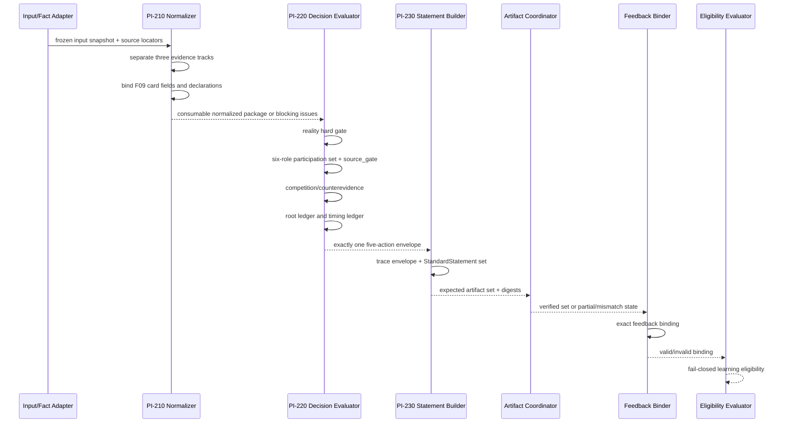

# PI-300 · F09 单卡最小垂直切片设计

> 任务编号：PI-300  
> 父任务：生产实现总控 G3  
> 文档性质：design/write；仅设计，不实现、不执行测试、不改变生产默认  
> 唯一冻结卡：F09「资本配置与风险承担」  
> 结论边界：本文证明的是“一卡端到端设计可描述且可验收”，不构成实现证明，不自验 G3，不宣称 G3 PASS

---

## 1. 结论

选择 **F09「资本配置与风险承担」** 作为唯一垂直切片。现有 G2 通用架构足以在不改变冻结语义、不把 YAML 编译成算法、不修改生产代码的前提下，完整设计：

```text
输入／事实适配
  → PI-210 三轨归一化
  → 现实事实硬门
  → 最小充分参与集
  → F09 source_gate
  → 竞争与反证
  → 根源／应期分账
  → 五动作之一
  → StandardStatement
  → report／statement_index／statement_records／manifest
  → feedback binding
  → learning eligibility
```

该结论只说明 G2 接口可被一条代表性路径实例化。当前仓库没有 F09 runtime consumer、统一五动作 dispatcher 或该卡 statement/feedback 接线；这些均是 **future implementation targets**。现有 production-default 组件只作为 **adapter seams**，不得据本文声称已经实现本切片。

若后续实现发现必须修改 F09 冻结定义、竞争边、显式 `null` 含义或 production-default 行为才能闭合，应停止并返回 `BLOCKED`，不得扩大到其他卡片。

---

## 2. 选择 F09 的理由

### 2.1 冻结依据

F09 冻结定义要求对可识别资本或信用资源、边界明确的经济对象、非机械配置裁量及可归属风险暴露进行独立核验，并按配置轴、风险轴或双轴裁决；状态与事件、动作与后果正交，见 [`F09 冻结契约`](../engine/contracts/12-real-world-function-evidence-cards-v1.md:265)。

F09 机器附录同时冻结了：

- `source_gate: traceable_source_binding_required`；
- 根源枚举 `R1_DIRECT_ROOT / R2_SINGLE_COMPLETABLE_GAP / R3_BACKGROUND_SUPPORT`；
- `validation_timepoints: [T0_FACT_FREEZE, T1_THEORY_COMPLETION, T2_OBSERVATION]`；
- `output_precision: null`；
- `output_precision` 被列为 unresolved；
- unresolved conflict 必须 abstain。

精确声明位置见 [`F09 mapping`](../mapping/real-world-function-evidence-cards-v1.yaml:451)。该 YAML 只提供声明值、路径、枚举和来源引用，不提供判定算法；其 `executable_logic_allowed: false` 边界不可突破。

### 2.2 代表性最强的原因

F09 用一张卡同时覆盖 G2 最容易失真的九个结构点：

1. **现实事实硬门**：理论候选不能代替真实资本／信用位置。
2. **双轴裁决**：配置轴、风险轴不得相互补足或简单求和。
3. **状态／事件分账**：基准日持续位置与指定窗口变化不能互相回填。
4. **竞争边**：必须与 F08 经营职责链独立过门，并允许有限并存。
5. **后果防回填**：财富结果、普通债务、名义身份不能反推 F09 成立。
6. **根源／应期分账**：运行时完成方式不能改写原局根源等级。
7. **来源门**：每个决定性事实必须有可追溯来源绑定。
8. **冻结声明最难组合**：validation plan 有明确值，而 output precision 同时为显式 `null` 和 unresolved；两者必须永久分账。
9. **失败安全**：竞争未解、必要 evaluator unknown、声明引用不可用、artifact 部分写入、反馈映射未知均能被一个切片覆盖。

F09 因此不是“业务最常见”的选择，而是“以最小卡数覆盖最多通用架构不变量”的选择。

### 2.3 为什么不扩成第二张卡

F08 只作为 F09 的竞争对象身份和竞争证据引用出现，不运行 F08 自身卡片流程，不生成 F08 决策或 statement。加入第二张卡会把“验证竞争接口”扩大为“验证多卡业务闭合”，违反 PI-300 的一卡边界。

---

## 3. 范围、非目标与能力口径

### 3.1 本文设计范围

- 一个 case、一个 F09 主候选、零到多个 F09 备选事实切片；
- PI-210 normalized package；
- PI-220 单个 `DecisionEvaluationResult` 与单个五动作 envelope；
- PI-230 单个 statement set 及其 artifacts、feedback binding、learning eligibility；
- production-default 设计目标轨道；
- staged/preprod 仅作 `AUDIT_ONLY` 对照，不参与生产结论或学习。

### 3.2 明确非目标

- 不实现或修改任何 Python、YAML、模板、测试、案例或报告；
- 不定义新的 F09 业务谓词、阈值、评分、优先级或动作选择算法；
- 不处理 F01–F08、F10–F12；
- 不把 F08 作为第二张卡执行；
- 不设计 G5、权重更新、promotion 或 production routing；
- 不把设计样例当作真实命盘结论；
- 不执行测试，不给出 G3 PASS；
- 不把现有 `questions` 当作已实现的 `ASK`；
- 不把 parallel abstain 当作统一 `ABSTAIN`；
- 不把 local review flag 当作统一 `HUMAN_REVIEW`。

### 3.3 当前能力与未来目标分账

| 环节 | 当前可复用事实 | PI-300 中的身份 | 禁止声称 |
|---|---|---|---|
| preflight | 已解析并保留 known facts/questions | 输入 adapter seam | 已全面消费无年份事实或 questions |
| production findings | 已有 D1–D4 与结构化落盘 | evidence adapter seam | 已产生 F09 normalized evidence |
| conflict | 多轨存在局部模型 | audit adapter seam | 已有统一 competition 或五动作 |
| report | 已有标准 renderer 与 Markdown lint | statement projection seam | 已消费 `StandardStatement` |
| statement index/records | 已有多规则 index 与单 anchor records | legacy projection seam | 已与 F09 revision/digest 原子绑定 |
| feedback ingest | 已按 statement ID join records | feedback adapter seam | 已支持 PI-230 完整 binding 或 F09 learning |
| preprod | 已有独立 run-centric artifacts | `AUDIT_ONLY` seam | 属于 production-default |

现状证据分别见 [`PI-110`](production-implementation-pi-110-input-pipeline-audit.md:33)、[`PI-120`](production-implementation-pi-120-findings-decision-conflict-audit.md:32) 与 [`PI-130`](production-implementation-pi-130-report-statement-feedback-audit.md:25)。

---

## 4. 不变量

1. 只有 `REALITY_FACT` 可满足现实事实硬门；`CHART_STRUCTURE` 与 `UNVERIFIED_HYPOTHESIS` 只能支持理论、候选、反证或待核验状态。
2. 现实事实不被理论失败删除；现实后果不反填动作、归属或根源。
3. F09 配置轴与风险轴分别求值；单轴成立只能产生受限结论，双轴不得靠缺失项互补。
4. `source_gate` 是显式参与角色，不被“文件存在”或自由文本来源替代。
5. 竞争与反证保留原记录；不能只保存胜方摘要。
6. 根源 ledger 与 timing ledger 永久分开；timing completion 不重写 root assessment。
7. `validation_timepoints` 与 `output_precision` 使用两个独立的 `FrozenDeclarationBinding`。
8. F09 的 output precision 声明对象存在，因此 binding 必须是 `RESOLVED`；其声明值为 `null` 且 unresolved，不得改写为 `ABSENT`、`UNAVAILABLE` 或 `UNRESOLVABLE`。
9. evaluator `UNKNOWN` 是状态，不是第六动作。
10. 一个 envelope 恰有一个动作及匹配 payload，五个动作都必须有非空 `basis_record_ids`。
11. `StandardStatement` 只投影 PI-220 结果，不重做业务判定。
12. statement text 不是反馈绑定主键；反馈必须绑定 statement、revision、set、case、track 与 artifact digest。
13. index 与 records 是不同投影；多规则到单 anchor 必须标记 `LOSSY`。
14. 任一 artifact 成功不代表 artifact set 完整；报告成功不代表可反馈或可学习。
15. unknown/unmapped/duplicate/mixed-revision feedback 一律 fail closed。
16. `PRODUCTION_DEFAULT` 与 staged/preprod 永不静默跨轨；跨轨只允许 `AUDIT_ONLY` transformation。
17. `CardIdentityRef.runtime_capability_status` 固定为 `REFERENCE_ONLY_NOT_IMPLEMENTATION_PROOF`。

---

## 5. 端到端顺序



### 5.1 Step 0：冻结运行身份

建立不可变 run context：

- `case_id`；
- `run_id`；
- `track=PRODUCTION_DEFAULT`；
- input snapshot digest；
- F09 contract version 与 mapping digest；
- evaluation `as_of`；
- adapter version；
- 所有 source locator 的快照身份。

同一幂等重试必须复用这些身份；输入或摘要变化必须新建 run，不得覆盖旧 run。

### 5.2 Step 1：输入／事实适配

适配器只做可证明转换：

1. 从 preflight `ParsedInput`、known facts、已有 findings 或人工结构化事实中提取候选材料；
2. 为每条材料指定来源 locator、采集时间、有效时间、actor、object、action、responsibility、consequence；
3. 无法证明的字段保持 missing/unknown，不从叙述文本静默推断；
4. questions 仅可作为待补字段来源，不自动成为 `ASK` 动作；
5. 无年份状态事实可进入归一化，但不得伪称现有 D3 已消费；
6. 不加载 YAML 生成判断函数。

### 5.3 Step 2：PI-210 三轨归一化

每条 `EvidenceRecord` 恰属一轨：

- `REALITY_FACT`：可核验的账户、合同、责任、资本／信用位置、配置动作或风险暴露事实；
- `CHART_STRUCTURE`：同一命盘、同一理论家族的结构作用链；
- `UNVERIFIED_HYPOTHESIS`：尚未核实的职业标签、财富推测、关联方推测、可能配置或可能风险。

Normalizer 还必须生成：

- `FrozenCardFieldRef`；
- unresolved field states；
- validation plan binding；
- output precision binding；
- transformation records；
- integrity issues。

`validate_for_pi220(package_id)` 只有在引用、摘要、轨道与声明 binding 结构完整时才可返回可消费状态。

### 5.4 Step 3：现实事实硬门

F09 硬门按冻结维度分别保存 evaluator record：

- 资源；
- 对象；
- 配置轴；
- 风险轴；
- 归属；
- 时态。

这里只设计 evaluator 的输入／输出契约，不定义如何从业务事实计算 `EVALUATED` 结果。规则如下：

- 只有 `REALITY_FACT` record IDs 可作为硬门满足依据；
- `MISSING` 表示必要事实未提供且字段可明确询问；
- `UNKNOWN` 表示已有输入但 evaluator 无法可靠判断；
- `CONFLICT` 表示相互不兼容事实未解；
- `NOT_EVALUATED` 表示前置 integrity 阻断；
- 财富增加、负债存在、职位名称、机构名称或理论候选不能补门。

### 5.5 Step 4：最小充分参与集

F09 候选必须形成六个角色的引用闭环：

| 角色 | 本切片要求 | 失败安全 |
|---|---|---|
| `SINGLE_SCHOOL_COMPLETE_NATAL_CHAIN` | 同校、同盘、同链结构依据 | 缺失不允许正式输出 |
| `DAIYUN_STAGE_EFFECT` | 大运阶段作用记录 | 缺失保留 timing 不完整 |
| `LIUNIAN_SPECIFIC_EVENT_TRIGGER` | 流年具体触发记录 | 缺失不得伪造具体应期 |
| `REAL_WORLD_FUNCTION_GATE` | F09 六维现实硬门记录 | 非 REALITY_FACT 不可满足 |
| `BREAK_CONDITION_OR_VALID_FALSIFIER` | 终止、转移、反证或有效 falsifier | 缺失时不得声称可证伪闭环完整 |
| `SOURCE_GATE` | 可追溯 source binding | unknown/mismatch 阻断正式输出 |

“角色齐全”不等于“F09 成立”；它只证明参与集合结构可供 decision evaluator 消费。

### 5.6 Step 5：F09 source gate

`SOURCE_GATE` evaluator 至少检查：

- source locator 可解析；
- locator 指向冻结快照而非可变自由文本；
- actor/object/action/责任记录与来源片段可对照；
- source digest 与 run snapshot 一致；
- 引用没有跨 case、跨 track 或跨 revision；
- 关键事实不是只由推测或理论轨提供。

`UNAVAILABLE` source、digest mismatch、跨 case 或不可定位来源均产生 blocking issue。来源语义是否足以证明业务事实仍由专门 evaluator 决定；source gate 不替代事实门。

### 5.7 Step 6：竞争与反证

唯一主候选为 F09。F08 仅作为 `strongest_competing_explanation` 的身份引用，用于回答：事实主要描述“经营单元职责链”，还是“资本／信用配置与风险位置”。

Competition set 必须保存：

- F09 主候选引用；
- F08 competing identity ref；
- 双方支持 record IDs；
- 双方反证 record IDs；
- 冲突维度；
- coexistence 是否仍待评估；
- unresolved issue IDs；
- 原始来源 locator。

不得执行 F08 卡，不得给 F08 生成独立 action 或 statement。若竞争无法在 F09 侧冻结边界内处理，动作只能走安全路径，不能新增跨卡业务规则。

### 5.8 Step 7：根源／应期

建立两个不可互写的账本：

**RootConstraintLedger**

- `R1_DIRECT_ROOT`；
- `R2_SINGLE_COMPLETABLE_GAP`；
- `R3_BACKGROUND_SUPPORT`；
- 或 evaluator unknown/not evaluated。

**TimingConstraintLedger**

- `ACTIVATE_EXISTING`；
- `COMPLETE_LATENT`；
- `REPAIR_DEFECT`；
- `TEMPORARY_SUBSTITUTE`；
- `INVALID_COMPLETION`；
- 以及阶段／流年证据和有效窗口。

`RootTimingConstraintSet` 只引用并检查两账本一致性。例如 timing 为 `TEMPORARY_SUBSTITUTE` 时不得把 root 改成 R1；`INVALID_COMPLETION` 不得生成肯定应期。具体何种命理证据对应何状态不在本文新增。

### 5.9 Step 8：选择五动作之一

PI-220 evaluator 生成恰好一个 `DecisionActionEnvelope`。本文只规定每种结果的结构可采纳条件，不定义动作优先级：

| 动作 | F09 切片中的最小成立结构 | 必须禁止 |
|---|---|---|
| `OUTPUT` | 可消费 package；必要门已评估；无 blocking issue；竞争已处置；根源／应期不越界；双 declaration binding 可用；basis 非空 | 用 explicit null 精度伪造具体输出精度 |
| `CONDITIONAL` | 无 integrity 阻断；条件引用与 unresolved issue 明确；输出范围被条件约束；basis 非空 | 用条件文本掩盖 source 或 binding 失败 |
| `ASK` | 每个问题绑定 `MISSING/UNKNOWN` issue 和字段路径；有 resume token；basis 非空 | 把输入 questions 原样复制成动作 |
| `ABSTAIN` | 阻断原因、对象、范围和 basis 非空 | 空对象；携带正式 statement payload |
| `HUMAN_REVIEW` | 待复核冲突两侧、记录、范围和 basis 非空 | 只保留摘要；覆盖原冲突；携带正式输出 payload |

### 5.10 Step 9：StandardStatement

PI-230 只消费 PI-220 输出。对 `OUTPUT` 或 `CONDITIONAL`，可生成可展示 assertion statement；对 `ASK`、`ABSTAIN`、`HUMAN_REVIEW`，仍生成动作状态 statement，以便审计和反馈，但不得伪装为肯定业务结论。

每条 `StandardStatement` 必须保留：

- statement、revision、set 身份；
- decision result 与 action 身份；
- 非空 basis；
- PI-210 evidence/source refs；
- F09 card identity；
- 两个声明 bindings 的逐值副本；
- feedback policy；
- content digest；
- integrity 与 issue IDs。

### 5.11 Step 10：Artifacts

同一 statement set 设计四个核心 artifact：

1. report：展示投影；
2. `statement_index`：完整多规则／多 evidence 审计投影；
3. `statement_records`：单 anchor feedback bridge；
4. manifest：set、revision、digest、attempt 与各 artifact 状态。

现有 renderer、index、records 和 artifact inventory 只是 adapter seams。未来适配必须显式验证 statement set/revision/digest；不能依赖“文件存在”。

### 5.12 Step 11：Feedback binding

反馈项必须精确绑定：

- case；
- `PRODUCTION_DEFAULT` track；
- statement ID；
- statement revision；
- statement set；
- artifact digest；
- records anchor；
- feedback verdict 与提交身份；
- 去重／幂等键。

只按 statement 文本、旧 index、未知 ID 或 preprod attachment 绑定都不足以形成 production learning binding。

### 5.13 Step 12：Learning eligibility

Eligibility evaluator 只做准入计算，不执行学习。最小条件：

- feedback binding 精确且唯一；
- artifact set 为 `COMPLETE_VERIFIED`；
- records anchor mapped；
- projection 的 `LOSSY` 已显式记录；
- 无 mixed revision、digest mismatch、unknown statement 或 duplicate conflict；
- track 为 `PRODUCTION_DEFAULT`；
- feedback policy 允许；
- F09 card identity 仍为 reference-only，不被误当实现证明。

不满足任一条件时为不可学习或待修复；不得更新权重、路由或 production-default。

---

## 6. Adapter 职责

| Adapter | 输入 | 输出 | 责任 | 明确不负责 |
|---|---|---|---|---|
| `InputSnapshotAdapter` | preflight 输入、known facts、findings | frozen run input | 快照、摘要、case/track/as-of | 业务推断 |
| `RealityFactAdapter` | 可核验现实材料 | `REALITY_FACT` records | actor/object/action/责任/时态/source 映射 | 用理论补事实 |
| `ChartStructureAdapter` | D1–D4、理论 findings | `CHART_STRUCTURE` records | 同校同盘同链引用 | 判断现实成立 |
| `HypothesisAdapter` | questions、未核叙述、候选 | hypothesis records | 保留不确定性 | 自动转 ASK/事实 |
| `FrozenCardReferenceAdapter` | F09 契约与 mapping snapshot | field refs/declaration refs | 精确转录、摘要、状态 | 执行 YAML |
| `DecisionInputAdapter` | normalized package | PI-220 request | 引用完整性、轨道检查 | 选择动作算法 |
| `LegacyFindingsAuditAdapter` | production findings | audit relation | 证明来源与转换 | 改写 findings |
| `StatementProjectionAdapter` | statement set | report/index/records intents | 投影和 fidelity 记录 | 重做 decision |
| `LegacyReportAdapter` | report intent | Markdown artifact attempt | 调用未来兼容 renderer seam | 声称现 renderer 原生支持 StandardStatement |
| `LegacyFeedbackAdapter` | feedback.md/records | PI-230 feedback submission | 解析、精确 binding、未知映射隔离 | 用 index 解锁学习 |
| `PreprodAuditAdapter` | preprod run/artifacts | audit-only refs | 对照与差异记录 | 进入 production decision/learning |

---

## 7. 设计级规范对象实例

以下是**不可执行的规范对象记法**，不是 YAML、代码、fixture 或业务算法。除明确标为“引用”的稳定 ID 外，每个示例均是相应 PI-210／PI-220／PI-230 类型的完整 F09 实例；`D-*` 记号均代表完整 `DigestRef { algorithm: SHA-256, canonicalization: "JCS", value: "<示例固定值>" }`，`V-*` 记号均代表已在同一 trace envelope 登记的完整 `VersionedObjectRef`，不能实现为裸字符串。示例时间均为固定设计值，不代表真实运行。

### 7.1 两个完整冻结声明对象及绑定

```text
VP-REF = FrozenDeclarationRef {
  declaration_id: "F09-VALIDATION-PLAN"
  declaration_type: VALIDATION_PLAN
  card_id: F09
  contract_version: "real-world-function-evidence-cards-v1"
  declaration_schema_version: "pi210-frozen-declaration-v1"
  content_digest: D-F09-VALIDATION-PLAN
}
OP-REF = FrozenDeclarationRef {
  declaration_id: "F09-OUTPUT-PRECISION"
  declaration_type: OUTPUT_PRECISION
  card_id: F09
  contract_version: "real-world-function-evidence-cards-v1"
  declaration_schema_version: "pi210-frozen-declaration-v1"
  content_digest: D-F09-OUTPUT-PRECISION
}

ValidationPlanRef {
  ref: VP-REF
  declared_timepoints: [T0_FACT_FREEZE, T1_THEORY_COMPLETION, T2_OBSERVATION]
  declared_state: PRESENT_VALUE
  source_field_ref: FrozenCardFieldRef {
    card_id: F09
    contract_id: real-world-function-evidence-cards-v1
    contract_version: "real-world-function-evidence-cards-v1"
    field_path: "/cards/F09/validation_timepoints"
    declared_state: PRESENT_VALUE
    declared_value: [T0_FACT_FREEZE, T1_THEORY_COMPLETION, T2_OBSERVATION]
    source_locator_id: "SRC-F09-MAPPING-VALIDATION"
  }
}
OutputPrecisionRef {
  ref: OP-REF
  declared_precision: null
  declared_state: BOTH_NULL_AND_UNRESOLVED
  source_field_ref: FrozenCardFieldRef {
    card_id: F09
    contract_id: real-world-function-evidence-cards-v1
    contract_version: "real-world-function-evidence-cards-v1"
    field_path: "/cards/F09/output_precision"
    declared_state: BOTH_NULL_AND_UNRESOLVED
    declared_value: null
    source_locator_id: "SRC-F09-MAPPING-PRECISION"
  }
}

validation_plan_binding = { presence: RESOLVED, ref: VP-REF }
output_precision_binding = { presence: RESOLVED, ref: OP-REF }
```

`FrozenDeclarationRef` 不含字段路径；路径只在被引用声明对象的 `source_field_ref` 中。decision envelope、`DecisionTraceRef` 与每个 `StandardStatement` 必须逐字段复制同一判别分支；对本例两个 `RESOLVED` 分支，六个身份字段必须分别精确相等。任何字段漂移都使下游对象 invalid，禁止按 declaration type 或 card ID 猜配。

### 7.2 完整逐维 gate sets、参与集、F09 单候选竞争与根源／应期

本节是 PI-470-R3 对 G4-H-01 的有界整改：直接采用 PI-225-R1／PI-295-R1 已独立接受的 PI-220 amendment 与 PI-285-R3 已独立接受的 PI-210 locator amendment，不新增本地 schema、enum、聚合 gate、resolver 或算法。冻结 F09 的资源、对象、配置轴、风险轴、归属、时态位于同一条“现实硬门与双卡”声明；因此只允许一个真实、可机械解析的整体 `FrozenCardFieldRef`，禁止制造六个 Markdown 子字段路径。

该整体 ref 使用 PI-210 唯一正式 canonical `mdff:v1` selector，定位真实冻结 Markdown 的 F09“现实硬门与双卡”直接列表项。`path`、`object_id=F09` 与 selector 只负责定位；唯一 `MARKDOWN_CONTRACT` binding 分支完整承载 snapshot/source schema/contract version、结构化 digest 与 captured time。mapping 只作声明性对照，不参与 ref 解析，也不产生子字段。这里的 `declared_value` 精确等于 `MDFF_V1_COPY` 对冒号后原文的逐码点输出。

```text
SRC-F09-REALITY-HARD-GATE = SourceLocator {
  source_id:"SRC-F09-REALITY-HARD-GATE"; source_type:FROZEN_CONTRACT_FIELD
  path:"engine/contracts/12-real-world-function-evidence-cards-v1.md"; object_id:"F09"
  field_path:"mdff:v1/heading/4.9%20F09%20%E8%B5%84%E6%9C%AC%E9%85%8D%E7%BD%AE%E4%B8%8E%E9%A3%8E%E9%99%A9%E6%89%BF%E6%8B%85/card/F09/item/%E7%8E%B0%E5%AE%9E%E7%A1%AC%E9%97%A8%E4%B8%8E%E5%8F%8C%E5%8D%A1"
  binding:{
    binding_kind:MARKDOWN_CONTRACT; binding_schema_version:"source-binding.markdown.v1"
    source_snapshot_id:"REAL-WORLD-FUNCTION-EVIDENCE-CARDS-V1-2026-07-19"
    source_schema_version:"markdown-source.commonmark-0.31.2-mdff-v1"
    contract_version:"real-world-function-evidence-cards-v1"
    content_digest:{algorithm:"sha256",canonicalization:"RAW-UTF8-NO-BOM-LF",value:"30ea0f8b8a91f95bc0a52ff90188740c2cc2282fcab27cd20be70404253d7a2f"}
    captured_at:"2026-07-19T00:00:00Z"
  }
}
FR-F09-REALITY-HARD-GATE = FrozenCardFieldRef {
  card_id:F09; contract_id:real-world-function-evidence-cards-v1; contract_version:"real-world-function-evidence-cards-v1"
  field_path:"mdff:v1/heading/4.9%20F09%20%E8%B5%84%E6%9C%AC%E9%85%8D%E7%BD%AE%E4%B8%8E%E9%A3%8E%E9%99%A9%E6%89%BF%E6%8B%85/card/F09/item/%E7%8E%B0%E5%AE%9E%E7%A1%AC%E9%97%A8%E4%B8%8E%E5%8F%8C%E5%8D%A1"; declared_state:PRESENT_VALUE
  declared_value:"资源、对象、配置轴、风险轴、归属和时态分别过门；单轴仅限定成立，双轴才是强主。状态证明基准日持续位置，事件证明指定窗口变化；S1–S3、E1–E3 与动作、资本、责任后果正交。"
  source_locator_id:"SRC-F09-REALITY-HARD-GATE"
}
F09-DEFINITION-REFS = [FR-F09-REALITY-HARD-GATE]
MDECL-F09-V1 = GateMemberDeclarationSet {
  declaration_set_id:"GATE-MEMBERS-F09"; declaration_source_id:"SRC-F09-REALITY-HARD-GATE"
  declaration_schema_version:"pi220-gate-member-declaration-v1"; declaration_version:"1"
  content_digest:"sha256:F09-SIX-MEMBER-DECLARATION-V1"
  members:[
    {declared_member_id:"F09-MEMBER-RESOURCE"; declared_member_value:"资源"; gate_definition_ref:FR-F09-REALITY-HARD-GATE},
    {declared_member_id:"F09-MEMBER-OBJECT"; declared_member_value:"对象"; gate_definition_ref:FR-F09-REALITY-HARD-GATE},
    {declared_member_id:"F09-MEMBER-ALLOCATION"; declared_member_value:"配置轴"; gate_definition_ref:FR-F09-REALITY-HARD-GATE},
    {declared_member_id:"F09-MEMBER-RISK"; declared_member_value:"风险轴"; gate_definition_ref:FR-F09-REALITY-HARD-GATE},
    {declared_member_id:"F09-MEMBER-ATTRIBUTION"; declared_member_value:"归属"; gate_definition_ref:FR-F09-REALITY-HARD-GATE},
    {declared_member_id:"F09-MEMBER-TENSE"; declared_member_value:"时态"; gate_definition_ref:FR-F09-REALITY-HARD-GATE}]
}
```

成员身份只在 `declaration_version="1"` 与 `content_digest` 所绑定的上述 declaration set 内成立，不得从 record ID、数组顺序、证据内容、issue path 或自然语言推断。`gate_definition_refs` 按 PI-225 去重后恰含一个整体 ref；六个 declarations 与六个 records 仍须按 `declared_member_id` 形成全双射。

下列记法只压缩不可执行设计 fixture，不是 schema、函数或算法。`BIND(ID,MID)` 逐处严格展开为完整 `GateEvaluationBindingRef { binding_id:"BIND-"+ID; binding_schema_version:"pi220-gate-evaluation-binding-v1"; binding_version:"1"; canonical_record_digest:"sha256:CANONICAL-"+ID+"-"+MID; immutable_source_digest:"sha256:IMMUTABLE-SOURCE-"+ID+"-"+MID }`；两个摘要必须分别匹配包含 candidate、整体 ref、member、state、全部 evidence/relation/path、reason code、source decision 的规范 record，以及其不可变授权来源。`REC(ID,MID,STATE,SUP,COUNTER,REL,MISS,CONFLICT,UNKNOWN,REASONS,SD)` 逐处严格展开为完整 `GateEvaluationRecord { gate_record_id:ID; candidate_id:"CAND-F09-1"; gate_definition_ref:FR-F09-REALITY-HARD-GATE; declared_member_id:MID; evaluation_binding_ref:BIND(ID,MID); state:STATE; supporting_evidence_ids:SUP; counterevidence_ids:COUNTER; conflict_relation_ids:REL; missing_paths:MISS; conflict_paths:CONFLICT; unknown_paths:UNKNOWN; reason_codes:REASONS; source_decision_ref:SD }`。`SAT(ID,MID,EV,SD)` 是 `REC(ID,MID,SATISFIED,[EV],[],[],[],[],[],[],SD)`；每个调用仍是独立完整 record。

```text
OUTPUT current DecisionEvaluationResult.gate_sets = [GateEvaluationSet {
  candidate_id:"CAND-F09-1"; function_id:F09; gate_definition_refs:F09-DEFINITION-REFS; member_declaration_set:MDECL-F09-V1
  records:[
    SAT("GATE-F09-RESOURCE-OUTPUT","F09-MEMBER-RESOURCE","RF-RESOURCE","SD-GATE-RESOURCE-OUTPUT"),
    SAT("GATE-F09-OBJECT-OUTPUT","F09-MEMBER-OBJECT","RF-OBJECT","SD-GATE-OBJECT-OUTPUT"),
    SAT("GATE-F09-ALLOCATION-OUTPUT","F09-MEMBER-ALLOCATION","RF-ALLOCATION","SD-GATE-ALLOCATION-OUTPUT"),
    SAT("GATE-F09-RISK-OUTPUT","F09-MEMBER-RISK","RF-RISK","SD-GATE-RISK-OUTPUT"),
    SAT("GATE-F09-ATTRIBUTION-OUTPUT","F09-MEMBER-ATTRIBUTION","RF-ATTRIBUTION","SD-GATE-ATTRIBUTION-OUTPUT"),
    SAT("GATE-F09-TENSE-OUTPUT","F09-MEMBER-TENSE","RF-TENSE","SD-GATE-TENSE-OUTPUT")]
  set_state:READY; issue_ids:[] }]

CONDITIONAL current DecisionEvaluationResult.gate_sets = [GateEvaluationSet {
  candidate_id:"CAND-F09-1"; function_id:F09; gate_definition_refs:F09-DEFINITION-REFS; member_declaration_set:MDECL-F09-V1
  records:[
    SAT("GATE-F09-RESOURCE-CONDITIONAL","F09-MEMBER-RESOURCE","RF-RESOURCE","SD-GATE-RESOURCE-CONDITIONAL"),
    SAT("GATE-F09-OBJECT-CONDITIONAL","F09-MEMBER-OBJECT","RF-OBJECT","SD-GATE-OBJECT-CONDITIONAL"),
    SAT("GATE-F09-ALLOCATION-CONDITIONAL","F09-MEMBER-ALLOCATION","RF-ALLOCATION","SD-GATE-ALLOCATION-CONDITIONAL"),
    REC("GATE-F09-RISK-CONDITIONAL","F09-MEMBER-RISK",UNKNOWN,[],[],[],[],[],["ISSUE-RISK-UNKNOWN"],[GATE.STATE_UNKNOWN],"SD-GATE-RISK-CONDITIONAL"),
    SAT("GATE-F09-ATTRIBUTION-CONDITIONAL","F09-MEMBER-ATTRIBUTION","RF-ATTRIBUTION","SD-GATE-ATTRIBUTION-CONDITIONAL"),
    SAT("GATE-F09-TENSE-CONDITIONAL","F09-MEMBER-TENSE","RF-TENSE","SD-GATE-TENSE-CONDITIONAL")]
  set_state:READY; issue_ids:["ISSUE-RISK-UNKNOWN","ISSUE-F09-BOUNDARY"] }]

ASK current DecisionEvaluationResult.gate_sets = [GateEvaluationSet {
  candidate_id:"CAND-F09-1"; function_id:F09; gate_definition_refs:F09-DEFINITION-REFS; member_declaration_set:MDECL-F09-V1
  records:[
    SAT("GATE-F09-RESOURCE-ASK","F09-MEMBER-RESOURCE","RF-RESOURCE","SD-GATE-RESOURCE-ASK"),
    SAT("GATE-F09-OBJECT-ASK","F09-MEMBER-OBJECT","RF-OBJECT","SD-GATE-OBJECT-ASK"),
    SAT("GATE-F09-ALLOCATION-ASK","F09-MEMBER-ALLOCATION","RF-ALLOCATION","SD-GATE-ALLOCATION-ASK"),
    SAT("GATE-F09-RISK-ASK","F09-MEMBER-RISK","RF-RISK","SD-GATE-RISK-ASK"),
    REC("GATE-F09-ATTRIBUTION-ASK","F09-MEMBER-ATTRIBUTION",MISSING,[],[],[],["ISSUE-ATTRIBUTION-MISSING"],[],[],[GATE.EVIDENCE_MISSING],null),
    SAT("GATE-F09-TENSE-ASK","F09-MEMBER-TENSE","RF-TENSE","SD-GATE-TENSE-ASK")]
  set_state:READY; issue_ids:["ISSUE-ATTRIBUTION-MISSING"] }]

ABSTAIN current DecisionEvaluationResult.gate_sets = [GateEvaluationSet {
  candidate_id:"CAND-F09-1"; function_id:F09; gate_definition_refs:F09-DEFINITION-REFS; member_declaration_set:MDECL-F09-V1
  records:[
    SAT("GATE-F09-RESOURCE-ABSTAIN","F09-MEMBER-RESOURCE","RF-RESOURCE","SD-GATE-RESOURCE-ABSTAIN"),
    SAT("GATE-F09-OBJECT-ABSTAIN","F09-MEMBER-OBJECT","RF-OBJECT","SD-GATE-OBJECT-ABSTAIN"),
    SAT("GATE-F09-ALLOCATION-ABSTAIN","F09-MEMBER-ALLOCATION","RF-ALLOCATION","SD-GATE-ALLOCATION-ABSTAIN"),
    SAT("GATE-F09-RISK-ABSTAIN","F09-MEMBER-RISK","RF-RISK","SD-GATE-RISK-ABSTAIN"),
    SAT("GATE-F09-ATTRIBUTION-ABSTAIN","F09-MEMBER-ATTRIBUTION","RF-ATTRIBUTION","SD-GATE-ATTRIBUTION-ABSTAIN"),
    SAT("GATE-F09-TENSE-ABSTAIN","F09-MEMBER-TENSE","RF-TENSE","SD-GATE-TENSE-ABSTAIN")]
  set_state:READY; issue_ids:[] }]

HUMAN_REVIEW current DecisionEvaluationResult.gate_sets = [GateEvaluationSet {
  candidate_id:"CAND-F09-1"; function_id:F09; gate_definition_refs:F09-DEFINITION-REFS; member_declaration_set:MDECL-F09-V1
  records:[
    SAT("GATE-F09-RESOURCE-HUMAN-REVIEW","F09-MEMBER-RESOURCE","RF-RESOURCE","SD-GATE-RESOURCE-HUMAN-REVIEW"),
    SAT("GATE-F09-OBJECT-HUMAN-REVIEW","F09-MEMBER-OBJECT","RF-OBJECT","SD-GATE-OBJECT-HUMAN-REVIEW"),
    SAT("GATE-F09-ALLOCATION-HUMAN-REVIEW","F09-MEMBER-ALLOCATION","RF-ALLOCATION","SD-GATE-ALLOCATION-HUMAN-REVIEW"),
    SAT("GATE-F09-RISK-HUMAN-REVIEW","F09-MEMBER-RISK","RF-RISK","SD-GATE-RISK-HUMAN-REVIEW"),
    REC("GATE-F09-ATTRIBUTION-HUMAN-REVIEW","F09-MEMBER-ATTRIBUTION",CONFLICT,["RF-ATTRIBUTION-A"],["RF-ATTRIBUTION-B"],["REL-ATTRIBUTION-CONFLICT"],[],["ISSUE-ATTRIBUTION-CONFLICT"],[],[GATE.EVIDENCE_CONFLICT],"SD-GATE-ATTRIBUTION-HUMAN-REVIEW"),
    SAT("GATE-F09-TENSE-HUMAN-REVIEW","F09-MEMBER-TENSE","RF-TENSE","SD-GATE-TENSE-HUMAN-REVIEW")]
  set_state:DISPUTED; issue_ids:["ISSUE-ATTRIBUTION-CONFLICT"] }]
```

每个 set 的 `gate_definition_refs` 都是同一个整体 ref 的单元素去重列表；六条 records 通过 `declared_member_id` 与 declaration members 形成全双射，且每条 record 的整体 ref 必须等于对应 member 的 ref。`set_state` 只表达结构状态。每个 binding、evidence、issue、relation 与 `source_decision_ref` 必须在场景当前 result／其 PI-210 package 中解析。任一维 missing／unknown／conflict 只改变该 member 的真实状态和 paths；member 缺失、重复、未知、共享 ref 不一致、声明版本／摘要失配、binding 摘要失配、断链或跨 result 查找均 invalid。

CONDITIONAL fixture 明确是**配置单轴**：配置轴 `SATISFIED`，风险轴真实保留 `UNKNOWN`，其 `ISSUE-RISK-UNKNOWN` 与 `unknown_paths` 必须同时传播到 participation、payload、trace 和 statement；UNKNOWN 风险既不能补强配置结论，也不能阻断仅限配置轴的条件结论。以下两个补充 fixture 与该配置单轴 fixture 一起机械覆盖三种冻结形态；每个 fixture 都是完整六记录 set，不允许实现成“按需交换”：

```text
RISK-ONLY current GateEvaluationSet {
  candidate_id:"CAND-F09-1"; function_id:F09; gate_definition_refs:F09-DEFINITION-REFS; member_declaration_set:MDECL-F09-V1
  records:[
    SAT("GATE-F09-RESOURCE-RISK-ONLY","F09-MEMBER-RESOURCE","RF-RESOURCE","SD-GATE-RESOURCE-RISK-ONLY"),
    SAT("GATE-F09-OBJECT-RISK-ONLY","F09-MEMBER-OBJECT","RF-OBJECT","SD-GATE-OBJECT-RISK-ONLY"),
    REC("GATE-F09-ALLOCATION-RISK-ONLY","F09-MEMBER-ALLOCATION",UNKNOWN,[],[],[],[],[],["ISSUE-ALLOCATION-UNKNOWN"],[GATE.STATE_UNKNOWN],"SD-GATE-ALLOCATION-RISK-ONLY"),
    SAT("GATE-F09-RISK-RISK-ONLY","F09-MEMBER-RISK","RF-RISK","SD-GATE-RISK-RISK-ONLY"),
    SAT("GATE-F09-ATTRIBUTION-RISK-ONLY","F09-MEMBER-ATTRIBUTION","RF-ATTRIBUTION","SD-GATE-ATTRIBUTION-RISK-ONLY"),
    SAT("GATE-F09-TENSE-RISK-ONLY","F09-MEMBER-TENSE","RF-TENSE","SD-GATE-TENSE-RISK-ONLY")]
  set_state:READY; issue_ids:["ISSUE-ALLOCATION-UNKNOWN"]
}
DUAL-AXIS current GateEvaluationSet {
  candidate_id:"CAND-F09-1"; function_id:F09; gate_definition_refs:F09-DEFINITION-REFS; member_declaration_set:MDECL-F09-V1
  records:[
    SAT("GATE-F09-RESOURCE-DUAL","F09-MEMBER-RESOURCE","RF-RESOURCE","SD-GATE-RESOURCE-DUAL"),
    SAT("GATE-F09-OBJECT-DUAL","F09-MEMBER-OBJECT","RF-OBJECT","SD-GATE-OBJECT-DUAL"),
    SAT("GATE-F09-ALLOCATION-DUAL","F09-MEMBER-ALLOCATION","RF-ALLOCATION","SD-GATE-ALLOCATION-DUAL"),
    SAT("GATE-F09-RISK-DUAL","F09-MEMBER-RISK","RF-RISK","SD-GATE-RISK-DUAL"),
    SAT("GATE-F09-ATTRIBUTION-DUAL","F09-MEMBER-ATTRIBUTION","RF-ATTRIBUTION","SD-GATE-ATTRIBUTION-DUAL"),
    SAT("GATE-F09-TENSE-DUAL","F09-MEMBER-TENSE","RF-TENSE","SD-GATE-TENSE-DUAL")]
  set_state:READY; issue_ids:[]
}
```

配置单轴、风险单轴都只能形成相应轴的 limited result；只有双轴 fixture 可承载 strong-primary 双轴范围。这里仅冻结结果边界，不增加动作优先级或 evaluator 算法。

每个 required participation role 恰有一个独立记录，任何角色都不能用另一角色的证据或状态补偿。五个场景各有自己的 `MinimumSufficientParticipationSet`；`PR-NATAL/PR-DAYUN/PR-LIUNIAN/PR-FALSIFIER/PR-SOURCE` 的完整 SATISFIED records 可逐值复制，但现实角色必须使用下列场景本地记录，禁止共享永久全满足对象：

```text
PR-REALITY-OUTPUT = ParticipationRoleRecord { participation_record_id:"PR-REALITY-OUTPUT"; participation_set_id:"PARTICIPATION-F09-OUTPUT"; role:REAL_WORLD_FUNCTION_GATE; frozen_definition_refs:F09-DEFINITION-REFS; state:SATISFIED; supporting_evidence_ids:["RF-RESOURCE","RF-OBJECT","RF-ALLOCATION","RF-RISK","RF-ATTRIBUTION","RF-TENSE"]; counterevidence_ids:[]; missing_issue_ids:[]; conflict_issue_ids:[]; unknown_issue_ids:[]; relation_ids:["REL-REALITY-RESOURCE","REL-REALITY-OBJECT","REL-REALITY-ALLOCATION","REL-REALITY-RISK","REL-REALITY-ATTRIBUTION","REL-REALITY-TENSE"]; source_decision_ref:"SD-REALITY-OUTPUT" }
PR-REALITY-CONDITIONAL = ParticipationRoleRecord { participation_record_id:"PR-REALITY-CONDITIONAL"; participation_set_id:"PARTICIPATION-F09-CONDITIONAL"; role:REAL_WORLD_FUNCTION_GATE; frozen_definition_refs:F09-DEFINITION-REFS; state:UNKNOWN; supporting_evidence_ids:["RF-RESOURCE","RF-OBJECT","RF-ALLOCATION","RF-ATTRIBUTION","RF-TENSE"]; counterevidence_ids:[]; missing_issue_ids:[]; conflict_issue_ids:[]; unknown_issue_ids:["ISSUE-RISK-UNKNOWN"]; relation_ids:["REL-REALITY-RESOURCE","REL-REALITY-OBJECT","REL-REALITY-ALLOCATION","REL-REALITY-ATTRIBUTION","REL-REALITY-TENSE"]; source_decision_ref:"SD-REALITY-CONDITIONAL" }
PR-REALITY-ASK = ParticipationRoleRecord { participation_record_id:"PR-REALITY-ASK"; participation_set_id:"PARTICIPATION-F09-ASK"; role:REAL_WORLD_FUNCTION_GATE; frozen_definition_refs:F09-DEFINITION-REFS; state:MISSING; supporting_evidence_ids:["RF-RESOURCE","RF-OBJECT","RF-ALLOCATION","RF-RISK","RF-TENSE"]; counterevidence_ids:[]; missing_issue_ids:["ISSUE-ATTRIBUTION-MISSING"]; conflict_issue_ids:[]; unknown_issue_ids:[]; relation_ids:["REL-REALITY-RESOURCE","REL-REALITY-OBJECT","REL-REALITY-ALLOCATION","REL-REALITY-RISK","REL-REALITY-TENSE"]; source_decision_ref:null }
PR-REALITY-ABSTAIN = ParticipationRoleRecord { participation_record_id:"PR-REALITY-ABSTAIN"; participation_set_id:"PARTICIPATION-F09-ABSTAIN"; role:REAL_WORLD_FUNCTION_GATE; frozen_definition_refs:F09-DEFINITION-REFS; state:SATISFIED; supporting_evidence_ids:["RF-RESOURCE","RF-OBJECT","RF-ALLOCATION","RF-RISK","RF-ATTRIBUTION","RF-TENSE"]; counterevidence_ids:[]; missing_issue_ids:[]; conflict_issue_ids:[]; unknown_issue_ids:[]; relation_ids:["REL-REALITY-RESOURCE","REL-REALITY-OBJECT","REL-REALITY-ALLOCATION","REL-REALITY-RISK","REL-REALITY-ATTRIBUTION","REL-REALITY-TENSE"]; source_decision_ref:"SD-REALITY-ABSTAIN" }
PR-REALITY-HUMAN-REVIEW = ParticipationRoleRecord { participation_record_id:"PR-REALITY-HUMAN-REVIEW"; participation_set_id:"PARTICIPATION-F09-HUMAN-REVIEW"; role:REAL_WORLD_FUNCTION_GATE; frozen_definition_refs:F09-DEFINITION-REFS; state:CONFLICT; supporting_evidence_ids:["RF-RESOURCE","RF-OBJECT","RF-ALLOCATION","RF-RISK","RF-ATTRIBUTION-A","RF-TENSE"]; counterevidence_ids:["RF-ATTRIBUTION-B"]; missing_issue_ids:[]; conflict_issue_ids:["ISSUE-ATTRIBUTION-CONFLICT"]; unknown_issue_ids:[]; relation_ids:["REL-ATTRIBUTION-CONFLICT","REL-REALITY-RESOURCE","REL-REALITY-OBJECT","REL-REALITY-ALLOCATION","REL-REALITY-RISK","REL-REALITY-TENSE"]; source_decision_ref:"SD-REALITY-HUMAN-REVIEW" }
```

每个场景集合的 `required_roles` 仍严格为六个冻结角色，`role_records` 仍恰含六条：五条上述公共角色的场景本地副本，加对应的 `PR-REALITY-X`；`structural_state=READY` 只表示形状完整。集合 `issue_ids` 必须包含其现实角色的 missing/conflict/unknown issue，且不得把角色状态与六条 gate records 的真实状态写成矛盾值。

F08 只由 PI-210 包内完整证据 `UH-F08-IDENTITY`、来源 `SRC-F08-FROZEN-IDENTITY` 和关系 `REL-F08-COUNTERS-F09` 表示。该证据的 `track=UNVERIFIED_HYPOTHESIS`、`kind=COMPETING_EXPLANATION`、`subject.function_id=F08`，其 external frozen source locator 可追溯；它不是 `FunctionCandidate`。PI-220 对 `candidate_ids` 只要求 `list<string>`，没有至少两个候选的基数约束，因此本实例只列 F09：

```text
CompetitionSet {
  competition_id: "COMPETITION-F09"
  candidate_ids: ["CAND-F09-1"]
  relation_ids: ["REL-F08-COUNTERS-F09"]
  dimension_records: [
    CompetitionDimensionEvaluation {
      dimension: strongest_competing_explanation
      candidate_evidence: { "CAND-F09-1": ["RF-ALLOCATION"] }
      candidate_counterevidence: { "CAND-F09-1": ["UH-F08-IDENTITY"] }
      comparison_relation_ids: ["REL-F08-COUNTERS-F09"]
      state: DISPUTED
      missing_paths: []
      conflict_paths: ["ISSUE-F08-F09-COMPETITION"]
      unknown_paths: []
    }
  ]
  counterevidence_records: [
    CounterevidenceReference {
      reference_id: "CE-F08-IDENTITY-ON-F09"
      candidate_id: "CAND-F09-1"
      evidence_id: "UH-F08-IDENTITY"
      relation_ids: ["REL-F08-COUNTERS-F09"]
      affected_gate_record_ids: []
      affected_dimension_records: ["strongest_competing_explanation"]
      source_track: UNVERIFIED_HYPOTHESIS
      source_locator: "SRC-F08-FROZEN-IDENTITY"
    }
  ]
  candidate_dispositions: [
    CandidateDisposition {
      candidate_id: "CAND-F09-1"
      disposition: UNRESOLVED
      source_decision_ref: "SD-F09-COMPETITION"
      supporting_record_ids: ["RF-ALLOCATION"]
      limiting_record_ids: ["CE-F08-IDENTITY-ON-F09", "ISSUE-F08-F09-COMPETITION"]
      reason_codes: []
    }
  ]
  structural_state: DISPUTED
  issue_ids: ["ISSUE-F08-F09-COMPETITION"]
}
```

上例是 `ABSTAIN` 场景的当前 `DecisionEvaluationResult` 所含竞争集。第 7.3 节五个 envelope 是互斥的场景模板；每个模板均有自己的当前 result，但都只执行 F09。`OUTPUT` 与 `CONDITIONAL` 场景必须在各自当前 result 的 `COMPETITION-F09.candidate_dispositions` 中分别实例化下列唯一 F09 记录，不能把三种 disposition 同时塞入同一个 `CompetitionSet`：

```text
OUTPUT scenario CandidateDisposition {
  candidate_id: "CAND-F09-1"
  disposition: INCLUDED
  source_decision_ref: "SD-F09-COMPETITION-OUTPUT"
  supporting_record_ids: ["GATE-F09-RESOURCE-OUTPUT", "GATE-F09-OBJECT-OUTPUT", "GATE-F09-ALLOCATION-OUTPUT", "GATE-F09-RISK-OUTPUT", "GATE-F09-ATTRIBUTION-OUTPUT", "GATE-F09-TENSE-OUTPUT", "RF-ALLOCATION"]
  limiting_record_ids: []
  reason_codes: []
}

CONDITIONAL scenario CandidateDisposition {
  candidate_id: "CAND-F09-1"
  disposition: CONDITIONAL
  source_decision_ref: "SD-F09-COMPETITION-CONDITIONAL"
  supporting_record_ids: ["GATE-F09-RESOURCE-CONDITIONAL", "GATE-F09-OBJECT-CONDITIONAL", "GATE-F09-ALLOCATION-CONDITIONAL", "GATE-F09-ATTRIBUTION-CONDITIONAL", "GATE-F09-TENSE-CONDITIONAL", "RF-ALLOCATION"]
  limiting_record_ids: ["GATE-F09-RISK-CONDITIONAL", "ISSUE-RISK-UNKNOWN", "ISSUE-F09-BOUNDARY"]
  reason_codes: []
}
```

本切片不扩展 PI-220 schema，也不引入 `disposition_id`。`OutputPayload.disposition_refs` 与 `ConditionalPayload.disposition_refs` 在本切片中承载 candidate identity；对每个 ref，只能在该 envelope 当前 `DecisionEvaluationResult` 中、由其 `basis_record_ids` 所引用的唯一 `CompetitionSet` 的 `candidate_dispositions` 内，以 `candidate_id == ref` 解析。每个 ref 必须恰好匹配一个 `CandidateDisposition`，且它必须与同 payload 的 `included_candidate_ids` 对应；零匹配、多匹配、未引用竞争集或跨 result 查找均使 envelope `structural_validity=INVALID`，禁止猜配或降级为可发布输出。动作兼容性也必须同时成立：`OUTPUT` 只接受 `INCLUDED`，`CONDITIONAL` 只接受 `CONDITIONAL`；上例 `UNRESOLVED` 只支持 `ABSTAIN` 场景，不能冒充可发布 disposition。

禁止创建 `CAND-F08-*`、F08 `FunctionCandidate`、F08 `CandidateDisposition`、F08 action 或 F08 statement。若未来校验器在无 G2 契约依据时强制至少两个 candidate，结果是 `BLOCKED`／contract mismatch，不得通过执行 F08 修复。

```text
RootConstraintLedger {
  candidate_id: "CAND-F09-1"
  root_entries: [
    RootLedgerEntry { root_evidence_id: "ROOT-E1", vocabulary_scope: CARD_SPECIFIC, label: "R2_SINGLE_COMPLETABLE_GAP", card_id: F09, object_refs: ["CS-NATAL"], rationale_source_refs: ["SRC-NATAL"], source_track: CHART_STRUCTURE }
  ]
  issue_ids: []
}
TimingConstraintLedger {
  candidate_id: "CAND-F09-1"
  timing_entries: [
    TimingLedgerEntry { timing_evidence_id: "TIMING-E1", completion_mode: COMPLETE_LATENT, target_root_evidence_id: "ROOT-E1", timing_object_refs: ["CS-DAYUN", "CS-LIUNIAN"], source_track: CHART_STRUCTURE }
  ]
  issue_ids: []
}
RootTimingConstraintSet {
  candidate_id: "CAND-F09-1"
  checks: [
    RootTimingConstraintCheck {
      check_id: "RTC-F09-1"
      constraint_ref: FC-F09-ROOT-TIMING
      root_entry_ids: ["ROOT-E1"]
      timing_entry_ids: ["TIMING-E1"]
      state: SATISFIED
      source_decision_ref: "SD-ROOT-TIMING"
      missing_paths: []
      conflict_paths: []
      unknown_paths: []
      reason_codes: []
    }
  ]
  structural_state: READY
  issue_ids: []
}
```

`FC-F09-ROOT-TIMING` 必须解析为完整 PI-220 `FrozenConstraintRef`。约束检查只引用账本，不产生可写回 root 的字段；fail-safe 变体使用 `VIOLATED`／`UNKNOWN`、非空 issue path 和可追溯 `source_decision_ref`，不得把 timing label 写入 `RootLedgerEntry.label`。

### 7.3 五个完整 payload 判别分支

每个对象都是一个独立、完整的 `DecisionActionEnvelope` 实例模板。对场景 `X ∈ {OUTPUT, CONDITIONAL, ASK, ABSTAIN, HUMAN-REVIEW}`，`COMMON-X` 表示逐值相同的必需字段：`subject_candidate_ids=["CAND-F09-1"]`、两个第 7.1 节完整 binding、`reason_codes=[]`、非空 `source_decision_refs=["SD-ACTION"]`，以及下列非空有序 basis：

```text
BASIS-X = [
  "GATE-F09-RESOURCE-X", "GATE-F09-OBJECT-X", "GATE-F09-ALLOCATION-X",
  "GATE-F09-RISK-X", "GATE-F09-ATTRIBUTION-X", "GATE-F09-TENSE-X",
  "PR-NATAL-X", "PR-DAYUN-X", "PR-LIUNIAN-X", "PR-REALITY-X", "PR-FALSIFIER-X", "PR-SOURCE-X",
  "COMPETITION-F09", "RTC-F09-1"
]
```

六个 gate identity 必须按资源→对象→配置轴→风险轴→归属→时态逐值同序出现，分别在该 envelope 当前 result 恰一解析为 `GateEvaluationRecord.gate_record_id`；即使某维为 `MISSING/UNKNOWN/CONFLICT` 也不得从 basis 删除。六个 `PR-*` 分别解析为 role record；`PARTICIPATION-F09` 与任何 gate set 容器都禁止作为 basis。action、`DecisionTraceRef`、`StandardStatement` 必须复制同一 `BASIS-X`，不得跨 result 回退。不存在 action priority，也不能同时装入两个 payload。

```text
OUTPUT envelope {
  action_id: "ACTION-OUTPUT"; selected_action: OUTPUT; COMMON
  payload: OutputPayload { included_candidate_ids: ["CAND-F09-1"], disposition_refs: ["CAND-F09-1"], scope_refs: ["SCOPE-F09-BOUNDED"] }
  blocking_issue_ids: []; nonblocking_issue_ids: []
  structural_validity: VALID; validation_errors: []
}
CONDITIONAL envelope {
  action_id: "ACTION-CONDITIONAL"; selected_action: CONDITIONAL; COMMON
  payload: ConditionalPayload { included_candidate_ids: ["CAND-F09-1"], disposition_refs: ["CAND-F09-1"], condition_refs: ["COND-F09-1"], unresolved_issue_ids: ["ISSUE-RISK-UNKNOWN","ISSUE-F09-BOUNDARY"], scope_refs: ["SCOPE-F09-CONDITIONAL"] }
  blocking_issue_ids: []; nonblocking_issue_ids: ["ISSUE-RISK-UNKNOWN","ISSUE-F09-BOUNDARY"]
  structural_validity: VALID; validation_errors: []
}
ASK envelope {
  action_id: "ACTION-ASK"; selected_action: ASK; COMMON
  payload: AskPayload {
    question_requests: [QuestionRequest { question_id: "Q-F09-1", target_issue_ids: ["ISSUE-ATTRIBUTION-MISSING"], requested_field_paths: ["/gate_sets/0/records/GATE-F09-ATTRIBUTION-ASK"], expected_answer_shape: "source-bound reality fact" }]
    unresolved_issue_ids: ["ISSUE-ATTRIBUTION-MISSING"]
    resume_token: "RESUME-F09-1"
  }
  blocking_issue_ids: ["ISSUE-ATTRIBUTION-MISSING"]; nonblocking_issue_ids: []
  structural_validity: VALID; validation_errors: []
}
ABSTAIN envelope {
  action_id: "ACTION-ABSTAIN"; selected_action: ABSTAIN; COMMON
  payload: AbstainPayload { abstained_candidate_ids: ["CAND-F09-1"], blocking_issue_ids: ["ISSUE-F08-F09-COMPETITION"], abstention_scope: "F09 bounded conclusion" }
  blocking_issue_ids: ["ISSUE-F08-F09-COMPETITION"]; nonblocking_issue_ids: []
  structural_validity: VALID; validation_errors: []
}
HUMAN_REVIEW envelope {
  action_id: "ACTION-HUMAN-REVIEW"; selected_action: HUMAN_REVIEW; COMMON
  payload: HumanReviewPayload { review_case_id: "CASE-DEMO", review_issue_ids: ["ISSUE-ATTRIBUTION-CONFLICT"], review_record_ids: ["RF-ATTRIBUTION-A", "RF-ATTRIBUTION-B", "REL-ATTRIBUTION-CONFLICT"], requested_review_scope: "F09 attribution conflict" }
  blocking_issue_ids: ["ISSUE-ATTRIBUTION-CONFLICT"]; nonblocking_issue_ids: []
  structural_validity: VALID; validation_errors: []
}
```

### 7.4 state／event／bounded outcome 的现有 G2 对象投影

本节只转录冻结 F09 声明，不新增字段、enum、业务规则或 statement schema。PI-210 已有 `EvidenceRecord.kind=REALITY_STATE|REALITY_EVENT`、`EvidenceSubject.subject_type=STATE|EVENT`、`TypedPayload`、`TemporalScope`、`EvidenceRelation` 与 `TransformationRecord`；PI-220 payload 已有 `scope_refs`；PI-230 statement 已有 `evidence_refs`、`relation_ids` 与 `semantic_scope`。因此采用以下无 schema 扩张方案：

1. state 与 event 使用两个独立 evidence identities；`subject_id` 保存身份，`TemporalScope.mode=AS_OF` 保存状态截止日，`INTERVAL` 保存事件窗口。S/E level 只有在来源对象自身明确给出时才按原值保存在 generic payload；不得由卡片说明或另一条 evidence 推导。
2. `TypedPayload.value_schema=null`；`value` 与 `raw_value` 逐值保存来源对象已经提供的标量或结构，不把 metadata、schema 名或字段名当成新的 F09 业务契约。自由文本来源不得自动拆成 level、axis、action、object、tense。
3. state 与 event 不使用 `DERIVED_FROM`、`VERIFIES` 或其他关系互相填值；历史 event 只能作为 event 证据，不能被 statement 当作 current state evidence。
4. bounded outcome 不设新 `EvidenceKind`。正例必须来自一个已经含 `axis/action/object/tense` 四个来源字段的现实状态或现实事件对象，使用对应的 `REALITY_STATE` 或 `REALITY_EVENT` 原类型承载；任一字段缺失即不是完整 bounded outcome。具体工具、金额或财富结果即使在来源中存在，也只能作为独立来源证据／反证，禁止成为 bounded outcome 或 statement 的直接落点。
5. 每次投影都附 PI-210 `TransformationRecord`：仅允许 `COPY`／`STRUCTURAL_WRAP` 等来源保真映射，`synthesized_fields=[]`。来自 Markdown／自由文本的结构抽取不能标记 `LOSSLESS`；无法逐字段定位时为 `PARTIAL/LOSSY/UNSUPPORTED` 并保留 issue，不能进入完整正例。

下列来源事实的唯一事实源是仓库内实际存在的不可变 JSON fixture [`production-implementation-pi-300-f09-source-snapshots-v1.json`](production-implementation-pi-300-f09-source-snapshots-v1.json)。该文件严格分离 envelope 与 `payload`，`payload.objects` 以 `SOURCE-STATE-1`、`SOURCE-EVENT-1`、`SOURCE-OUTCOME-1` 唯一键控；摘要只覆盖 `RFC8785-JCS-UTF8(payload)`。下列 prose 只作人类预览，不是来源事实源；resolver 必须终止到该 JSON 文件。每个 `field_path` 都是从命中对象根开始的 RFC 6901 pointer，每个 locator 都携带必填 `IMMUTABLE_JSON_SNAPSHOT` binding，且 binding 与 envelope identity 逐值一致。

```text
F09-SOURCE-SNAPSHOT-PATH = "plans/production-implementation-pi-300-f09-source-snapshots-v1.json"
F09-SOURCE-SNAPSHOT-BINDING = SourceBinding {
  binding_kind:IMMUTABLE_JSON_SNAPSHOT
  binding_schema_version:"source-binding.immutable-json.v1"
  source_snapshot_id:"PI-300-F09-SOURCE-SNAPSHOT-V1"
  source_schema_version:"reality-fact-source-snapshot.v1"
  contract_version:"pi-300-f09-source-snapshots-v1"
  content_digest:{algorithm:"sha256",canonicalization:"RFC8785-JCS-UTF8",value:"67517fe2d04fb0fe580e031643dab2ad53fcdb8c90707ba4d496c316dd87f5e7"}
  captured_at:"2026-07-19T00:00:00Z"
}

Non-normative preview SOURCE-STATE-1 = {value:{level:"S2",position:"持续承担资本配置职责",as_of:"2026-06-30"}}
SRCLOC-STATE-LEVEL    = SourceLocator {source_id:"SRCLOC-STATE-LEVEL",source_type:INPUT_FIELD,path:F09-SOURCE-SNAPSHOT-PATH,object_id:"SOURCE-STATE-1",field_path:"/value/level",binding:F09-SOURCE-SNAPSHOT-BINDING}
SRCLOC-STATE-POSITION = SourceLocator {source_id:"SRCLOC-STATE-POSITION",source_type:INPUT_FIELD,path:F09-SOURCE-SNAPSHOT-PATH,object_id:"SOURCE-STATE-1",field_path:"/value/position",binding:F09-SOURCE-SNAPSHOT-BINDING}
SRCLOC-STATE-AS-OF    = SourceLocator {source_id:"SRCLOC-STATE-AS-OF",source_type:INPUT_FIELD,path:F09-SOURCE-SNAPSHOT-PATH,object_id:"SOURCE-STATE-1",field_path:"/value/as_of",binding:F09-SOURCE-SNAPSHOT-BINDING}

Non-normative preview SOURCE-EVENT-1 = {value:{level:"E2",change:"配置责任范围扩大",interval:{start:"2026-04-01",end:"2026-06-30",start_inclusive:true,end_inclusive:true}}}
SRCLOC-EVENT-LEVEL = SourceLocator {source_id:"SRCLOC-EVENT-LEVEL",source_type:INPUT_FIELD,path:F09-SOURCE-SNAPSHOT-PATH,object_id:"SOURCE-EVENT-1",field_path:"/value/level",binding:F09-SOURCE-SNAPSHOT-BINDING}
SRCLOC-EVENT-CHANGE = SourceLocator {source_id:"SRCLOC-EVENT-CHANGE",source_type:INPUT_FIELD,path:F09-SOURCE-SNAPSHOT-PATH,object_id:"SOURCE-EVENT-1",field_path:"/value/change",binding:F09-SOURCE-SNAPSHOT-BINDING}
SRCLOC-EVENT-START = SourceLocator {source_id:"SRCLOC-EVENT-START",source_type:INPUT_FIELD,path:F09-SOURCE-SNAPSHOT-PATH,object_id:"SOURCE-EVENT-1",field_path:"/value/interval/start",binding:F09-SOURCE-SNAPSHOT-BINDING}
SRCLOC-EVENT-END = SourceLocator {source_id:"SRCLOC-EVENT-END",source_type:INPUT_FIELD,path:F09-SOURCE-SNAPSHOT-PATH,object_id:"SOURCE-EVENT-1",field_path:"/value/interval/end",binding:F09-SOURCE-SNAPSHOT-BINDING}
SRCLOC-EVENT-START-INCLUSIVE = SourceLocator {source_id:"SRCLOC-EVENT-START-INCLUSIVE",source_type:INPUT_FIELD,path:F09-SOURCE-SNAPSHOT-PATH,object_id:"SOURCE-EVENT-1",field_path:"/value/interval/start_inclusive",binding:F09-SOURCE-SNAPSHOT-BINDING}
SRCLOC-EVENT-END-INCLUSIVE = SourceLocator {source_id:"SRCLOC-EVENT-END-INCLUSIVE",source_type:INPUT_FIELD,path:F09-SOURCE-SNAPSHOT-PATH,object_id:"SOURCE-EVENT-1",field_path:"/value/interval/end_inclusive",binding:F09-SOURCE-SNAPSHOT-BINDING}

Non-normative preview SOURCE-OUTCOME-1 = {value:{axis:"allocation",action:"重配资本额度",object:"经营单元A",tense:"current"}}
SRCLOC-OUTCOME-AXIS = SourceLocator {source_id:"SRCLOC-OUTCOME-AXIS",source_type:INPUT_FIELD,path:F09-SOURCE-SNAPSHOT-PATH,object_id:"SOURCE-OUTCOME-1",field_path:"/value/axis",binding:F09-SOURCE-SNAPSHOT-BINDING}
SRCLOC-OUTCOME-ACTION = SourceLocator {source_id:"SRCLOC-OUTCOME-ACTION",source_type:INPUT_FIELD,path:F09-SOURCE-SNAPSHOT-PATH,object_id:"SOURCE-OUTCOME-1",field_path:"/value/action",binding:F09-SOURCE-SNAPSHOT-BINDING}
SRCLOC-OUTCOME-OBJECT = SourceLocator {source_id:"SRCLOC-OUTCOME-OBJECT",source_type:INPUT_FIELD,path:F09-SOURCE-SNAPSHOT-PATH,object_id:"SOURCE-OUTCOME-1",field_path:"/value/object",binding:F09-SOURCE-SNAPSHOT-BINDING}
SRCLOC-OUTCOME-TENSE = SourceLocator {source_id:"SRCLOC-OUTCOME-TENSE",source_type:INPUT_FIELD,path:F09-SOURCE-SNAPSHOT-PATH,object_id:"SOURCE-OUTCOME-1",field_path:"/value/tense",binding:F09-SOURCE-SNAPSHOT-BINDING}

EvidenceRecord STATE-F09-2026Q2 {
  evidence_id:"STATE-F09-2026Q2"; case_id:"CASE-DEMO"; track:REALITY_FACT; kind:REALITY_STATE
  subject:{subject_type:STATE,subject_id:"F09-STATE-POSITION-2026Q2",function_id:F09,domain:"capital_allocation_and_risk_bearing"}
  payload:{value_type:OBJECT,value:{level:"S2",position:"持续承担资本配置职责"},value_schema:null,raw_value:{level:"S2",position:"持续承担资本配置职责"},language:"zh-CN"}
  assertion_mode:REPORTED; polarity:SUPPORTING
  verification:{status:SOURCE_VALIDATED,verified_at:"2026-07-19T00:00:00Z",verifier:null,method:"exact source-field binding",contradiction_refs:[]}
  temporal_scope:{mode:AS_OF,point:null,interval:null,as_of:{value:"2026-06-30",precision:DAY},source_precision:DAY,calendar:"gregorian",timezone:"Asia/Shanghai",raw_expression:"截至2026-06-30"}
  sources:[SRCLOC-STATE-LEVEL,SRCLOC-STATE-POSITION,SRCLOC-STATE-AS-OF]; card_field_refs:[FR-F09-REALITY-HARD-GATE]; confidence_ref:null; source_object_refs:[]; unresolved_fields:[]; extensions:{}
}
EvidenceRecord EVENT-F09-2026Q2 {
  evidence_id:"EVENT-F09-2026Q2"; case_id:"CASE-DEMO"; track:REALITY_FACT; kind:REALITY_EVENT
  subject:{subject_type:EVENT,subject_id:"F09-EVENT-CHANGE-2026Q2",function_id:F09,domain:"capital_allocation_and_risk_bearing"}
  payload:{value_type:OBJECT,value:{level:"E2",change:"配置责任范围扩大"},value_schema:null,raw_value:{level:"E2",change:"配置责任范围扩大"},language:"zh-CN"}
  assertion_mode:REPORTED; polarity:SUPPORTING
  verification:{status:SOURCE_VALIDATED,verified_at:"2026-07-19T00:00:00Z",verifier:null,method:"exact source-field binding",contradiction_refs:[]}
  temporal_scope:{mode:INTERVAL,point:null,interval:{start:{value:"2026-04-01",precision:DAY},end:{value:"2026-06-30",precision:DAY},start_inclusive:true,end_inclusive:true},as_of:null,source_precision:DAY,calendar:"gregorian",timezone:"Asia/Shanghai",raw_expression:"2026Q2窗口变化"}
  sources:[SRCLOC-EVENT-LEVEL,SRCLOC-EVENT-CHANGE,SRCLOC-EVENT-START,SRCLOC-EVENT-END,SRCLOC-EVENT-START-INCLUSIVE,SRCLOC-EVENT-END-INCLUSIVE]; card_field_refs:[FR-F09-REALITY-HARD-GATE]; confidence_ref:null; source_object_refs:[]; unresolved_fields:[]; extensions:{}
}
EvidenceRecord OUTCOME-F09-1 {
  evidence_id:"OUTCOME-F09-1"; case_id:"CASE-DEMO"; track:REALITY_FACT; kind:REALITY_STATE
  subject:{subject_type:STATE,subject_id:"F09-BOUNDED-OUTCOME-1",function_id:F09,domain:"capital_allocation_and_risk_bearing"}
  payload:{value_type:OBJECT,value:{axis:"allocation",action:"重配资本额度",object:"经营单元A",tense:"current"},value_schema:null,raw_value:{axis:"allocation",action:"重配资本额度",object:"经营单元A",tense:"current"},language:"zh-CN"}
  assertion_mode:REPORTED; polarity:SUPPORTING
  verification:{status:SOURCE_VALIDATED,verified_at:"2026-07-19T00:00:00Z",verifier:null,method:"four exact source-field bindings",contradiction_refs:[]}
  temporal_scope:{mode:AS_OF,point:null,interval:null,as_of:{value:"2026-06-30",precision:DAY},source_precision:DAY,calendar:"gregorian",timezone:"Asia/Shanghai",raw_expression:"截至2026-06-30"}
  sources:[SRCLOC-OUTCOME-AXIS,SRCLOC-OUTCOME-ACTION,SRCLOC-OUTCOME-OBJECT,SRCLOC-OUTCOME-TENSE]; card_field_refs:[FR-F09-REALITY-HARD-GATE]; confidence_ref:null; source_object_refs:[]; unresolved_fields:[]; extensions:{}
}
TransformationRecord TR-F09-STATE-1 {
  transformation_id:"TR-F09-STATE-1"; adapter_id:"RealityFactAdapter"; adapter_version:"design-v1"; source_object_refs:[{object_type:SOURCE_OBJECT,object_id:"SOURCE-STATE-1",external:true,source_locator_id:"SRCLOC-STATE-LEVEL"}]; target_object_refs:[{object_type:EVIDENCE,object_id:"STATE-F09-2026Q2",external:false,source_locator_id:null}]; fidelity:LOSSLESS
  field_mappings:[{source_field_path:"/value/level",target_field_path:"/payload/value/level",operation:COPY,fidelity:LOSSLESS},{source_field_path:"/value/position",target_field_path:"/payload/value/position",operation:COPY,fidelity:LOSSLESS},{source_field_path:"/value/as_of",target_field_path:"/temporal_scope/as_of/value",operation:COPY,fidelity:LOSSLESS}]
  dropped_fields:[]; dropped_object_refs:[]; synthesized_fields:[]; issues:[]; transformed_at:"2026-07-19T00:00:00Z"
}
TransformationRecord TR-F09-EVENT-1 {
  transformation_id:"TR-F09-EVENT-1"; adapter_id:"RealityFactAdapter"; adapter_version:"design-v1"; source_object_refs:[{object_type:SOURCE_OBJECT,object_id:"SOURCE-EVENT-1",external:true,source_locator_id:"SRCLOC-EVENT-LEVEL"}]; target_object_refs:[{object_type:EVIDENCE,object_id:"EVENT-F09-2026Q2",external:false,source_locator_id:null}]; fidelity:LOSSLESS
  field_mappings:[{source_field_path:"/value/level",target_field_path:"/payload/value/level",operation:COPY,fidelity:LOSSLESS},{source_field_path:"/value/change",target_field_path:"/payload/value/change",operation:COPY,fidelity:LOSSLESS},{source_field_path:"/value/interval/start",target_field_path:"/temporal_scope/interval/start/value",operation:COPY,fidelity:LOSSLESS},{source_field_path:"/value/interval/end",target_field_path:"/temporal_scope/interval/end/value",operation:COPY,fidelity:LOSSLESS},{source_field_path:"/value/interval/start_inclusive",target_field_path:"/temporal_scope/interval/start_inclusive",operation:COPY,fidelity:LOSSLESS},{source_field_path:"/value/interval/end_inclusive",target_field_path:"/temporal_scope/interval/end_inclusive",operation:COPY,fidelity:LOSSLESS}]
  dropped_fields:[]; dropped_object_refs:[]; synthesized_fields:[]; issues:[]; transformed_at:"2026-07-19T00:00:00Z"
}
TransformationRecord TR-F09-OUTCOME-1 {
  transformation_id:"TR-F09-OUTCOME-1"; adapter_id:"RealityFactAdapter"; adapter_version:"design-v1"; source_object_refs:[{object_type:SOURCE_OBJECT,object_id:"SOURCE-OUTCOME-1",external:true,source_locator_id:"SRCLOC-OUTCOME-AXIS"}]; target_object_refs:[{object_type:EVIDENCE,object_id:"OUTCOME-F09-1",external:false,source_locator_id:null}]; fidelity:LOSSLESS
  field_mappings:[{source_field_path:"/value/axis",target_field_path:"/payload/value/axis",operation:COPY,fidelity:LOSSLESS},{source_field_path:"/value/action",target_field_path:"/payload/value/action",operation:COPY,fidelity:LOSSLESS},{source_field_path:"/value/object",target_field_path:"/payload/value/object",operation:COPY,fidelity:LOSSLESS},{source_field_path:"/value/tense",target_field_path:"/payload/value/tense",operation:COPY,fidelity:LOSSLESS}]
  dropped_fields:[]; dropped_object_refs:[]; synthesized_fields:[]; issues:[]; transformed_at:"2026-07-19T00:00:00Z"
}
EvidenceRelation REL-F09-STATE-OUTCOME {
  relation_id:"REL-F09-STATE-OUTCOME"; relation_type:SUPPORTS
  from_ref:{object_type:EVIDENCE,object_id:"STATE-F09-2026Q2",external:false,source_locator_id:null}
  to_ref:{object_type:EVIDENCE,object_id:"OUTCOME-F09-1",external:false,source_locator_id:null}
  scope:{function_id:F09,dimension:null}; source_refs:["SRCLOC-STATE-LEVEL","SRCLOC-STATE-POSITION","SRCLOC-STATE-AS-OF","SRCLOC-OUTCOME-AXIS"]; status:ASSERTED
  temporal_scope:{mode:AS_OF,point:null,interval:null,as_of:{value:"2026-06-30",precision:DAY},source_precision:DAY,calendar:"gregorian",timezone:"Asia/Shanghai",raw_expression:"截至2026-06-30"}
  metadata:{}
}
```

`RelationScope` 严格保持 PI-210 的 `{function_id, dimension}`；四要素只存在于来源对象和被定位的 `EvidenceRecord.payload`。正例传播为：OUTPUT `scope_refs=["REL-F09-STATE-OUTCOME"]`，action、`DecisionTraceRef`、`StandardStatement` 逐值复制 `BASIS-OUTPUT`；statement 通过 `evidence_refs` 与 `relation_ids` 解析 state identity、S level、as-of 和 bounded outcome 四要素。EVENT 必须用独立 `V-EVENT-F09-2026Q2` 引用以解析 event identity、E level 和 interval，不能替换 state ref。CONDITIONAL 配置单轴 statement 还必须在 `issue_ids` 保留 `ISSUE-RISK-UNKNOWN`，并通过同序 basis 解析风险 gate 与 `PR-REALITY-CONDITIONAL`；任何层级丢失该 issue/path 均 invalid。

### 7.5 完整 StatementSet 与 StandardStatement

下例的 `V-PACKAGE`、`V-RESULT`、`V-RF-RESOURCE`、`V-STATE-F09-2026Q2`、`V-OUTCOME-F09-1`、`V-CS-NATAL`、`V-CONFIDENCE`、`V-CONTRACT` 与 `V-MAPPING` 均为完整 PI-230 `VersionedObjectRef`（含 object type/ID/revision/schema/contract、`DigestBinding`、locator、captured time），不得降为裸 ID。`DecisionTraceRef` 完整复制第 7.3 节所选 envelope；这里只选择 `OUTPUT` 作为结构示例，不规定选择算法。

```text
StatementSet {
  statement_set_id: "SS-1"
  statement_schema_version: "pi230-statement-v1"
  case_id: "CASE-DEMO"
  track: PRODUCTION_DEFAULT
  source_package_ref: V-PACKAGE
  decision_trace_ref: DecisionTraceRef {
    result_ref: V-RESULT
    action_id: "ACTION-OUTPUT"
    selected_action: OUTPUT
    basis_record_ids: ["GATE-F09-RESOURCE-OUTPUT", "GATE-F09-OBJECT-OUTPUT", "GATE-F09-ALLOCATION-OUTPUT", "GATE-F09-RISK-OUTPUT", "GATE-F09-ATTRIBUTION-OUTPUT", "GATE-F09-TENSE-OUTPUT", "PR-NATAL-OUTPUT", "PR-DAYUN-OUTPUT", "PR-LIUNIAN-OUTPUT", "PR-REALITY-OUTPUT", "PR-FALSIFIER-OUTPUT", "PR-SOURCE-OUTPUT", "COMPETITION-F09", "RTC-F09-1"]
    blocking_issue_ids: []
    nonblocking_issue_ids: []
    source_decision_refs: ["SD-ACTION"]
    output_precision_binding: { presence: RESOLVED, ref: OP-REF }
    validation_plan_binding: { presence: RESOLVED, ref: VP-REF }
    structural_validity: VALID
  }
  statements: [
    StandardStatement {
      statement_id: "S-F09-1"
      statement_revision_id: "SR-F09-1"
      statement_schema_version: "pi230-statement-v1"
      case_id: "CASE-DEMO"
      statement_set_id: "SS-1"
      track: PRODUCTION_DEFAULT
      semantic_scope: "F09 bounded action projection"
      domain: "capital_allocation_and_risk_bearing"
      statement_text: "F09 示例展示文本；不代表真实案例结论。"
      display_section: "F09"
      decision_result_id: "DR-1"
      action_id: "ACTION-OUTPUT"
      basis_record_ids: ["GATE-F09-RESOURCE-OUTPUT", "GATE-F09-OBJECT-OUTPUT", "GATE-F09-ALLOCATION-OUTPUT", "GATE-F09-RISK-OUTPUT", "GATE-F09-ATTRIBUTION-OUTPUT", "GATE-F09-TENSE-OUTPUT", "PR-NATAL-OUTPUT", "PR-DAYUN-OUTPUT", "PR-LIUNIAN-OUTPUT", "PR-REALITY-OUTPUT", "PR-FALSIFIER-OUTPUT", "PR-SOURCE-OUTPUT", "COMPETITION-F09", "RTC-F09-1"]
      evidence_refs: [V-RF-RESOURCE, V-STATE-F09-2026Q2, V-OUTCOME-F09-1, V-CS-NATAL]
      relation_ids: ["REL-F09-STATE-OUTCOME", "REL-F08-COUNTERS-F09"]
      source_locator_ids: ["SRC-1", "SRCLOC-STATE-LEVEL", "SRCLOC-STATE-POSITION", "SRCLOC-STATE-AS-OF", "SRCLOC-OUTCOME-AXIS", "SRCLOC-OUTCOME-ACTION", "SRCLOC-OUTCOME-OBJECT", "SRCLOC-OUTCOME-TENSE", "SRC-NATAL"]
      card_identity_refs: [CardIdentityRef { card_identity_ref_id: "CARDREF-F09", card_id: F09, normative_contract_ref: V-CONTRACT, machine_appendix_ref: V-MAPPING, field_path: "/cards/F09", source_field_state: PRESENT_VALUE, evaluator_state: EVALUATED, declaration_status: FROZEN_DECLARATION, runtime_capability_status: REFERENCE_ONLY_NOT_IMPLEMENTATION_PROOF, source_locator_ids: ["SRC-F09-CONTRACT", "SRC-F09-MAPPING"], issue_ids: [] }]
      confidence_snapshot_ref: V-CONFIDENCE
      output_precision_binding: { presence: RESOLVED, ref: OP-REF }
      validation_plan_binding: { presence: RESOLVED, ref: VP-REF }
      feedback_policy: FEEDBACK_ALLOWED
      content_digest: D-STATEMENT
      integrity: VALID
      issue_ids: []
    }
  ]
  content_digest: D-STATEMENT-SET
  generated_at: "2026-07-19T00:00:00Z"
  publication_state: PUBLISHABLE
  issue_ids: []
}
```

### 7.6 完整 FeedbackSubmission、FeedbackBinding 与 LearningEligibility

```text
FeedbackSubmission {
  feedback_id: "FB-1"
  case_id: "CASE-DEMO"
  track: PRODUCTION_DEFAULT
  source_snapshot_ref: SnapshotRef { source_snapshot_id: "SNAP-FB-1", source_type: FEEDBACK, source_locator_ids: ["SRC-FB-1"], schema_version: "feedback-source-v1", contract_version: "pi230", content_digest: D-FEEDBACK-SOURCE, captured_at: "2026-07-19T00:00:00Z", immutability: MUTABLE_SOURCE_CAPTURE }
  parser_id: "legacy-feedback-adapter"
  parser_version: "design-v1"
  feedback_items: [FeedbackItem { feedback_item_id: "FB-ITEM-1", feedback_id: "FB-1", source_span_locator: "SRC-FB-1#/items/0", target_statement_id: "S-F09-1", target_statement_revision_id: "SR-F09-1", target_run_id: null, target_prediction_id: null, verdict: "example-verdict", annotation: "design-only", integrity: VALID, issue_ids: [] }]
  content_digest: D-FEEDBACK-SUBMISSION
  captured_at: "2026-07-19T00:00:00Z"
}
FeedbackBinding {
  feedback_binding_id: "FB-BIND-1"
  feedback_item_ref: V-FEEDBACK-ITEM
  binding_protocol: PRODUCTION_STATEMENT
  case_match: MATCH
  track_match: MATCH
  run_match: NOT_APPLICABLE
  statement_match: MATCH
  revision_match: MATCH
  statement_set_match: MATCH
  artifact_digest_match: MATCH
  target_object_refs: [V-STATEMENT, V-STATEMENT-SET, V-RECORDS]
  record_anchor_ref: V-RULE-ANCHOR
  status: BOUND
  issue_ids: []
}
LearningEligibility {
  eligibility_id: "ELIG-1"
  feedback_binding_id: "FB-BIND-1"
  policy_id: "PRODUCTION-STATEMENT-ELIGIBILITY"
  policy_version: "policy-v1"
  status: ELIGIBLE
  learning_target_refs: [V-RULE-ANCHOR]
  excluded_supporting_rule_refs: [V-NON-ANCHOR-RULE-2, V-NON-ANCHOR-RULE-3]
  blocking_reason_codes: []
  evaluated_at: "2026-07-19T00:00:00Z"
}
```

这些对象只采用 PI-230 规范字段和枚举。`BOUND`／`ELIGIBLE` 是完整正例；unknown、mismatch、mixed revision、digest mismatch 或 unsupported anchor 必须分别落到 `UNBOUND | AMBIGUOUS | INVALID` 与 `INELIGIBLE | HUMAN_REVIEW`，不得引入本地状态。`LearningEligibility` 只记录准入，不执行学习。

---

## 8. FrozenDeclarationBinding 全分支失败安全

### 8.1 F09 正常绑定

| 声明 | F09 冻结字段状态 | binding presence | 处置 |
|---|---|---|---|
| validation plan | `PRESENT_VALUE` | `RESOLVED` + non-null ref | 按 T0/T1/T2 身份传递，不与精度合并 |
| output precision | `BOTH_NULL_AND_UNRESOLVED` | `RESOLVED` + non-null ref | 保留 `declared_precision=null` 和 unresolved；禁止推断默认精度 |

### 8.2 五个 presence 分支

下表是 binding 协议的结构与故障注入设计，不修改 F09 冻结事实：

| presence | 合法结构 | 对 PI-220 的影响 | 对 statement/feedback/learning 的影响 |
|---|---|---|---|
| `RESOLVED` | 必须且只能携带完整 `ref` | 可继续；仍需检查声明值状态 | 原样传至 trace/statement |
| `ABSENT` | 固定 absent reason，无 ref | 只有冻结契约确实无该声明时才合法；若 F09 必有声明则是 adapter defect | 不生成肯定 statement；不可学习 |
| `NOT_APPLICABLE` | 固定 N/A reason，无 ref | 只有契约明确不适用时合法；对 F09 两声明强行使用即结构错误 | fail closed |
| `UNAVAILABLE` | 非空 issue；来源未读或当前不可用 | 阻断 `OUTPUT/CONDITIONAL`；可形成安全动作 | artifact 可审计，不可反馈学习 |
| `UNRESOLVABLE` | `attempted_ref` + 非空 issue | 阻断 `OUTPUT/CONDITIONAL`；保留实际解析尝试 | 不得伪装 explicit null；不可学习 |

### 8.3 字段状态与 evaluator 状态

以下状态永久不可互换：

- explicit `null`：冻结字段存在且值明确为空；
- unresolved：冻结声明明确未决；
- absent：冻结声明没有该字段；
- evaluator unknown：运行时 evaluator 对已有输入无法可靠求值；
- missing evidence：运行时必要事实未提供。

F09 output precision 同时是 explicit `null` 与 unresolved，但 declaration binding 仍为 `RESOLVED`。若 evaluator 不知道风险轴是否成立，那是 evaluator `UNKNOWN`，不能改写 output precision 的冻结状态。

---

## 9. 五条代表性动作路径

以下均为设计测试路径，不是动作优先级算法。

### 9.1 `OUTPUT`

前置：package 可消费；现实必要门由 REALITY_FACT 满足；source gate 通过；竞争已处置；root/timing 合法；两 binding 均为正确 `RESOLVED`；无 blocking issue。

结果：生成受冻结边界约束的 F09 statement。由于 output precision 声明为 explicit null + unresolved，statement 不得虚构金额、概率、等级或更细精度。

### 9.2 `CONDITIONAL`

前置：完整性与 source gate 通过；单轴事实已成立，另一轴不用于补强；存在可定位的非阻断条件或未决范围；条件 refs 完整。

结果：仅输出条件约束内的单轴／有限结论，保留 unresolved issue。不得把另一轴写成已成立。

### 9.3 `ASK`

前置：例如归属或时态为 `MISSING`，字段可由外部回答；问题绑定 issue、请求字段路径和 resume token；basis 非空。

结果：生成“请求补充可核验事实”的动作 statement。不得要求用户提供系统内部推断，不得直接复用普通 questions 列表。

### 9.4 `ABSTAIN`

前置：例如 F08/F09 competing explanation 持续 unresolved，或 F09 冻结 contradiction guard 要求冲突未解即弃权；阻断依据完整。

结果：对指定 F09 范围弃权，保存双方证据和反证。不得附带正式 F09 肯定 statement。

### 9.5 `HUMAN_REVIEW`

前置：来源均可追溯，但同一法律／合同／账户安排对风险归属出现不可自动映射的冲突，且复核需要专业解释；双方记录和 review scope 完整。

结果：形成审计 statement 和 review packet；不覆盖冲突，不自动学习。

---

## 10. 测试矩阵（仅设计，不执行）

| ID | 场景 | 注入／前置 | 预期动作或状态 | 必验不变量 |
|---|---|---|---|---|
| T01 | OUTPUT 正常路径 | 全门、参与集、source、竞争处置、root/timing 完整 | `OUTPUT` | 不从 null 精度推断细节；basis 非空 |
| T02 | CONDITIONAL 单轴 | 配置轴成立、风险轴不用于补强、条件可定位 | `CONDITIONAL` | 单轴受限；条件 refs 完整 |
| T03 | ASK 缺归属事实 | attribution=`MISSING` | `ASK` | question→issue→field path→resume token |
| T04 | ABSTAIN 竞争未解 | F08/F09 强竞争 unresolved | `ABSTAIN` | 双方原记录保留；无正式 payload |
| T05 | HUMAN_REVIEW 来源解释冲突 | evaluator=`CONFLICT`，需专业复核 | `HUMAN_REVIEW` | review scope、两侧 refs、basis 非空 |
| T06 | explicit null | F09 output precision 值为 null | binding=`RESOLVED` | ref 非空；不得变 ABSENT |
| T07 | null + unresolved | F09 output precision 同时列 unresolved | field=`BOTH_NULL_AND_UNRESOLVED` | 与 binding presence 分账 |
| T08 | absent 负例 | 合成一个缺字段声明快照用于协议测试 | `ABSENT` 或结构错误 | 不改变 F09 snapshot；不解释为 null |
| T09 | evaluator unknown | 风险输入存在但 evaluator 无法求值 | 安全动作之一 | UNKNOWN 不是第六动作 |
| T10 | source unavailable | source locator 当前不可读 | binding/gate blocking | 禁止 OUTPUT/CONDITIONAL |
| T11 | declaration unresolvable | attempted ref 摘要/版本无法解析 | `UNRESOLVABLE` | attempted ref 与 issue 保留 |
| T12 | invalid N/A | 对 F09 必需声明伪造 NOT_APPLICABLE | 结构 invalid | fail closed，不写 statement 结论 |
| T13 | 理论冒充事实 | 只有 CHART_STRUCTURE 满足现实维度 | 硬门不通过 | 三轨不污染 |
| T14 | hypothesis 冒充事实 | 未核职业／财富叙述 | 硬门不通过 | hypothesis 不升级 reality |
| T15 | 竞争冲突 | F08 operating duty 与 F09 capital position 同时强 | conflict/unresolved | 不执行第二张卡；不重复增权 |
| T16 | 后果反填 | 只有盈利、亏损或一般债务 | 门不通过 | consequence 不补 action/attribution |
| T17 | 根源／应期改写攻击 | timing=TEMPORARY_SUBSTITUTE，试图改 root=R1 | constraint invalid | timing 不改 root |
| T18 | validation/precision 串线 | 把 T0/T1/T2 写入 precision | structural invalid | declaration type/ID/path 分离 |
| T19 | decision→statement binding 漂移 | statement 修改 binding branch/digest | statement invalid | 两 binding 逐值同一 |
| T20 | 多规则 records 投影 | statement 有 3 rule refs | records=`LOSSY` | 1 anchor + 2 dropped refs |
| T21 | report 成功、records 失败 | 写入故障 | artifact set=`PARTIAL` | feedback/learning NOT_READY |
| T22 | records 成功、index 失败 | 第二文件写入故障 | `PARTIAL` | 不回滚覆盖旧文件；标记混合风险 |
| T23 | 新 records + 旧 index | stale file 注入 | `STALE_MIXED_REVISION` | 禁止 feedback readiness |
| T24 | digest mismatch | 同 key 不同 digest | mismatch | 不覆盖既有 artifact |
| T25 | unknown feedback mapping | statement ID 不存在或 anchor UNMAPPED | repair/ineligible | 学习样本为 0 |
| T26 | revision mismatch | feedback 指向旧 revision | invalid binding | 不按文本模糊匹配 |
| T27 | duplicate same payload | 同幂等键、同 digest 重试 | no-op success | 不重复 artifact/feedback |
| T28 | duplicate conflicting payload | 同幂等键、不同 digest | conflict | 不覆盖、不学习 |
| T29 | preprod 跨轨输入 | preprod attachment 注入 production binding | invalid/audit-only | 不进入 production learning |
| T30 | card identity 误宣称 | capability status 改为 implemented | structural invalid | 固定 reference-only |
| T31 | F08 identity-only competition 正例 | `candidate_ids=[CAND-F09-1]`；F08 只在 evidence/relation/issue/source locator | 结构可消费 | 只有 F09 candidate/disposition；`strongest_competing_explanation` 可追溯 |
| T32 | 伪造 F08 candidate 负例 | 注入 `CAND-F08-1`、F08 disposition/action/statement 任一项 | structural invalid | 拒绝第二卡，不静默删除伪造对象 |
| T33 | singleton 被实现拒绝 | 校验器无契约依据要求 candidate 至少两个 | `BLOCKED` | 报 contract mismatch，不执行 F08 修补 |
| T34 | validation ref 完整正例 | 六字段均存在且 digest 可解析 | `RESOLVED` | field path 仅在 `source_field_ref` |
| T35 | output precision ref 完整正例 | 六字段均存在；声明值 null + unresolved | `RESOLVED` | ref 非空；状态 `BOTH_NULL_AND_UNRESOLVED` |
| T36 | declaration identity 缺字段 | 删除任一六字段或把 path 塞进 ref 替代身份 | invalid | 不按 card/type 猜配 |
| T37 | decision→trace→statement 逐字段漂移 | 修改任一 ref identity 字段 | trace/statement invalid | 两声明分别逐字段同一 |
| T38 | OUTPUT payload contract | 完整 OutputPayload + 非空 BasisRecordIds | valid branch | payload/action 一一对应，无 priority |
| T39 | CONDITIONAL payload contract | 完整 ConditionalPayload + issue/scope/condition refs | valid branch | unresolved issue 不被条件文本吞掉 |
| T40 | ASK payload contract | 完整 QuestionRequest、issue、path、resume token | valid branch | 非空 BasisRecordIds 与原始 issue refs |
| T41 | ABSTAIN payload contract | 完整 candidate、blocking issue、scope | valid branch | 不携带 OUTPUT payload |
| T42 | HUMAN_REVIEW payload contract | 完整 case、issue、record、review scope | valid branch | 保留冲突两侧，不定义优先级 |
| T43 | payload 判别错配负例 | `selected_action=ASK` 携带 OutputPayload 或多 payload | invalid | 恰好一个匹配 payload |
| T44 | StatementSet 必需字段 | 删除 schema/case/track/source package/trace/time/publication/digest 任一项 | invalid | 完整 PI-230 set，不接受局部 schema |
| T45 | StandardStatement 必需字段 | 删除 semantic/domain/text/relation/confidence/binding/revision 等任一项 | invalid | 所有 required 字段及完整 refs 存在 |
| T46 | 六 participation role 完整正例 | 每 role 独立完整 record | READY（仅结构） | 角色不能互补，READY 不代表 SATISFIED |
| T47 | participation 补偿攻击 | 删除 SOURCE_GATE record，用 REAL_WORLD_FUNCTION_GATE 证据补 | invalid | required role 恰一独立记录 |
| T48 | participation fail-safe 路径 | MISSING/CONFLICT/UNKNOWN 无相应 issue 或 SATISFIED 无 source decision | invalid | 状态—证据—issue—decision 路径闭合 |
| T49 | root ledger 完整正例 | 完整 RootLedgerEntry | valid structure | 只接受 CHART_STRUCTURE root evidence |
| T50 | timing ledger 完整正例 | 完整 TimingLedgerEntry | valid structure | completion mode 不写入 root label |
| T51 | root/timing check fail-safe | VIOLATED/UNKNOWN 无 issue path、reason 或 source decision | invalid | checks 引用两账本且不反写 |
| T52 | FeedbackSubmission/Item 全字段 | 完整 snapshot/parser/items/digests/times/targets/integrity | valid structure | 只用 PI-230 字段与枚举 |
| T53 | FeedbackBinding 全字段 | 七维 match、target refs、anchor、status、issues 完整 | `BOUND` 或规范失败分支 | 不使用本地 binding 状态 |
| T54 | LearningEligibility 全字段 | policy identity、targets、excluded refs、reasons/time 完整 | 规范三态之一 | eligibility 不执行学习 |
| T55 | feedback revision 幂等变化 | 仅 statement revision 改变 | canonical key 改变 | 不复用旧 ingest identity |
| T56 | eligibility policy 幂等变化 | 仅 policy version 改变 | canonical key 改变 | 重新评估，不复用旧准入 |
| T57 | feedback item 集合幂等变化 | item ID 增删/排序规范化后集合改变 | canonical key 按规范改变 | item IDs 纳入 canonical identity |
| T58 | feedback source digest 幂等变化 | 同反馈 ID、来源内容摘要变化 | mismatch/new identity | 禁止 last-write-wins |
| T59 | basis record type 正例（六维 gate fixture 前置） | 分别以前述五个互斥场景的当前 result 为前置；每个 result 恰含资源、对象、配置轴、风险轴、归属、时态六条场景后缀一致的 `GateEvaluationRecord`，action、trace、statement 使用同序六 gate、六个场景本地 `PR-*-X`、`COMPETITION-F09`、`RTC-F09-1` | valid structure | 六 gate IDs 在当前 result 分别恰一解析；三层逐值同序且不跨 result 查找 |
| T60 | wrong participation basis record type | 把任一 `PR-*` 替换为 participation set 容器身份 | invalid | 容器 ID 不得冒充 `ParticipationRoleRecord.participation_record_id`；fail closed |
| T61 | OUTPUT disposition 唯一解析正例 | 当前 OUTPUT result 的所引竞争集仅有 `candidate_id=CAND-F09-1, disposition=INCLUDED` | `OUTPUT` valid branch | candidate identity 恰一匹配且动作兼容 |
| T62 | dangling disposition reference | `disposition_refs=["CAND-NOT-IN-SET"]` | invalid | 禁止跨 result 查找、猜配或静默修复 |
| T63 | zero disposition matches | ref 为 `CAND-F09-1`，所引竞争集无该 candidate disposition | invalid | 零匹配 fail closed |
| T64 | multiple disposition matches | 所引同一竞争集含两个 `candidate_id=CAND-F09-1` disposition | invalid | 多匹配 fail closed，不按顺序选取 |
| T65 | disposition/action incompatibility | OUTPUT 唯一匹配 `CONDITIONAL` 或 `UNRESOLVED`；CONDITIONAL 唯一匹配 `INCLUDED` 或 `UNRESOLVED` | invalid | OUTPUT 仅接受 INCLUDED；CONDITIONAL 仅接受 CONDITIONAL |
| T66 | CONDITIONAL disposition 唯一解析正例 | 当前 CONDITIONAL result 的所引竞争集仅有 `candidate_id=CAND-F09-1, disposition=CONDITIONAL` | `CONDITIONAL` valid branch | candidate identity 恰一匹配且条件／issue refs 保留 |
| T67 | artifact item state 全枚举正例 | 分别构造 PI-230 八种 `ArtifactRecord.state` | valid structure | 仅接受 `NOT_ATTEMPTED/WRITING/WRITTEN_UNVERIFIED/VERIFIED/FAILED/STALE/MISMATCH/SUPERSEDED` |
| T68 | illegal `NOT_STARTED` | artifact item state=`NOT_STARTED` | invalid | 不把本地旧值映射为 `NOT_ATTEMPTED` |
| T69 | illegal `WRITTEN` | artifact item state=`WRITTEN` | invalid | 不把本地旧值映射为 `WRITTEN_UNVERIFIED` |
| T70 | item-level `STALE` | artifact 仍指向旧 statement revision | item=`STALE`；set 非 ready | 与 set-level `STALE_MIXED_REVISION` 分账，禁止 feedback readiness |
| T71 | item-level `MISMATCH` | observed digest 与 expected digest 不同 | item=`MISMATCH`；set 非 ready | 与 set-level `DIGEST_MISMATCH` 分账，不覆盖既有 artifact |
| T72 | item-level `SUPERSEDED` | 新 revision 已取代旧 artifact | 旧 item=`SUPERSEDED`；set 依现行 required items 计算 | 保留旧项审计身份，不把 superseded 当 verified |
| T73 | ABSTAIN unresolved disposition 正例 | 当前 ABSTAIN result 唯一 F09 disposition=`UNRESOLVED` 且竞争 issue 阻断 | `ABSTAIN` valid branch | unresolved 不得产生 OUTPUT/CONDITIONAL statement |
| T74 | declaration／record 全覆盖正例 | declaration set 恰有六个唯一 member，六条 records 各引用其中一个且共享整体 ref | valid structure | declaration 与 record 按 `declared_member_id` 全双射；不依赖数组顺序 |
| T75 | duplicate／omitted member | 重复一个 `declared_member_id` 或省略任一 declaration／record member | invalid + `GATE.MEMBER_CARDINALITY_INVALID` | 禁止按 record ID、顺序或证据补齐 |
| T76 | unknown member | record 使用 declaration set 不含的 member ID | invalid + `GATE.MEMBER_DECLARATION_INVALID` | 未知 member fail closed |
| T77 | shared-ref inconsistency | 六个 member 或任一 record 改用非整体 F09 ref／伪造子路径 | invalid + `GATE.MEMBER_BINDING_MISMATCH` | declaration、record 与去重 ref 列表必须共享同一整体 ref |
| T78 | declaration version/digest 失败 | member ID 不变但 declaration version、value、ref 或 content digest 任一漂移 | invalid + `GATE.MEMBER_DECLARATION_INVALID` | member identity 仅在 version+digest 边界内成立 |
| T79 | evaluation binding mismatch | 改 state、evidence、path、reason code 或 source decision 而保留原 binding 摘要 | invalid + `GATE.MEMBER_BINDING_MISMATCH` | canonical record 与 immutable source 两个摘要都须命中 |
| T80 | permutation attack | 交换两个 member 的 state/evidence 但保留原 identity/binding | invalid + `GATE.PERMUTATION_BINDING_INVALID` | 内容交换不能绕过身份与 binding |
| T81 | record reorder invariance | 仅重排六条完整 records，member identity、payload 与 binding 均不变 | semantics unchanged | 不得从数组位置推断成员语义 |
| T82 | 配置单轴完整 fixture | allocation SATISFIED、risk UNKNOWN，其余四维 SATISFIED，全部有 member/binding | `CONDITIONAL` limited allocation | UNKNOWN 使用已注册 `GATE.STATE_UNKNOWN`，issue/path 贯穿全链 |
| T83 | 风险单轴完整 fixture | risk SATISFIED、allocation UNKNOWN，其余四维 SATISFIED，全部有 member/binding | limited risk result | UNKNOWN allocation 不补强风险结论 |
| T84 | 双轴完整 fixture | allocation 与 risk 均 SATISFIED，其余四维 SATISFIED | dual-axis scope structurally available | 仅双轴可承载 strong-primary 范围，不定义动作优先级 |
| T85 | 六维 gate 断链 | 任一 binding、supporting evidence、issue path、relation 或 source decision 无法解析 | invalid | 每个 member 独立 fail closed |
| T86 | 理论证据冒充现实事实 | 六维任一 SATISFIED 只引用 CHART_STRUCTURE 或 UNVERIFIED_HYPOTHESIS | invalid gate | 现实参与角色也不得写 SATISFIED |
| T87 | 五场景 participation 一致性 | 五场景分别使用场景本地 `PR-REALITY-X` 与共享整体 frozen ref | valid structure | state、support/counter 与 issue IDs 对齐六维 member records |
| T88 | 共享全满足现实角色攻击 | CONDITIONAL/ASK/HUMAN_REVIEW 改用 `PR-REALITY-OUTPUT` | invalid | participation 不得掩盖 UNKNOWN/MISSING/CONFLICT |
| T89 | action→trace→statement 六 gate basis 漂移 | 删除、换序、替换任一 gate record ID 或场景本地 participation ID | invalid | 三层 basis 全序列逐值相等；record 内 member identity 另行校验 |
| T90 | Markdown whole ref 与 snapshot actual-file resolution | 用唯一注册 profile 解析 F09 canonical `mdff:v1` selector，并读取仓库内实际 JSON fixture；校验两类 SourceBinding 联合身份 | valid projection | whole ref 精确命中冻结原文；JSON path 终止到现存文件，禁止旧 JSON-like path、prose 或未来路径替代 |
| T91 | state 来源字段完整 | fixture 的 `payload.objects.SOURCE-STATE-1` 原生含 level/position/as_of；三 RFC6901 locator、三 immutable binding 与三 LOSSLESS COPY 完整 | valid projection | statement 可解析 S level、identity 与截止日；pointer 从对象根开始 |
| T92 | event 来源字段完整 | fixture 的 `SOURCE-EVENT-1` 原生含 level/change/start/end/两 inclusivity；六 locator/binding 与六 COPY 完整 | valid projection | event identity、E level 与窗口独立解析，external ref 终止到同一文件 |
| T93 | state/event 时态或 object/pointer 错配 | state 使用 event object/window，或 event 引用 state object/as-of，或 pointer 从 envelope 根开始 | invalid projection | object identity、对象根 RFC6901 pointer 与 temporal target 不可互换 |
| T94 | bounded outcome 来源字段完整 | fixture 的 `SOURCE-OUTCOME-1` 原生含 axis/action/object/tense；四 locator/binding 与四 COPY 完整 | valid projection | `value_schema=null`、无 synthesized business fields，LOSSLESS 链终止到实际 payload 字段 |
| T95 | 来源字段／object／pointer 缺失 | 从 payload 删除被 COPY 字段或 object，或把 pointer 改为不存在路径，target 仍保留 | invalid LOSSLESS claim | metadata、generic payload、内联 preview 或文字断言不能补来源结构 |
| T96 | snapshot identity／JCS digest 不一致 | binding 的 snapshot/source schema/contract/digest/captured_at 任一与 envelope 不同，digest 非结构化 64 lowercase hex，或摘要 envelope 而非 `RFC8785-JCS-UTF8(payload)` | invalid projection | path 存在与本地重摘要都不能绕过逐值 identity 和 payload-only digest 校验 |
| T97 | mapping／external termination 不完整 | 删除任一 source-to-target mapping，或 external source ref 不终止到 actual fixture locator | invalid LOSSLESS claim | 每个目标来源值必须有机械可检验的 file→object→pointer→COPY 链 |
| T98 | bounded outcome 缺四要素之一 | 删除 axis/action/object/tense 任一 source field、locator、binding 或 mapping | incomplete, not bounded outcome | 不从卡片说明、其他字段或运行时间推断 |
| T99 | 自由文本／prose preview 结构化攻击 | 从 Markdown、free text 或本节 non-normative preview 自动拆字段并标 LOSSLESS | invalid transformation | 唯一来源事实源是实际 JSON fixture；其他输入必须 PARTIAL/LOSSY/UNSUPPORTED + issue |
| T100 | value_schema／旧 locator identity 变相来源 | 用 `value_schema`、metadata、payload assertion，或旧顶层 `schema_version/content_digest/captured_at` 代替必填 SourceBinding | invalid design projection | generic payload 不授权新增 schema或来源事实；旧顶层 identity 与双写均 fail closed |
| T101 | 直接输出具体工具／金额／财富结果 | bounded outcome 或 statement 写工具、金额或确定结果；同时核验合法四字段仍逐值 COPY | prohibited output | 只可保留为独立来源证据／反证；合法 LOSSLESS 链不得被扩写 |
| T102 | UNKNOWN reason registry hit | CONDITIONAL 与 RISK-ONLY 的 UNKNOWN record 均查询 PI-220 注册目录 | valid only for `GATE.STATE_UNKNOWN` | 任何未注册 UNKNOWN code 均 invalid |
| T103 | CONDITIONAL risk issue 传播 | 检查 payload、nonblocking issues、trace、statement issue 与 basis 路径 | valid only if all preserved | `ISSUE-RISK-UNKNOWN` 任一层丢失均 invalid |
| T104 | 综合 fail-closed | 同时注入未知 member、binding mismatch、locator digest mismatch 或未注册 reason code 任一项 | invalid | 不得通过顺序、共享 ref、metadata、prose 或降级分支修复 |

### 10.1 测试证据层次

未来独立实现任务至少应分四层，但本文不创建或执行测试：

1. contract tests：T31–T104 的候选边界、判别联合、六维 basis/disposition 解析、gate/participation 唯一性与当前 result 解析域、state/event/outcome 投影、artifact item 状态、所有必需字段、不可变 binding 与 canonical identity；
2. component tests：adapter、gate、participation、competition、root/timing、projection、binding、artifact lifecycle、idempotency；
3. vertical integration tests：T01–T104 中仅执行 F09 的对象流；
4. acceptance tests：未来只由新的独立 PI-400-R4 G4 rereview 实例验证，不由 PI-300 或本轮整改实例自验。

本文矩阵共 104 个连续设计用例；本任务创建测试数为 0、执行测试数为 0、运行时结果为无，不以静态文档检查冒充测试证据。

---

## 11. 失败注入

| 注入点 | 注入方式 | 预期隔离边界 | 可重试性 |
|---|---|---|---|
| input snapshot | JSON fixture payload 在读取后变化，或 envelope digest 不是实际 `RFC8785-JCS-UTF8(payload)` 的 SHA-256 | run invalid，不进入 normalize | 生成新联合 snapshot identity/new run；不得原 identity 覆写 |
| source locator | actual fixture 404/权限错误，object/pointer 不命中，binding/envelope 任一 identity 不同，或旧顶层 identity/旧 CASE-DEMO path 回流 | source gate blocking | 修正来源并以合规 binding 重试；不得用 prose preview、目标值或默认值补齐 |
| normalizer | track 缺失或跨轨引用 | package invalid | 修 adapter 后同 input 重建 |
| declaration resolver | Markdown 冻结文件不可用或 RAW-UTF8-NO-BOM-LF digest 不符 | `UNAVAILABLE`／`UNRESOLVABLE` | 同 key、同 expected digest 重试；内容变化必须新 snapshot identity |
| declaration resolver | whole ref 不是 canonical `mdff:v1`、profile/heading/card/label 不唯一、`MDFF_V1_COPY` 与 declared value 不同，或 MARKDOWN binding 不完整 | `UNRESOLVABLE` | 修正显式 ref/binding 后新 attempt；不得恢复旧 JSON-like path或伪造 null |
| decision evaluator | 必要 evaluator exception | issue + safe action path | 决定结果未提交前可重试 |
| competition | 只保存胜方、丢失反方 | structural invalid | 重建 competition set |
| root/timing | timing 写回 root | constraint invalid | 重建 decision，不覆盖旧 ledger |
| statement builder | binding digest 漂移 | statement invalid | 从同 decision 重建 |
| report write | report 写到一半 | artifact attempt failed/partial | 临时对象或新 attempt；不算成功 |
| records write | report 已成功后失败 | set partial | 同 set/revision/digest 幂等重试 |
| index write | records 已成功后失败 | set partial | 只补缺 artifact，先验 digest |
| manifest write | 三文件成功但 manifest 失败 | written-unverified | 重建 manifest 并复核摘要 |
| feedback parser | unknown statement ID | invalid mapping audit | 修 feedback 或 mapping 后新 binding attempt |
| feedback duplicate | 同 key 不同 verdict/digest | duplicate conflict | 人工处置前不可重试覆盖 |
| eligibility | artifact set 状态读取失败 | NOT_READY | 状态恢复后重新计算，不执行学习 |

---

## 12. 幂等、非原子 artifact 与回滚边界

### 12.1 PI-230 `IdempotencyKey`

所有阶段直接采用 PI-230 的同一规范对象，不再定义拼接字符串键：

```text
IdempotencyKey {
  operation: NORMALIZE | DECIDE | BUILD_STATEMENT_SET | RENDER_REPORT |
             PROJECT_INDEX | PROJECT_RECORDS | BIND_FEEDBACK |
             EVALUATE_LEARNING_ELIGIBILITY | INGEST_FEEDBACK
  case_id: "CASE-DEMO"
  track: PRODUCTION_DEFAULT
  source_digest: D-OPERATION-SOURCE
  schema_versions_digest: D-SCHEMA-VERSIONS
  contract_digest: D-G2-CONTRACTS or null
  statement_set_id: "SS-1" or null
  feedback_id: "FB-1" or null
  canonical_key_digest: D-CANONICAL-KEY
}
```

各 operation 只改变上述规范字段的值及 canonical input，不创建新字段或本地 operation enum。artifact 单项写入分别使用 `RENDER_REPORT`、`PROJECT_INDEX`、`PROJECT_RECORDS`；feedback 流程分别使用 `BIND_FEEDBACK`、`EVALUATE_LEARNING_ELIGIBILITY`、`INGEST_FEEDBACK`。

对 feedback ingest／binding／eligibility，`canonical_key_digest` 的规范输入必须显式包含：

1. `FeedbackSubmission.source_snapshot_ref.content_digest`（feedback source digest）；
2. 规范化后的全部 `FeedbackItem.feedback_item_id`；
3. 每个目标 `target_statement_revision_id`；
4. `LearningEligibility.policy_id + policy_version`；
5. 顶层 `case_id + track + statement_set_id + feedback_id` 以及 PI-230 要求的 schema／contract digest。

因此来源摘要、item ID 集、statement revision 或 eligibility policy version 任一变化都必须得到不同 `canonical_key_digest`；不能沿用旧 `BIND_FEEDBACK` 身份。规则：

- 同 key + 同目标 digest：返回 `NO_OP_ALREADY_VERIFIED` 或继续缺失步骤，不重复副作用；
- 同 key + 不同 digest：mismatch，禁止覆盖；
- failed attempt 可生成新 `attempt_id`，但逻辑对象身份不因重试漂移；
- 输入、contract、schema、decision、statement revision、feedback source/items 或 policy version变化必须产生新 operation identity。

### 12.2 非原子 artifact 情景

Artifact coordinator 不假设跨文件事务。每个 artifact 独立记录：

- expected digest；
- observed digest；
- statement set/revision；
- attempt ID；
- PI-230 `ArtifactRecord.state` 原值：`NOT_ATTEMPTED/WRITING/WRITTEN_UNVERIFIED/VERIFIED/FAILED/STALE/MISMATCH/SUPERSEDED`；
- 错误与时间戳。

不得定义本地 item state 或将旧值静默映射为规范值。单项生命周期示例：尚未尝试为 `NOT_ATTEMPTED`，写入完成但摘要尚未核验为 `WRITTEN_UNVERIFIED`，指向旧 statement revision 为 `STALE`，observed digest 不等于 expected digest 为 `MISMATCH`，被新 revision 取代但仍保留审计身份为 `SUPERSEDED`。这些是 item-level 状态，不能用下列 set-level 聚合状态替代。

Set 状态由记录计算：

- `COMPLETE_VERIFIED`：所有 required artifacts 同 set/revision 且摘要通过；
- `PARTIAL`：任一缺失、失败或尚未验证；
- `STALE_MIXED_REVISION`：存在旧/新 revision 混合；
- `DIGEST_MISMATCH`：同身份内容不一致。

只有 `COMPLETE_VERIFIED` 才可进入 feedback-ready 的下一步检查。

### 12.3 回滚边界

1. **不可回滚业务事实**：input snapshot、evidence、decision、statement set 一经以 digest 发布，不原地改写；修复用新 revision。
2. **不做跨文件假回滚**：某 artifact 已成功而后续失败时，不删除已成功文件；manifest 标记 partial，避免删除失败造成二次不一致。
3. **可回滚临时写**：单文件尚未提交的临时对象可丢弃；提交后只可 supersede，不覆盖未知内容。
4. **不回滚反馈审计**：无效或未知反馈仍保留 submission/binding issue，但 eligibility 为不可学习。
5. **不回滚到其他轨道**：production-default 失败不能自动改走 preprod/staged 并把结果当生产成功。
6. **不回滚冻结语义**：任何实现困难都不能通过把 explicit null 改 absent、把 unresolved 改默认值或删除 source gate 解决。

---

## 13. Production-default 与 staged/preprod 分账

| 维度 | `PRODUCTION_DEFAULT` 目标切片 | staged/preprod |
|---|---|---|
| 输入身份 | production run snapshot | 独立 run/snapshot |
| decision | PI-220 target interface | 现有局部模型只可适配为 audit evidence |
| statement | PI-230 statement set | preprod report item 不自动等价 |
| artifact | production statement artifact set | 独立 preprod artifacts |
| feedback | exact statement/revision/set binding | attachment target binding 独立 |
| learning eligibility | 仅 production binding 可评估 | 不得跨轨解锁 |
| transformation | track-preserving | 只允许 `AUDIT_ONLY` crossing |

禁止事项：

- 不把 `DecisionRun` 直接当 PI-220 result；
- 不把 preprod attachment 当 production statement bridge；
- 不把 staged conflict 结果当 F09 competition 决定；
- 不把 parallel abstain/review 直接映射为统一动作；
- 不因 preprod artifact 完整就改变 production-default。

---

## 14. 验收观察点与 falsifier

### 14.1 第一证明点

独立 G3 验收首先应机械检查一个 F09 synthetic object flow：

- 同一个 output precision 声明在 PI-210、PI-220、trace、StandardStatement 中始终是 `RESOLVED`；
- ref 始终非空且 identity/digest 相同；
- ref 所指声明值始终为 `null`；
- unresolved 状态始终保留；
- validation plan 始终是另一个 `VALIDATION_PLAN` ref；
- 全链未生成推断精度。

该点是最小但最强的架构证据，因为它同时验证字段状态、声明引用、跨层同一性和失败安全。

### 14.2 直接 falsifier

出现以下任一项即可否定本切片设计可被忠实实现，必须返回 `BLOCKED` 或使 G3 不通过：

1. 需要修改 F09 冻结字段、竞争边或 contradiction guard 才能选择动作；
2. 需要把 mapping YAML 解释为 executable predicate；
3. 需要把 explicit null binding 改为 absent/unavailable；
4. validation plan 与 output precision 无法独立传递；
5. ASK/ABSTAIN/HUMAN_REVIEW 无法保存非空 basis 和原始 issue refs；
6. StandardStatement 必须重做业务判定才能生成；
7. 无法区分 report success 与 artifact set complete；
8. unknown feedback mapping 仍会产生学习样本；
9. 必须借用 preprod/staged 结果改变 production-default；
10. 必须扩展到第二张卡才能完成 F09 侧竞争记录。

---

## 15. 未解决风险

1. **业务 evaluator 未实现**：本文没有也不应定义 F09 六维事实门的计算算法。
2. **输入事实粒度不足**：现有 known facts 消费偏窄，无年份状态事实和 questions 尚无全面默认消费者。
3. **统一五动作未实现**：现有多个轨道只有语义近似物，尤其 ASK 无统一 dispatcher。
4. **F09 runtime reference adapter 未实现**：当前没有该 mapping 的 Python consumer；未来也不得直接执行 YAML。
5. **竞争接口接线未实现**：现有 conflict 模型碎片化，production integration 不自动产出结构化冲突。
6. **StandardStatement 未接入现 renderer**：现有 report context 与 artifacts 不是 PI-230 原生对象。
7. **artifact gate 错位**：现有 production gate 与 records 学习事实源不一致，且跨文件非原子。
8. **legacy records 是单 anchor**：多规则 evidence 到 learning fanout 必然有显式 `LOSSY` 边界。
9. **反馈完成不等于可学习**：现有计数语义可能在 records 缺失时仍登记完成。
10. **G3 尚未独立验收**：本文作者不得对自身设计作阶段门裁决。

这些风险没有通过扩大范围解决；它们被保留为后续独立验收的观察项或 future implementation targets。

---

## 16. PI-360-R2 整改边界核对（非验收）

PI-360-R2 仅修复 PI-390-R2 确认的两项 Medium：basis/disposition 引用闭合，以及 artifact item state 与 PI-230 同构。以下只记录设计材料是否已按该范围补齐，不是机械测试结果或 G3 裁决：

- [x] 恰好选择一张冻结卡：F09；F08 只有 evidence/relation/issue/source identity，没有 candidate、disposition、action 或 statement。
- [x] 两个 `RESOLVED` declaration ref 均列出六个身份字段，字段路径仅在 `source_field_ref`。
- [x] action、trace、statement 逐值复制同一组允许的 basis records；participation basis 使用六个 `PR-*` role record IDs，不使用 participation set 容器身份。
- [x] OUTPUT／CONDITIONAL disposition refs 在各自当前 result 的所引竞争集内按 candidate identity 恰一解析，并校验动作兼容；ABSTAIN 保留独立 `UNRESOLVED` 场景。
- [x] artifact item state 逐值采用 PI-230 八值枚举，item-level stale/mismatch/superseded 与 set-level 聚合状态分账。
- [x] participation、competition、root/timing、五 payload、StatementSet/StandardStatement、feedback/eligibility 均直接采用 G2 规范形状。
- [x] feedback idempotency 采用 PI-230 `IdempotencyKey`，canonical identity 包含 source digest、item IDs、statement revision 与 policy version。
- [x] 设计矩阵包含 basis 类型、disposition 解析／兼容和 artifact item state 的精确正反例。
- [x] 未新增 schema 字段、业务规则、阈值、评分、动作优先级或 YAML 执行语义。
- [x] 未实现代码、未创建或执行测试、未修改 G2／冻结契约、未改变 production-default、未设计 G5。

**PI-360-R2 是 bounded remediation，不是 acceptor，也不产生验收结论；其 disposition 与 artifact 修复继续保留。**

---

## 17. PI-360-R3 整改边界记录（非验收）

PI-360-R3 只修复 PI-390-R3 的唯一 Medium `M-R3-01`，本节仅记录授权文档内的设计改动，不是测试执行、独立复验或阶段门裁决：

- [x] 第 7.2 节按 PI-220 原字段为五个互斥场景分别实例化完整 `GateEvaluationSet` 与完整 `GateEvaluationRecord`，未新增字段或 enum。
- [x] 每个场景的 fixture 明确属于该 envelope 的当前 `DecisionEvaluationResult.gate_sets`；六个逐维 `gate_record_id` 在该当前 result 内分别恰一存在，禁止聚合、跨 result 共享或回退。
- [x] 每个 gate record 保留冻结 gate definition ref、candidate、state、support/counter evidence、relation、missing/conflict/unknown paths、reason codes 与 source decision 字段，并按 `SATISFIED/MISSING/CONFLICT` 保持 PI-220 fail-safe 语义。
- [x] action → trace → statement 的 basis 顺序和值未改变；gate basis 未被删除，六个 participation、competition 与 root/timing check 身份未漂移。
- [x] T59 增加明确 gate fixture 前置；T74–T77 分别覆盖 gate record 缺失、重复、错误记录类型与跨 result 引用。
- [x] PI-360-R2 已闭合的 disposition 当前 result 恰一解析／动作兼容设计，以及 PI-230 artifact 八值 item state 与 set 聚合分账保持不变。
- [x] 仍为 F09 单卡；F08 identity-only；未执行 YAML、未修改冻结语义／G2／production-default，未实现代码或测试，未生成 G5。

**PI-360-R3 是历史 bounded design remediation，不是 acceptor；其当时指向 PI-390-R4 的叙述只作历史追溯，不是本文当前验收入口。本轮不裁决 PASS，也不改变独立 review 才能作出的阶段门状态。**

---

## 18. 父任务唯一下一动作

**READY_FOR_INDEPENDENT_REREVIEW。唯一下一动作是 PI-400-R4 independent rereview：由与 PI-300、PI-470-R3 及既有 PI-400 review 分离的实例，仅依据冻结 F09 语义、已接受的 PI-210／G2 amendments、PI-400-R3 尚开放的 `G4-H-01`／`G4-M-01`、实际 JSON fixture 和本文对象／T01–T104 设计矩阵作裁决。本轮静态整改不自验、不构成 G4 PASS 或验收证据；rereview 不得实现代码、运行测试、执行 YAML、进入 G5 或扩展到第二张卡。**
